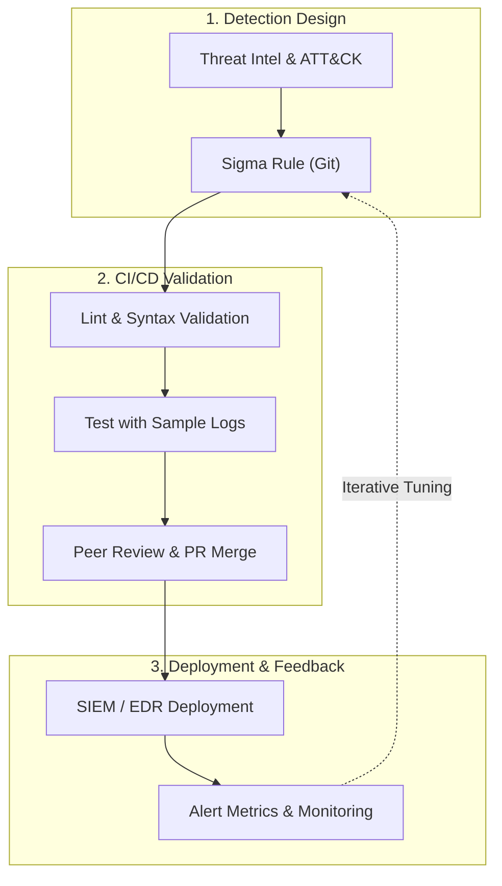

A Security Operations Center's (SOC) true maturity isn't measured by the petabytes of logs it hoards each month—it is measured by the fidelity of the detections it extracts from those logs.

In far too many enterprises, the reality is painfully familiar: detection rules are slapped together directly inside a web console, nobody knows who changed what query or why, and whether a rule even functions is only discovered when an incident slips straight through. The result? Soul-crushing alert fatigue for analysts and a sprawling graveyard of legacy rules that nobody dares touch.

**Detection-as-Code (DaC)** brings software engineering discipline to detection engineering. Rules live in Git, are written in platform-agnostic specifications, are verified against test fixtures, undergo peer review via pull requests, and deploy with structured version control.

Let's walk through an end-to-end detection lifecycle: starting from a MITRE ATT&CK technique hypothesis, authoring a Sigma rule, setting up automated query pipelines, running validation tests against sample data, and managing deployments with version control.

<div class="glass-panel reveal-on-scroll">

| Criterion | Traditional Rule Management | Detection-as-Code (DaC) |
| :--- | :--- | :--- |
| **Source of Truth** | SIEM console, personal notes | Git repository (single source of truth) |
| **Rule Format** | Proprietary, vendor-locked syntax | Platform-agnostic Sigma + automated pipelines |
| **Change Control** | Undocumented, irreversible | Pull requests, code review, commit history |
| **Validation** | Discovered when an incident is missed | Verification tests against positive/negative logs |
| **Quality Tracking** | Subjective, gut feelings | Precision, alert volume, and ATT&CK coverage metrics |
| **Deployment** | Manual copy-paste in UI | Repeatable, version-controlled deployment |

</div>

---

## The Detection Lifecycle

Detection-as-Code is not a product—it is an end-to-end engineering discipline. Every detection rule begins as a threat hypothesis, matures through testing against sample logs, and is either refined or decommissioned based on its production metrics.



### From Hypothesis to Rule

High-fidelity detection engineering always starts with a simple question: *"What distinct footprint does this adversarial technique leave in our specific environment?"*

MITRE ATT&CK gives us a common vocabulary to frame the problem. But before writing a single line of logic, you need clear answers to three practical questions:

1. **Visibility:** Do we actually collect the telemetry required to catch this technique (e.g., Sysmon Event ID 1, Windows Event ID 4688, EDR process creation events)?
2. **Legitimate Noise:** Which administrative tools, deployment agents, or scripts legitimately exhibit this exact behavior in our network?
3. **Response Playbook:** When this alert fires, what specific actions will the on-call analyst take? An alert without an actionable response playbook is just expensive noise.

---

## Sigma: The Platform-Agnostic Rule Standard

Sigma describes detection logic using clean, readable YAML without locking you into any single vendor's dialect. A single Sigma rule can be automatically compiled into Elastic (Lucene/ES|QL), Splunk (SPL), Microsoft Sentinel (KQL), or Chronicle queries. This avoids vendor lock-in and allows seamless rule sharing with the broader security community.

### Example Rule: Encoded PowerShell Execution

The rule below detects PowerShell invocations containing Base64-encoded command parameters (ATT&CK T1059.001). Because this pattern appears in both legitimate administration tools and malicious payloads, the `falsepositives` and `filter_*` sections are explicitly documented:

```yaml
title: PowerShell Encoded Command Execution
id: 6f3c2a8e-1d4b-4c7e-9a2f-5b8d0e7c1a93
status: test
description: Detects PowerShell launched with a Base64-encoded command parameter.
references:
  - https://attack.mitre.org/techniques/T1059/001/
author: Yusuf Talha ARABACI
date: 2026-10-09
tags:
  - attack.execution
  - attack.t1059.001
logsource:
  category: process_creation
  product: windows
detection:
  selection_img:
    Image|endswith:
      - '\powershell.exe'
      - '\pwsh.exe'
  selection_cli:
    CommandLine|contains:
      - ' -enc '
      - ' -encodedcommand '
      - ' -ec '
  filter_known_admin:
    ParentImage|endswith: '\ccmexec.exe'
  condition: all of selection_* and not filter_known_admin
falsepositives:
  - Software deployment agents and signed administrative scripts
level: medium
```

Key design highlights:
- **`id`:** A unique UUID. Even if the rule title changes later, production telemetry and tuning history remain tied to this identifier.
- **`status`:** Tracks rule maturity (`experimental` → `test` → `stable`), driving automated promotion policies.
- **`filter_*`:** Codifies known exceptions directly inside the detection logic so you never wonder why an exclusion was added six months down the line.

---

## Automated Query Pipelines

To translate Sigma into vendor-native queries, we use `sigma-cli` alongside pySigma backends. The compilation pipeline maps generic Sigma fields to target data schemas (such as Elastic Common Schema / ECS):

```bash
pip install sigma-cli
sigma plugin install elasticsearch
sigma plugin install splunk

# Syntax and schema verification
sigma check rules/

# Elastic compilation (Lucene query with ECS field mapping)
sigma convert -t lucene -p ecs_windows rules/windows/process_creation/

# Splunk compilation (SPL)
sigma convert -t splunk -p splunk_windows rules/windows/process_creation/
```

> [!WARNING]
> **Silent Field-Mapping Failures:** The most dangerous bug in Detection-as-Code is querying a field that doesn't actually exist in your production index. The query syntax is completely valid, but because the field is missing from incoming logs, the rule will never fire. Compiling rules is never enough—you must test them against real telemetry.

---

## Validating Detections with Sample Logs

The only way to guarantee a rule catches threats without generating alert storms is to execute it against curated log datasets. We maintain two types of test fixtures for every rule:

- **Positive Fixtures (`positive.ndjson`):** Logs that must trigger the rule (generated via red-team simulations or captured test attacks).
- **Negative Fixtures (`negative.ndjson`):** Sanitized production logs representing benign activity that must never trigger the rule.

### Test and Verification Fixture

A clean Python script to test the converted detection query against the sample dataset:

```python
import json
from pathlib import Path
import pytest
from elasticsearch import Elasticsearch

es = Elasticsearch("http://localhost:9200")
CASES = sorted(Path("tests").glob("*/expected.json"))

def load(index: str, path: Path) -> None:
    for line in path.read_text(encoding="utf-8").splitlines():
        es.index(index=index, document=json.loads(line))
    es.indices.refresh(index=index)

@pytest.mark.parametrize("case", CASES, ids=lambda p: p.parent.name)
def test_rule(case: Path) -> None:
    spec = json.loads(case.read_text(encoding="utf-8"))
    query = Path(spec["query_file"]).read_text(encoding="utf-8").strip()

    for kind in ("positive", "negative"):
        index = f"test-{case.parent.name}-{kind}"
        load(index, case.parent / f"{kind}.ndjson")
        hits = es.count(index=index, q=query)["count"]
        assert hits == spec[f"{kind}_hits"], f"{kind}: {hits} != {spec[f'{kind}_hits']}"
```

This verification approach catches two critical pitfalls before rules go live:
1. Blind rules that catch nothing (0 hits on positive tests).
2. Hyperactive rules that flood analysts with noise (unexpected hits on negative tests).

---

## Measuring Rule Quality and Metrics

The true metric of a detection's success is how efficiently it utilizes an analyst's time. In production, every alert must be tagged during triage (True Positive, False Positive, Legitimate Activity).

<div class="render-cards">
  <article class="render-card">
    <h4>Precision</h4>
    <p>Ratio of true positives to total alerts: <code>TP / (TP + FP)</code>. Low precision signals noisy rules draining analyst resources.</p>
  </article>
  <article class="render-card">
    <h4>Alert Volume</h4>
    <p>Daily alert triggers per rule. Spikes indicate an active campaign or an unannounced operational change.</p>
  </article>
  <article class="render-card">
    <h4>ATT&CK Coverage</h4>
    <p>Techniques backed by tested, verified rules—not just aspirational drafts. Highlights your true blind spots.</p>
  </article>
  <article class="render-card">
    <h4>Mean Time to Detect (MTTD)</h4>
    <p>Elapsed time between event execution and alert creation, exposing ingestion latency issues.</p>
  </article>
</div>

A battle-tested practice: any rule whose precision falls below an agreed threshold (say, 70%) is automatically pulled into an audit backlog and assigned back to the author. Your rule repository should be treated like a manicured garden, not an overgrown junkyard.

---

## Version Control and Deployment Principles

Git serves as the single source of truth for all detection logic. Once rules are reviewed and verified, they are managed under version control. If an analyst modifies a query directly within the SIEM console, the version-controlled repository makes it easy to track differences and prevent undocumented drift.

### Safe Rollout Strategies

- **Shadow Mode:** New detections run silently for several days without alerting analysts, only event counts are recorded to measure real-world baseline noise.
- **Severity-Based Routing:** `level: low` detections remain reserved for correlation chains and threat hunting, while `high` and `critical` detections immediately open actionable triage tickets.
- **Instant Rollbacks:** Because every release maps directly to a Git tag, rolling back a noisy deployment takes a single commit.

---

## How to Get Started

You don't need to rebuild your entire SOC overnight. Take a phased approach:

1. **Establish Version Control:** Export your existing SIEM queries and commit them to Git. Don't worry about converting them yet—just gain immediate change visibility.
2. **Adopt Sigma for New Detections:** Write all future rules in Sigma and require `sigma check` in PRs.
3. **Build Your First Test Fixtures:** Create positive and negative log samples for your top 5–10 critical detections and verify your rule logic.
4. **Track Triage Precision:** Tag production alerts with rule UUIDs to start measuring true precision metrics.
5. **Lock Down the Console:** Manage all rules centrally in Git and restrict direct manual query editing in your SIEM interface.

Modern detection engineering must move as fast as adversaries do. When you treat detections as code, every alert ceases to be random noise—it becomes the verified outcome of a tested hypothesis.
