For modern engineering teams shipping code dozens of times a day, velocity is everything. But as release cycles shrink from months to minutes, the volume of code changes that need security verification grows exponentially. Bolting on a three-week penetration test at the tail end of a release or routing every deploy through a centralized security approval queue simply doesn't scale anymore—it turns security into an agonizing bottleneck that frustrates developers.

Recent high-profile breaches have driven this lesson home with brutal clarity:

* **The SolarWinds Incident:** Proved that tampering with the build pipeline itself can silently poison the entire downstream supply chain.
* **The Log4Shell Crisis:** Exposed how deeply buried transitive dependencies can introduce critical zero-day risks overnight across entire organizations.
* **The Capital One Breach:** Demonstrated how a single SSRF bug paired with over-privileged cloud metadata roles leads to massive data exfiltration.
* **The XZ Utils & Codecov Attacks:** Revealed that adversaries are actively hunting developer machines, upstream repositories, and CI runner environments.

That's why **DevSecOps** is not about buying shiny enterprise tools or blindly peppering scanners across your CI jobs. DevSecOps is an engineering culture and architectural discipline that weaves security natively into every phase of the Software Development Life Cycle (SDLC)—from the very first keystroke in an IDE to live production runtime monitoring.

<div class="glass-panel reveal-on-scroll">

| Architectural Criterion | Traditional Security Approach | DevSecOps Operating Model |
| :--- | :--- | :--- |
| **Point of Engagement** | Late SDLC (Reactive penetration testing days before launch) | Continuous across every SDLC phase (Plan, Code, CI/CD, GitOps, Runtime) |
| **Feedback Latency** | Static PDF audit reports delivered weeks later | Near-instant, automated feedback in IDEs and Pull Request checks |
| **Ownership Model** | Siloed, centralized security team acting as sole gatekeepers | Distributed ownership backed by an active Security Champions network |
| **Governance Mode** | Manual approval gates and bureaucratic checkpoints | Automated pipeline checks, Policy-as-Code, and enforced quality gates |
| **Remediation Cost** | Late detection in production: Emergency patches, business disruption | Early detection in code/design: Resolved rapidly with minimal overhead |

</div>

---

## DevSecOps Model and Principles

Building a resilient DevSecOps program requires anchoring tools onto three structural pillars: People, Process, and Governance.

<div class="render-cards">
  <div class="render-card">
    <div class="render-card-icon">⚡</div>
    <div class="render-card-title">Shift-Left and Early Verification</div>
    <p>Empowers developers by bringing static analysis and secret scanning directly into IDEs and local pre-commit hooks before code reaches remote repositories.</p>
  </div>
  <div class="render-card">
    <div class="render-card-icon">🛡️</div>
    <div class="render-card-title">Shift-Everywhere and Defense-in-Depth</div>
    <p>Extends security controls across build pipelines, supply chain provenance, GitOps delivery, and in-kernel runtime monitoring.</p>
  </div>
  <div class="render-card">
    <div class="render-card-icon">🤝</div>
    <div class="render-card-title">Shared Responsibility Model</div>
    <p>Transitions security engineers from obstructive gatekeepers into enablement partners who build automated internal developer security tooling.</p>
  </div>
</div>

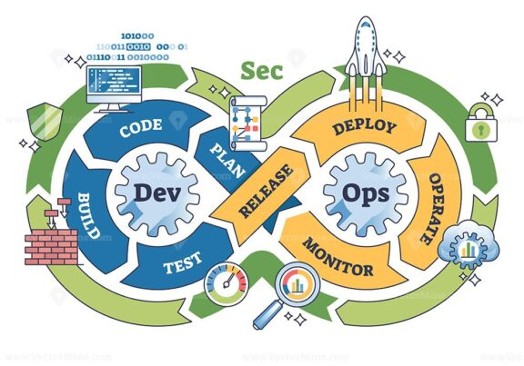

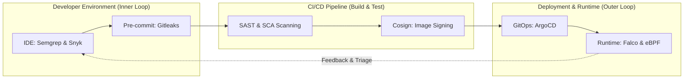

### Balancing Shift-Left and Shift-Everywhere

The traditional **"Shift-Left"** ethos advocates migrating security checks toward the earliest stages of development. As widely documented across software engineering literature (including historically referenced IBM Systems Sciences Institute and NIST defect studies), remediation costs scale non-linearly as vulnerabilities progress toward later phases of the delivery lifecycle.

* **Design and Authoring:** Identifying architectural flaws or insecure APIs during design or local coding is resolved rapidly with minimal overhead.
* **CI/CD Build & Test:** Flaws flagged during pipeline execution block faulty builds and provide contextual pull request feedback within the active sprint.
* **Production Runtime:** Remedying deployed vulnerabilities in production incurs substantial overhead — emergency hotfix deployments, operational downtime, compliance liabilities (GDPR, PCI DSS v4.0), and severe breach blast radius.

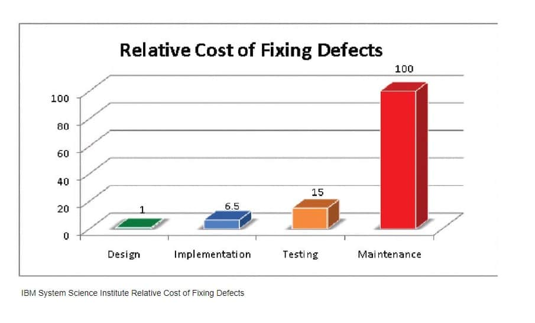

However, relying exclusively on Shift-Left introduces critical architectural blind spots:

1. **Runtime Dynamics:** Infrastructure configuration drift, runtime permission flaws, and inter-service network violations cannot be observed through static source analysis alone.
2. **Emergent and Zero-Day Exploits:** Vulnerabilities that are not yet publicly known or novel exploit primitives can bypass static pattern matching rules.
3. **Supply Chain & Infrastructure Compromise:** Compromised CI runners or container escapes occur independently of source code logic.

Modern security architectures therefore embrace **"Shift-Everywhere"** (Full Lifecycle Security), balancing proactive developer-side prevention with continuous in-kernel runtime protection.

---

### End-to-End Security Lifecycle

A comprehensive security architecture establishes explicit, automated controls for each discrete phase of software delivery.

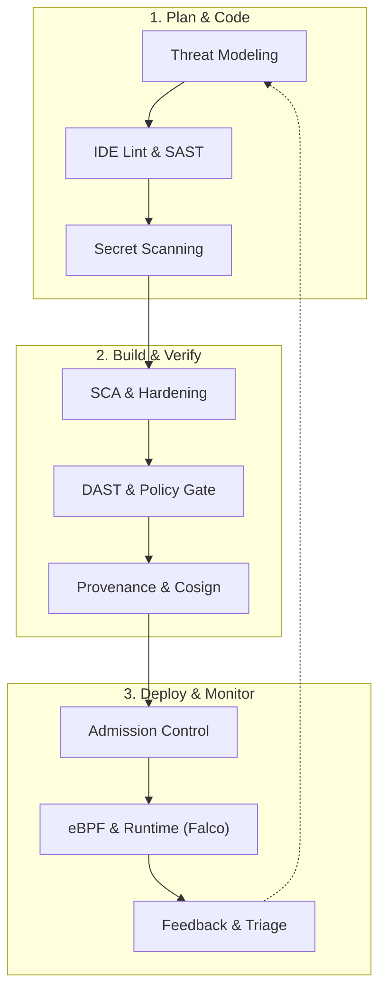

<div class="glass-panel reveal-on-scroll">

| SDLC Stage | Primary Threat | Security Control | Verification & Enforcement Point |
| :--- | :--- | :--- | :--- |
| **Plan** | Architectural and logic flaws | Threat Modeling (STRIDE / PASTA) | Architecture review, security requirements |
| **Code** | Insecure API usage, injection bugs | IDE security linting, Semgrep | Real-time developer editor diagnostics |
| **Commit** | Credential leakage into repository | Pre-commit hooks, Gitleaks | Local commit aborted on non-zero exit code |
| **Build & Test** | Vulnerable dependencies, rogue PRs | SCA, Compiler hardening, SAST | CI quality gates, SARIF diagnostic uploads |
| **Package** | Image tampering, poisoned packages | Minimal distroless images, SBOM | Syft generating CycloneDX/SPDX manifests |
| **Attestation** | Unverified or forged artifacts | Cryptographic signing, SLSA Provenance | Cosign keyless signing via OIDC claims |
| **Deploy** | Unauthorized images, config drift | GitOps (ArgoCD), Admission Controllers | Kyverno / OPA Gatekeeper cluster policies |
| **Runtime** | Container breakout, reverse shell | Kernel-level syscall monitoring (eBPF) | Falco alerts, Tetragon in-kernel SIGKILL |
| **Feedback** | Chronic technical debt, delayed fixes | MTTR metrics, automated fix PRs | Dependabot/Renovate, Jira issue tracking |

</div>

---

## Developer Environment and Inner Loop

The local developer workspace (the Inner Loop) provides the fastest and most cost-effective feedback loop in the entire security architecture.

<div class="render-cards">
  <div class="render-card">
    <div class="render-card-icon">🔍</div>
    <div class="render-card-title">Deep Static Analysis (SAST)</div>
    <p>Goes beyond syntax checking to analyze data flow, control flow, and taint tracking to detect complex injection vulnerabilities before commit.</p>
  </div>
  <div class="render-card">
    <div class="render-card-icon">🔑</div>
    <div class="render-card-title">Multi-Layered Secret Scanning</div>
    <p>Combines regex patterns with Shannon entropy calculations and contextual heuristics to intercept exposed API tokens locally.</p>
  </div>
  <div class="render-card">
    <div class="render-card-icon">⚡</div>
    <div class="render-card-title">Pre-Commit Policy Hooks</div>
    <p>Executes lightweight security checks in under 3 seconds to ensure clean, compliant code reaches the shared remote repository.</p>
  </div>
</div>

### Modern Static Code Analysis

Static Application Security Testing (SAST) analyzes source code and intermediate representations without executing the application. While basic linters rely on regular expressions or Abstract Syntax Trees (AST), modern enterprise SAST engines (e.g., CodeQL, Semgrep Pro) employ multidimensional analysis techniques:

1. **Abstract Syntax Trees (AST):** Represents code structure as a hierarchical syntax tree to identify insecure function calls and syntax antipatterns.
2. **Control-Flow Analysis:** Maps potential execution paths to determine the conditions and sequence under which code blocks execute.
3. **Data-Flow and Taint Analysis:** Tracks untrusted inputs (Sources — such as HTTP request parameters) as they flow through the application, verifying whether they pass through an effective sanitizer before reaching a critical execution sink (e.g., `eval()`, SQL query, system command).
4. **Semantic Analysis:** Interprets execution intent and type systems to substantially reduce false positive rates.

> [!NOTE]
> **Static Analysis and Zero-Day Vulnerabilities:** Static analysis can detect previously unknown vulnerabilities (zero-days) when they manifest as recognizable insecure code patterns or unsafe taint flows. However, SAST cannot anticipate emergent logic flaws, novel exploit primitives, or infrastructure-level vulnerabilities without modeled semantics.

### Secret Scanning Mechanics

Exposed API keys, cryptographic private keys, and database passwords are prime targets for initial access attacks. Modern scanners (Gitleaks, TruffleHog) deploy hybrid detection strategies:

* **Regular Expressions:** Identifies structured tokens from known providers (AWS `AKIA...`, GitHub `ghp_...`, Slack bearer tokens).
* **Shannon Entropy Analysis:** Evaluates character randomness to flag high-entropy strings indicative of generated passwords and keys.
* **Contextual Heuristics:** Evaluates proximity to identifier keywords (`password`, `bearer_token`, `client_secret`) to prioritize genuine credentials.

Claims of "near-zero false positives" in secret scanning do not hold up in real-world repositories. High-entropy UUIDs, mock testing fixtures, and obfuscated hashes can trigger benign alerts. A mature DevSecOps workflow involves tuning custom rules for internal key patterns and managing legitimate exceptions transparently via `.gitleaksignore`.

### Pre-Commit Local Controls

The following manifest configures lightweight, sub-3-second local pre-commit checks:

```yaml
# .pre-commit-config.yaml - Rapid Local Checks (< 3s)
repos:
  - repo: https://github.com/gitleaks/gitleaks
    rev: v8.18.4
    hooks:
      - id: gitleaks
        name: Detect Hardcoded Secrets
        entry: gitleaks protect --verbose --redact --staged

  - repo: https://github.com/returntocorp/semgrep
    rev: v1.75.0
    hooks:
      - id: semgrep
        name: Fast Local SAST (High-Confidence Rules)
        args: ['--config=p/security-audit', '--error', '--skip-unknown-extensions']
```

---

## CI/CD Pipeline and Supply Chain

Continuous Integration pipelines (GitHub Actions, GitLab CI, Jenkins) operate with extensive administrative privileges across enterprise environments. Because they build code, package containers, and deploy to cloud environments, they represent high-value targets for attackers.

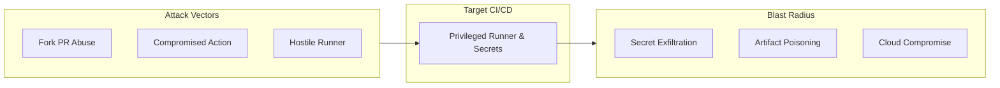

<div class="glass-panel reveal-on-scroll">

| Asset / Component | Threat & Attack Vector | Security Control | Residual Risk |
| :--- | :--- | :--- | :--- |
| **CI Runner Memory** | Rogue scripts dumping environment variables | Dynamic ephemeral Vault tokens, Log masking | Zero-day process memory inspection |
| **Workflow Triggers** | Malicious PR executing code in privileged context | Restrict `pull_request_target`, enforce `pull_request` | Human error during manual workflow review |
| **Third-Party Actions** | Upstream repository hijacking via mutable tags | Pin actions by full commit SHA | Vulnerabilities present in the pinned commit |
| **Outbound Egress** | Runner exfiltrating secrets to command-and-control | Egress network filtering (Harden-Runner) | DNS tunneling over permitted domain endpoints |
| **Cloud IAM Credentials** | Static AWS/GCP access keys exposed in runner | OIDC workload identity federation | Permissive IAM trust policy configurations |

</div>

### Threat Modeling and Trigger Isolation

A common and severe vulnerability in GitHub Actions workflows arises from misunderstanding `pull_request` versus `pull_request_target`:

* **`pull_request`:** Executes code from the untrusted fork repository, runs with read-only permissions and has zero access to repository secrets.
* **`pull_request_target`:** Executes within the context of the base repository, possesses write access and full access to repository secrets.

> [!CAUTION]
> **Critical Architectural Guidance:** Avoid using `pull_request_target` for workflows that execute untrusted pull-request code. If `pull_request_target` is necessary (e.g., for automated labeling or triage comments), never checkout or execute untrusted fork code within the privileged workflow context.

### Pipeline Hardening and OIDC

Enterprise CI hardening rests on two foundational architectural pillars:

1. **Egress Network Filtering:** CI runners must restrict outbound network calls exclusively to verified package registries and trusted endpoints using tools like Step-Security Harden-Runner.
2. **Short-Lived OIDC Federation:** Replace long-lived static cloud keys (`AWS_SECRET_ACCESS_KEY`) with OpenID Connect (OIDC) token exchanges that issue short-lived credentials scoped strictly to the repository and branch.

---

### Baseline Security Workflow

The following workflow demonstrates a hardened baseline security pipeline incorporating commit SHA pinning, minimal permissions, and multi-layered automated scanning.

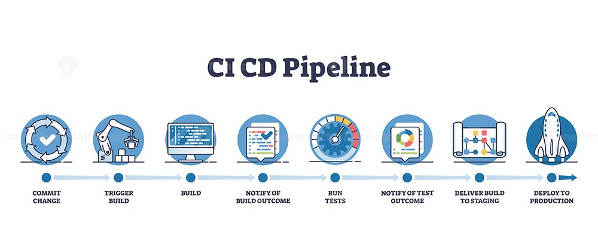

```yaml
name: Baseline Security Pipeline

on:
  push:
    branches: [main]
  pull_request:
    branches: [main]

permissions:
  contents: read

jobs:
  security-audit:
    name: Fast Triage and Static Verification
    runs-on: ubuntu-latest
    permissions:
      contents: read
      security-events: write

    steps:
      - name: Harden Runner (Egress Security)
        uses: step-security/harden-runner@63c24ba6bd7ba022e95695ff85de572c04a18142 # v2.8.1
        with:
          egress-policy: audit

      - name: Checkout Code
        uses: actions/checkout@v6

      - name: Scan for Hardcoded Secrets
        uses: gitleaks/gitleaks-action@v3
        env:
          GITHUB_TOKEN: ${{ secrets.GITHUB_TOKEN }}

      - name: Run SAST Analysis (Semgrep)
        uses: returntocorp/semgrep-action@713efdd345f30344b03657d5bd8a30176b440669 # v1
        with:
          config: p/ci
          generateSarif: "semgrep.sarif"

      - name: Upload Security Findings to GitHub
        if: always()
        uses: github/codeql-action/upload-sarif@d39d31e687223d841ef683f52467bd88e9b21c14 # v3.25.3
        with:
          sarif_file: semgrep.sarif
```

---

### Supply Chain Layers and SLSA

Modern applications are composed of over 80% open-source third-party dependencies. Securing the software supply chain requires cryptographic proof of component authenticity and build reproducibility.

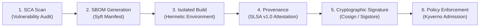

Supply chain security encompasses distinct, interdependent disciplines:

1. **SCA (Software Composition Analysis):** Audits dependencies against known vulnerability databases (CVEs) and flags outdated or insecure libraries.
2. **SBOM (Software Bill of Materials):** A formal machine-readable inventory (CycloneDX or SPDX format) detailing all direct and transitive dependencies, package hashes, and licensing metadata.
3. **Hermetic Builds:** Build processes executed within isolated environments devoid of unauthorized network access, ensuring reproducible output artifacts.
4. **Provenance Metadata:** Verifiable records documenting the precise source commit, builder identity, and pipeline parameters that produced an artifact.
5. **SLSA Framework (Supply-chain Levels for Software Artifacts):** A security specification (SLSA v1.0) establishing progressive standards across Source and Build tracks (Build Levels 1–3) to prevent tampering and ensure verifiable provenance.
6. **Cryptographic Signing (Cosign & Sigstore):** Digitally signs container images and provenance attestations using keyless OIDC certificates, binding artifacts to immutable transparency logs.

---

## Deployment Security and Infrastructure Isolation

Continuous delivery architectures have witnessed the systematic obsolescence of traditional "Push-Based" deployments in favor of declarative, "Pull-Based" GitOps paradigms.

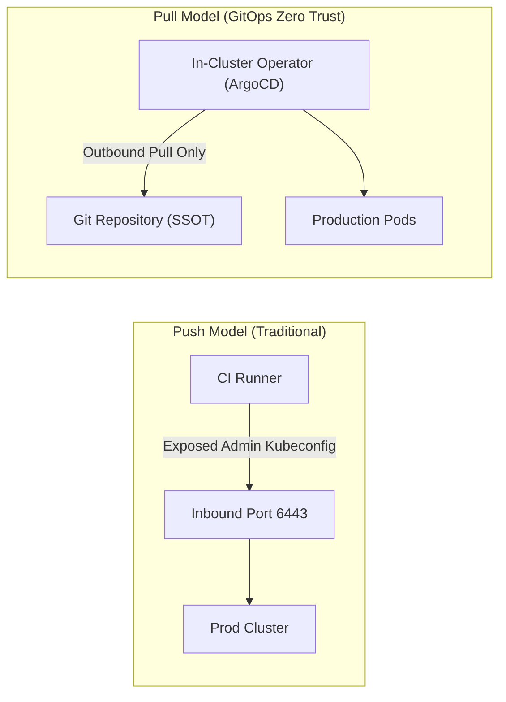

<div class="glass-panel reveal-on-scroll">

| Architectural Criterion | Push Model (Traditional CI/CD) | Pull Model (GitOps / ArgoCD) |
| :--- | :--- | :--- |
| **API Accessibility** | Port 6443 must be exposed to internet or broad CI network | Cluster remains completely private, zero inbound listening ports required |
| **Credential Storage** | High-privilege static `kubeconfig` secrets stored in CI/CD runners | Zero cluster credentials shared with CI, authentication is internal to cluster |
| **Configuration Drift** | Manual ad-hoc changes go unnoticed and persist | Continuous drift detection automatically reconciles state against Git (Self-Healing) |
| **Blast Radius of CI Breach** | CI compromise → Immediate full cluster takeover | Compromised CI can only submit Git PRs. Kyverno & admission policies guard the cluster |

</div>

### Kubernetes Admission Controllers

To guarantee that unsigned or non-compliant containers never execute in production, clusters deploy Admission Controllers. **Kyverno** enforces cryptographic Cosign image signatures directly at the Kubernetes API server boundary:

```yaml
# Kyverno ClusterPolicy - Enforce Cryptographic Image Signatures
apiVersion: kyverno.io/v1
kind: ClusterPolicy
metadata:
  name: verify-image-signature-policy
spec:
  validationFailureAction: Enforce
  rules:
    - name: verify-cosign-signature
      match:
        any:
          - resources: { kinds: ["Pod"] }
      verifyImages:
        - imageReferences: ["ghcr.io/enterprise-org/*"]
          attestors:
            - entries:
                - keys:
                    publicKeys: |
                      -----BEGIN PUBLIC KEY-----
                      MFkwEwYHKoZIzj0CAQYIKoZIzj0DAQcDQgAE...
                      -----END PUBLIC KEY-----
```

---

### In-Memory Secret Management

Injecting database credentials, API tokens, and private certificates as plain environment variables (`env`) expands the runtime attack surface.

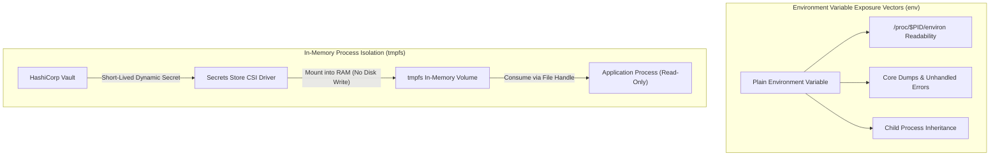

The threat model of raw environment variables stems from several operating system realities:
* Co-located processes running under the same UID can read `/proc/$PID/environ`.
* Application crashes, core dumps, and unhandled exception traces frequently capture the entire process environment and leak it into central logging pipelines.
* Child processes spawned by the primary container entrypoint inherit the complete parent environment by default.

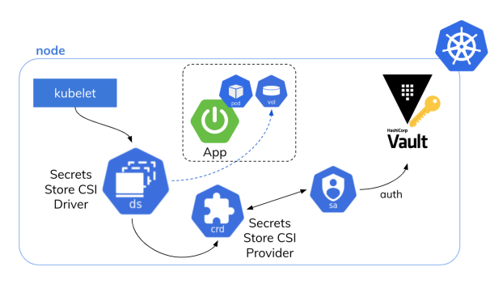

With the **Secrets Store CSI Driver**, secrets are mounted directly into volatile memory (`tmpfs`) without persisting to physical node storage. The application consumes credentials via standard file handles:

```yaml
# Pod Volume Mount - RAM-Based Ephemeral Secret
volumeMounts:
  - name: secrets-store-inline
    mountPath: "/mnt/secrets"
    readOnly: true
volumes:
  - name: secrets-store-inline
    csi:
      driver: secrets-store.csi.k8s.io
      readOnly: true
      volumeAttributes:
        secretProviderClass: "vault-database-credentials"
```

---

### Cloud Metadata and SSRF Protection

A pervasive attack vector against cloud workloads is **Server-Side Request Forgery (SSRF)**. If an application contains an SSRF vulnerability, attackers can attempt to query the cloud provider's internal Instance Metadata Service (`169.254.169.254`) to steal temporary IAM credentials assigned to the underlying host.

Mitigating this risk requires platform-specific controls.

<div class="glass-panel reveal-on-scroll">

| Cloud Platform | Metadata Architecture | Primary Security Control | Architectural Implementation |
| :--- | :--- | :--- | :--- |
| **AWS EC2** | IMDS (Instance Metadata Service) | **Enforce IMDSv2** (`http_tokens = "required"`) | Requires session-oriented PUT tokens. For containerized hosts, set `http_put_response_hop_limit = 2` so container bridge networking can reach the token endpoint. |
| **Azure VM** | Azure IMDS | **Enforce Custom Header** (`Metadata: true`) | Rejects metadata requests lacking the `Metadata: true` header, mitigating blind SSRF exploits. |
| **GCP Compute** | Google Metadata Server | **Enforce Header Check** (`Metadata-Flavor: Google`) | Demands `Metadata-Flavor: Google` header and automatically drops requests containing proxy forwarding headers (`X-Forwarded-For`). |
| **Kubernetes** | Node-Shared Metadata IP | **Workload Identity & NetworkPolicies** | Disables direct node IAM role exposure. NetworkPolicies drop all container egress traffic targeting `169.254.169.254`. |

</div>

```hcl
# AWS EC2 Terraform - Secure IMDSv2 Configuration
resource "aws_instance" "secure_workload" {
  ami           = "ami-0c55b159cbfafe1f0"
  instance_type = "t3.medium"

  metadata_options {
    http_endpoint               = "enabled"
    http_tokens                 = "required" # Disables IMDSv1, mandates v2 session tokens
    http_put_response_hop_limit = 2          # Safe limit for containerized bridge networking
    instance_metadata_tags      = "disabled"
  }
}
```

---

## Runtime and Serverless Security

Regardless of how rigorous pre-deployment checks are, runtime protection is essential to detect privilege escalations, container breakouts, and zero-day exploitation in live workloads.

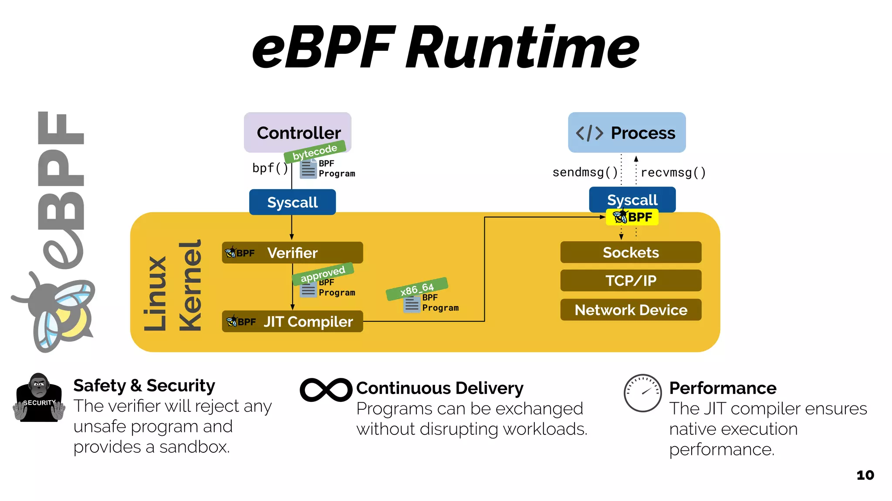

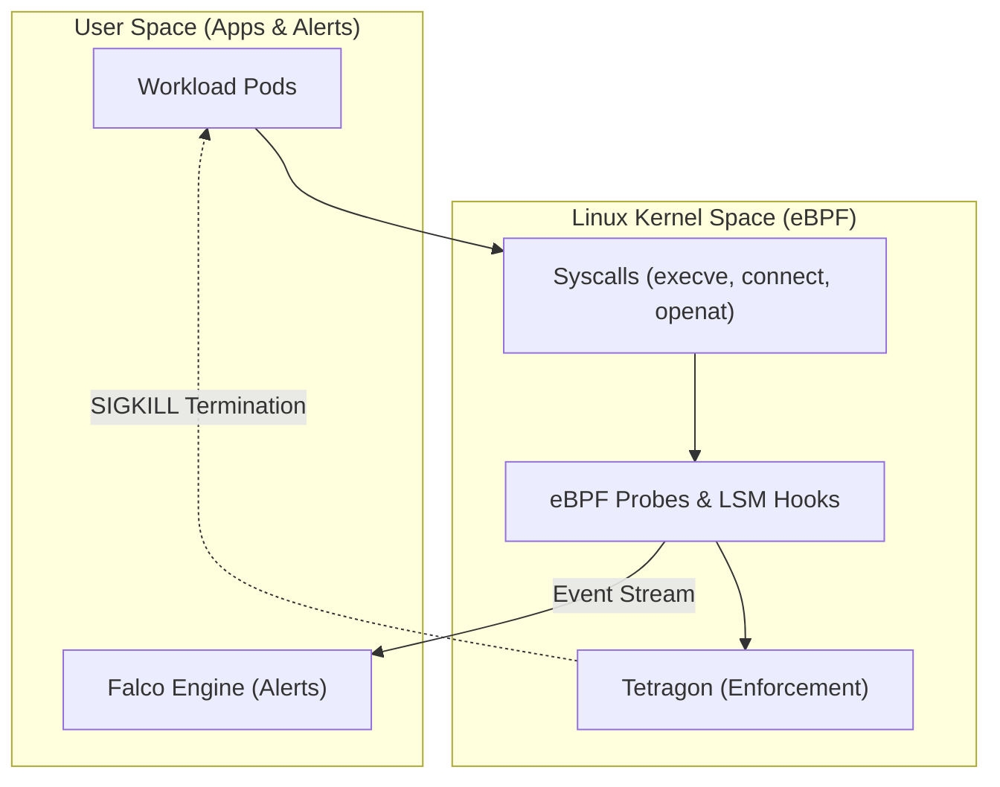

### Kernel-Level Observability with eBPF

Legacy runtime monitoring agents relying on `auditd` or `ptrace` introduce significant CPU overhead (often 15–30%) due to constant context switching between user space and kernel space.

**Extended Berkeley Packet Filter (eBPF)** enables sandboxed, bytecode programs to execute directly within the Linux kernel without modifying kernel source or loading unstable kernel modules:
* Collects kernel-level telemetry (`tracepoints`, `kprobes`, `LSM hooks`) with negligible CPU overhead.
* Resists tampering: even if an attacker compromises a container or disables user-space monitoring daemons, kernel-level eBPF probes remain fully operational.

### Detection and Prevention with Falco and Tetragon

Modern cloud-native architectures delineate clear responsibilities between detection and in-kernel enforcement:

* **Falco (Runtime Threat Detection):** Monitors syscall streams (`execve`, `openat`, `socket`), evaluates events against declarative YAML behavioral rules, and generates real-time security alerts. It excels at flagging anomalous activities like shell spawning inside containers or unexpected reads from `/etc/shadow`.
* **Tetragon (Cilium - In-Kernel Enforcement):** Hooks directly into Linux Security Modules (LSM). Unlike user-space alert loops, Tetragon can enforce real-time security policies directly within kernel space — synchronously blocking malicious system calls or terminating compromised processes (`SIGKILL`) before malicious execution completes.

```yaml
# Sample Falco Rule - Detecting Shell Execution in Containers
- rule: Unauthorized Shell Spawned in Container
  desc: Detects interactive shell execution inside production containers
  condition: >
    spawned_process and container and
    (proc.name in (bash, sh, zsh, ksh))
  output: >
    Critical Security Alert: Shell spawned in container
    (user=%user.name pod=%k8s.pod.name image=%container.image.repository)
  priority: CRITICAL
  tags: [runtime, container, mitre_execution]
```

### Runtime Application Self-Protection (RASP)

Runtime Application Self-Protection (RASP) embeds security monitoring directly within the application execution runtime (JVM, Node.js, CLR). Where network WAFs struggle with encrypted payloads or complex protocols, RASP evaluates incoming data in context — validating data flow immediately before database execution or deserialization sinks to block exploit payloads that evade perimeter defenses.

---

### Serverless and Event-Driven Security

Cloud architectures are increasingly adopting serverless and edge computing runtimes (Cloudflare Workers, AWS Lambda, Google Cloud Functions). While serverless abstracts away operating system patching, it introduces distinct security considerations.

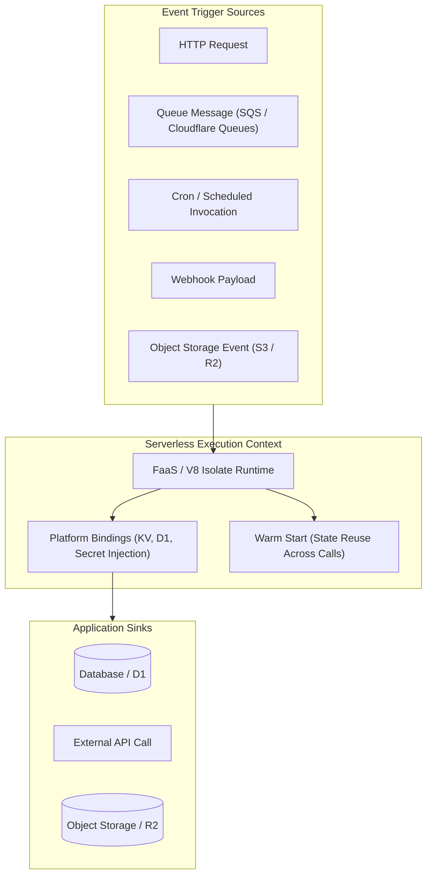

#### Event Sources and Taint Analysis

Standard SAST rule configurations predominantly treat incoming HTTP parameters (`req.params`, `req.body`, `$_GET`) as untrusted taint sources. However, event-driven architectures introduce asynchronous, non-HTTP ingress points:

* **Message Queues:** Queue payloads are frequently assumed to be trusted internal data, leading to unsanitized consumption by background workers.
* **Webhooks and Object Storage Events:** Payloads delivered by third-party webhooks or metadata attached to uploaded storage objects can serve as injection vectors if passed directly into execution sinks.
* **Service Bindings:** Platforms like Cloudflare Workers utilize direct in-memory bindings (KV, D1, RPC bindings) rather than standard network sockets, bypassing perimeter network inspection.

Security teams must configure static analysis tooling with custom taint sources modeling these non-HTTP entry points to prevent blind spots.

#### Warm Start State Persistence

To minimize cold-start latency, serverless runtimes maintain "warm" execution containers across sequential invocations:

* Global variables and local scratch directories (`/tmp`) can persist across warm invocations.
* Sensitive data stored in global variables during one user's request could inadvertently leak into subsequent invocations serving different requests.
* Remediation: Functions must remain strictly stateless, sensitive in-memory variables must be explicitly purged, and secrets should be consumed via platform secret bindings or short-lived IAM roles rather than local filesystem caches.

---

## Organizational Culture and Maturity

DevSecOps failures rarely stem from tooling deficiencies. They are almost universally driven by organizational friction, lack of shared ownership, and unmanaged alert fatigue.

<div class="glass-panel reveal-on-scroll">

| Security Discipline | Threat / Attack Vector | Detection Mechanism | Enforcement Point | Representative Tooling |
| :--- | :--- | :--- | :--- | :--- |
| **SAST** | Source code injection, insecure logic | Taint tracking, AST, data/control flow | IDE warnings, PR blocking gates | Semgrep, CodeQL, SonarQube |
| **SCA** | Vulnerable open-source dependencies | CVE vulnerability feed matching | CI build quality gates | Trivy, Snyk, OSV-Scanner |
| **Secret Scanning** | Hardcoded credentials in Git | Entropy analysis, regex heuristics | Pre-commit hooks, push protection | Gitleaks, TruffleHog |
| **IaC Security** | Cloud misconfiguration, exposed ports | Policy-as-Code static evaluation | PR checks, CI deployment gate | Checkov, tfsec, Trivy IaC |
| **Provenance & SLSA** | Build artifact tampering | Cryptographic signatures, in-toto claims | Pre-deployment admission policy | Cosign, Sigstore, SLSA Builder |
| **GitOps Security** | Ad-hoc cluster tampering, config drift | Continuous reconciliation against Git | In-cluster pull-only operator | ArgoCD, Flux |
| **Runtime Security** | Zero-days, container escape, shells | Kernel syscall stream inspection | Falco alerting, Tetragon SIGKILL | Falco, Tetragon, Cilium |

</div>

### Security Champions Network

Centralized security teams cannot scale to attend every sprint planning session or review every individual pull request. The solution is embedding and training dedicated engineers within each product squad as **Security Champions**.

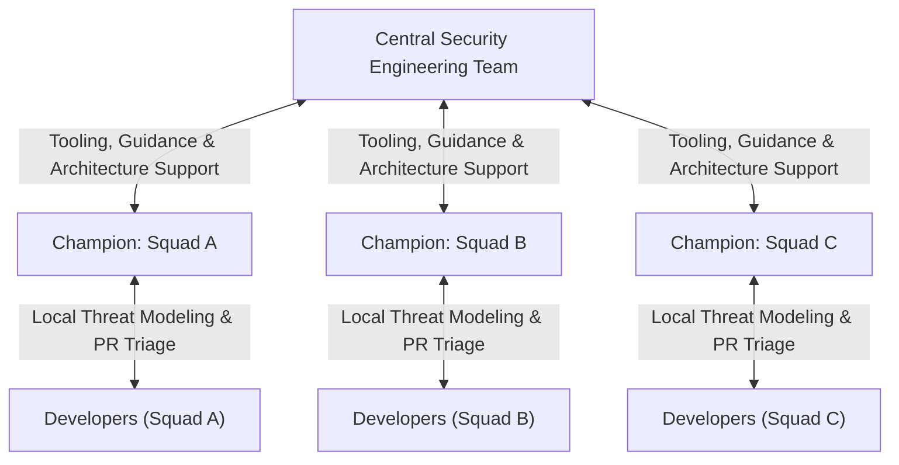

> [!IMPORTANT]
> **Leadership Commitment:** Organizations should establish explicit, leadership-backed capacity allocation (typically a recognized percentage of sprint capacity) for Security Champion activities rather than treating them as purely voluntary, unmeasured overtime.

### Maturity Frameworks: SAMM and DSOMM

Measuring DevSecOps progress requires objective, structured frameworks:

* **OWASP SAMM (Software Assurance Maturity Model v2.0):** Evaluates organizational maturity across 5 core business functions: Governance, Design, Implementation, Verification, and Operations.
* **OWASP DSOMM (DevSecOps Maturity Model v5.1):** Evaluates tactical, technical practices integrated directly into DevOps pipelines across four dimensions: Static Depth, Dynamic Depth, Intensity, and Consolidation.
* **NIST SSDF (SP 800-218):** Defines government and enterprise standards for mitigating supply chain and software development vulnerabilities.

<div class="glass-panel reveal-on-scroll">

| Control Discipline | Common Limitations & Blind Spots | Operational Trade-Off | Remediation Strategy |
| :--- | :--- | :--- | :--- |
| **SAST** | Blind to dynamic runtime logic flaws | High rule volume slows developer feedback | Start with high-confidence rules, focus on PR diffs |
| **SCA** | Cannot verify if vulnerable code is reachable | High volume of unexploitable CVE alerts | Implement reachability analysis and EPSS triage |
| **Secret Scanning** | High-entropy mock test tokens trigger alerts | Strict blocking interrupts local developer flow | Maintain disciplined `.gitleaksignore` exemptions |
| **eBPF Runtime** | Operates at time-of-exploit (reactive) | Kernel dependency and memory limits | Pair runtime defense with strict pre-deployment admission |

</div>

---

### Practical Implementation Roadmap

Attempting to implement every tool and policy simultaneously leads to alert fatigue and organizational resistance. Organizations should follow a phased adoption model:

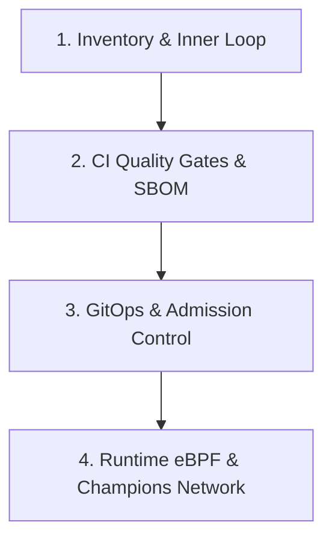

1. **Phase 1 — Discovery & Inventory:** Catalog existing repositories, third-party libraries, container images, and cloud assets.
2. **Phase 2 — Inner Loop Hygiene:** Deploy local pre-commit secret scanning (Gitleaks) to stop credential leakage at the workstation level.
3. **Phase 3 — Baseline CI Quality Gates:** Integrate lightweight SAST and SCA scanning into pull request pipelines, deliver SARIF findings directly to developers.
4. **Phase 4 — Supply Chain Security:** Transition to distroless container images, generate SBOMs with Syft, and sign release artifacts cryptographically with Cosign.
5. **Phase 5 — GitOps & Admission Control:** Migrate deployment workflows to pull-based GitOps (ArgoCD), enforce image signature verification using Kyverno.
6. **Phase 6 — Runtime Observability:** Deploy eBPF-based Falco and Tetragon across production clusters to detect and intercept anomalous kernel events.
7. **Phase 7 — Program Maturity & Champions:** Formalize the Security Champions program and benchmark pipeline maturity against OWASP DSOMM 5.1.

---

Security is not a final destination, it's an evolving discipline. When you empower developers instead of blocking them, automate policies as code, and treat pipelines as first-class citizens, security becomes an accelerator rather than a hurdle. Own your code, secure your supply chain!

## References

1. **NIST SP 800-218:** Secure Software Development Framework (SSDF) Version 1.1: Recommendations for Mitigating the Risk of Software Vulnerabilities. National Institute of Standards and Technology.
2. **OWASP SAMM v2.0:** Software Assurance Maturity Model: A Guide to Building Security into Software Development. OWASP Foundation.
3. **OWASP DSOMM v5.1:** DevSecOps Maturity Model (Released September 2026): Dimensions for Evaluating Engineering Workflows. OWASP Foundation.
4. **SLSA Specification v1.0:** Supply-chain Levels for Software Artifacts: Build Track & Provenance Requirements. OpenSSF.
5. **GitHub Actions Security Documentation:** Securely using pull_request_target & Hardening Runners with OpenID Connect (OIDC). GitHub Docs.
6. **CNCF Cloud Native Security Whitepaper v2:** Cloud Native Computing Foundation Security Technical Advisory Group.
7. **Sigstore & Cosign Architecture:** Standard for Container Signing, Verification and Storage in OCI Registries. Linux Foundation.
8. **Kyverno Documentation:** Kubernetes Native Policy Management and Image Verification Engine.
9. **Falco & Tetragon Kernel Tracing Documentation:** Runtime Security and eBPF-Based In-Kernel Observability and Enforcement.
10. **CIS Benchmarks:** Center for Internet Security Benchmarks for Kubernetes and Linux Operating Systems.
