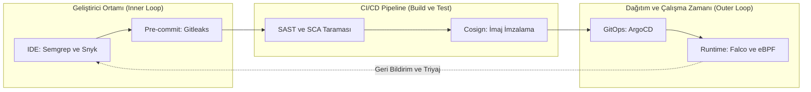
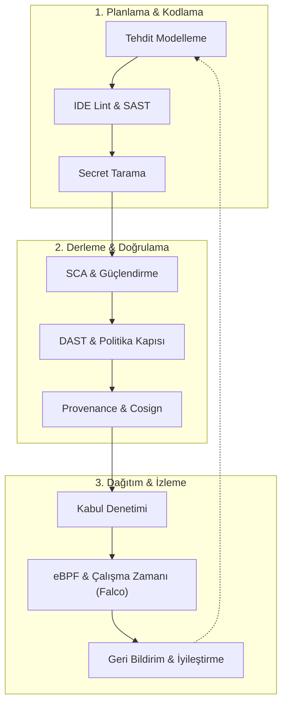
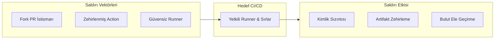
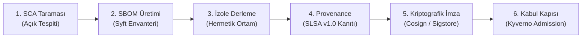
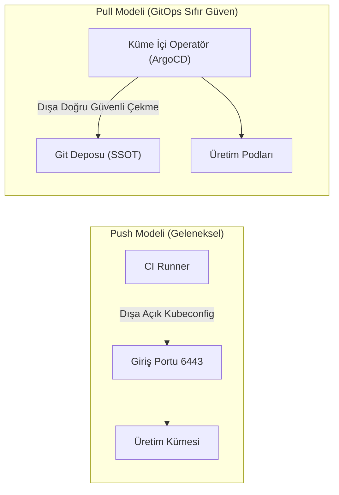
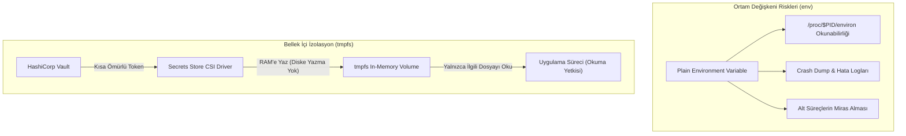
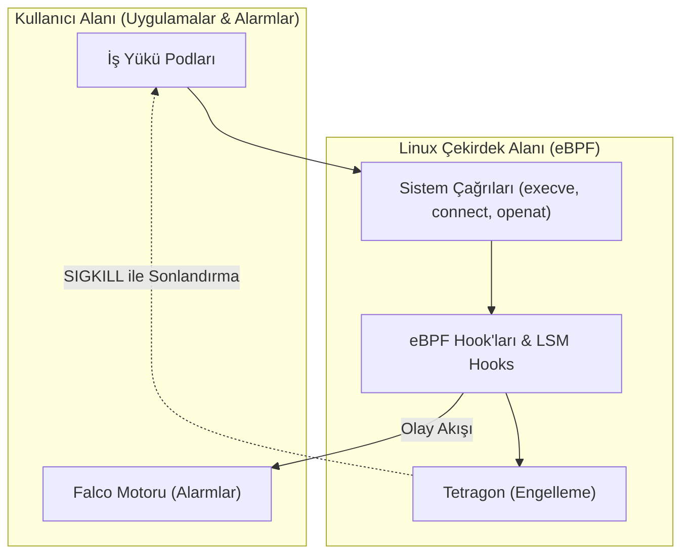
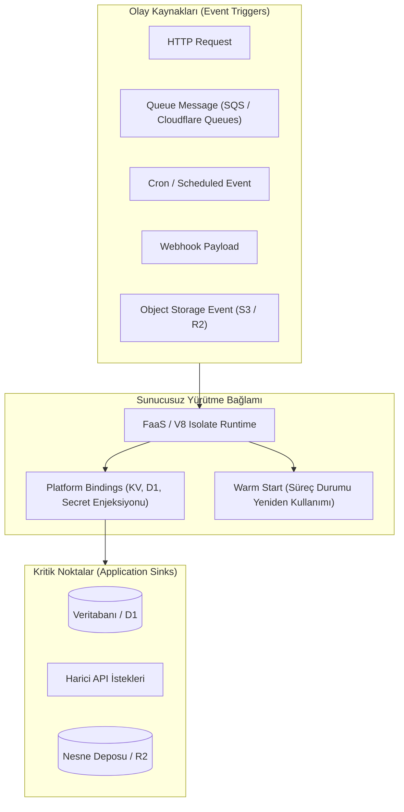
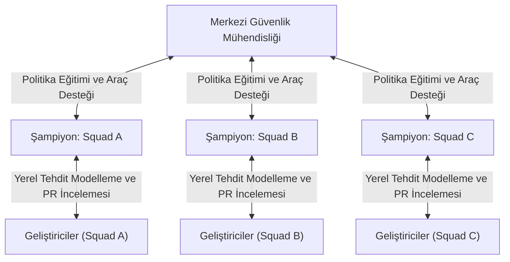
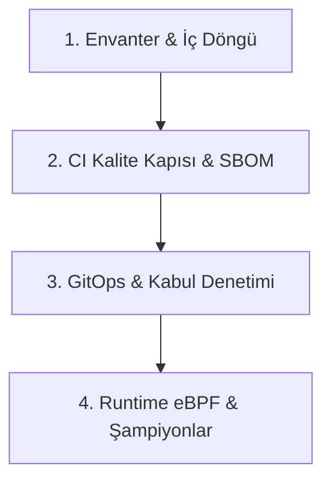

Günde onlarca kez canlıya kod çıkan modern mühendislik ekipleri için hız her şeydir. Fakat teslimat hızı arttıkça, yönetilmesi ve güvenceye alınması gereken güvenlik açıkları da katlanarak büyür. Eskiden yaptığımız gibi projenin en sonuna üç haftalık sızma testi koymak veya güvenlik ekibinin önüne onay biletleri yığmak, artık sürekli teslimat (CI/CD) pipeline'larının hızına yetişemiyor, geliştiricilerin hevesini kıran devasa bir darboğaza dönüşüyor.

Geçtiğimiz yıllarda yaşanan küresel felaketler, güvenliği en sona ertelemenin ne kadar pahalıya patladığını hepimize gösterdi:

* **SolarWinds Olayı:** Zararlı kodların doğrudan derleme (build) aşamasında enjekte edilebileceğini ve tüm tedarik zincirini zehirleyebileceğini kanıtladı.
* **Log4Shell Krizi:** Farkında bile olmadığımız derin açık kaynak bağımlılıklarının tüm kurumsal sistemleri bir gecede sıfırıncı gün (0-day) krizine sürükleyebileceğini ortaya koydu.
* **Capital One İhlali:** Basit bir SSRF zafiyetinin aşırı yetkili bulut rolleriyle birleştiğinde nasıl devasa bir veri sızıntısına dönüştüğünü belgeledi.
* **XZ Utils ve Codecov Vakaları:** Saldırganların artık doğrudan geliştirici araçlarını, CI runner'larını ve açık kaynak depolarını hedef aldığını gösterdi.

İşte bu yüzden **DevSecOps**, sağdan soldan araç satın alıp pipeline'lara rastgele tarayıcılar tıkıştırma işi değildir. DevSecOps, güvenliği ilk kod satırından canlı runtime'a kadar her aşamaya organik biçimde yediren bir mühendislik kültürü ve mimari disiplindir.

<div class="glass-panel reveal-on-scroll">

| Mimari Kriter | Geleneksel Güvenlik Yaklaşımı | DevSecOps Operasyonel Modeli |
| :--- | :--- | :--- |
| **Giriş Noktası** | SDLC'nin en sonu (Yayına günler kala reaktif sızma testi) | SDLC'nin her aşaması (Planlama, Kodlama, CI/CD, GitOps, Runtime) |
| **Geri Bildirim Hızı** | Haftalar süren statik PDF raporları | IDE ve Pull Request içi otomatik, anlık bulgu geri bildirimi |
| **Sorumluluk Modeli** | İzole güvenlik ekibinin tekelinde manuel kontrol | Dağıtık sahiplik ve Güvenlik Şampiyonları (Security Champions) ağı |
| **Kontrol Mekanizması** | Manuel onay kapıları ve bürokratik onay süreçleri | Otomatik testler, Kod Olarak Politika (Policy-as-Code) ve kalite kapıları |
| **Maliyet ve İyileştirme** | Üretimde geç tespit: Kapsamlı acil yamalar ve veri ihlali riski | Tasarım ve kodlamada erken tespit: Minimum iş kesintisiyle hızlı çözüm |

</div>

---

## DevSecOps Modeli ve İlkeler

DevSecOps dönüşümünün sürdürülebilir olması, salt araç tedarikine değil, İnsan, Süreç ve Yönetişim sütunlarının sağlam bir mimari zemin üzerine kurulmasına bağlıdır.

<div class="render-cards">
  <div class="render-card">
    <div class="render-card-icon">⚡</div>
    <div class="render-card-title">Shift-Left ve Erken Doğrulama</div>
    <p>Güvenlik kontrollerini geliştiricinin çalışma alanına (IDE ve pre-commit) taşıyarak zafiyetlerin merkezi depoya ulaşmadan yakalanmasını sağlar.</p>
  </div>
  <div class="render-card">
    <div class="render-card-icon">🛡️</div>
    <div class="render-card-title">Shift-Everywhere ve Derinlemesine Savunma</div>
    <p>Güvenliği yalnızca derleme anına hapsetmeyip tedarik zinciri, GitOps teslimatı ve çekirdek seviyesi runtime izleme ile uçtan uca korur.</p>
  </div>
  <div class="render-card">
    <div class="render-card-icon">🤝</div>
    <div class="render-card-title">Paylaşılan Sorumluluk Modeli</div>
    <p>Güvenlik ekiplerini birer "onay kapısı" olmaktan çıkarıp geliştiricileri otonom kılan güvenlik platform mühendislerine dönüştürür.</p>
  </div>
</div>




### Shift-Left ve Shift-Everywhere Dengesi

Yazılım güvenliğindeki klasik **"Shift-Left"** yaklaşımı, güvenlik kontrollerini yazılım yaşam döngüsünün başlangıcına (IDE ve Pull Request seviyesine) çekmeyi savunur. Yazılım mühendisliği literatüründe (özellikle IBM Systems Sciences Institute ve NIST çalışmalarında) sıklıkla vurgulandığı üzere, zafiyetlerin tespit ve onarım maliyetleri yaşam döngüsünün ilerleyen aşamalarına doğru doğrusal olmayan bir ivmeyle artar.

* **Tasarım ve Kodlama Aşaması:** Bir mantıksal açığı veya güvensiz kütüphaneyi yerel ortamda tespit edip gidermek minimum maliyetle ve anında çözülür.
* **Pipeline (Build/Test):** CI aşamasında yakalanan açıklar, derleme blokajı ve PR geri bildirimiyle mühendislik sprint'i içinde eritilir.
* **Canlı Ortam (Production):** Canlıya sızmış bir zafiyeti onarmak, acil yama dağıtımları, operasyonel iş kesintileri, hukuki sorumluluklar (GDPR, KVKK, PCI DSS v4.0) ve veri ihlali riskleriyle katlanarak ağırlaşır.


Ancak yalnızca Shift-Left'e odaklanmak şu yapısal kör noktaları doğurur:

1. **Çalışma Zamanı Dinamikleri:** Altyapı sapmaları (drift), dinamik yetkilendirme hataları ve servisler arası ağ ihlalleri statik kaynak kod analizinde görünmez.
2. **Bilinmeyen Tehditler ve Sıfırıncı Gün Açıkları:** Kodlama anında henüz kamuya açıklanmamış veya kurumsal çevreye özgü istismar zincirleri statik kural setlerini atlatabilir.
3. **Tedarik Zinciri ve Altyapı:** CI runner'ının ele geçirilmesi veya üretim ortamı container kaçışları kod seviyesindeki kontrollerden bağımsız gerçekleşir.

Bu nedenle modern mimariler, Shift-Left'i üretim ortamının dinamik korumasıyla harmanlayan **"Shift-Everywhere"** (veya Tam Yaşam Döngüsü Güvenliği) modelini benimser.

---

### Uçtan Uca Güvenlik Yaşam Döngüsü

Bütüncül bir güvenlik mimarisi, planlamadan çalışma zamanına kadar her aşamanın kendine has tehditlerine karşı özelleşmiş kontroller tanımlar.



<div class="glass-panel reveal-on-scroll">

| SDLC Aşaması | Birincil Tehdit | Güvenlik Kontrolü | Doğrulama & Engelleme Mekanizması |
| :--- | :--- | :--- | :--- |
| **Planlama** | Tasarım ve mantık kusurları | Tehdit Modelleme (STRIDE / PASTA) | Mimari tasarım onayı, güvenlik gereksinimleri |
| **Kodlama** | Güvensiz API kullanımı, enjeksiyon | IDE eklentileri, Semgrep kuralları | Geliştirici anlık uyarıları |
| **Commit** | Depoya kimlik bilgisi sızması | Pre-commit hook'ları, Gitleaks | Yerel commit iptali (Exit code != 0) |
| **Build & Test** | Zaafiyetli bağımlılıklar, kötü niyetli PR | SCA, Derleyici sertleştirme, SAST | CI kalite kapısı (Quality Gate), SARIF analizi |
| **Paketleme** | İmaj manipülasyonu, bağımlılık zehirlenmesi | Minimal distroless imaj, SBOM | Syft ile CycloneDX/SPDX üretimi |
| **Kanıtlama** | Sahte veya doğrulanmamış derleme | Kriptografik imzalama, SLSA Provenance | Cosign anahtarsız imza, OIDC kimlik doğrulama |
| **Dağıtım** | Yetkisiz imaj çalıştırma, konfigürasyon sapması | GitOps (ArgoCD), Admission Controller | Kyverno / OPA Gatekeeper kabul kuralları |
| **Runtime** | Container kaçışı, reverse shell, yetki yükseltme | Çekirdek seviyesi izleme (eBPF) | Falco alarmları, Tetragon in-kernel engelleme |
| **Geri Bildirim** | Tekrarlayan açıklar, yama gecikmeleri | Metrik takibi (MTTR), Otomatik PR | Dependabot/Renovate, Jira entegrasyonu |

</div>

---

## Geliştirici Ortamı ve İç Döngü

Geliştiricinin yerel makinesinde başlayan iç döngü (Inner Loop), güvenlik geri bildiriminin en ucuz ve en hızlı sağlandığı katmandır.

<div class="render-cards">
  <div class="render-card">
    <div class="render-card-icon">🔍</div>
    <div class="render-card-title">Derin Statik Kod Analizi (SAST)</div>
    <p>Soyut Sözdizimi Ağacı (AST) ötesinde, veri akışı (data-flow), kontrol akışı (control-flow) ve leke takibi (taint tracking) ile enjeksiyon açıklarını tespit eder.</p>
  </div>
  <div class="render-card">
    <div class="render-card-icon">🔑</div>
    <div class="render-card-title">Çok Katmanlı Gizli Anahtar Taraması</div>
    <p>Salt düzenli ifadelerin ötesinde Shannon entropi algoritmaları ve bağlamsal anahtar kelime eşleşmeleriyle API anahtarlarını commit öncesi durdurur.</p>
  </div>
  <div class="render-card">
    <div class="render-card-icon">⚡</div>
    <div class="render-card-title">Pre-Commit Hook'ları</div>
    <p>Yerel Git hook'larıyla saniyeler içinde çalışan hafif kontroller uygular, geliştiricinin akışını bölmeden güvenlik bariyeri oluşturur.</p>
  </div>
</div>

### Modern Statik Kod Analizi

Statik Uygulama Güvenlik Testi (SAST), kaynak kodun derlenmeden veya çalıştırılmadan incelenmesidir. Geleneksel yaklaşımlar yalnızca basit düzenli ifadeler veya Soyut Sözdizimi Ağaçları (AST) üzerinde yüzeysel kontroller yaparken, modern kurumsal SAST motorları (ör. CodeQL, Semgrep Pro) çok boyutlu analiz tekniklerini harmanlar:

1. **Soyut Sözdizimi Ağacı (AST):** Kodun dilbilgisi yapısını hiyerarşik bir ağaç olarak modeller, güvensiz fonksiyon çağrılarını yapısal olarak bulur.
2. **Kontrol Akışı Analizi (Control-Flow Analysis):** Kod bloklarının hangi koşullarda ve hangi sırada icra edileceğini belirleyen yürütme yollarını modeller.
3. **Veri Akışı ve Leke Takibi (Data-Flow & Taint Tracking):** Güvenilmeyen bir kaynaktan (Source - ör. HTTP sorgu parametresi) gelen girdinin, güvenli bir arındırma fonksiyonundan (Sanitizer) geçmeden kritik bir noktaya (Sink - ör. `eval()`, SQL sorgusu, OS komutu) ulaşıp ulaşmadığını izler.
4. **Semantik Analiz:** Kodun yürütme niyetini ve tip güvenliğini anlamlandırarak yanlış pozitif (FP) oranlarını düşürür.

> [!NOTE]
> **Statik Analiz ve Sıfırıncı Gün Açıkları:** Statik analiz motorları, kamuya henüz CVE olarak yansımamış bilinmeyen açıkları (zero-day) tanınabilir güvensiz kod desenleri veya leke akışları (taint paths) üzerinden tespit edebilir. Ancak SAST, altyapı seviyesindeki istismar zincirlerine, dinamik bellek yolsuzluklarına veya çalışma zamanındaki beklenmedik iş mantığı hatalarına karşı tam bir koruma sağlayamaz.

### Gizli Anahtar Taraması

Kaynak kod depolarına sızan API anahtarları, özel sertifikalar ve veri tabanı şifreleri, kimlik tabanlı saldırıların temelini oluşturur. Modern tarayıcılar (Gitleaks, TruffleHog) tespit doğruluğunu artırmak için hibrit bir mimari kullanır:

* **Düzenli İfade (Regex) Kütüphaneleri:** Bilinen sağlayıcıların (AWS `AKIA...`, GitHub `ghp_...`, Slack token'ları) standart formatlarını arar.
* **Shannon Entropi Analizi:** Karakter dizisindeki rastgelelik seviyesini ölçer. Yüksek entropiye sahip dizgiler şifrelenmiş veya rastgele üretilmiş kimlik bilgilerine işaret eder.
* **Bağlamsal Anahtar Kelime Doğrulaması:** Değişken adları (`password`, `bearer_token`, `private_key`) ile yakınındaki dizgiler arasındaki ilişkiyi inceler.

Gizli anahtar taramasında "sıfır yanlış pozitif" (zero false positives) iddiası gerçekçi değildir. Test dosyalarındaki sahte mock veriler, karmaşık hash değerleri veya yüksek entropili UUID'ler alarm tetikleyebilir. Başarılı bir DevSecOps uygulaması, kural setlerinin kurumsal bağlama göre özelleştirilmesini ve `.gitleaksignore` ile meşru istisnaların kayıt altına alınmasını gerektirir.

### Pre-Commit Yerel Kontrolleri

Aşağıdaki yapılandırma, geliştiricinin makinesinde yerel olarak çalışan ve hassas verileri merkezi depoya ulaşmadan engelleyen hafif bir pre-commit kurulumunu modeller:

```yaml
# .pre-commit-config.yaml - Hızlı Yerel Kontroller (< 3 sn)
repos:
  - repo: https://github.com/gitleaks/gitleaks
    rev: v8.18.4
    hooks:
      - id: gitleaks
        name: Detect Hardcoded Secrets
        entry: gitleaks protect --verbose --redact --staged

  - repo: https://github.com/returntocorp/semgrep
    rev: v1.75.0
    hooks:
      - id: semgrep
        name: Fast Local SAST (High-Confidence Rules)
        args: ['--config=p/security-audit', '--error', '--skip-unknown-extensions']
```

---

## CI/CD Pipeline ve Tedarik Zinciri

Merkezi CI/CD pipeline'ları (GitHub Actions, GitLab CI, Jenkins), kurumsal ortamın en yüksek ayrıcalıklara sahip yürütme merkezleridir. Kod derleme, container oluşturma ve bulut ortamlarına dağıtım yetkilerine sahip oldukları için saldırganların birincil hedefi haline gelmiştir.



<div class="glass-panel reveal-on-scroll">

| Varlık / Bileşen | Tehdit ve Saldırı Yolu | Güvenlik Kontrolü | Artık Risk (Residual Risk) |
| :--- | :--- | :--- | :--- |
| **CI Runner Belleği** | Güvensiz script'lerin ortam değişkenlerinden gizli anahtar okuması | HashiCorp Vault dinamik token'ları, Maskeleme | Zero-day bellek dökümü zafiyetleri |
| **GitHub Actions Tetikleyicisi** | Kötü niyetli PR ile ayrıcalıklı bağlamda kod çalıştırma | `pull_request` kullanımı, `pull_request_target` sınırlandırması | Manuel onay süreçlerindeki insan hataları |
| **Üçüncü Taraf Action'lar** | Action deposunun etiket kaydırmasıyla (tag mutability) ele geçirilmesi | Tam Commit SHA sabitleme (SHA pinning) | Sabitlenen commit'teki sıfırıncı gün açıkları |
| **Giden Ağ Trafiği** | Runner üzerinden saldırgan sunucusuna gizli anahtar sızdırma | Egress ağ filtrelemesi (Harden-Runner) | İzin verilen etki alanları üzerinden DNS tünelleme |
| **Bulut Sağlayıcı Erişimi** | Statik AWS/GCP anahtarlarının ele geçirilmesi | OIDC tabanlı kısa ömürlü federasyon | Yanlış yapılandırılmış IAM trust politikaları |

</div>

### Pipeline Tehditleri ve Tetikleyici İzolasyonu

GitHub Actions ekosisteminde en sık yapılan yapılandırma hatası `pull_request` ile `pull_request_target` tetikleyicileri arasındaki ayrımın yanlış anlaşılmasıdır:

* **`pull_request`:** Çatallanmış (fork) depodan gelen PR kodunu çalıştırır, ancak kaynak depodaki gizli anahtarlara (`secrets`) erişemez ve salt-okunur izinlerle sınırlandırılmıştır.
* **`pull_request_target`:** Hedef ana deponun bağlamında çalışır, depodaki gizli anahtarlara tam erişim sağlayabilir ve yazma izinlerine sahip olabilir.

> [!CAUTION]
> **Kritik Mimari Kural:** Güvenilmeyen harici kaynak kodunu derleyen veya test eden iş akışlarında `pull_request_target` kullanımından kaçının. Eğer PR etiketleme veya bot bildirimleri için `pull_request_target` gerekliyse, ayrıcalıklı iş akışı içerisinde saldırgan denetimindeki PR kodunu asla `checkout` etmeyin ve çalıştırmayın.

### Pipeline Sertleştirme ve OIDC

Pipeline güvenliğinde iki vazgeçilmez temel prensip vardır:

1. **Ağ Çıkış Denetimi (Egress Filtering):** Runner'ların yalnızca GitHub, paket depoları veya izin verilen adreslerle iletişim kurmasına izin verilir.
2. **Statik Anahtarsız Bulut Erişimi (OIDC):** CI ortamında uzun ömürlü `AWS_SECRET_ACCESS_KEY` saklamak yerine, OpenID Connect (OIDC) ile kısa ömürlü geçici oturum token'ları talep edilir.

---

### Temel Güvenlik İş Akışı

Aşağıdaki iş akışı, modern action sürümlerini, tam SHA sabitlemeyi, minimal token izinlerini ve çok katmanlı tarama disiplinlerini bir araya getiren temel bir CI pipeline'ını modeller.


```yaml
name: Baseline Security Pipeline

on:
  push:
    branches: [main]
  pull_request:
    branches: [main]

permissions:
  contents: read

jobs:
  security-audit:
    name: Fast Triage and Static Verification
    runs-on: ubuntu-latest
    permissions:
      contents: read
      security-events: write

    steps:
      - name: Harden Runner (Egress Security)
        uses: step-security/harden-runner@63c24ba6bd7ba022e95695ff85de572c04a18142 # v2.8.1
        with:
          egress-policy: audit

      - name: Checkout Code
        uses: actions/checkout@v6

      - name: Scan for Hardcoded Secrets
        uses: gitleaks/gitleaks-action@v3
        env:
          GITHUB_TOKEN: ${{ secrets.GITHUB_TOKEN }}

      - name: Run SAST Analysis (Semgrep)
        uses: returntocorp/semgrep-action@713efdd345f30344b03657d5bd8a30176b440669 # v1
        with:
          config: p/ci
          generateSarif: "semgrep.sarif"

      - name: Upload Security Findings to GitHub
        if: always()
        uses: github/codeql-action/upload-sarif@d39d31e687223d841ef683f52467bd88e9b21c14 # v3.25.3
        with:
          sarif_file: semgrep.sarif
```

---

### Tedarik Zinciri Katmanları ve SLSA

Yazılım geliştirme süreçleri devasa miktarda açık kaynak bağımlılığı üzerine inşa edilir. Bir uygulamanın kod tabanının %80'inden fazlası üçüncü taraf kütüphanelerden oluşur. Tedarik zinciri güvenliği, bu bağımlılıkların ve derleme çıktılarının uçtan uca doğrulanabilir olmasını şart koşar.



Tedarik zinciri kavramları sıklıkla birbirine karıştırılır. Bu disiplinler hiyerarşik bir güven zinciri oluşturur:

1. **SCA (Yazılım Bileşen Analizi):** Bilinen zafiyetleri (CVE), lisan ihlallerini ve eskiyen paketleri tespit eder.
2. **SBOM (Yazılım Malzeme Listesi):** Uygulamadaki doğrudan ve transitif tüm bağımlılıkların, sürümlerin ve hash değerlerinin standart makine formatındaki (CycloneDX veya SPDX) eksiksiz envanteridir.
3. **Derleme İzolasyonu (Hermetic Builds):** Derleme işleminin harici ağ erişimi olmadan, yalnızca doğrulanmış girdi paketleriyle tekrarlanabilir (reproducible) şekilde çalıştırılmasıdır.
4. **Provenance (Köken Belgesi):** Bir derleme artifaktının hangi kaynak kod commit'inden, hangi derleyicide ve hangi pipeline tarafından üretildiğini kanıtlayan değiştirilemez üst veridir.
5. **SLSA (Supply-chain Levels for Software Artifacts):** Tedarik zinciri bütünlüğünü değerlendirmek için standartlaştırılmış bir güvenlik çerçevesidir (SLSA v1.0). SLSA, salt bir imzalama standardı değil, kaynak kod, derleme ortamı ve kanıt doğrulama seviyelerini (Build Levels 1–3) tanımlayan mimari bir rehberdir.
6. **Kriptografik İmzalama ve Kanıtlama (Cosign & In-Toto):** Üretilen container imajını ve SBOM/Provenance üst verilerini bir imza anahtarı veya OIDC kimliğiyle şifreleyerek kayıt altına alır.

---

## Dağıtım Güvenliği ve Altyapı İzolasyonu

Sürekli dağıtım (CD) aşamasında geleneksel "Push-Based" modelin yetersizlikleri belirginleşmiş, yerini "Pull-Based" GitOps modeline bırakmıştır.



<div class="glass-panel reveal-on-scroll">

| Mimari Kriter | Push Modeli (Geleneksel CI/CD) | Pull Modeli (GitOps / ArgoCD) |
| :--- | :--- | :--- |
| **API Güvenliği** | Port 6443 internete veya geniş ağa açık olmak zorunda | Cluster tamamen private kalır, dışarıdan gelen hiçbir bağlantı kabul edilmez |
| **Kimlik Bilgisi Saklama** | CI/CD runner'da kalıcı, yüksek yetkili `kubeconfig` tutulur | CI'a sıfır cluster yetkisi verilir, kimlik denetimi cluster içinde yereldir |
| **Konfigürasyon Sapması (Drift)** | Manuel değişiklikler tespit edilemez ve üzerine yazılmaz | ArgoCD canlı ortam ile Git arasındaki farkı anında tespit edip onarır (Self-Healing) |
| **Saldırı Senaryosu Etkisi** | CI pipeline zehirlenmesi → Doğrudan tam cluster ele geçirme | CI zehirlense bile yalnızca Git PR açabilir. Kyverno & OPA admission kontrolleri engeller |

</div>

### Kubernetes Kabul Denetleyicileri

İmzasız veya tedarik zinciri kanıtı bulunmayan hiçbir imajın üretim kümesinde ayağa kalkmaması için giriş kapısında bir denetçi bulunmalıdır. **Kyverno**, Cosign ile imzalanmamış imajları doğrudan API sunucusu sınırında engeller:

```yaml
# Kyverno ClusterPolicy - Cosign İmzası Zorunluluğu
apiVersion: kyverno.io/v1
kind: ClusterPolicy
metadata:
  name: verify-image-signature-policy
spec:
  validationFailureAction: Enforce
  rules:
    - name: verify-cosign-signature
      match:
        any:
          - resources: { kinds: ["Pod"] }
      verifyImages:
        - imageReferences: ["ghcr.io/enterprise-org/*"]
          attestors:
            - entries:
                - keys:
                    publicKeys: |
                      -----BEGIN PUBLIC KEY-----
                      MFkwEwYHKoZIzj0CAQYIKoZIzj0DAQcDQgAE...
                      -----END PUBLIC KEY-----
```

---

### Bellek İçi Gizli Anahtar Yönetimi

Veri tabanı şifrelerini, API anahtarlarını veya özel sertifikaları container ortamına düz ortam değişkeni (`env`) olarak aktarmak güvenlik tehdit yüzeyini genişletir.



Ortam değişkenlerinin risk modeli şu dinamiklere dayanır:
* Aynı kullanıcı yetkisine sahip diğer süreçler `/proc/$PID/environ` üzerinden bu değişkenleri okuyabilir.
* Uygulama çöktüğünde üretilen bellek dökümleri (core dumps), hata takip sistemleri veya merkezi log toplayıcılar ortam değişkenlerini farkında olmadan kaydedebilir.
* Ana süreçten çatallanan (fork) alt süreçler bu değişkenleri otomatik olarak miras alır.


**Secrets Store CSI Driver** ile sırlar diske yazılmadan doğrudan RAM tabanlı geçici dosya sistemine (`tmpfs`) monte edilir. Uygulama sırları dosya okuma yetkisiyle tüketir ve süreç bittiğinde bellekten tamamen silinir:

```yaml
# Pod Volume Mount - RAM Tabanlı Gizli Anahtar
volumeMounts:
  - name: secrets-store-inline
    mountPath: "/mnt/secrets"
    readOnly: true
volumes:
  - name: secrets-store-inline
    csi:
      driver: secrets-store.csi.k8s.io
      readOnly: true
      volumeAttributes:
        secretProviderClass: "vault-database-credentials"
```

---

### Bulut Metadata ve SSRF Koruması

Bulut ortamlarında çalışan uygulamalar için en ölümcül saldırı vektörlerinden biri **Sunucu Taraflı İstek Sahteciliği (SSRF)** zafiyetidir. Uygulama üzerindeki bir SSRF açığı, saldırganın platformun dahili Metadata Servisine (`169.254.169.254`) erişerek sunucuya atanmış bulut kimlik rollerini (IAM Credentials) sızdırmasına olanak tanır.

Her bulut platformu bu riski yönetmek için farklı savunma mimarileri uygular.

<div class="glass-panel reveal-on-scroll">

| Platform | Metadata Servisi Mimarisi | Temel Savunma Kontrolü | Mimari Konfigürasyon ve Detaylar |
| :--- | :--- | :--- | :--- |
| **AWS EC2** | IMDS (Instance Metadata Service) | **IMDSv2 Zorunluluğu** (`http_tokens = "required"`) | Oturum tabanlı PUT token'ı zorunlu kılar. Container ortamlarında ağ paketlerinin bridge üzerinden geçebilmesi için `http_put_response_hop_limit = 2` ayarlanmalıdır. |
| **Azure VM** | Azure IMDS | **Özel Header Denetimi** (`Metadata: true`) | Gelen isteklerde zorunlu `Metadata: true` başlığı arar. SSRF isteklerinde başlık manipülasyonu yapılamıyorsa erişim engellenir. |
| **GCP Compute** | Google Metadata Server | **Metadata-Flavor Denetimi** (`Metadata-Flavor: Google`) | Zorunlu `Metadata-Flavor: Google` başlığı gerektirir, `X-Forwarded-For` gibi başlıklar içeren istekleri otomatik olarak reddeder. |
| **Kubernetes** | Node Seviyesi Ortak Metadata | **Workload Identity & Ağ Politikaları** | Pod'ların node IAM rollerine erişimi engellenir. NetworkPolicy ile `169.254.169.254` IP'sine giden tüm çıkış trafiği (egress) kesilir. |

</div>

```hcl
# AWS EC2 Terraform - Güvenli IMDSv2 ve Container Hop Limit Yapılandırması
resource "aws_instance" "secure_workload" {
  ami           = "ami-0c55b159cbfafe1f0"
  instance_type = "t3.medium"

  metadata_options {
    http_endpoint               = "enabled"
    http_tokens                 = "required" # IMDSv1'i devre dışı bırakır, v2 oturumu zorunlu kılar
    http_put_response_hop_limit = 2          # Container/bridge ağları için güvenli sınır
    instance_metadata_tags      = "disabled"
  }
}
```

---

## Çalışma Zamanı ve Sunucusuz Güvenlik

Ne kadar sıkı test edilirse edilsin, hiçbir sistem üretim ortamında sıfır risk garantisi veremez. Canlı ortamda gerçekleşen yetki yükseltme, container kaçışı veya sıfırıncı gün saldırılarını yakalamak için çekirdek (kernel) seviyesinde görünürlük zorunludur.




### eBPF ile Çekirdek Seviyesi Görünürlük

Geleneksel güvenlik ajanları (ör. `auditd`, `ptrace`), her sistem çağrısında kullanıcı alanı ile çekirdek arasında yoğun context switch'e yol açarak %15–30 arasında işlemci yükü oluşturur. 

**eBPF (Extended Berkeley Packet Filter)**, Linux çekirdeğini yeniden derlemeden veya riskli çekirdek modülleri yüklemeden doğrudan çekirdek alanı içerisinde güvenli, sanal makine tabanlı kod çalıştırma imkanı sunar:
* Çekirdek olayları (`tracepoints`, `kprobes`, `LSM hooks`) minimum ek yükle izlenir.
* Bir container içinde `ptrace` veya kullanıcı alanı araçları saldırgan tarafından devre dışı bırakılsa dahi çekirdek seviyesindeki görünürlük kesintiye uğramaz.

### Falco ve Tetragon ile Tespit ve Engelleme

Kurumsal mimarilerde bu iki açık kaynaklı eBPF aracı farklı sorumluluklar üstlenir:

* **Falco (Tehdit Tespiti ve Görünürlük):** Sistem çağrılarını (`execve`, `openat`, `socket`) dinler, kullanıcı alanındaki kural motoruyla eşleştirir ve anomali anında SIEM/Slack alarmları üretir. Bir container içinde interaktif kabuk (`/bin/bash`) açılması veya `/etc/shadow` dosyasına erişilmesi gibi davranışları raporlar.
* **Tetragon (Cilium - Doğrudan Çekirdekte Engelleme):** Yalnızca tespit etmekle kalmaz. Linux Güvenlik Modülleri (LSM) hook'larını kullanarak kötü niyetli bir işlemi kullanıcı alanındaki ajanın onayını beklemeden **doğrudan çekirdek seviyesinde (in-kernel)** engelleyebilir veya süreci sonlandırabilir (`SIGKILL`).

```yaml
# Örnek Falco Kuralı - Container İçinde Kabuk Başlatma Tespiti
- rule: Container İçinde Yetkisiz Kabuk Açılması
  desc: Üretim ortamında bir container içinde shell açıldığında tetiklenir
  condition: >
    spawned_process and container and
    (proc.name in (bash, sh, zsh, ksh))
  output: >
    Kritik Güvenlik Alarmı: Pod içinde kabuk başlatıldı
    (user=%user.name pod=%k8s.pod.name image=%container.image.repository)
  priority: CRITICAL
  tags: [runtime, container, mitre_execution]
```

### Uygulama İçi Koruma (RASP)

RASP, uygulamanın çalıştığı sanal makinenin veya çalıştırma motorunun (JVM, Node.js, CLR) içine entegre olan bir güvenlik katmanıdır. Dış çevre güvenliği sağlayan WAF (Web Application Firewall) cihazlarının şifreli trafik veya karmaşık yükler karşısında yetersiz kaldığı durumlarda RASP, gelen verinin bellekte nasıl işlendiğini, veritabanına giden sorgunun yapısını veya dosya sistemi çağrılarını bağlamsal olarak denetler. RASP, çevre kontrollerinin ayırt etmekte zorlandığı deserialization veya kör SQL injection gibi karmaşık saldırı sınıflarına karşı bağlamsal doğrulama sağlar.

---

### Sunucusuz ve Olay Güdümlü Güvenlik

Modern bulut mimarileri geleneksel sanal makinelerden ve Kubernetes kümelerinden hızla sunucusuz (Serverless) ve Edge Computing (Cloudflare Workers, AWS Lambda) platformlarına kaymaktadır. Bu mimariler işletim sistemi yönetim yükünü ortadan kaldırsa da kendilerine has bir güvenlik ve tehdit profili sunar.



#### Olay Kaynakları ve Leke Analizi

Geleneksel SAST kuralları, güvenlik açıklarını ararken çoğunlukla standart HTTP girdi parametrelerini (`req.params`, `req.body`, `$_GET`) potansiyel leke kaynakları (taint sources) olarak modeller. Ancak olay güdümlü mimarilerde veri akışı HTTP sınırlarının çok ötesine geçer:

* **Kuyruk Mesajları (Queue Events):** Asenkron mesaj kuyruklarından tüketilen veriler genellikle güvenilir kabul edilerek doğrudan arka plan işleyicilerine aktarılır, bu durum dolaylı enjeksiyon açıklarına yol açabilir.
* **Webhook ve Nesne Depolama Olayları:** Dış servislerden gelen webhook yükleri veya depoya yüklenen bir dosyanın meta verileri arındırılmadan bir veritabanı veya komut çağrısına ulaştığında kritik açıklara neden olur.
* **Hizmet Bağlayıcıları (Service Bindings & Environment):** Cloudflare Workers gibi izole ortamlarda servisler arası iletişim ağ soketleri yerine doğrudan bellek içi platform bağlamları (Bindings) üzerinden sağlanır.

Geliştiricilerin ve güvenlik ekiplerinin statik analiz araçlarını HTTP dışı olay kaynaklarını da birer girdi olarak tanıyacak şekilde özel leke kurallarıyla (custom taint rules) yapılandırması şarttır.

#### Sıcak Başlatma ve Durum Yeniden Kullanımı

Sunucusuz fonksiyonlar her çağrıda sıfırdan ayağa kalkmaz. Bulut sağlayıcılar maliyeti ve gecikmeyi düşürmek için yürütme ortamını "sıcak" tutar (warm start).

* Fonksiyon kapsamı dışındaki global değişkenler ve yerel geçici disk alanları (`/tmp`) ardışık çağrılar arasında korunabilir.
* Bir kullanıcının talebi sırasında global bir nesneye yazılan hassas kimlik bilgisi veya oturum verisi, bir sonraki çağrıda farklı bir kullanıcının bağlamına sızabilir.
* Çözüm: Fonksiyonlar tamamen durumsuz (stateless) tasarlanmalı, çağrı sonunda hassas değişkenler açıkça temizlenmeli ve gizli anahtarlar disk yerine platformun güvenli bağlayıcıları (Secret Bindings / IAM Roles) üzerinden anlık okunmalıdır.

---

## Organizasyonel Kültür ve Olgunluk

DevSecOps dönüşümünün başarısız olmasının en yaygın sebebi teknik araç yetersizliği değil, organizasyonel kültür ve süreç kopukluğudur.

<div class="glass-panel reveal-on-scroll">

| Güvenlik Disiplini | Karşılanan Tehdit / Vektör | Tespit Yöntemi | Zorlama / Engelleme Noktası | Örnek Araçlar |
| :--- | :--- | :--- | :--- | :--- |
| **SAST** | Kaynak kodda enjeksiyon, mantık hatası | Leke takibi, AST, Veri/Kontrol akışı | IDE uyarısı, PR bloke etme | Semgrep, CodeQL, SonarQube |
| **SCA** | Zafiyetli açık kaynak kütüphane | CVE veritabanı eşleştirmesi | Derleme kalite kapısı | Trivy, Snyk, OSV-Scanner |
| **Secret Scanning** | Kodda unutulan API anahtarı, şifre | Entropi analizi, Regex, Anahtar kelime | Pre-commit hook'u, Push koruması | Gitleaks, TruffleHog |
| **IaC Güvenliği** | Hatalı bulut konfigürasyonu, açık port | Statik kural ve politika denetimi | PR incelemesi, CI kapısı | Checkov, tfsec, Trivy IaC |
| **Provenance & SLSA** | Derleme artifaktının manipülasyonu | Kriptografik imza, in-toto üst verisi | Dağıtım öncesi kabul kontrolü | Cosign, Sigstore, SLSA Builder |
| **GitOps Güvenliği** | Yetkisiz cluster müdahalesi, drift | Sürekli durum mutabakatı (reconciliation) | Cluster içi tek yönlü çekme | ArgoCD, Flux |
| **Runtime Güvenliği** | Sıfırıncı gün, container kaçışı, shell | Çekirdek seviyesi sistem çağrısı analizi | Falco alarmı, Tetragon SIGKILL | Falco, Tetragon, Cilium |

</div>

### Güvenlik Şampiyonları Ağı

Merkezi bir güvenlik ekibinin her sprint planlamasına, mimari tartışmaya veya pull request onayına dahil olması matematiksel olarak imkansızdır. Çözüm, her geliştirme takımının (Squad) içerisinden gönüllü ve güvenlik bilincine sahip bir mühendisin **Güvenlik Şampiyonu** olarak yetiştirilmesidir.



> [!IMPORTANT]
> **Kapasite ve Liderlik Desteği:** Güvenlik Şampiyonluğu programları, mühendislerin mesai dışı gönüllü faaliyetlerine terk edilmemelidir. Yönetim, şampiyonların sprint kapasitesinden güvenlik modelleme ve eğitim faaliyetleri için resmi bir zaman payı ayırmalıdır.

### Olgunluk Çerçeveleri (SAMM ve DSOMM)

Kurumlar güvenlik yolculuklarındaki ilerlemelerini tarafsız çerçevelerle ölçmelidir:

* **OWASP SAMM (Software Assurance Maturity Model v2.0):** Organizasyonel düzeyde yazılım güvencesini ölçer. Yönetişim, Tasarım, Uygulama, Doğrulama ve Operasyon olmak üzere 5 temel alanı kapsar.
* **OWASP DSOMM (DevSecOps Maturity Model v5.1):** Doğrudan CI/CD pipeline'larına, otomatik testlere ve DevOps iş akışlarına entegre teknik faaliyetlerin derinliğini ölçer (Statik Derinlik, Dinamik Derinlik, Yoğunluk ve Konsolidasyon boyutları).
* **NIST SSDF (SP 800-218):** ABD federal standartlarında güvenli yazılım geliştirme uygulamalarını belirleyen kurumsal çerçevedir.

<div class="glass-panel reveal-on-scroll">

| Kontrol Alanı | Yaygın Kısıtlar ve Kör Noktalar | Operasyonel Trade-Off | İyileştirme Stratejisi |
| :--- | :--- | :--- | :--- |
| **SAST** | Dinamik iş mantığı hatalarını yakalayamaz | Yüksek kural sayısı geliştiriciyi yavaşlatır | Yüksek güvenilirlikli kurallarla başlama, PR içi odak |
| **SCA** | Kodun o kütüphane fonksiyonunu çağırıp çağırmadığını bilmez | Çok sayıda önemsiz kütüphane alarmı | Çağrılabilirlik analizi (reachability) ve EPSS filtreleme |
| **Secret Scan** | Test ortamı mock verilerinde yanlış alarmlar verir | Katı kontroller yerel commit akışını böler | `.gitleaksignore` ve doğrulanmış token şablonları |
| **eBPF Runtime** | Yalnızca olay anında devreye girer (reaktif) | Çekirdek uyumluluğu ve eBPF bellek sınırları | CI/CD aşamasında önleyici kontrollerle destekleme |

</div>

---

### Kademeli Uygulama Yol Haritası

Tüm bu araç ve süreçleri bir gecede devreye almaya çalışmak "güvenlik yorgunluğuna" ve mühendislik direncine yol açar. Kademeli bir uygulama planı izlenmelidir:



1. **Aşama 1 — Keşif ve Envanter:** Mevcut kod depolarını, kullanılan bağımlılıkları ve bulut varlıklarını listeleyin.
2. **Aşama 2 — İç Döngü Hijyeni:** Pre-commit hook'larını (Gitleaks) devreye alarak depolara yeni gizli anahtar sızmasını tamamen durdurun.
3. **Aşama 3 — Temel CI Kalite Kapıları:** CI pipeline'larına hafif SAST ve SCA kontrolleri ekleyin, sonuçları SARIF formatında geliştiriciye sunun.
4. **Aşama 4 — Tedarik Zinciri Güvenliği:** Distroless imajlara geçin, Syft ile SBOM üretin ve Cosign ile imajları kriptografik olarak imzalayın.
5. **Aşama 5 — GitOps ve Kabul Kontrolleri:** Dağıtımı ArgoCD ile çekme (pull) modeline taşıyın. Kyverno ile imzasız imajların ayağa kalkmasını engelleyin.
6. **Aşama 6 — Runtime Görünürlüğü:** Üretim Kubernetes kümelerine eBPF tabanlı Falco ve Tetragon kurarak çekirdek seviyesinde anomali takibi başlatın.
7. **Aşama 7 — Olgunluk ve Şampiyonlar:** Güvenlik Şampiyonları ağını kurun, OWASP DSOMM 5.1 ile kurumun olgunluk seviyesini periyodik olarak değerlendirin.

---

Güvenlik bir varış noktası değil, sürekli evrilen bir yolculuktur. Yazılım geliştirme hızınızı düşürmeden, geliştiriciyi düşman değil ortak görerek ve her adımı koda dökerek dirençli sistemler inşa edebilirsiniz. Verinizin ve kodunuzun mimarı olun!

## Kaynakça

1. **NIST SP 800-218:** Secure Software Development Framework (SSDF) Version 1.1: Recommendations for Mitigating the Risk of Software Vulnerabilities. National Institute of Standards and Technology.
2. **OWASP SAMM v2.0:** Software Assurance Maturity Model: A Guide to Building Security into Software Development. OWASP Foundation.
3. **OWASP DSOMM v5.1:** DevSecOps Maturity Model (Released September 2026): Dimensions for Evaluating Engineering Workflows. OWASP Foundation.
4. **SLSA Specification v1.0:** Supply-chain Levels for Software Artifacts: Build Track & Provenance Requirements. OpenSSF.
5. **GitHub Actions Security Documentation:** Securely using pull_request_target & Hardening Runners with OpenID Connect (OIDC). GitHub Docs.
6. **CNCF Cloud Native Security Whitepaper v2:** Cloud Native Computing Foundation Security Technical Advisory Group.
7. **Sigstore & Cosign Architecture:** Standard for Container Signing, Verification and Storage in OCI Registries. Linux Foundation.
8. **Kyverno Documentation:** Kubernetes Native Policy Management and Image Verification Engine.
9. **Falco & Tetragon Kernel Tracing Documentation:** Runtime Security and eBPF-Based In-Kernel Observability and Enforcement.
10. **CIS Benchmarks:** Center for Internet Security Benchmarks for Kubernetes and Linux Operating Systems.
