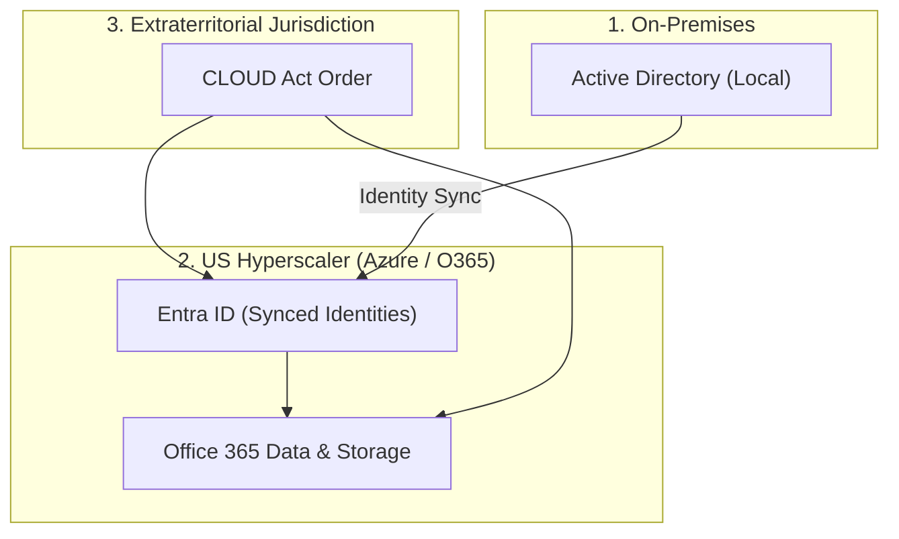
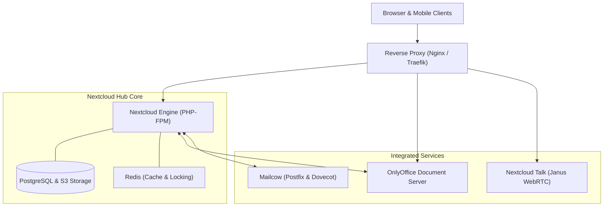
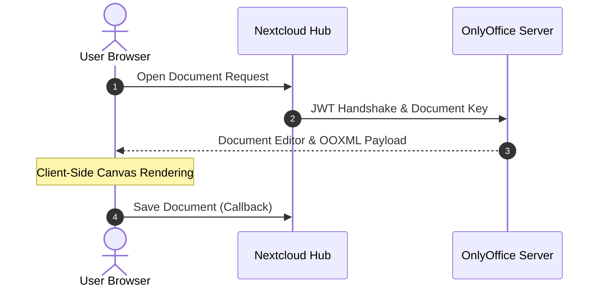
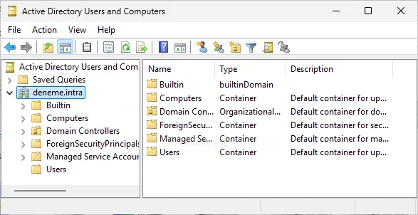

The past decade witnessed an aggressive industry transition from standalone desktop software to centralized SaaS paradigms. Today, the vast majority of institutional memory and operational workflows reside within closed commercial ecosystems dominated by Microsoft 365 (M365) and Google Workspace. Yet, as the classic industry adage reminds us: **"There is no cloud, it's just someone else's computer."**

<div class="video-container" style="position: relative; padding-bottom: 56.25%; height: 0; overflow: hidden; max-width: 100%; margin: 1.5rem 0; border-radius: 12px; box-shadow: 0 4px 15px rgba(0,0,0,0.3);">
  <iframe src="https://www.youtube.com/embed/CFdZWgiAj8I" title="What the devil is Cloud Computing?" style="position: absolute; top: 0; left: 0; width: 100%; height: 100%; border: 0;" allow="accelerometer; autoplay; clipboard-write; encrypted-media; gyroscope; picture-in-picture; web-share" allowfullscreen></iframe>
</div>

While these platforms offer real-time collaboration convenience, they introduce profound risks concerning data sovereignty, regulatory compliance (GDPR, international data residency), and supply chain dependency. Legal mechanisms such as the United States CLOUD Act mandate that data stored with US-headquartered providers remains subject to extraterritorial subpoenas regardless of physical server location.

In this architectural guide, we dissect the vendor lock-in mechanisms of traditional office ecosystems and present a complete blueprint for reclaiming data sovereignty — spanning individual developer engineering tooling (LaTeX, DuckDB, Slidev), enterprise Linux desktop strategies, and a self-hosted corporate collaboration stack (**Nextcloud Hub, OnlyOffice Document Server, and Mailcow**).

<div class="glass-panel reveal-on-scroll">

| Architectural Criterion | Public Cloud / Commercial SaaS | Sovereign Engineering & On-Prem Stack |
| :--- | :--- | :--- |
| **Data Ownership** | Proprietary XML archives held hostage on vendor servers | Plain-text simplicity and self-governed PostgreSQL storage |
| **Regulatory Standing** | Extraterritorial CLOUD Act exposure and continuous telemetry | Complete local data sovereignty and full GDPR compliance |
| **Collaboration & Diffs** | Binary conflicts and opaque tracked changes | Line-by-line Git diff analysis and on-premise OnlyOffice Canvas rendering |
| **Asset Longevity** | Account suspension triggers deletion queues | Independent, amortized infrastructure built to last decades |
| **Artificial Intelligence** | Corporate data transmitted to external LLM APIs | Autonomous on-premise models (Llama, Mistral) on internal GPUs |

</div>

---

## Cloud Dependency and the Data Sovereignty Crisis

While hyperscalers promote stringent privacy pledges for enterprise subscriptions, they construct steep operational barriers against data export and platform exit strategies. Effective control over organizational data remains bound to unilateral licensing terms.

When an M365 subscription terminates, customer data is not immediately returned to local storage. Instead, it enters a 30-day suspension window, followed by a permanent deletion queue between days 31 and 60. According to IDC research, 45% of digital enterprises now classify data sovereignty as their preeminent infrastructure concern.


### Microsoft's Cloud-First Pressure and Deprecation Strategies

To accelerate public cloud adoption, legacy software vendors systematically depress on-premises product support:

* **Windows Server and Azure Hybrid Innovations:** Microsoft has prioritized Azure-centric capabilities across core operating system releases. The Windows Server 2022 Datacenter: Azure Edition explicitly restricts features like zero-reboot Hotpatching, SMB over QUIC, and Azure Extended Networking exclusively to Azure-integrated virtual environments.
* **WSUS (Windows Server Update Services):** Formally marked as deprecated in late 2024. New feature development has halted, channeling IT administrators toward cloud-managed Intune, Windows Autopatch, and Azure Update Manager.
  
  

* **Windows Admin Center (WAC) and Azure Local:** Even surviving management tools like WAC are engineered to serve as ingestion funnels for Azure Arc and Azure Migrate. Azure Local (formerly Azure Stack HCI) reframes on-premises hardware as a hybrid extension managed and billed through Azure.
* **Identity Management and Active Directory:** While on-premises Active Directory Domain Services (AD DS) receives maintenance in Windows Server 2025 (optional 32k database page size, LAPS enhancements), the overwhelming majority of identity engineering targets **Microsoft Entra ID** (formerly Azure AD). The Azure AD Graph API is decommissioned in favor of Microsoft Graph, and organizations are actively pressured to federate on-premises directories via Azure AD Connect.

  

The following sequence illustrates how hybrid identity synchronization exposes corporate credentials to foreign jurisdictional warrants:



### Extraterritorial Jurisdiction and the US CLOUD Act

Microsoft routinely commits to data residency protections for European and international customers. However, statutory extraterritorial laws fundamentally conflict with regional data protection frameworks.

Under the U.S. CLOUD Act, American technology corporations are legally obligated to disclose customer records in their custody or control upon receipt of a lawful warrant, irrespective of physical server geography. In June 2025, during formal proceedings, **Microsoft France's General Counsel** acknowledged the reality: *"If requests from the U.S. are made in the correct legal form, Microsoft must provide the data."*


Analyses published by Heise and The Register highlight that physical location within European data centers does not guarantee sovereign immunity against extraterritorial judicial processes. Technical safeguards like Customer-Managed Keys (CMK/BYOK) and Azure Confidential Computing construct technical impediments, but they cannot eliminate statutory compliance obligations.

### Strategic Roadmap for On-Premises-Only Organizations

For enterprises committed to strict on-premises data isolation, a defense-in-depth framework is essential:

* **30-Day Comprehensive Inventory:** Catalog all operational workloads and telemetry pipelines using tools like Azure Migrate to uncover undocumented public cloud dependencies.
* **60-Day Data Classification & Isolation:** Segment sensitive institutional assets into air-gapped network enclaves physically separated from external routing.
* **Customer-Controlled Keys (CMK/BYOK):** Retain all cryptographic master keys within internal Hardware Security Modules (HSM) rather than managed cloud vaults.
* **Contractual Protections (DPA Audits):** Negotiate strict Data Processing Agreements specifying prompt breach disclosure timelines and verifiable data deletion terms.

---

## Document Engineering: Word Pitfalls and the Power of LaTeX

"What You See Is What You Get" (WYSIWYG) editors like Microsoft Word force writers to manipulate visual presentation simultaneously with conceptual logic. This conflation creates chronic technical debt: authors constantly battle inconsistent margins, fractured numbered lists, and erratic image anchoring.

### The DOCX Format and Version Control Hurdles

A `.docx` file is a zipped container of interdependent XML nodes. This binary-like layout breaks **Git** and standard version control workflows.

Because Git tracks line-by-line textual differences, a minor whitespace or style modification in Word rewrites multiple internal XML tags. Git interprets this as the deletion of the previous file and the addition of a totally new binary artifact, rendering branching, collaborative code reviews, and three-way merging impossible.

### LaTeX: Decoupling Content from Presentation

LaTeX enforces "What You Mean Is What You Get" (WYSIWYM), strictly isolating content from typographic rendering. The author focuses exclusively on structural markup (sections, equations, bibliographic keys), delegating typography to the typesetting engine:

* **Complete Git Integration:** Every sentence resides in transparent `.tex` plain text, enabling detailed commit histories and pull requests.
* **Template Independence:** A single raw document can compile into academic journal layouts, technical specifications, or executive summaries simply by swapping document classes.
* **Automated Revision Audits with latexdiff:** Generates visual difference PDFs in seconds, highlighting deletions in red and additions in blue for compliance audits.


---

## Transparency in Data Analytics: Excel Disasters vs. CSV and DuckDB

Microsoft Excel merges computation logic (formulas) and raw data into the same grid cells, producing opaque spreadsheets vulnerable to catastrophic silent errors.

### Historic Excel Catastrophes

* **UK COVID-19 Caseload Loss:** In October 2020, over 15,000 positive COVID-19 cases vanished from British national tracking records. The failure occurred when CSV laboratory feeds were imported into legacy `.xls` workbooks, causing Excel to silently truncate all data exceeding its 65,536-row ceiling.
* **Reinhart-Rogoff Economic Policy Error:** A widely cited macroeconomic paper that justified global austerity policies contained an Excel formula that mistakenly averaged 15 rows instead of 20, substantially misrepresenting GDP growth rates for years.
* **Genomic Nomenclature Corruption:** Excel's default auto-formatting routinely converted gene symbols like `MARCH1` into calendar dates ("March 1st"). The problem was so widespread that in 2020 international scientific bodies renamed 27 human genes solely to prevent spreadsheet corruption.

### DuckDB: Decoupling Compute from Storage

Modern data engineering principles demand a strict architectural separation: store raw data in open formats (CSV, Parquet) and execute analytic logic via auditable SQL queries.

DuckDB provides an in-process vectorized SQL OLAP engine optimized for analytical processing:
* **Columnar Storage:** Reads solely the columns required by the active query, drastically reducing disk I/O and memory saturation.
* **SIMD Vectorized Execution:** Leverages modern CPU vector extensions to process data in streaming chunks.
* **Auditable SQL Logic:** SQL transformation scripts are version-controlled alongside application code.

<div class="duckdb-flow reveal-on-scroll">
  <div class="flow-step">
    <div style="font-size: 2rem;">💾</div>
    <strong>Raw Storage</strong>
    <p style="font-size: 0.7rem;">.csv / .parquet</p>
  </div>
  <div class="flow-arrow">➔</div>
  <div class="flow-step" style="border-color: var(--app-accent-color);">
    <div style="font-size: 2rem;">🦆</div>
    <strong>DuckDB Engine</strong>
    <p style="font-size: 0.7rem;">Vectorized SQL Query</p>
  </div>
  <div class="flow-arrow">➔</div>
  <div class="flow-step">
    <div style="font-size: 2rem;">📊</div>
    <strong>Auditable Result</strong>
    <p style="font-size: 0.7rem;">Reproducible Analytics</p>
  </div>
</div>

<div class="glass-panel reveal-on-scroll">

| Analytical Dimension | Microsoft Excel | DuckDB (Vectorized SQL Engine) |
| :--- | :--- | :--- |
| **Scalability** | 1-Million Row Hard Limit (Memory Saturation) | Handles terabyte-scale datasets on single machines |
| **Logic Transparency** | Low (Formulas hidden inside individual cells) | Total (Independent, readable `.sql` query files) |
| **Type Integrity** | Fragile (Aggressive automatic type conversions) | Strict (Strongly typed, schema-validated execution) |
| **Version Control** | Binary file merge conflicts | Native Git compatibility with line-level diffs |

</div>

---

## Code-Driven Presentations: Slidev and the Modern Web Stack

Slide software like PowerPoint creates static snapshots. Copying an Excel chart into a presentation breaks the analytical pipeline, whenever underlying metrics update, slides must be manually re-exported and reformatted.

The engineering ecosystem is transitioning toward **Presentation-as-Code**, authoring slide decks using Markdown and standard web technologies (HTML, CSS, JavaScript).


### Slidev: Developer-Centric Slide Workflows

Built on Vue.js and Vite, **Slidev** transforms presentation design into modern web development:
* **Interactive Code Execution:** Embedded Monaco Editor allows presenters to write, edit, and execute code live during presentations.
* **Dynamic API Data Binding:** Connects directly to backend REST or GraphQL endpoints to render real-time charts.
* **Git-Native Single-Source:** The entire slide presentation lives inside a single `slides.md` file.

<div class="render-cards">
  <article class="render-card render-card-ssr reveal-on-scroll">
    <div class="render-card-head">
      <span class="render-badge" style="background: #42b883; color: #ffffff;">Slidev</span>
      <h3>Web Framework</h3>
    </div>
    
    <p>Powered by Vue components, live Monaco code execution, and dynamic web visualization integrations.</p>
  </article>

  <article class="render-card render-card-ssg reveal-on-scroll">
    <div class="render-card-head">
      <span class="render-badge" style="background: #3e82f7; color: #ffffff;">Marp</span>
      <h3>Minimalist Markdown</h3>
    </div>
    
    <p>Generates high-fidelity PDF and HTML slide decks directly from plain Markdown with zero configuration overhead.</p>
  </article>

  <article class="render-card render-card-csr reveal-on-scroll">
    <div class="render-card-head">
      <span class="render-badge" style="background: #111111; color: #ffffff;">Reveal.js</span>
      <h3>Interactive Canvas</h3>
    </div>
    
    <p>Supports 2D horizontal/vertical slide navigation, custom D3.js visual hooks, and interactive web elements.</p>
  </article>

  <article class="render-card render-card-isr reveal-on-scroll">
    <div class="render-card-head">
      <span class="render-badge" style="background: #000000; color: #ffffff;">Impress.js</span>
      <h3>3D Spatial Flow</h3>
    </div>
    
    <p>Leverages CSS3 3D transforms to pan, rotate, and zoom across an infinite virtual presentation canvas.</p>
  </article>
</div>

---

## Enterprise Sovereign Infrastructure: Nextcloud Hub, OnlyOffice, and Mailcow

While individual developers can adopt LaTeX and DuckDB independently, enterprise organizations require shared file systems, collaborative document editing, WebRTC videoconferencing, and corporate email.


The sovereign on-premises alternative to M365 and Google Workspace unites three open-source cornerstones: **Nextcloud Hub**, **OnlyOffice Document Server**, and **Mailcow**.




### Nextcloud Files and Storage Architecture

Nextcloud Files functions as the core WebDAV storage abstraction. For enterprise workloads exceeding 500 active users, proper storage architecture is critical:


* **ADA (Advanced Data Access) Engine:** Replaces the legacy monolithic `oc_filecache` table with sharded database tables for thumbnails, user avatars, and application metadata. This optimization shrinks core database footprints by 56% and eliminates up to 80% of unnecessary WebDAV PROPFIND queries.
* **Primary Object Storage (S3 / MinIO):** For petabyte-scale deployments, Nextcloud connects directly to S3-compatible object storage (MinIO or Ceph). Object payloads are stored flat using internal UUIDs, while file hierarchies and access rights are managed within PostgreSQL.

> [!CAUTION]
> **Architectural Pitfall:** Primary Object Storage must be configured during initial installation, migrating an active filesystem to primary S3 storage post-deployment causes data corruption. Furthermore, primary S3 storage bypasses Nextcloud's integrated BorgBackup volume snapshots. Disaster recovery workflows must decouple PostgreSQL database dumps (`pg_dump`) from asynchronous S3 bucket replication (MinIO Mirroring).

### OnlyOffice Document Editing: Client-Side Rendering (CSR)

For collaborative in-browser editing of Microsoft Office documents, the two open-source standards are **Collabora Online (CODE)** and **ONLYOFFICE**.


Their fundamental difference lies in their rendering architecture:

<div class="render-cards">
  <div class="render-card render-card-ssr">
    <div class="render-card-head">
      <span class="render-badge" style="background: #3e82f7; color: #ffffff;">Collabora Online</span>
      <h3>Server-Side Rendering (SSR)</h3>
    </div>
    <p>Runs a headless LibreOffice engine on the server, streaming rasterized document tiles to the client browser. Consumes 16 GB RAM for ~50 active users, high-latency connections cause noticeable typing lag.</p>
  </div>

  <div class="render-card render-card-csr">
    <div class="render-card-head">
      <span class="render-badge" style="background: #ff6f3c; color: #ffffff;">ONLYOFFICE Docs</span>
      <h3>Client-Side Rendering (CSR)</h3>
    </div>
    <p>Powered by an HTML5 Canvas and JavaScript rendering engine. The client machine executes layout rendering locally. 4 GB server RAM easily supports 100 concurrent sessions with 99% Microsoft OOXML fidelity.</p>
  </div>
</div>




> [!WARNING]
> **Reverse Proxy JWT Header Stripping:** Document exchanges between Nextcloud and OnlyOffice are cryptographically signed via JSON Web Tokens (JWT). Enterprise reverse proxies frequently strip standard `Authorization` headers. To resolve this, configure `local.json` in OnlyOffice to inspect a custom header name (e.g., `AuthorizationJwt`) and align Nextcloud's administration panel accordingly.
>
> **Community Edition Concurrency Limits:** The open-source OnlyOffice Docs Community Edition enforces a hardcoded limit of **20 concurrent browser tabs**. The 21st tab opens in read-only mode. For larger deployments, upgrade to OnlyOffice Enterprise or deploy resource-scaled Collabora clusters.

### Nextcloud Talk and High Performance Backend (HPB)

Nextcloud Talk provides WebRTC audio/video conferencing, team chat, and screen sharing:

* **Mesh / Peer-to-Peer Topology:** In default setups, participants stream video directly to each other. In a 5-person call, each client uploads 4 distinct video streams, exhausting client bandwidth and failing beyond 4-5 participants.
* **High Performance Backend (HPB - SFU Architecture):** Incorporates the Janus WebRTC Gateway and NATS messaging broker into a **Selective Forwarding Unit (SFU)**. Each user uploads a single video stream to Janus, which duplicates and routes packets to other peers. This enables reliable 20-50 participant enterprise conferences.

### Enterprise Messaging with Mailcow

Nextcloud's built-in Mail app is a lightweight webmail client rather than a standalone mail server. Maintaining email sovereignty requires hosting an independent containerized mail infrastructure such as **Mailcow** (Postfix, Dovecot, SOGo, Rspamd, ClamAV).


To guarantee email deliverability and avoid spam classification by external providers, configure the following DNS cryptographic records:

<div class="render-cards">
  <div class="render-card render-card-ssg">
    <div class="render-card-head">
      <span class="render-badge">SPF</span>
      <h3>Sender Policy Framework</h3>
    </div>
    <p>Authorizes specific server IP addresses to transmit email for the domain:</p>
    <code>v=spf1 mx a -all</code>
  </div>

  <div class="render-card render-card-isr">
    <div class="render-card-head">
      <span class="render-badge">DKIM</span>
      <h3>Cryptographic Signatures</h3>
    </div>
    <p>Asymmetric 2048-bit RSA keys published via DNS TXT records verify message integrity in transit.</p>
  </div>

  <div class="render-card render-card-ssr">
    <div class="render-card-head">
      <span class="render-badge">DMARC</span>
      <h3>Enforcement Policy</h3>
    </div>
    <p>Instructs receiving mail transfer agents to reject unaligned emails:</p>
    <code>v=DMARC1, p=reject, rua=mailto:postmaster@domain.com</code>
  </div>

  <div class="render-card render-card-csr">
    <div class="render-card-head">
      <span class="render-badge">rDNS / PTR</span>
      <h3>Reverse DNS Pointer</h3>
    </div>
    <p>Ensures server IP reverse lookup matches the fully qualified mail domain name exactly.</p>
  </div>
</div>

### Autonomous On-Premise Artificial Intelligence

Unlike M365 Copilot or Google Gemini, which stream corporate documents to cloud inference clusters, Nextcloud Hub deploys an **AppAPI** framework providing **100% on-premise AI**:

* **Isolated Execution:** Runs Python-based inference containers isolated from the main PHP-FPM web workers.
* **Self-Hosted LLMs:** Executes open-source models (**Llama**, **Mistral**) locally on enterprise GPUs for document synthesis and draft generation.
* **On-Prem Speech-to-Text:** Transcribes meeting recordings using local **Whisper** models with zero outbound data leakage.

### Enterprise Identity and Access Governance

* **LDAPS & OIDC Single Sign-On:** Synchronizes users via LDAPS (Port 636) with Active Directory or OpenLDAP. Integrates with Keycloak or Authentik using OpenID Connect (OIDC) to enforce centralized multi-factor authentication (FIDO2 / WebAuthn).
* **Data Loss Prevention (DLP) and ICAP:** The File Access Control engine inspects incoming uploads using the ICAP protocol, automatically classifying sensitive documents containing PII or financial tokens to prevent unauthorized public sharing.
* **Encryption Architectures:** Supports Server-Side Encryption (SSE) for encrypting files before writing to untrusted S3 backends, alongside client-managed End-to-End Encryption (E2EE) ensuring zero-knowledge isolation on desktop and mobile endpoints.

---

## Production Performance Tuning Checklist

To ensure high availability and prevent performance degradation under concurrent user load, apply the following optimizations across the infrastructure:


<div class="render-cards">
  <div class="render-card render-card-isr">
    <div class="render-card-head">
      <span class="render-badge">REDIS</span>
      <h3>Transactional Locking</h3>
    </div>
    <p>Offload file lock coordination from PostgreSQL to Redis and enforce a <code>noeviction</code> memory policy.</p>
  </div>

  <div class="render-card render-card-csr">
    <div class="render-card-head">
      <span class="render-badge">PHP-FPM</span>
      <h3>Static Worker Allocation</h3>
    </div>
    <p>Dimension workers using: <code>pm.max_children = (Total RAM - OS/DB RAM) / 100MB</code>.</p>
  </div>

  <div class="render-card render-card-ssr">
    <div class="render-card-head">
      <span class="render-badge">OPCACHE & JIT</span>
      <h3>Bytecode Optimization</h3>
    </div>
    <p>Enable JIT compilation via <code>opcache.jit=1255</code> and retain routing metadata with <code>opcache.save_comments=1</code>.</p>
  </div>

  <div class="render-card render-card-ssg">
    <div class="render-card-head">
      <span class="render-badge">SYSTEM CRON</span>
      <h3>Background Automation</h3>
    </div>
    <p>Replace slow web-driven AJAX triggers with a 5-minute system crontab executing <code>cron.php</code>.</p>
  </div>
</div>

### Redis File Locking Optimization
Concurrent sync operations query lock states continuously. Leaving locks on the primary database (`oc_file_locks`) creates severe disk I/O bottlenecks. Delegate lock coordination to Redis in `config.php`:
```php
'memcache.locking' => '\OC\Memcache\Redis',
```
The Redis eviction policy (`maxmemory-policy`) must be explicitly set to `noeviction` to prevent early eviction of active locks.

### Static PHP-FPM Worker Sizing
To prevent process churning under high concurrency, configure `pm = static`. Calculate maximum worker allocations using:
```text
max_children = (Total System RAM - OS & Database RAM) / Average Worker Memory Footprint (~100MB)
```
*Example:* On a 32 GB server reserving 16 GB for OS and PostgreSQL, allocate `pm.max_children = 150`.

### OPCache and JIT Configuration
Add the following directives to `php.ini` to accelerate PHP execution:
```ini
opcache.memory_consumption=256
opcache.max_accelerated_files=20000
opcache.interned_strings_buffer=32
opcache.jit=1255
opcache.save_comments=1 ; Disabling comments will break Nextcloud annotation routing and crash the application.
```

### System Crontab Execution
Avoid using default AJAX background job triggers. Schedule system-level cron jobs executing every 5 minutes:
```bash
*/5 * * * * php -f /var/www/nextcloud/cron.php
```

---

## Enterprise Operating System Alternative: Linux Desktop and Independent Governance

In response to Microsoft's aggressive cloud-first strategy, the deprecation of WSUS, and the forced migration of Active Directory to Entra ID, adopting open-source operating systems across client workstations is an essential strategic defense.

Linux desktop environments provide organizations with transparency and operational autonomy unattainable within closed commercial ecosystems:
* **Absolute Control and Zero Telemetry:** Eliminates background telemetry channels harvesting organizational behavior and communication topology.
* **Sovereign Local Processing:** Operations remain completely functional and resilient even under protracted internet outages.
* **Substantial TCO Advantages:** Eliminates per-seat Windows Client Access Licenses (CAL) and Office subscriptions, older hardware remains secure and performant for years.

### Enterprise Linux Distributions and Management Tooling

Distributions engineered for enterprise stability and long-term maintenance:

<div class="render-cards">
  <article class="render-card render-card-ssr reveal-on-scroll">
    <div class="render-card-head">
      <span class="render-badge" style="background: #e00; color: #ffffff;">RHEL & AlmaLinux</span>
      <h3>Enterprise Stability</h3>
    </div>
    <p>Red Hat ecosystem or free binary-compatible AlmaLinux. 10-year enterprise lifecycle support with strict ABI guarantees.</p>
  </article>

  <article class="render-card render-card-csr reveal-on-scroll">
    <div class="render-card-head">
      <span class="render-badge" style="background: #02d35f; color: #ffffff;">SUSE SLED</span>
      <h3>European Sovereignty</h3>
    </div>
    <p>SUSE Linux Enterprise Desktop, widely adopted across European public sector institutions for data sovereignty.</p>
  </article>

  <article class="render-card render-card-ssg reveal-on-scroll">
    <div class="render-card-head">
      <span class="render-badge" style="background: #e95420; color: #ffffff;">Ubuntu LTS</span>
      <h3>Broad Ecosystem</h3>
    </div>
    <p>Canonical 5-to-10 year LTS security maintenance, extensive hardware driver support, and deep developer tooling.</p>
  </article>

  <article class="render-card render-card-isr reveal-on-scroll">
    <div class="render-card-head">
      <span class="render-badge" style="background: #175ddc; color: #ffffff;">TÜBİTAK Pardus</span>
      <h3>National Distribution</h3>
    </div>
    <p>Debian-based corporate desktop widely deployed across Turkish public institutions, universities, and municipalities.</p>
  </article>
</div>

### Identity and Centralized Policy Governance (Active Directory and WSUS Alternatives)

Open-source tooling provides mature replacements for legacy Microsoft management infrastructure:



* **Active Directory Replacement (FreeIPA / Red Hat IdM):** Combines 389 Directory Server (LDAP), MIT Kerberos, Dogtag PKI, and BIND to provide centralized authentication, host-based access control (HBAC), and sudo rule enforcement.
* **Group Policy (GPO) Replacement (Ansible, Puppet, Fleet Commander):** Enforces declarative workstation configuration, desktop policies, and browser security baselines across thousands of endpoints.
* **WSUS Replacement (`dnf-automatic` & `unattended-upgrades`):** Automatically distributes vetted operating system security updates from internal local mirrors without relying on external cloud endpoints.

### Real-World Case Studies and Phased Migration Strategy

* **City of Munich LiMux Initiative:** Deployed Linux and open-source office tooling across 15,000 desktop workstations, establishing independence from proprietary vendor lock-in.
* **French National Gendarmerie (GendBuntu):** Migrated 37,000 workstations to customized Ubuntu installations, realizing substantial annual licensing savings and total operational sovereignty.
* **Andalusia Regional Government (Spain):** Deployed over 220,000 Linux desktop systems across regional educational institutions.

> [!TIP]
> **Phased Migration Strategy:** Enterprise transitions must avoid overnight "big bang" switchovers. Begin with non-critical technical and support units, establish thorough end-user training curriculums, and accommodate legacy Windows applications using web interfaces, Wine compatibility layers, or isolated virtual machines.

---

## Open-Source Desktop Alternatives and Proprietary Ecosystem Analysis

For non-technical staff requiring traditional office application suites, open-source desktop suites provide powerful capabilities without compromising privacy:

* **LibreOffice:** Built on the ISO standard Open Document Format (ODF), completely offline, and free from diagnostic telemetry.
* **ONLYOFFICE Desktop:** Provides a modern tabbed ribbon interface with near-native fidelity for Microsoft OOXML formats (.docx, .xlsx, .pptx).

<div class="render-cards">
  <article class="render-card render-card-ssr reveal-on-scroll">
    <div class="render-card-head">
      <span class="render-badge" style="background: #ff6f3c; color: #ffffff;">ONLYOFFICE</span>
      <h3>Modern Compatibility</h3>
    </div>
    
    <p>Native OOXML architecture and integrated Nextcloud collaboration with high visual parity to Microsoft files.</p>
  </article>

  <article class="render-card render-card-csr reveal-on-scroll">
    <div class="render-card-head">
      <span class="render-badge" style="background: #3a7610; color: #ffffff;">LibreOffice</span>
      <h3>Sovereign Fortress</h3>
    </div>
    
    <p>Strict ODF standards, zero telemetry, and completely offline execution. The uncompromising defender of data privacy.</p>
  </article>
  <article class="render-card render-card-ssg reveal-on-scroll">
    <div class="render-card-head">
      <span class="render-badge" style="background: #0e85cd; color: #ffffff;">Apache OpenOffice</span>
      <h3>Legacy Ancestor</h3>
    </div>
    
    <p>The OpenOffice.org lineage that LibreOffice forked from in 2010. Development has largely stalled, so it is not recommended for new deployments.</p>
  </article>
</div>

<div class="glass-panel reveal-on-scroll">

| Comparison Metric | LibreOffice | ONLYOFFICE Docs |
| :--- | :--- | :--- |
| **Primary Document Format** | ODF (Open Document Format - ODT/ODS) | OOXML (Microsoft Standard - DOCX/XLSX) |
| **MS Office Compatibility** | Advanced (via conversion layer) | Native (Near 1:1 layout fidelity) |
| **User Interface** | Classic menus or configurable NotebookBar | Modern tabbed ribbon layout |
| **Real-Time Collaboration** | Via Collabora Online integration | Native Document Server clustering |

</div>

### The Lock-in Anatomy of Proprietary Ecosystems

Migrating between commercial SaaS vendors does not establish data sovereignty, it merely changes which corporation controls your data:

<div class="render-cards">
  <article class="render-card render-card-ssr reveal-on-scroll">
    <div class="render-card-head">
      <span class="render-badge" style="background: #d83b01; color: #ffffff;">Microsoft 365</span>
      <h3>Ecosystem Lock-in</h3>
    </div>
    
    <p>The industry benchmark for vendor lock-in. Polished operational workflows that permanently capture organizational memory.</p>
  </article>

  <article class="render-card render-card-ssr reveal-on-scroll">
    <div class="render-card-head">
      <span class="render-badge" style="background: #4285f4; color: #ffffff;">Google Docs</span>
      <h3>SaaS Monopoly</h3>
    </div>
    
    <p>Escaping Microsoft into Google Workspace merely transfers custody to another centralized data processor.</p>
  </article>

  <article class="render-card render-card-csr reveal-on-scroll">
    <div class="render-card-head">
      <span class="render-badge" style="background: #f47b20; color: #ffffff;">Zoho Office</span>
      <h3>Proprietary Cloud</h3>
    </div>
    
    <p>Offers a rich application portfolio but remains hosted entirely on vendor infrastructure beyond sovereign control.</p>
  </article>

  <article class="render-card render-card-ssg reveal-on-scroll">
    <div class="render-card-head">
      <span class="render-badge" style="background: #000000; color: #ffffff;">Apple iWork</span>
      <h3>Hardware Boundary</h3>
    </div>
    
    <p>Binds users strictly to Apple hardware and iCloud. Proprietary file formats remain incompatible with Git.</p>
  </article>

  <article class="render-card render-card-ssr reveal-on-scroll">
    <div class="render-card-head">
      <span class="render-badge" style="background: #e11d48; color: #ffffff;">WPS Office</span>
      <h3>Commercial Clone</h3>
    </div>
    
    <p>Offers high MS Office compatibility but operates as closed-source commercial software with telemetry concerns.</p>
  </article>

  <article class="render-card render-card-ssr reveal-on-scroll">
    <div class="render-card-head">
      <span class="render-badge" style="background: #2563eb; color: #ffffff;">FreeOffice</span>
      <h3>Lightweight Suite</h3>
    </div>
    
    <p>Fast on entry-level hardware but closed-source, lacks an enterprise-grade self-hosted collaboration roadmap.</p>
  </article>
</div>

---

## Complementary Engineering Tools for Digital Freedom

Additional open-source tools empowering sovereign workflows:

<div class="render-cards">
  <article class="render-card render-card-ssr reveal-on-scroll" style="border: 1px solid rgba(var(--app-accent-rgb, 37, 99, 235), 0.3);">
    <div class="render-card-head">
      <span class="render-badge" style="background: #4752b2; color: #ffffff;">Quarto</span>
      <h3>Scientific Publishing</h3>
    </div>
    <p>The modern bridge between LaTeX and Markdown. Compiles Python/R code, data tables, and narrative into PDF or Web outputs.</p>
  </article>

  <article class="render-card render-card-csr reveal-on-scroll" style="border: 1px solid rgba(var(--app-accent-rgb, 37, 99, 235), 0.3);">
    <div class="render-card-head">
      <span class="render-badge" style="background: #313131; color: #ffffff;">Zotero</span>
      <h3>Reference Manager</h3>
    </div>
    <p>Manages academic bibliographies independently via self-hosted WebDAV storage (Nextcloud) instead of commercial SaaS.</p>
  </article>

  <article class="render-card render-card-ssg reveal-on-scroll" style="border: 1px solid rgba(var(--app-accent-rgb, 37, 99, 235), 0.3);">
    <div class="render-card-head">
      <span class="render-badge" style="background: #ff3e00; color: #ffffff;">Mermaid.js</span>
      <h3>Diagrams as Code</h3>
    </div>
    <p>Renders complex system architectures from text syntax, eliminating dependencies on proprietary drawing software.</p>
  </article>

  <article class="render-card render-card-isr reveal-on-scroll" style="border: 1px solid rgba(var(--app-accent-rgb, 37, 99, 235), 0.3);">
    <div class="render-card-head">
      <span class="render-badge" style="background: #175ddc; color: #ffffff;">Vaultwarden</span>
      <h3>Sovereign Vault</h3>
    </div>
    <p>Self-hosted, lightweight Bitwarden-compatible password vault keeping enterprise credentials within private infrastructure.</p>
  </article>
</div>

---

The short-term convenience of proprietary cloud suites must not become an excuse for forfeiting ownership of organizational memory and mission-critical data. Structuring documents with LaTeX, querying datasets locally with DuckDB, authoring presentations with Slidev, and anchoring collaboration onto self-hosted Nextcloud, OnlyOffice, and Mailcow infrastructure is not just a tooling preference—it is a conscious commitment to digital independence.

Be the architect of your own data, reclaim your sovereignty!

---

## References and Further Reading

1. **Nextcloud Hub Architectural Documentation:** Nextcloud Server Administration Guide & High Performance Backend Documentation. Nextcloud GmbH.
2. **ONLYOFFICE Document Server:** ONLYOFFICE API and Integration Documentation for Nextcloud and Enterprise Storage. Ascensio System SIA.
3. **Mailcow: dockerized:** Mailcow Official Documentation: Modular E-Mail Stack with Postfix, Dovecot, SOGo, and Rspamd.
4. **LaTeX Project:** Documentation and The Comprehensive TeX Archive Network (CTAN). LaTeX3 Project.
5. **DuckDB Documentation:** In-Process Columnar SQL OLAP Engine Documentation and Benchmark Reports. DuckDB Foundation.
6. **Slidev Documentation:** Presentation Infrastructure for Developers: Vue & Vite Markdown Driven Slides.
7. **US CLOUD Act Legal Framework:** Clarifying Lawful Overseas Use of Data Act: Extraterritorial Data Transfer and Cross-Border Considerations. U.S. Department of Justice.
8. **Microsoft Learn & Tech Community:** Windows Server 2022/2025 Features, WSUS Deprecation Guidance, Azure Local Architecture, and Azure AD Graph to Microsoft Graph Migration.
9. **Heise Online & The Register:** Legal and Sovereignty Analyses of US CLOUD Act on European Cloud Operations and Microsoft France Disclosures.
10. **LiMux & European Open Source Public Deployments:** City of Munich Open Source Strategy, French Gendarmerie GendBuntu Project, and Andalusian Educational Deployments.
