Son yıllarda masaüstü yazılımlardan bulut tabanlı SaaS modellerine hızlı bir geçiş yaşadık. Günümüzde kurumsal hafızanın ve günlük iş süreçlerinin büyük kısmı Microsoft 365 (M365) ve Google Workspace gibi genel bulut sağlayıcılarının kapalı ekosistemlerinde rehin tutuluyor. Teknoloji dünyasındaki o meşhur aforizmanın hatırlattığı gibi: **"Bulut diye bir şey yoktur, o sadece başkasının bilgisayarıdır."**

<div class="video-container" style="position: relative; padding-bottom: 56.25%; height: 0; overflow: hidden; max-width: 100%; margin: 1.5rem 0; border-radius: 12px; box-shadow: 0 4px 15px rgba(0,0,0,0.3);">
  <iframe src="https://www.youtube.com/embed/CFdZWgiAj8I" title="What the devil is Cloud Computing?" style="position: absolute; top: 0; left: 0; width: 100%; height: 100%; border: 0;" allow="accelerometer; autoplay; clipboard-write; encrypted-media; gyroscope; picture-in-picture; web-share" allowfullscreen></iframe>
</div>

Bu platformlar anlık işbirliği kolaylığı getirse de veri egemenliği, yasal uyumluluk (GDPR, KVKK) ve siber güvenlik açılarından kurumsal yöneticileri derin bir açmazla baş başa bırakıyor. ABD Bulut Yasası (US Cloud Act) gibi düzenlemeler, verileriniz hangi coğrafyada depolanırsa depolansın yabancı otoritelerin tek taraflı taleplerine açık kapı bırakıyor. 

Bu rehberde, ofis ekosistemlerinin oluşturduğu bağımlılık zincirini kırmayı, hem bireysel mühendislik araçlarıyla (LaTeX, DuckDB, Slidev) hem kurumsal Linux masaüstü stratejileriyle, hem de kurum içi barındırılan egemen altyapılarla (**Nextcloud Hub, OnlyOffice Document Server ve Mailcow**) veri egemenliğimizi nasıl geri kazanacağımızı uçtan uca inceliyoruz.

<div class="glass-panel reveal-on-scroll">

| Mimari Kriter | Genel Bulut / SaaS Modelleri | Egemen Mühendislik ve On-Prem Stack |
| :--- | :--- | :--- |
| **Veri Mülkiyeti** | Sağlayıcının sunucularında kapalı XML yığınları | Düz metin (Plain-Text) ve kendi denetiminizdeki veritabanı |
| **Yasal Güvenlik** | US Cloud Act ve sınır ötesi telemetri taraması | Yerel sunucularda tam egemenlik, %100 yerel KVKK/GDPR uyumu |
| **İşbirliği ve Versiyonlama** | E-posta ekleri ve bozuk ikili dosya çakışmaları | Git ile satır satır diff analizi, yerel OnlyOffice / Nextcloud işbirliği |
| **Altyapı Ömrü** | Abonelik iptalinde verilerin silinme kuyruğuna alınması | Yıllarca kararlılıkla çalışan bağımsız, amorti edilmiş altyapı |
| **Yapay Zeka (AI)** | Kurumsal verilerin dış LLM sağlayıcılarına aktarımı | Sunucunuzun GPU'sunda çalışan otonom yerel modeller (Llama, Mistral) |

</div>

---

## Bulut Bağımlılığı ve Veri Egemenliği Krizi

Google ve Microsoft gibi teknoloji devleri kurumsal aboneliklerde veri gizliliği sözleşmeleri vadetse de veriyi dışa aktarma (exit strategy) süreçlerinde aşılması güç operasyonel duvarlar örer. Belgelerimiz üzerindeki fiili kontrolümüz, sağlayıcının tek taraflı olarak revize edebileceği lisans politikalarına rehindir.

Örneğin bir M365 aboneliği iptal edildiğinde kurumsal veriler anında yerel sunuculara teslim edilmez. İlk 30 günlük askıya alma periyodunda hizmetlere erişim dondurulur, 31 ila 60. günler arasında ise veriler kalıcı olarak silinme kuyruğuna alınır. IDC araştırmalarına göre dijital kurumların %45'i veri egemenliğini en kritik güvenlik endişesi olarak görmektedir.

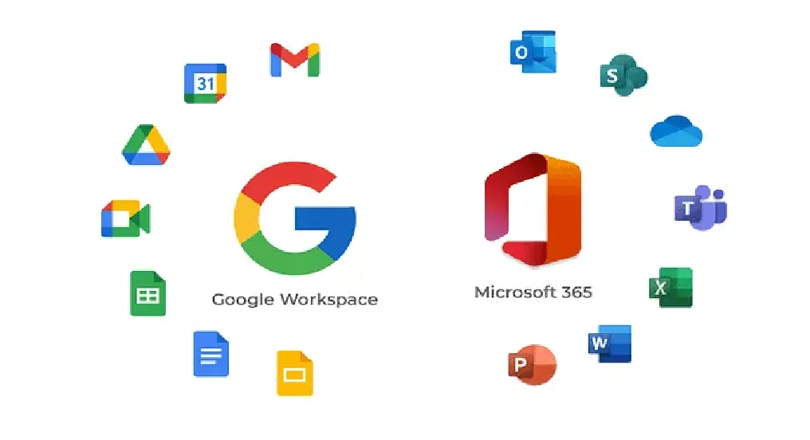

### Microsoft'un Bulut Odaklı (Cloud-First) Baskısı ve Deprecation Riskleri

Büyük yazılım sağlayıcıları, kurumları genel buluta taşınmaya zorlamak amacıyla yerel (on-premises) ürün yatırımlarını kademeli olarak durdurmaktadır:

* **Windows Server ve Azure Hibrit Entegrasyonu:** Microsoft, ürün geliştirmede ağırlığı Azure odaklı hibrit özelliklere vermiştir. Örneğin Windows Server 2022 Datacenter: Azure Edition, kesintisiz güncelleme sunan Hotpatch, SMB over QUIC ve Azure Extended Networking gibi buluta bağımlı özelliklerle donatılmıştır.
* **WSUS (Windows Server Update Services):** Eylül 2024’te Microsoft, WSUS’un resmi olarak "kullanımdan kaldırılmış" (deprecated) ilan edildiğini duyurmuştur. Yeni özellik yatırımı durdurulmuş, güncelleme yönetimi doğrudan bulut tabanlı Windows Autopatch, Intune ve Azure Update Manager'a yönlendirilmiştir.
  
  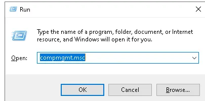

* **Windows Admin Center (WAC) ve Azure Local:** WAC gibi yaşayan yerel araçlar dahi Azure Arc ve Azure Migrate entegrasyonlarıyla bulut köprüsüne dönüştürülmüştür. Eski adıyla Azure Stack HCI, yeni adıyla **Azure Local** ise on-prem donanımı tamamen terk etmek yerine altyapıyı "Azure ile birleştirilmiş" bir hibrit model olarak konumlandırmaktadır.
* **Kimlik Yönetimi ve On-Prem Active Directory:** Klasik Active Directory (AD DS) Windows Server 2025 ile 32k veritabanı sayfa boyutu ve LAPS geliştirmeleri alsa da kimlik yatırımlarının %90'ı bulut tabanlı **Microsoft Entra ID** (eski Azure AD) platformuna kaydırılmıştır. Azure AD Graph API 2025 sonu itibarıyla emekliye ayrılmakta ve kurumlar Azure AD Connect ile kimliklerini buluta taşımaya teşvik edilmektedir.

  

Aşağıdaki mimari şema, yerel kimlik bilgilerinin buluta taşınmasıyla yabancı hukuk otoritelerinin erişim yetkisine nasıl açık hale geldiğini modeller:

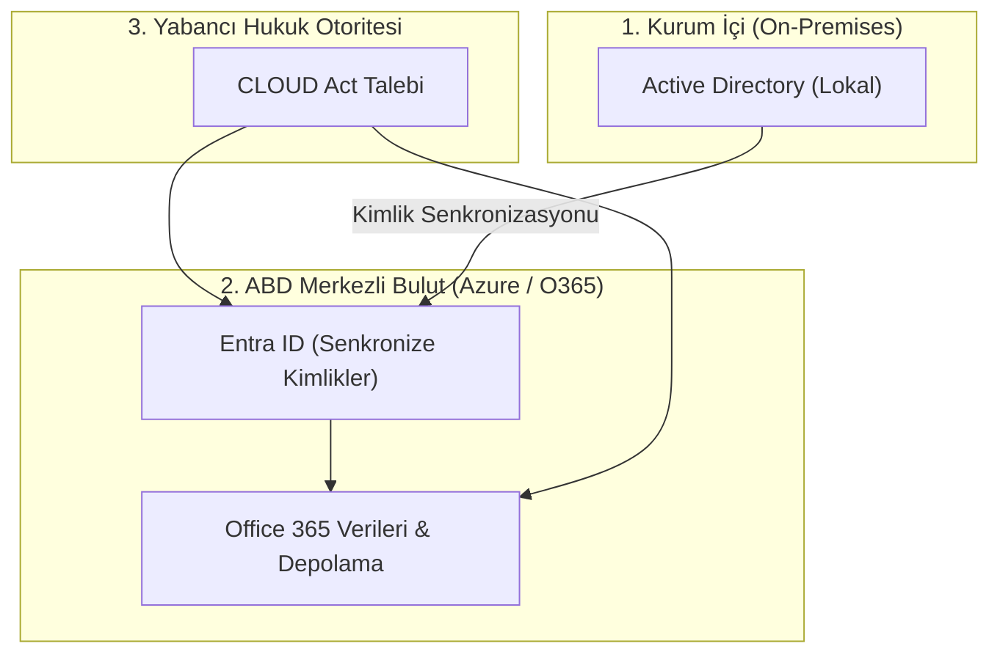

### Hukuki Gerçekler ve Yabancı Mahkeme Kararları (US CLOUD Act)

Microsoft, Avrupa dahil olmak üzere müşterilerine veri koruma taahhütleri sunmaktadır, örneğin Avrupa bulut verilerinin yerel ekiplerce denetleneceğini duyurmuştur. Ancak uluslararası hukuki çerçeveler bu taahhütlerin arkasındaki koruma kalkanını kırmaktadır.

ABD CLOUD Act nedeniyle Microsoft, yasal olarak geçerli bir federal erişim talebi geldiğinde verileri sağlamakla yükümlüdür. Nitekim **Microsoft Fransa Genel Hukuk Müşaviri**, Haziran 2025'teki resmi bir soruşturmada şu kritik itirafta bulunmuştur: *"ABD'den gelen talepler yasal formatta yapıldığı takdirde Microsoft bu verileri sağlamak zorundadır."*

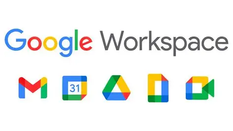

Heise ve The Register raporlarında da vurgulandığı üzere, veriler fiziksel olarak Avrupa sınırları içinde tutulsa dahi sağlayıcının tabi olduğu ana merkez yasaları gereğince uluslararası yargı emirleri karşısında mutlak bir veri egemenliği garantisi verilememektedir. Müşteri Tarafından Yönetilen Anahtarlar (Customer-Managed Keys / BYOK) veya Azure Confidential Computing gibi teknolojiler ek bir teknik engel koysa da hukuki erişim taleplerini sistematik olarak ortadan kaldıramaz.

### Yerel (On-Prem-Only) Kurumlar İçin Savunma Adımları

Verilerini asla kurum dışına çıkarmak istemeyen yapılar için teknik, sözleşmesel ve operasyonel bir yol haritası şarttır:

* **30 Günlük Kapsamlı Envanter:** Hangi verilerin ve servislerin bulutta barındığını, hangi verilerin hassas olduğunu Azure Migrate gibi araçlarla haritalandırın.
* **60 Günlük Erişim ve İzolasyon Politikası:** Kritik verilerin kurum dışına çıkmasını engelleyen hava boşluklu (air-gapped) izole ağ segmentleri kurgulayın.
* **Müşteri Kontrolündeki Anahtarlar (CMK/BYOK):** Azure veya M365 kullanılacaksa şifreleme anahtarlarını kurum içi Donanımsal Güvenlik Modüllerinde (HSM) tutun.
* **Sözleşmesel Güvenceler (DPA):** Veri işleme, sınır ötesi erişim ve ihlal bildirim sürelerini kapsayan veri işleme eklerini (DPA) hukuki denetime tabi tutun.

---

## Belge Mühendisliği: Word'ün Hataları ve LaTeX'in Gücü

Microsoft Word gibi "Gördüğünü Alırsın" (WYSIWYG) mantığıyla çalışan editörler, günlük kısa notlar için pratik görünse de teknik ve kurumsal dokümantasyonda kronik bir mimari borç üretir. Yazarın doğrudan nihai görsel çıktı üzerinde çalışması, içerik ile biçimlendirmenin birbirine kilitlenmesine yol açar. Sayfa sonları, kayan numaralandırmalar ve metni dağıtan görseller gibi tipografik ayrıntılar yazarın asıl işini böler.

### DOCX'in Teknik Borcu ve Versiyonlama Sorunu

Bir `.docx` dosyası aslında sıkıştırılmış bir XML arşivinden ibarettir. Bu yapı, yazılım mühendisliğinin kalbi olan **Git** ve benzeri sürüm kontrol sistemleriyle tamamen uyumsuzdur.

Git satır satır değişiklikleri (diff) takip eder. Ancak Word belgesinde yapılan tek bir boşluk veya stil değişikliği, arka plandaki XML düğümlerinin tamamını değiştirir. Git bu durumu eski dosyanın silinip yerine bambaşka bir ikili (binary) dosyanın eklenmesi olarak algılar. Ekiplerin aynı doküman üzerinde dallanarak (branching) çalışması veya çakışmaları çözmesi (merge) imkansız hale gelir.

### LaTeX ile Mantıksal Yapı ve Tasarım Ayrımı

LaTeX ise "Ne Demek İstiyorsan Onu Alırsın" (WYSIWYM) yaklaşımıyla içeriği tasarımdan kesin çizgilerle ayırır. Yazar sadece belgenin mantıksal kurgusuna (bölümler, formüller, referanslar) odaklanır, tipografik dizgiyi arka plandaki derleme motoru üstlenir.

* **Tam Git Uyumluluğu:** Her cümle düz metin olarak kaydedildiği için her değişiklik şeffaf bir commit geçmişiyle izlenir.
* **Şablon Esnekliği:** Tek bir `.tex` kaynak metnine farklı stil paketleri uygulanarak saniyeler içinde akademik makale, teknik şartname veya kurumsal rapor üretilebilir.
* **latexdiff ile Kusursuz Karşılaştırma:** İki sürüm arasındaki farklar saniyeler içinde renkli işaretlemelerle (silinenler kırmızı/çizili, eklenenler mavi) derlenerek denetçilere sunulabilir.

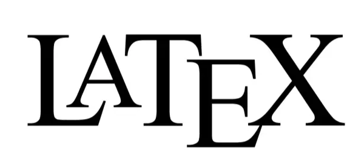

---

## Veri Analitiğinde Şeffaflık: Excel Felaketleri vs. CSV ve DuckDB Mimarisi

Microsoft Excel, hesaplama mantığı (formül) ile veriyi aynı ızgara hücrelerinde birleştirerek insan hatasına fazlasıyla açık, denetlenemez bir zemin yaratır.

### Tarihteki Kritik Excel Hataları

* **İngiltere COVID-19 Vaka Kaybı:** Ekim 2020'de 15 binden fazla pozitif vaka kamu sağlığı kayıtlarından silindi. Nedeni, laboratuvarlardan gelen CSV verilerinin eski `.xls` formatına aktarılması ve Excel'in 65.536 satır sınırını aşan kayıtları sessizce budamasıydı.
* **Reinhart-Rogoff Ekonomi Politikası Skandalı:** Küresel kemer sıkma politikalarını gerekçelendiren akademik bir çalışmada, Excel formülünün 20 satır yerine yanlışlıkla 15 satırı kapsaması nedeniyle ortalama büyüme verisi hatalı hesaplandı. Formüller hücre içine gömülü olduğundan bu hata yıllarca fark edilemedi.
* **Genetik Terimlerin Otomatik Bozulması:** Excel'in otomatik tür dönüştürme algoritması, `MARCH1` gibi gen adlarını "1 Mart" tarihine çevirdi. Sırf Excel'in bu ısrarlı davranışı yüzünden 2020 yılında 27 insan geninin adı uluslararası komitelerce değiştirilmek zorunda kalındı.

### DuckDB: Mantık ve Depolamanın Kesin Ayrımı

Modern veri mühendisliğinde kural basittir: Veri (storage) CSV veya Parquet gibi açık formatlarda tutulmalı, analiz mantığı (compute) ise SQL sorgularıyla yürütülmelidir.

DuckDB, ilişkisel SQL gücünü süreç içi (in-process) çalışan vektörel bir motorla birleştirir:
* **Sütun Tabanlı Saklama (Columnar Storage):** Yalnızca sorgulanan sütunları diskten okuyarak bellek ve G/Ç (I/O) yükünü minimuma indirir.
* **SIMD Vektörel Sorgu İşleme:** Modern işlemcilerin SIMD komut setlerini kullanarak milyonlarca satırı paralel olarak işler.
* **Git ile Versiyonlanabilir Mantık:** Tüm veri analitiği adımları `.sql` dosyaları olarak Git üzerinde denetlenebilir ve tekrarlanabilir (reproducible) hale gelir.

<div class="duckdb-flow reveal-on-scroll">
  <div class="flow-step">
    <div style="font-size: 2rem;">💾</div>
    <strong>Ham Veri</strong>
    <p style="font-size: 0.7rem;">.csv / .parquet</p>
  </div>
  <div class="flow-arrow">➔</div>
  <div class="flow-step" style="border-color: var(--app-accent-color);">
    <div style="font-size: 2rem;">🦆</div>
    <strong>DuckDB Motoru</strong>
    <p style="font-size: 0.7rem;">Vektörel SQL Sorgusu</p>
  </div>
  <div class="flow-arrow">➔</div>
  <div class="flow-step">
    <div style="font-size: 2rem;">📊</div>
    <strong>Şeffaf Sonuç</strong>
    <p style="font-size: 0.7rem;">Tekrarlanabilir Çıktı</p>
  </div>
</div>

<div class="glass-panel reveal-on-scroll">

| Analitik Kriter | Microsoft Excel | DuckDB (Vektörel SQL Motoru) |
| :--- | :--- | :--- |
| **İşlem Kapasitesi** | 1 Milyon Satır Limiti (Bellek Tıkanması) | Terabaytlarca veri (Disk/RAM verimli) |
| **Mantıksal Şeffaflık** | Düşük (Hücrelerin içine gömülü formüller) | Çok Yüksek (Açık, incelenebilir SQL betikleri) |
| **Tür Güvenliği** | Zayıf (Otomatik tarih ve format dönüşümleri) | Katı (Şemalı, katı tür denetimi) |
| **Versiyon Kontrolü** | İkili dosya çakışmaları, imkansız diff | Kusursuz (Git diff/merge uyumlu düz metin) |

</div>

---

## Sunum Mimarisinde Kod Dönemi: Slidev ve Modern Web Stack

PowerPoint ve benzeri geleneksel araçlar veriyi slayt içine yapıştırarak statikleştirir. Excel'den kopyalanan bir grafik sunuma eklendiği an veriden kopar, veri tabanında bir rakam değiştiğinde tüm slaytları tek tek elle güncellemek gerekir.

Mühendislik dünyası sunumları da bir yazılım projesi gibi ele alan **"Sunum Kod Olarak" (Presentation-as-Code)** yaklaşımına evrilmektedir.

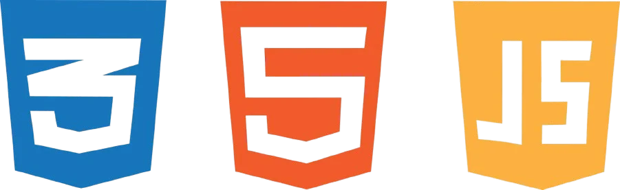

### Slidev: Web Mimarisinin Zirvesi

Vue.js ve Vite üzerine kurulu **Slidev**, slayt hazırlamayı modern bir web geliştirme deneyimine dönüştürür:
* **Canlı Kod Çalıştırma:** Monaco Editor entegrasyonu sayesinde slayt üzerinden ayrılmadan canlı kod çalıştırılabilir.
* **Dinamik Veri Bağlama:** REST veya GraphQL API'lerinden anlık veri çekilerek sunum esnasında güncel grafikler çizilebilir.
* **Tek Dosyada Git İşbirliği:** Sunum içeriği tek bir `slides.md` dosyasında yaşar.

<div class="render-cards">
  <article class="render-card render-card-ssr reveal-on-scroll">
    <div class="render-card-head">
      <span class="render-badge" style="background: #42b883; color: #ffffff;">Slidev</span>
      <h3>Web Mimarisi</h3>
    </div>
    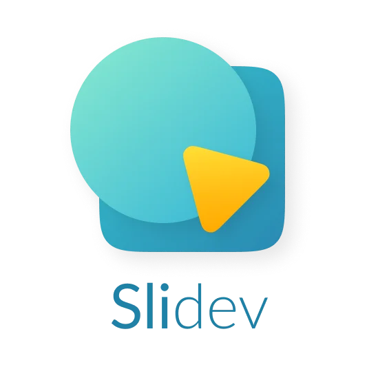
    <p>Vue bileşenleri, dinamik API verileri ve Monaco Editor ile slayt üzerinde canlı kod çalıştırma imkanı.</p>
  </article>

  <article class="render-card render-card-ssg reveal-on-scroll">
    <div class="render-card-head">
      <span class="render-badge" style="background: #3e82f7; color: #ffffff;">Marp</span>
      <h3>Minimalist ve Hızlı</h3>
    </div>
    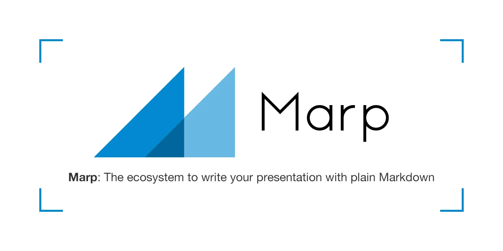
    <p>Görsel karmaşayla uğraşmadan yalnızca standart Markdown sözdizimiyle anında PDF ve HTML sunumlar üretir.</p>
  </article>

  <article class="render-card render-card-csr reveal-on-scroll">
    <div class="render-card-head">
      <span class="render-badge" style="background: #111111; color: #ffffff;">Reveal.js</span>
      <h3>Etkileşimli Çerçeve</h3>
    </div>
    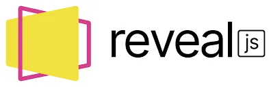
    <p>HTML5 ve D3.js ile iç içe çalışan, iki boyutlu yatay ve dikey slayt navigasyonu sunan güçlü kütüphane.</p>
  </article>

  <article class="render-card render-card-isr reveal-on-scroll">
    <div class="render-card-head">
      <span class="render-badge" style="background: #000000; color: #ffffff;">Impress.js</span>
      <h3>3D Görsel Derinlik</h3>
    </div>
    
    <p>CSS3 dönüşümleriyle sınırsız bir tuval üzerinde dönen ve derinleşen sinematik sunumlar kurgular.</p>
  </article>
</div>

---

## Kurumsal Egemen Altyapı: Nextcloud Hub, OnlyOffice ve Mailcow

Mühendislerin kişisel iş akışlarını LaTeX ve DuckDB ile bağımsızlaştırması harika bir ilk adımdır, ancak yüzlerce çalışanı olan kurumlarda ortak dosya depolama, ofis belgelerini tarayıcıda canlı düzenleme, görüntülü toplantı ve kurumsal e-posta ihtiyaçları devam eder.

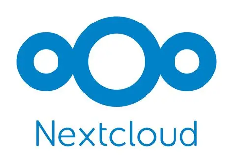

Bu gereksinimleri genel bulut devlerine teslim etmeden karşılayan açık kaynaklı altın standart: **Nextcloud Hub**, **OnlyOffice Document Server** ve **Mailcow** üçlüsüdür.


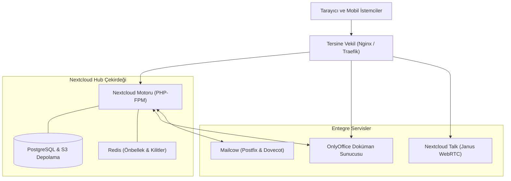

### Nextcloud Files ve Depolama Optimizasyonu

Nextcloud Files, WebDAV protokolü üzerinde inşa edilmiş çekirdek depolama katmanıdır. 500'den fazla kullanıcılı kurumsal ortamlarda veritabanı G/Ç darboğazını önlemek için şu mimari stratejiler uygulanır:

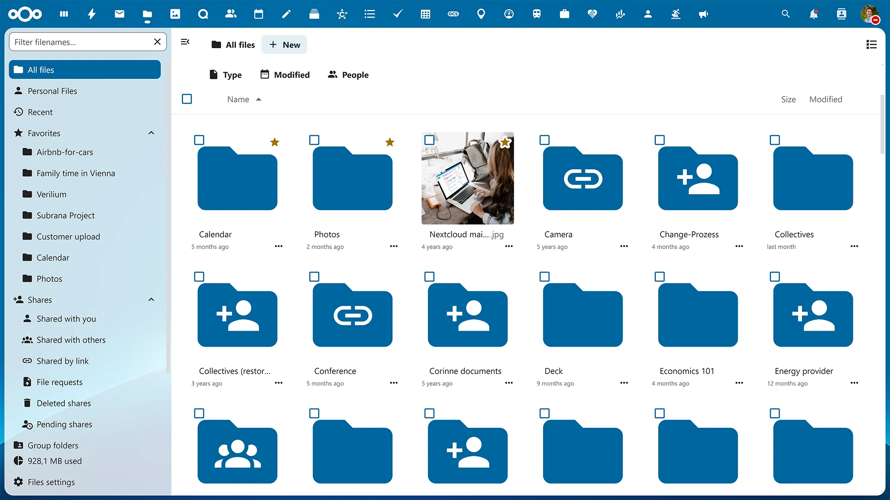

* **ADA (Advanced Data Access) Engine:** Eski sürümlerdeki monolitik `oc_filecache` tablosunu parçalayarak (database sharding) küçük resim önizlemelerini ve uygulama meta verilerini ayrı tablolara taşır. Bu sayede veritabanı boyutu %56 küçülür ve WebDAV durum sorguları (PROPFIND) %80 oranında azalır.
* **Primary Object Storage (S3 / MinIO):** Petabayt seviyesindeki dosya depolaması için geleneksel NFS veya yerel disk dizileri yerine S3 uyumlu nesne depolama kullanılır. Dosyalar S3 üzerinde düz (flat) bir yapıda UUID'lerle saklanırken, klasör hiyerarşisi PostgreSQL'de tutulur.

> [!CAUTION]
> **Kritik Mimari Not:** Primary Object Storage yapılandırması yalnızca kurulumun başında seçilebilir, çalışan bir sistemi sonradan birincil S3 depolamaya geçirmek veri kaybına yol açar. Ayrıca S3 depolamaya geçildiğinde yerel diskleri yedekleyen entegre BorgBackup sistemi devre dışı kalır. Felaket kurtarma senaryosu PostgreSQL yedekleri (`pg_dump`) ile S3 kova replikasyonunun (MinIO Mirroring) ayrı ayrı senkronize edilmesini gerektirir.

### OnlyOffice Belge Yönetimi: Client-Side Rendering (CSR)

Kurumsal kullanıcıların Word, Excel ve PowerPoint dosyalarını web tarayıcısında bozulmadan eşzamanlı düzenlemesi için iki ana alternatif vardır: **Collabora Online (CODE)** ve **ONLYOFFICE**.

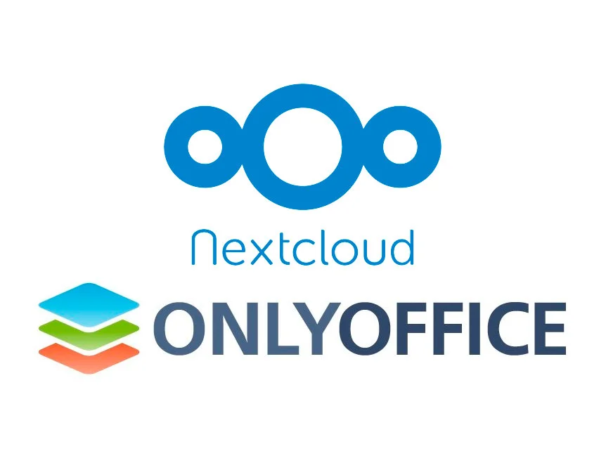

İki platform arasındaki temel mimari fark belgenin nerede çizildiğidir:

<div class="render-cards">
  <div class="render-card render-card-ssr">
    <div class="render-card-head">
      <span class="render-badge" style="background: #3e82f7; color: #ffffff;">Collabora Online</span>
      <h3>Server-Side Rendering (SSR)</h3>
    </div>
    <p>Belge sunucu tarafında çalışan LibreOffice motorunda işlenir ve tarayıcıya sayfa karoları (tiles) resim olarak aktarılır. 50 aktif kullanıcıda 16 GB RAM tüketebilir, yüksek gecikmeli ağlarda yazma hissiyatı yavaşlar.</p>
  </div>

  <div class="render-card render-card-csr">
    <div class="render-card-head">
      <span class="render-badge" style="background: #ff6f3c; color: #ffffff;">ONLYOFFICE Docs</span>
      <h3>Client-Side Rendering (CSR)</h3>
    </div>
    <p>HTML5 Canvas ve JavaScript tabanlı çizim motoru kullanır. Çizim kullanıcının tarayıcısında gerçekleşir. 100 eşzamanlı kullanıcı için 4 GB sunucu RAM'i yeterlidir. Microsoft Office formatlarıyla (.docx, .xlsx, .pptx) %99 uyumludur.</p>
  </div>
</div>

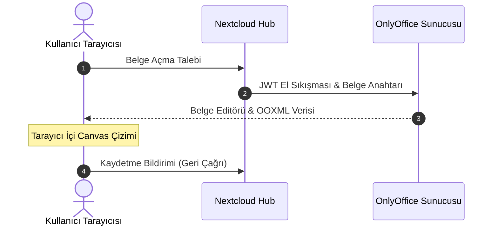

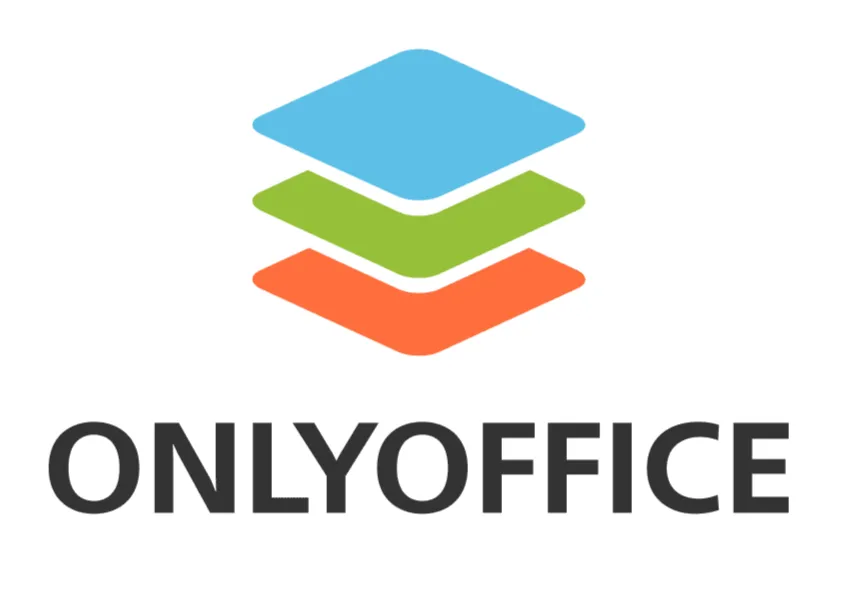

> [!WARNING]
> **JWT ve Tersine Vekil (Reverse Proxy) Ayarları:** OnlyOffice ile Nextcloud arasındaki trafik, belgelerin izinsiz indirilmesini önlemek için JSON Web Token (JWT) ile imzalanır. Kurumsal tersine vekiller standart `Authorization` başlığını silebileceğinden, OnlyOffice `local.json` yapılandırmasında başlık adı `AuthorizationJwt` olarak özelleştirilmeli ve Nextcloud yönetim panelinde bu başlık tanımlanmalıdır.
>
> **Topluluk Sürümü Sınırı:** Ücretsiz OnlyOffice Docs Community Edition, en fazla **20 eşzamanlı bağlantı (sekme)** sınırı içerir. 21. kullanıcı doküman açtığında belge salt-okunur modda açılır. 50'den fazla kullanıcılı kurumlarda OnlyOffice Enterprise lisansına geçilmeli ya da sınırsız Collabora alternatifi değerlendirilmelidir.

### Nextcloud Talk ile Güvenli Gerçek Zamanlı İletişim

Nextcloud Talk, sesli/görüntülü konferans, sohbet ve ekran paylaşımı sunan WebRTC tabanlı bir iletişim katmanıdır.

* **Standart Kurulum (Mesh Network / P2P):** Katılımcılar medya akışlarını doğrudan birbirlerine yükler. 5 kişilik bir görüşmede her istemci 4 ayrı video yüklemek zorundadır, bu da istemci işlemcisini ve bant genişliğini tüketerek 4-5 katılımcıdan sonra görüşmeyi kilitler.
* **High Performance Backend (HPB - SFU Mimarisi):** Janus WebRTC Gateway ve NATS kuyruğundan oluşan orkestrasyon, **Selective Forwarding Unit (SFU)** mimarisini kullanır. Katılımcı videosunu sunucuya tek bir akış olarak iletir. Janus bu akışı çoğaltarak diğer katılımcılara dağıtır. 10, 20 veya 50 kişilik kurumsal toplantılar ancak HPB mimarisiyle mümkündür.

### Kurumsal E-Posta Hizmetleri: Mailcow Entegrasyonu

Nextcloud içerisindeki yerleşik "Mail" uygulaması bağımsız bir e-posta sunucusu değil, yalnızca web tabanlı bir IMAP/SMTP istemcisidir. E-posta verisinin kurum sınırlarında kalmasını sağlamak için arka planda Docker üzerinde çalışan **Mailcow** (Postfix, Dovecot, SOGo, Rspamd, ClamAV) kümesi konumlandırılmalıdır.

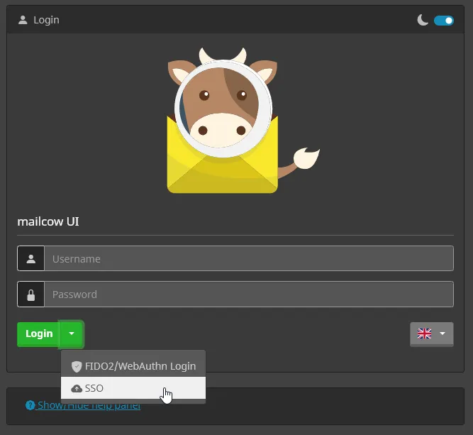

Kendi e-posta sunucunuzu işletirken gönderilen postaların Gmail ve Outlook tarafından spam olarak engellenmemesi için aşağıdaki DNS standartları eksiksiz uygulanmalıdır:

<div class="render-cards">
  <div class="render-card render-card-ssg">
    <div class="render-card-head">
      <span class="render-badge">SPF</span>
      <h3>Sender Policy Framework</h3>
    </div>
    <p>Alan adınız adına e-posta göndermeye yetkili IP adreslerini belirler:</p>
    <code>v=spf1 mx a -all</code>
  </div>

  <div class="render-card render-card-isr">
    <div class="render-card-head">
      <span class="render-badge">DKIM</span>
      <h3>DomainKeys Identified Mail</h3>
    </div>
    <p>E-postanın yolda tahrif edilmediğini kanıtlayan asimetrik şifreleme. 2048-bit RSA anahtarı DNS'e TXT olarak girilir.</p>
  </div>

  <div class="render-card render-card-ssr">
    <div class="render-card-head">
      <span class="render-badge">DMARC</span>
      <h3>İlke ve Raporlama</h3>
    </div>
    <p>SPF/DKIM doğrulaması başarısız e-postaların reddedilmesini zorunlu kılar:</p>
    <code>v=DMARC1, p=reject, rua=mailto:postmaster@domain.com</code>
  </div>

  <div class="render-card render-card-csr">
    <div class="render-card-head">
      <span class="render-badge">rDNS / PTR</span>
      <h3>Tersine DNS Kaydı</h3>
    </div>
    <p>Sunucu IP'sine ters sorgu atıldığında geri dönen ismin posta sunucusu hostname'iyle eşleşmesi şarttır.</p>
  </div>
</div>

### Otonom ve Yerel Yapay Zeka: Nextcloud AI Assistant

M365 Copilot veya Google Gemini gibi servisler, belgeleri analiz etmek için şirket verilerini harici bulut API'lerine gönderir. Nextcloud Hub, **AppAPI** mimarisi sayesinde sunucunuzun dışına tek bir bayt veri çıkarmadan **%100 Yerel Yapay Zeka (Local LLM)** deneyimi sunar:

* **İzole Yürütme:** AppAPI, Python tabanlı yapay zeka servislerini ana PHP sürecinden izole ederek ayrı Docker konteynerlerinde çalıştırır.
* **Açık Kaynaklı Modeller:** Sunucunun yerel GPU gücünü kullanarak **Llama** ve **Mistral** modelleri üzerinden belge özetleme ve metin üretimi yapar.
* **Yerel Ses Çözümleme:** Toplantı kayıtları yerel **Whisper** modeliyle metne dönüştürülür. Tüm analiz GDPR ve KVKK'ya tam uyumlu biçimde kurum içi donanımda tamamlanır.

### Kurumsal Güvenlik, Kimlik ve Erişim Denetimi

* **LDAPS ve OIDC SSO Entegrasyonu:** Kullanıcı yönetimi Active Directory veya OpenLDAP sunucularına port 636 (LDAPS) üzerinden bağlanır. Keycloak veya Authentik gibi modern SSO portalları konumlandırılarak OIDC protokolüyle tek noktadan giriş ve FIDO2/WebAuthn çok faktörlü doğrulama (MFA) sağlanır.
* **Veri Sızıntısı Önleme (DLP) ve Flow:** Nextcloud'un yerleşik dosya erişim kontrolü. IP adresi, grup ve dosya türüne göre kurallar tanımlar. ICAP protokolüyle dosyalar diske yazılmadan önce kurumsal DLP motoruna iletilerek hassas veriler otomatik etiketlenir.
* **Sunucu Taraflı Şifreleme (SSE) vs. Uçtan Uca Şifreleme (E2EE):** SSE, dosyaları harici S3 depolamaya yazmadan önce AES-256 ile şifreler. E2EE ise istemci cihazda üretilen anahtarlarla çalışır, sunucu yöneticisi dahi dosya içeriğini göremez (Zero-Knowledge mimarisi).

---

## Üretim Ortamları İçin Performans İnce Ayarları (Production Tuning Checklist)

Yüzlerce kullanıcının eşzamanlı çalıştığı bir Nextcloud ve OnlyOffice kümesinde donma ve yavaşlamaları engellemek için sistem seviyesinde şu optimizasyonlar uygulanmalıdır:

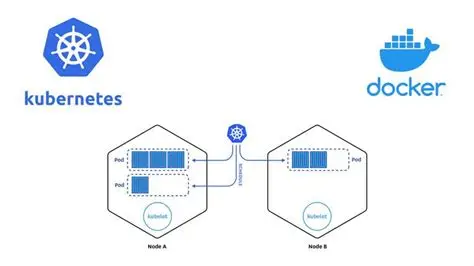

<div class="render-cards">
  <div class="render-card render-card-isr">
    <div class="render-card-head">
      <span class="render-badge">REDIS</span>
      <h3>İşlemsel Dosya Kilitleme</h3>
    </div>
    <p>Dosya kilit yönetimini PostgreSQL yerine Redis'e devredin, tahliye politikasını <code>noeviction</code> olarak ayarlayın.</p>
  </div>

  <div class="render-card render-card-csr">
    <div class="render-card-head">
      <span class="render-badge">PHP-FPM</span>
      <h3>Statik Worker Hesabı</h3>
    </div>
    <p>Worker sayısını formülle hesaplayın: <code>pm.max_children = (Toplam RAM - OS/DB RAM) / 100MB</code>.</p>
  </div>

  <div class="render-card render-card-ssr">
    <div class="render-card-head">
      <span class="render-badge">OPCACHE & JIT</span>
      <h3>Derleme Optimizasyonu</h3>
    </div>
    <p>CPU yükünü düşürmek için <code>opcache.jit=1255</code> ve <code>opcache.save_comments=1</code> direktiflerini aktif edin.</p>
  </div>

  <div class="render-card render-card-ssg">
    <div class="render-card-head">
      <span class="render-badge">SYSTEM CRON</span>
      <h3>Arka Plan Görevleri</h3>
    </div>
    <p>Yavaş AJAX tetikleyicisi yerine sistem crontab'ı ile her 5 dakikada bir <code>cron.php</code> çalıştırın.</p>
  </div>
</div>

### Redis ile İşlemsel Dosya Kilitleme (Transactional File Locking)
Eşzamanlı dosya senkronizasyonlarında çakışmaları önlemek için kullanılan kilit mekanizması, varsayılan kurulumda veritabanını (`oc_file_locks` tablosu) kullanır. Bu durum disk IOPS limitlerini hızla tüketir. `config.php` dosyasında kilit yönetimi mutlaka Redis'e devredilmelidir:
```php
'memcache.locking' => '\OC\Memcache\Redis',
```
Redis bellek tahliye politikası (`maxmemory-policy`), kilitlerin süresinden önce bellekten silinip dosya bütünlüğünü bozmasını önlemek için kesinlikle `noeviction` olarak ayarlanmalıdır.

### PHP-FPM Statik Süreç Yöneticisi
Yoğun trafik dalgalanmalarında sunucunun yanıt vermez duruma düşmesini engellemek için kurumsal ortamlarda `pm = static` modu seçilmelidir. Çalıştırılabilecek maksimum worker sayısı (`pm.max_children`) şu formülle belirlenir:
```text
max_children = (Toplam RAM - İşletim Sistemi ve Veritabanı RAM İhtiyacı) / Süreç Başına Ortalama PHP Tüketimi (~100MB)
```
*Örnek:* 32 GB RAM'li bir sunucuda OS ve DB için 16 GB ayrıldığında, kalan 16 GB RAM için `pm.max_children = 150` olarak atanmalıdır.

### OPCache ve JIT Yapılandırması
`php.ini` dosyanızda şu parametreleri uygulayarak betik derleme hızını maksimize edin:
```ini
opcache.memory_consumption=256
opcache.max_accelerated_files=20000
opcache.interned_strings_buffer=32
opcache.jit=1255
opcache.save_comments=1 ; Kapatılması Nextcloud rota sistemini bozarak sunucuyu çökertecektir.
```

### Sistem Crontab Entegrasyonu
Nextcloud'un varsayılan "AJAX" arka plan yürütücüsü web sayfalarını yavaşlatır. Arka plan görevleri işletim sistemi crontab'ına bağlanmalı ve her 5 dakikada bir çalıştırılmalıdır:
```bash
*/5 * * * * php -f /var/www/nextcloud/cron.php
```

---

## Kurumsal İşletim Sistemi Alternatifi: Linux Masaüstü ve Bağımsız Yönetim

Microsoft'un agresif bulut odaklı stratejisi, WSUS'u devre dışı bırakması ve Active Directory'yi buluta zorlaması karşısında işletim sistemi katmanında da açık kaynaklı ve egemen çözümlere yönelmek stratejik bir gerekliliktir.

Linux masaüstü altyapıları, kurumlara kapalı kaynaklı sistemlerde asla elde edilemeyecek bir denetlenebilirlik ve şeffaflık sunar:
* **Tam Kontrol ve Sıfır Telemetri:** Arka planda üreticiye kullanım alışkanlıkları ve telemetri aktaran gizli kanallar bulunmaz.
* **Yerel Veri İşleme:** İnternet erişimi kesilse dahi sistemler ve yerel iş akışları %100 kararlılıkla çalışır.
* **Maliyet Tasarrufu ve Donanım Ömrü:** Windows ve Office istemci lisans maliyetleri sıfırlanır, zorunlu donanım yenilemeleri yerine mevcut bilgisayarlar yıllarca verimli biçimde kullanılır.

### Kurumsal Linux Dağıtımları ve Yönetim Araçları

Kurumsal ortamlar için tercih edilebilecek kurumsal düzeyde (enterprise-ready) dağıtımlar ve yönetim ekosistemi:

<div class="render-cards">
  <article class="render-card render-card-ssr reveal-on-scroll">
    <div class="render-card-head">
      <span class="render-badge" style="background: #e00; color: #ffffff;">RHEL & AlmaLinux</span>
      <h3>Enterprise Stabilite</h3>
    </div>
    <p>Red Hat ekosistemi veya ücretsiz binary-uyumlu AlmaLinux. 10 yıla varan kurumsal yaşam döngüsü ve profesyonel destek.</p>
  </article>

  <article class="render-card render-card-csr reveal-on-scroll">
    <div class="render-card-head">
      <span class="render-badge" style="background: #02d35f; color: #ffffff;">SUSE SLED</span>
      <h3>Avrupa Standartları</h3>
    </div>
    <p>SUSE Linux Enterprise Desktop, özellikle Avrupa kamu kurumlarında veri egemenliği projelerinin en güçlü kalesidir.</p>
  </article>

  <article class="render-card render-card-ssg reveal-on-scroll">
    <div class="render-card-head">
      <span class="render-badge" style="background: #e95420; color: #ffffff;">Ubuntu LTS</span>
      <h3>Geniş Ekosistem</h3>
    </div>
    <p>Canonical tarafından sağlanan 5-10 yıllık LTS güvenlik desteği, geniş donanım sürücü havuzu ve zengin paket ekosistemi.</p>
  </article>

  <article class="render-card render-card-isr reveal-on-scroll">
    <div class="render-card-head">
      <span class="render-badge" style="background: #175ddc; color: #ffffff;">TÜBİTAK Pardus</span>
      <h3>Milli Dağıtım</h3>
    </div>
    <p>Türkiye'de kamu kurumlarında, okullarda ve belediyelerde yaygın olarak kullanılan Debian tabanlı kurumsal masaüstü.</p>
  </article>
</div>

### Merkezi Kimlik ve Politika Yönetimi (Active Directory ve WSUS Alternatifleri)

Linux dünyasında Windows altyapısının doğrudan açık kaynaklı karşılıkları olgunlaşmıştır:

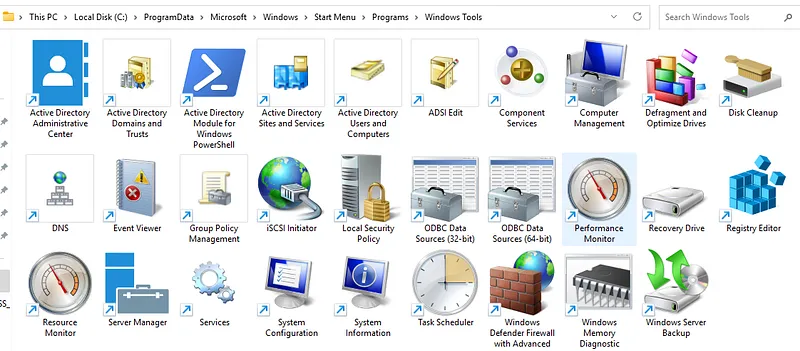

* **Active Directory Alternatifi (FreeIPA / Red Hat IdM):** Kerberos, 389 Directory Server (LDAP) ve DNS orkestrasyonu ile merkezi kullanıcı kimlik doğrulaması, rol tabanlı erişim kontrolü (RBAC) ve SSH anahtar yönetimi sunar.
* **GPO (Group Policy) Alternatifi (Ansible, Puppet ve Fleet Commander):** Yüzlerce bilgisayarın masaüstü politikalarını, tarayıcı yapılandırmalarını ve güvenlik ayarlarını tek bir merkezi merkezden bildirimsel olarak yönetir.
* **WSUS Alternatifi (`dnf-automatic` & `unattended-upgrades`):** Güncelleme paketlerini yerel kurumsal depolardan (Local Mirror) otomatik ve denetimli olarak dağıtarak harici ağ bağımlılığını sıfırlar.

### Gerçek Dünya Başarı Hikayeleri ve Kademeli Geçiş

* **Münih Belediyesi LiMux Projesi:** 15.000 masaüstü bilgisayarda Linux ve açık kaynak ofis kullanılarak lisans bağımlılığı kırılmış ve vendor lock-in ortadan kaldırılmıştır.
* **Fransa Jandarması (Gendarmerie Nationale):** 37.000 bilgisayarda özel Ubuntu sürümü (GendBuntu) kullanılarak milyonlarca avroluk lisans tasarrufu ve tam veri egemenliği sağlanmıştır.
* **Endülüs Bölgesi (İspanya):** Eğitim sektöründe 220.000 Linux bilgisayarı devreye alınmıştır.

> [!TIP]
> **Kademeli Geçiş Stratejisi:** Kurumsal dönüşümlerde tüm sistemleri bir gecede değiştirmek kullanıcı direncine yol açar. Önce teknik ve idari destek birimlerinden başlanmalı, kapsamlı kullanıcı adaptasyon eğitimleri verilmeli ve kritik eski Windows yazılımları için web tabanlı alternatifler, Wine/CrossOver veya izole KVM sanal makineleri hazır tutulmalıdır.

---

## Açık Kaynaklı Masaüstü Alternatifleri ve Tescilli Ekosistem Analizi

Kod tabanlı araçlar (LaTeX, DuckDB) teknik ekipler için idealken, son kullanıcıların bir kısmı geleneksel masaüstü ofis arayüzlerine ihtiyaç duyar. Bu ihtiyaç verilerimizi genel buluta kaptırmamızı gerektirmez:

* **LibreOffice:** ISO standardı ODF (Open Document Format) kullanan, arka planda telemetri göndermeyen ve tamamen çevrimdışı çalışan en köklü özgür ofis paketidir.
* **ONLYOFFICE Desktop:** Microsoft OOXML formatlarıyla (.docx, .xlsx, .pptx) %99 uyumlu çalışan, sekme tabanlı modern bir masaüstü alternatifidir.

<div class="render-cards">
  <article class="render-card render-card-ssr reveal-on-scroll">
    <div class="render-card-head">
      <span class="render-badge" style="background: #ff6f3c; color: #ffffff;">ONLYOFFICE</span>
      <h3>Modern Uyumluluk</h3>
    </div>
    
    <p>OOXML çekirdek mimarisi ve şirket içi Nextcloud entegrasyonu. Microsoft belgeleriyle kusursuz biçimsel uyum.</p>
  </article>

  <article class="render-card render-card-csr reveal-on-scroll">
    <div class="render-card-head">
      <span class="render-badge" style="background: #3a7610; color: #ffffff;">LibreOffice</span>
      <h3>Gizlilik Kalesi</h3>
    </div>
    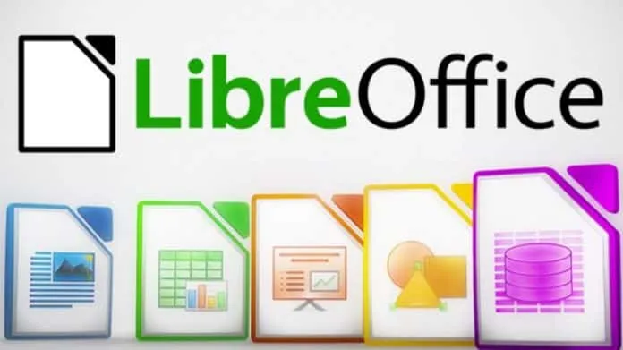
    <p>Açık ODF standartları, sıfır telemetri ve tamamen çevrimdışı çalışma. Dijital egemenliğin tavizsiz savunucusu.</p>
  </article>
  <article class="render-card render-card-ssg reveal-on-scroll">
    <div class="render-card-head">
      <span class="render-badge" style="background: #0e85cd; color: #ffffff;">Apache OpenOffice</span>
      <h3>Eski Ata</h3>
    </div>
    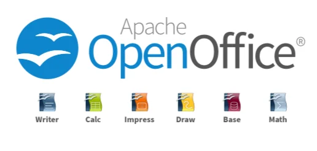
    <p>LibreOffice'in 2010'da çatallandığı OpenOffice.org soyunun devamı. Geliştirme büyük ölçüde durduğu için yeni kurulumlarda önerilmez.</p>
  </article>
</div>

<div class="glass-panel reveal-on-scroll">

| Karşılaştırma Ölçütü | LibreOffice | ONLYOFFICE Docs |
| :--- | :--- | :--- |
| **Temel Belge Formatı** | ODF (Open Document Format - ODT/ODS) | OOXML (Microsoft Standartları - DOCX/XLSX) |
| **MS Office Uyumluluğu** | Gelişmiş (Format dönüştürme katmanıyla) | Kusursuz (Yerel çekirdek uyumu) |
| **Kullanıcı Arayüzü (UI)** | Klasik menüler veya yapılandırılabilir Ribbon | Sekmeli modern Ribbon arayüzü |
| **Canlı Eşzamanlı İşbirliği** | Collabora Online entegrasyonuyla | Yerleşik Document Server mimarisiyle |

</div>

### Tescilli Ekosistemlerin Mimari Kilitleri

Tescilli bulut sağlayıcıları arasında geçiş yapmak veri egemenliği sağlamaz, yalnızca verinizin hangi tekelin sunucularında rehin kalacağını seçmenize yarar:

<div class="render-cards">
  <article class="render-card render-card-ssr reveal-on-scroll">
    <div class="render-card-head">
      <span class="render-badge" style="background: #d83b01; color: #ffffff;">Microsoft 365</span>
      <h3>Ekosistem Prangası</h3>
    </div>
    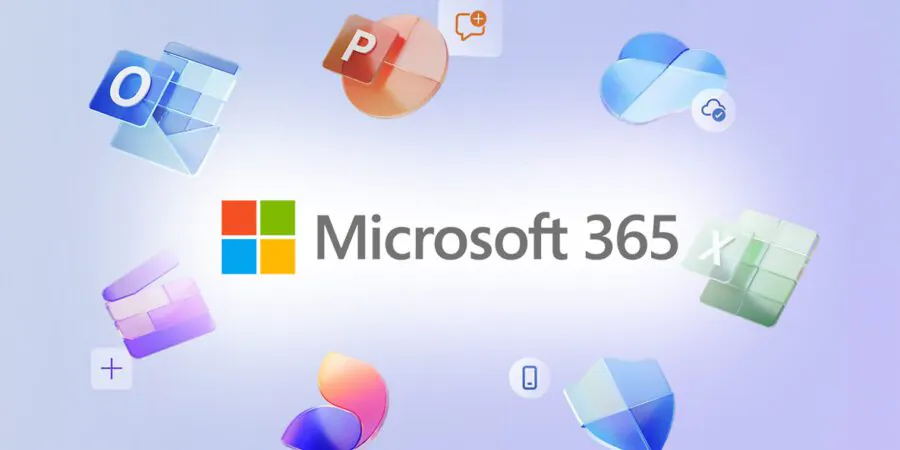
    <p>Bulut bağımlılığı ve vendor lock-in kavramının endüstri standardı. Veri egemenliğinin önündeki en katı bariyer.</p>
  </article>

  <article class="render-card render-card-ssr reveal-on-scroll">
    <div class="render-card-head">
      <span class="render-badge" style="background: #4285f4; color: #ffffff;">Google Docs</span>
      <h3>SaaS Tekeli</h3>
    </div>
    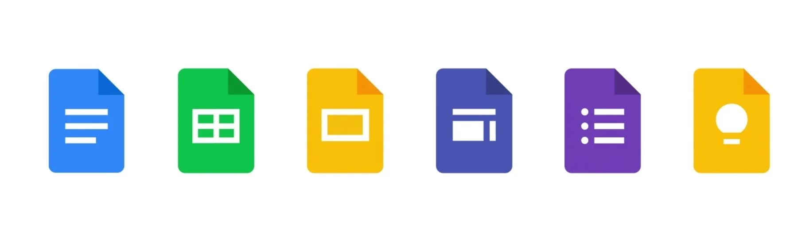
    <p>M365'ten kaçıp Google'a sığınmak veri egemenliği getirmez, yalnızca verinizi hangi sağlayıcının işleyeceğini değiştirir.</p>
  </article>

  <article class="render-card render-card-csr reveal-on-scroll">
    <div class="render-card-head">
      <span class="render-badge" style="background: #f47b20; color: #ffffff;">Zoho Office</span>
      <h3>Kapsamlı Ama Kapalı</h3>
    </div>
    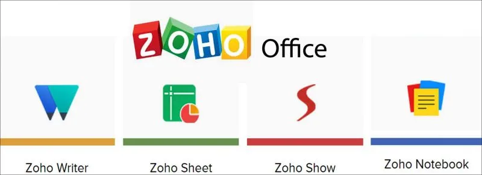
    <p>Geniş uygulama yelpazesi sunsa da tescilli bulut altyapısı nedeniyle kurum kontrolünün dışındadır.</p>
  </article>

  <article class="render-card render-card-ssg reveal-on-scroll">
    <div class="render-card-head">
      <span class="render-badge" style="background: #000000; color: #ffffff;">Apple iWork</span>
      <h3>Donanım Kilidi</h3>
    </div>
    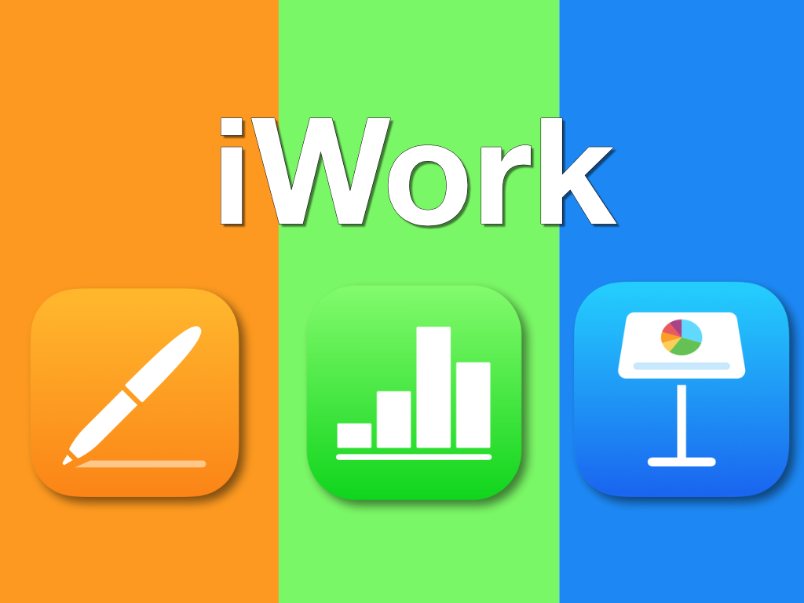
    <p>Kullanıcıyı Apple donanımlarına ve kapalı iCloud ekosistemine bağlar, formatları tescillidir ve Git ile uyumsuzdur.</p>
  </article>

  <article class="render-card render-card-ssr reveal-on-scroll">
    <div class="render-card-head">
      <span class="render-badge" style="background: #e11d48; color: #ffffff;">WPS Office</span>
      <h3>Ticari Klon</h3>
    </div>
    
    <p>MS formatlarıyla uyumlu çalışan Ribbon arayüzü, ancak kapalı kaynaklı yapısı telemetri şüpheleri barındırır.</p>
  </article>

  <article class="render-card render-card-ssr reveal-on-scroll">
    <div class="render-card-head">
      <span class="render-badge" style="background: #2563eb; color: #ffffff;">FreeOffice</span>
      <h3>Hafif Alternatif</h3>
    </div>
    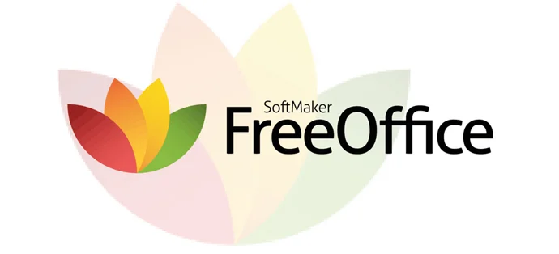
    <p>Hızlı çalışır ancak kapalı kaynaklıdır, kurumsal veri egemenliği için on-premise çözüm sunmaz.</p>
  </article>
</div>

---

## Dijital Özgürlük İçin Tamamlayıcı Mühendislik Araçları

Mühendislik ve araştırma iş akışlarını destekleyen diğer açık kaynaklı bileşenler:

<div class="render-cards">
  <article class="render-card render-card-ssr reveal-on-scroll" style="border: 1px solid rgba(var(--app-accent-rgb, 37, 99, 235), 0.3);">
    <div class="render-card-head">
      <span class="render-badge" style="background: #4752b2; color: #ffffff;">Quarto</span>
      <h3>Bilimsel Yayıncılık</h3>
    </div>
    <p>LaTeX ve Markdown arasındaki en modern köprü. Python/R kodlarını, tabloları ve analizleri tek kaynaktan PDF veya Web raporuna dönüştürür.</p>
  </article>

  <article class="render-card render-card-csr reveal-on-scroll" style="border: 1px solid rgba(var(--app-accent-rgb, 37, 99, 235), 0.3);">
    <div class="render-card-head">
      <span class="render-badge" style="background: #313131; color: #ffffff;">Zotero</span>
      <h3>Bibliyografya Kalesi</h3>
    </div>
    <p>Akademik referansları ticari SaaS servisleri yerine kendi WebDAV sunucunuzda (Nextcloud) saklayan açık kaynaklı çözüm.</p>
  </article>

  <article class="render-card render-card-ssg reveal-on-scroll" style="border: 1px solid rgba(var(--app-accent-rgb, 37, 99, 235), 0.3);">
    <div class="render-card-head">
      <span class="render-badge" style="background: #ff3e00; color: #ffffff;">Mermaid.js</span>
      <h3>Diagram-as-Code</h3>
    </div>
    <p>Karmaşık mimari şemaları metin tabanlı sözdizimiyle çizip belgelere gömmek için ideal açık kaynaklı standart.</p>
  </article>

  <article class="render-card render-card-isr reveal-on-scroll" style="border: 1px solid rgba(var(--app-accent-rgb, 37, 99, 235), 0.3);">
    <div class="render-card-head">
      <span class="render-badge" style="background: #175ddc; color: #ffffff;">Vaultwarden</span>
      <h3>Egemen Şifre Kasası</h3>
    </div>
    <p>Tüm kurumsal kimlik ve şifreleri üçüncü taraf bulutlar yerine kendi sunucunuzda tutan Bitwarden uyumlu hafif kasa.</p>
  </article>
</div>

---

Bulut tabanlı ofis platformlarının getirdiği anlık kullanım kolaylığı, kurumsal hafızamızın ve stratejik verilerimizin mülkiyetini başkalarına devretmenin bahanesi olamaz. Belgeleri LaTeX ile kodlamak, verileri DuckDB ile yerelde sorgulamak, sunumları Slidev ile hazırlamak ve kurumsal işbirliğini Nextcloud, OnlyOffice ve Mailcow ile kendi sunucularımızda ayağa kaldırmak bir nostalji değil, dijital bağımsızlığımızı ve veri egemenliğimizi geri kazanma iradesidir.

Verinizin mimarı olun, egemenliğinizi geri alın!

---

## Kaynakça ve İleri Okuma

1. **Nextcloud Hub Mimari Dokümantasyonu:** Nextcloud Server Administration Guide & High Performance Backend Documentation. Nextcloud GmbH.
2. **ONLYOFFICE Document Server:** ONLYOFFICE API and Integration Documentation for Nextcloud and Enterprise Storage. Ascensio System SIA.
3. **Mailcow: dockerized:** Mailcow Official Documentation: Modular E-Mail Stack with Postfix, Dovecot, SOGo, and Rspamd.
4. **LaTeX Project:** Documentation and The Comprehensive TeX Archive Network (CTAN). LaTeX3 Project.
5. **DuckDB Documentation:** In-Process Columnar SQL OLAP Engine Documentation and Benchmark Reports. DuckDB Foundation.
6. **Slidev Documentation:** Presentation Infrastructure for Developers: Vue & Vite Markdown Driven Slides.
7. **US CLOUD Act Legal Framework:** Clarifying Lawful Overseas Use of Data Act: Extraterritorial Data Transfer and Cross-Border Considerations. U.S. Department of Justice.
8. **Microsoft Learn & Tech Community:** Windows Server 2022/2025 Features, WSUS Deprecation Guidance, Azure Local Architecture, and Azure AD Graph to Microsoft Graph Migration.
9. **Heise Online & The Register:** Legal and Sovereignty Analyses of US CLOUD Act on European Cloud Operations and Microsoft France Disclosures.
10. **LiMux & European Open Source Public Deployments:** City of Munich Open Source Strategy, French Gendarmerie GendBuntu Project, and Andalusian Educational Deployments.
