Bu yazımda bilgi teknolojileri ve güvenliği alanında çalışan ulusal ve uluslararaası organizasyonlara değineceğim. Bu alandaki standartlardan ve amaçlarından bahsedeceğim.

---

## Bilgi Güvenliğinin Temel Sacayakları ve Risk Yönetimi

Bilgi güvenliği, yalnızca teknik güvenlik duvarları veya karmaşık şifreleme algoritmalarından ibaret değildir, insan, süreç ve teknolojiyi kapsayan bütünleşik bir disiplindir. Her kurumsal güvenlik stratejisi üç temel ilke (CIA Triad) üzerine inşa edilir:

1. **Gizlilik (Confidentiality):** Verinin yalnızca yetkili kullanıcılar ve sistemler tarafından erişilebilir olmasını garanti eder (Örn: Güçlü kimlik doğrulama, rol tabanlı erişim kontrolü - RBAC ve veri şifreleme).
2. **Bütünlük (Integrity):** Bilginin yetkisiz kişilerce veya beklenmedik sistem arızalarıyla değiştirilmesini, silinmesini veya bozulmasını engeller (Örn: Kriptografik hash doğrulamaları, dijital imzalar ve versiyon takibi).
3. **Erişilebilirlik (Availability):** Yetkili kullanıcıların ihtiyaç duydukları anda sistemlere ve verilere kesintisiz ulaşabilmesini sağlar (Örn: Yedeklilik, yük dengeleme, felaket kurtarma planları ve DDoS koruması).

### Temel Risk Denklemi
Siber güvenlik standartlarının nihai hedefi kurumsal riski yönetilebilir seviyede tutmaktır. Bu dinamik şu temel denklemle modellenir:

$$\text{Risk} = \text{Tehdit (Threat)} \times \text{Zafiyet (Vulnerability)} \times \text{Varlık Değeri / Etki (Impact)}$$

Bir kurum tehdit aktörlerini doğrudan kontrol edemez, ancak sistemlerindeki zafiyetleri kapatarak ve varlıkları katmanlı savunmayla koruyarak toplam riski minimize edebilir. Aşağıdaki organizasyonlar ve standartlar, bu dengeyi kurumsal ölçekte kurmak için geliştirilmiştir.

## Bilgi Teknolojileri ve Güvenliği Organizasyonları

Bilgi teknolojileri ve güvenliği organizasyonlarının temel amacı, bilgi varlıklarını koruyarak organizasyonların bilgiye yetkisiz erişimi engellemek, bilginin ve bilgi varlıklarının bütünlüğünü ve doğruluğunu sağlamak ve yetkili kullanıcıların bilgilere ihtiyaç duyduklarında erişimini temin etmektir.

### Uluslararası Standart ve Güvenlik Kuruluşları

#### ISO (International Organization for Standardization)

ISO, bilgi teknolojileri ve güvenliği için uluslararası standartlar geliştiren önde gelen bir kuruluştur. Bu standartlar, kuruluşların bilgi varlıklarını korumasına yardımcı olur.

#### IEC (International Electrotechnical Commission)

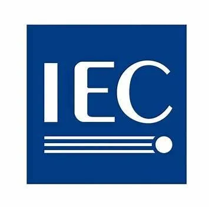

Elektrik, elektronik ve ilgili teknolojiler için standartlar geliştiren IEC, ISO ile iş birliği yaparak siber güvenlik ve bilişim teknolojileri alanındaki standartları oluşturur. Örneğin, ISO/IEC 27000 serisi standartları bu iş birliğinin bir ürünüdür.

#### ISACA (Information Systems Audit and Control Association)

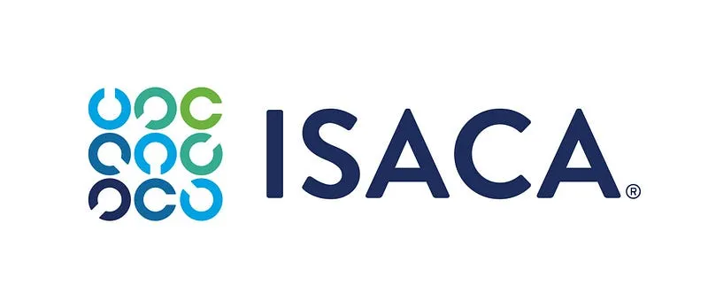

ISACA, bilgi sistemleri denetimi, güvenliği ve yönetişimi konularında uzmanlaşmış uluslararası bir profesyonel organizasyondur. 1969'da kurulan bu kuruluş, COBIT gibi BT yönetişim çerçeveleri geliştirir ve CISA (Certified Information Systems Auditor) ile CISM (Certified Information Security Manager) gibi sertifikasyonlar sunarak profesyonellerin yetkinliklerini artırır. İşletmelerin teknoloji risklerini yönetmesine ve siber güvenlik standartlarını uygulamasına yardımcı olan ISACA, teorik ve pratik bilgi birikimini bir araya getirerek sektörde önemli bir yer edinmiştir.

#### ITU (International Telecommunication Union)

Birleşmiş Milletler'e bağlı bir kuruluş olan ITU, telekomünikasyon ve bilgi teknolojileri alanında standartlar belirleyerek siber güvenlik stratejilerini koordine eder. Üye ülkelerle iş birliği yaparak dijital altyapıların korunmasını ve siber tehditlere karşı dirençli hale gelmesini hedefler. İnternetin yaygınlaşması ve iletişim ağlarının güvenliği gibi konularda liderlik yapan ITU, küresel çapta teknoloji politikalarının şekillenmesine katkıda bulunur.

#### NSA (National Security Agency)

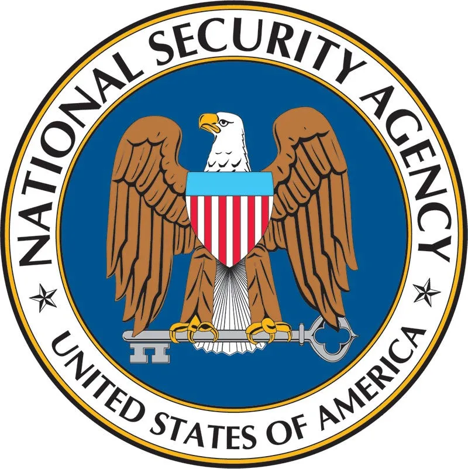

ABD merkezli Ulusal Güvenlik Ajansı (NSA), 1952'de kurulan ve ulusal güvenliği korumak için sinyal istihbaratı (SIGINT) toplama, siber güvenlik sağlama ve kriptoloji alanında faaliyet gösteren bir organizasyondur. Kritik altyapıları siber tehditlere karşı korurken, AES gibi şifreleme standartlarının geliştirilmesine katkıda bulunur ve TAO birimiyle hedefli siber operasyonlar yürütür. Ancak, PRISM gibi programlarla dünya genelinde iletişim izleme faaliyetleri nedeniyle gizlilik ihlali tartışmalarına konu olmuştur. Hem savunma hem de istihbarat toplama kapasitesiyle, bilgi teknolojileri ve güvenliği alanında küresel bir etkiye sahiptir.

#### ENISA (European Union Agency for Cybersecurity)

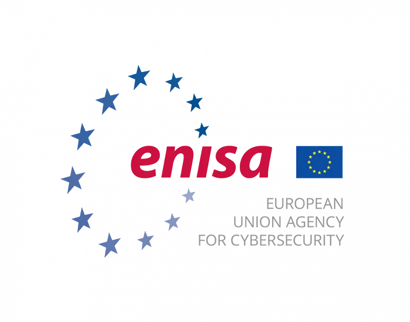

Avrupa Birliği'nin siber güvenlik ajansı ENISA, üye ülkelerde siber güvenlik kapasitesini artırmak ve ortak tehditlere karşı iş birliğini güçlendirmek için 2004'te kurulmuştur. Risk analizleri, eğitim programları ve standart geliştirme çalışmalarıyla Avrupa'nın dijital güvenliğini destekler. Ayrıca, uluslararası siber güvenlik topluluğunda etkili bir aktör olarak, tehdit istihbaratı paylaşımı ve kriz yönetimi gibi alanlarda faaliyet gösterir.

#### ETSI (European Telecommunications Standards Institute)

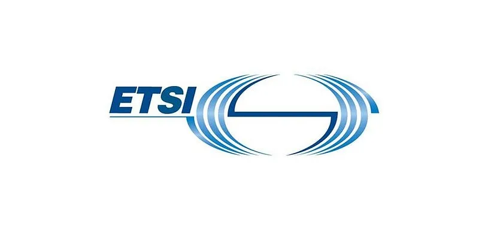

Avrupa Telekomünikasyon Standartlar Enstitüsü (ETSI), 1988'de kurulan ve telekomünikasyon, bilgi teknolojileri ve siber güvenlik alanlarında standartlar geliştiren bir Avrupa organizasyonudur. GSM, 5G ve Nesnelerin İnterneti (IoT) gibi teknolojilerin standartlarını oluştururken, siber güvenlik protokolleri ve veri koruma sistemleri üzerinde de çalışır. ETSI, endüstri, akademi ve kamu kurumlarıyla iş birliği yaparak yenilikçi ve güvenli iletişim teknolojilerinin küresel çapta yaygınlaşmasını sağlar. Avrupa odaklı olsa da, standartları uluslararası düzeyde benimsenir.

#### NIST (National Institute of Standards and Technology)

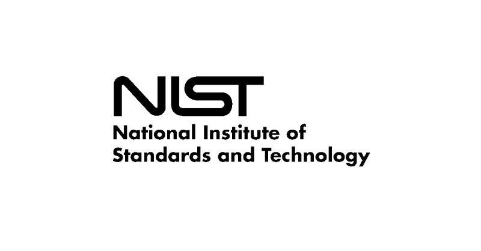

ABD merkezli NIST, bilgi teknolojileri ve siber güvenlik alanında standartlar ve rehberler geliştiren önde gelen bir kuruluştur. NIST Cybersecurity Framework ve SP 800 serisi gibi kaynaklar, dünya genelinde kuruluşlar tarafından referans alınır. Teknolojik yenilikleri desteklerken, siber tehditlere karşı pratik çözümler sunan NIST, hem kamu hem de özel sektörde güvenliğin artırılmasına katkıda bulunur.

#### IEEE (Institute of Electrical and Electronics Engineers)

Bilgi teknolojisi, telekomünikasyon ve siber güvenlik gibi alanlarda standartlar geliştiren IEEE, özellikle teknik yenilikler ve uygulamalar konusunda küresel bir otoritedir.

#### IETF (Internet Engineering Task Force)

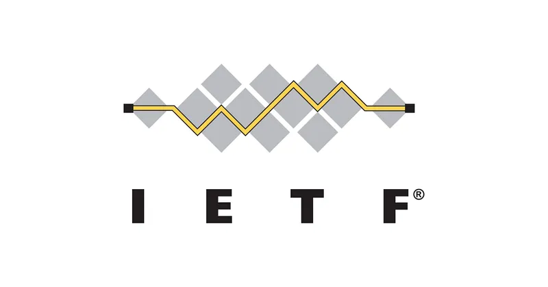

İnternetin teknik altyapısını geliştiren IETF, ağ protokolleri ve güvenlik standartları üzerinde çalışır. Açık bir topluluk olarak faaliyet gösterir ve internetin güvenliğini artırmayı hedefler.

#### ISC² (International Information System Security Certification Consortium)

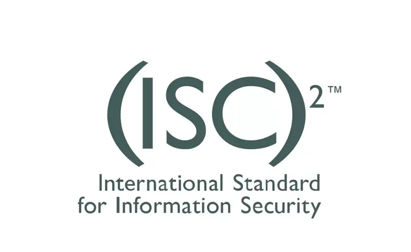

ISC² (**Uluslararası Bilgi Sistemleri Güvenliği Sertifikasyon Konsorsiyumu**), bilgi güvenliği profesyonelleri için uluslararası geçerliliği olan sertifikalar sunan, kar amacı gütmeyen bir kuruluştur. CISSP (Certified Information Systems Security Professional) gibi sektörde saygın sertifikalarıyla tanınan ISC², bilgi güvenliği alanında standartları belirlemekte ve bu alanda profesyonel gelişimi desteklemektedir. Kuruluş, etik kurallara bağlılığı ve sürekli eğitim gereklilikleriyle bilgi güvenliği uzmanlarının yetkinliklerini güncel tutmalarını sağlamayı amaçlamaktadır.

#### OWASP (Open Web Application Security Project)

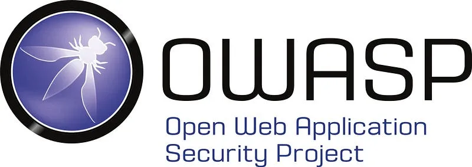

OWASP (Açık Web Uygulama Güvenliği Projesi), web uygulama güvenliği alanında dünya genelinde faaliyet gösteren açık kaynaklı ve kar amacı gütmeyen bir organizasyondur. Amacı, yazılım geliştiricilere, güvenlik uzmanlarına ve kurumlara daha güvenli uygulamalar geliştirmeleri için rehberlik ve araçlar sunmaktır. OWASP, özellikle her birkaç yılda bir güncellenen ve dünya genelinde referans olarak kabul edilen "OWASP Top 10" adlı raporuyla tanınır, bu rapor, en yaygın ve kritik web uygulama güvenlik açıklarını sıralar. Gönüllüler tarafından yürütülen OWASP projeleri, kılavuzlar, test araçları ve eğitim materyalleri gibi pek çok ücretsiz kaynak içerir.

#### FIRST (Forum of Incident Response and Security Teams)

Siber olaylara müdahale ekiplerinin uluslararası bir ağı olan FIRST, güvenlik olaylarına hızlı yanıt verilmesini ve bilgi paylaşımını teşvik eder.

### Türkiye'deki Ulusal Siber Güvenlik Kuruluşları

#### BTK (Bilgi Teknolojileri ve İletişim Kurumu)

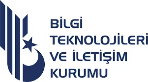

Bilgi Teknolojileri ve İletişim Kurumu, Türkiye'de telekomünikasyon ve bilişim sektörünü düzenleyen ve denetleyen temel kamu kuruluşudur. 2000 yılında Telekomünikasyon Kurumu olarak kurulmuş, 2008'de ise bugünkü adını almıştır. BTK, elektronik haberleşme sektöründe rekabeti teşvik ederken, siber güvenlik politikalarını koordine eder ve USOM (Ulusal Siber Olaylara Müdahale Merkezi) gibi birimleri bünyesinde barındırarak ulusal çapta siber tehditlere karşı mücadele yürütür. Ayrıca, BTK Akademi ile teknoloji ve siber güvenlik eğitimleri sunarak farkındalık oluşturur.

#### USOM (Ulusal Siber Olaylara Müdahale Merkezi — TR-CERT)

BTK bünyesinde faaliyet gösteren USOM, Türkiye'nin siber güvenlik kalesi olarak tanımlanır ve ulusal ile uluslararası düzeyde siber tehditlere karşı koruma sağlar. Siber olaylara hızlı müdahale, tehdit istihbaratı toplama ve kamu ile özel sektör arasında koordinasyon sağlama gibi görevleri üstlenir. Türkiye'ye yönelik siber saldırıların tespiti ve önlenmesi için 7/24 çalışan bu merkez, kritik altyapıların güvenliğini artırmayı hedefler ve siber güvenlik ekosisteminin gelişimine katkıda bulunur.

#### TÜBİTAK BİLGEM

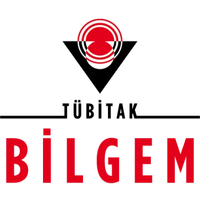

Türkiye Bilimsel ve Teknolojik Araştırma Kurumu'na (TÜBİTAK) bağlı olan BİLGEM(Bilişim ve Bilgi Güvenliği İleri Teknolojiler Araştırma Merkezi), bilişim ve siber güvenlik teknolojileri alanında Ar-Ge faaliyetleri yürütür. Ulusal güvenlik projeleri için yazılım, donanım ve kriptoloji çözümleri geliştiren bu merkez, özellikle savunma sanayi ve kamu kurumları için yenilikçi teknolojiler üretir. Siber güvenlik testleri, yerli yazılım geliştirme ve bilgi güvenliği sistemleri konularında Türkiye'nin önde gelen kuruluşlarından biridir.

#### TSE (Türk Standartları Enstitüsü)

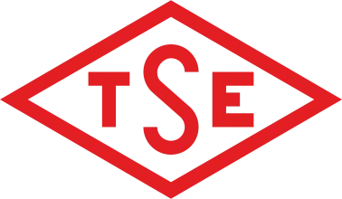

Türk Standartları Enstitüsü (TSE), 1954'te kurulan ve Türkiye'de standart geliştirme, belgelendirme ve denetim faaliyetleri yürüten ulusal bir organizasyondur. Bilgi teknolojileri ve güvenliği alanında, özellikle ISO/IEC 27001 gibi uluslararası standartların Türkiye'de uygulanmasını destekler ve siber güvenlik yönetim sistemlerinin belgelendirilmesine katkıda bulunur. TSE, BT ürünlerinin güvenilirliğini test eder, yerli firmaların standartlara uygunluğunu denetler ve ulusal siber güvenlik ekosisteminin güçlenmesine yardımcı olur.

#### Türkiye Siber Güvenlik Kümelenmesi

Türkiye Siber Güvenlik Kümelenmesi, 2017 yılında Savunma Sanayii Başkanlığı ve Dijital Dönüşüm Ofisi'nin öncülüğünde, kamu kurumları, özel sektör ve akademi temsilcilerinin katkılarıyla kurulmuştur. Kümelenmenin temel amacı, yerli ve milli siber güvenlik ürünlerinin geliştirilmesini teşvik etmek, siber güvenlik ekosistemini güçlendirmek ve uluslararası rekabet gücünü artırmaktır. Platform, üyelerinin teknik ve finansal gelişimini desteklemek, siber güvenlik standartlarını iyileştirmek ve insan kaynağını artırmak için çeşitli faaliyetler yürütmektedir. 

#### Bilgi Güvenliği Derneği (BGD)

2007 yılında kurulmuş olan Bilgi Güvenliği Derneği, akademisyenler, kamu görevlileri ve özel sektör uzmanlarının katılımıyla bilgi güvenliği alanında farkındalık oluşturmak, eğitimler düzenlemek ve ulusal politikalara katkı sağlamak amacıyla faaliyet göstermektedir. Dernek, kamu ve özel sektöre yönelik seminerler ve çalıştaylar düzenleyerek bilgi paylaşımını teşvik eder.

#### Türkiye Bilişim Derneği (TBD)

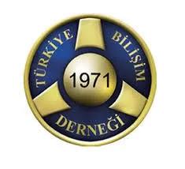

1971 yılında kurulan Türkiye Bilişim Derneği, bilişim sektörünü geliştirmeyi amaçlayan ve bu alandaki paydaşları bir araya getiren köklü bir sivil toplum kuruluşudur. TBD, bilgi teknolojileri, yazılım, siber güvenlik ve bilişim hukuku gibi alanlarda kamuoyu oluşturma, seminerler düzenleme ve kamu politikalarına katkı sağlama görevini üstlenmektedir.

---

## Bilgi Teknolojileri ve Güvenliği Standartları

Bilgi teknolojileri ve güvenliği standartlarının temel amacı, kurumların ve bireylerin dijital varlıklarını korumak, siber tehditlere karşı önlem almak ve güvenli bir dijital ortam oluşturmaktır. Bu standartlar, verilerin gizliliğini, bütünlüğünü ve erişilebilirliğini sağlamayı, riskleri minimize etmeyi, yasal düzenlemelere uyum sağlamayı ve en iyi uygulamaları teşvik etmeyi hedefler. Böylece, kurumların ve bireylerin dijital dünyada güvenle faaliyet göstermesine katkıda bulunur.

### Uluslararası Güvenlik Standartları ve Yönetişim Çerçeveleri

#### ISO/IEC 27000 Serisi

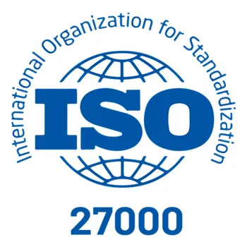

ISO/IEC 27000 serisi, bilgi güvenliği yönetim sistemlerinin oluşturulması, uygulanması ve sürdürülmesi için uluslararası kabul görmüş bir dizi standarttır. Bu seri, organizasyonların bilgi güvenliğini sağlamak için kullanabilecekleri kapsamlı bir çerçeve sunar. ISO/IEC 27001, serinin temel standardıdır ve bir bilgi güvenliği yönetim sistemi (ISMS) kurma gereksinimlerini belirler. ISO/IEC 27002 ise bu sistemin uygulanmasında kullanılan güvenlik kontrollerine ilişkin en iyi uygulama önerileri sunar. Diğer standartlar, risk yönetimi, veri koruma, erişim kontrolü, iş sürekliliği ve diğer bilgi güvenliği alanlarında organizasyonlara rehberlik eder. ISO/IEC 27000 serisi, bilgi güvenliği süreçlerini standardize ederek organizasyonların risklerini azaltmalarına ve güvenliklerini artırmalarına yardımcı olur.

#### NIST SP 800-53

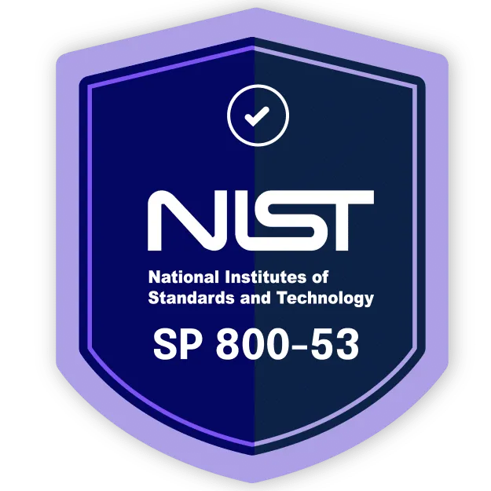

ABD Ulusal Standartlar ve Teknoloji Enstitüsü (NIST) tarafından geliştirilen bu standart, federal hükümet ve diğer organizasyonlar için bilgi sistemlerinin güvenliğini sağlamaya yönelik geniş kapsamlı kontrol ve yönergeler sunar. NIST SP 800–53, siber güvenlik için önemli bir referans kaynağıdır.

#### CIS Controls (Center for Internet Security)

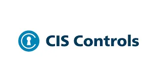

İnternet Güvenliği Merkezi(CIS) tarafından geliştirilen CIS Kontrolleri, organizasyonların siber güvenliklerini güçlendirmeleri için en iyi uygulama rehberleri sunar. Bu kontroller, saldırılara karşı savunma duvarı oluşturarak bilgi güvenliğini artırmayı amaçlar.

#### Common Criteria (Ortak Kriterler)

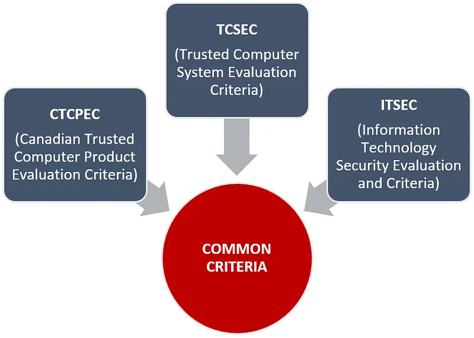

Common Criteria (Ortak Kriterler), bilgi teknolojisi (BT) ürünlerinin ve sistemlerinin güvenlik özelliklerini değerlendirmek için uluslararası kabul görmüş bir standarttır. ISO/IEC 15408 olarak da bilinen bu standart, BT ürünlerinin güvenlik gereksinimlerini belirlemek, bu gereksinimlere uygunluğunu test etmek ve belgelendirmek için bir çerçeve sunar. Ürünlerin güvenlik seviyelerini değerlendirmek için EAL (Evaluation Assurance Level) olarak adlandırılan değerlendirme güvence seviyelerini kullanır. Common Criteria, güvenlik bilincinin yüksek olduğu sektörlerde (kamu, savunma, finans vb.) yaygın olarak kullanılmaktadır.

#### NIST Cybersecurity Framework

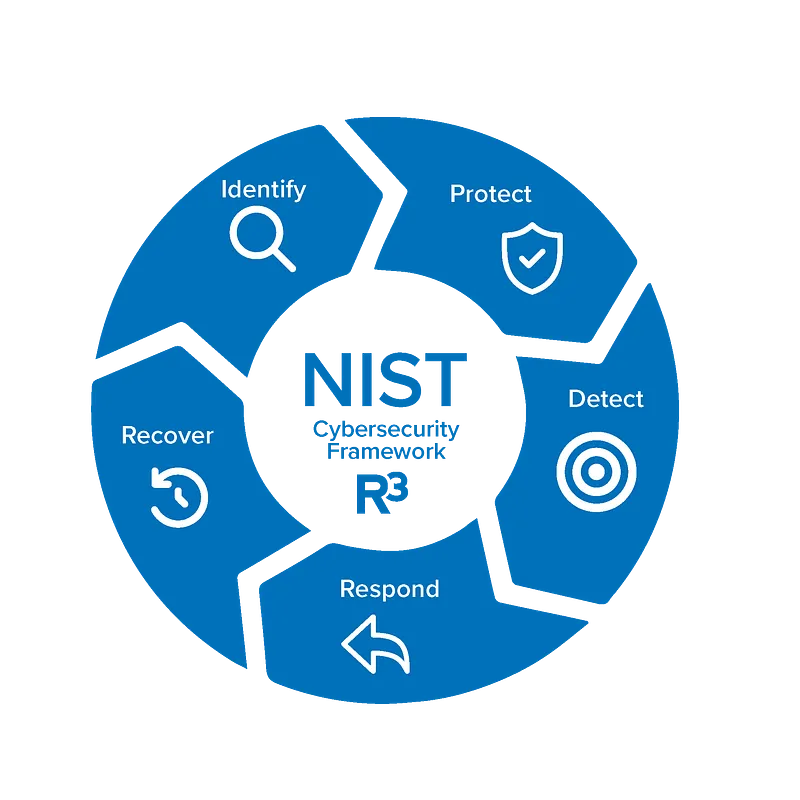

ABD Ulusal Standartlar ve Teknoloji Enstitüsü (NIST) tarafından geliştirilen bir çerçevedir. Kuruluşların siber güvenlik risklerini yönetmek ve iyileştirmek için bir rehber sunar.

#### COBIT (Control Objectives for Information Technologies)

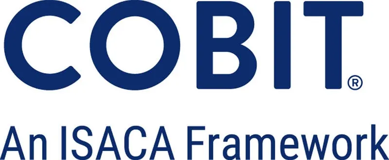

COBIT (Bilgi Teknolojileri için Kontrol Amaçları), BT yönetişimi ve yönetimi için bir çerçeve sunar. Bu standart, organizasyonların bilgi teknolojilerini etkin bir şekilde yönetmelerini ve güvenliğini sağlamalarını destekler. COBIT, süreçlerin kontrol edilmesini ve izlenmesini sağlar.

#### ITIL (Information Technology Infrastructure Library)

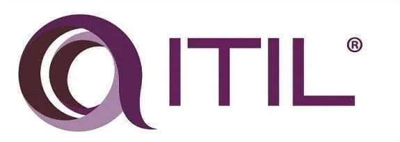

ITIL, BT hizmet yönetimi için bir çerçeve sunar ve organizasyonların BT hizmetlerini verimli, güvenli ve uyumlu bir şekilde yönetmelerine yardımcı olur. ITIL, süreçlerin etkinliğini artırmayı amaçlar.

#### MITRE ATT&CK

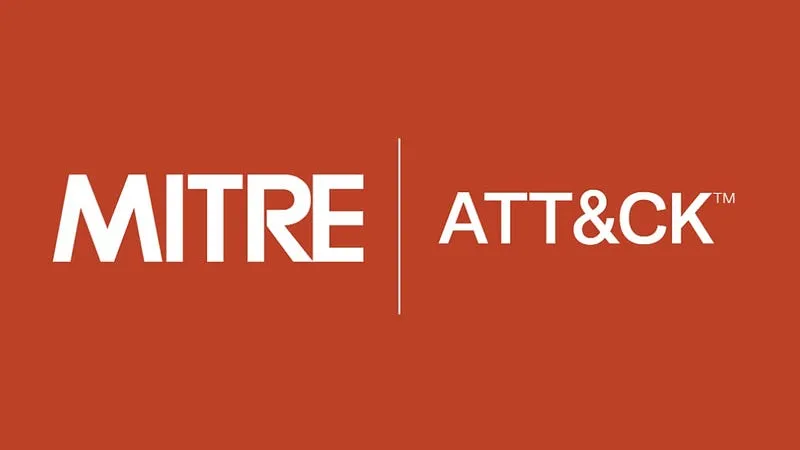

MITRE ATT&CK, gerçek dünya gözlemlerine dayanan, siber saldırgan taktiklerinin ve tekniklerinin küresel olarak erişilebilir bir bilgi tabanıdır. Saldırganların saldırı yaşam döngüsü boyunca kullandıkları taktikleri ve teknikleri detaylandırır. Bu çerçeve, kuruluşların saldırıları daha iyi anlamalarına, tehdit istihbaratını geliştirmelerine ve savunma stratejilerini optimize etmelerine yardımcı olur.

#### Cyber Kill Chain

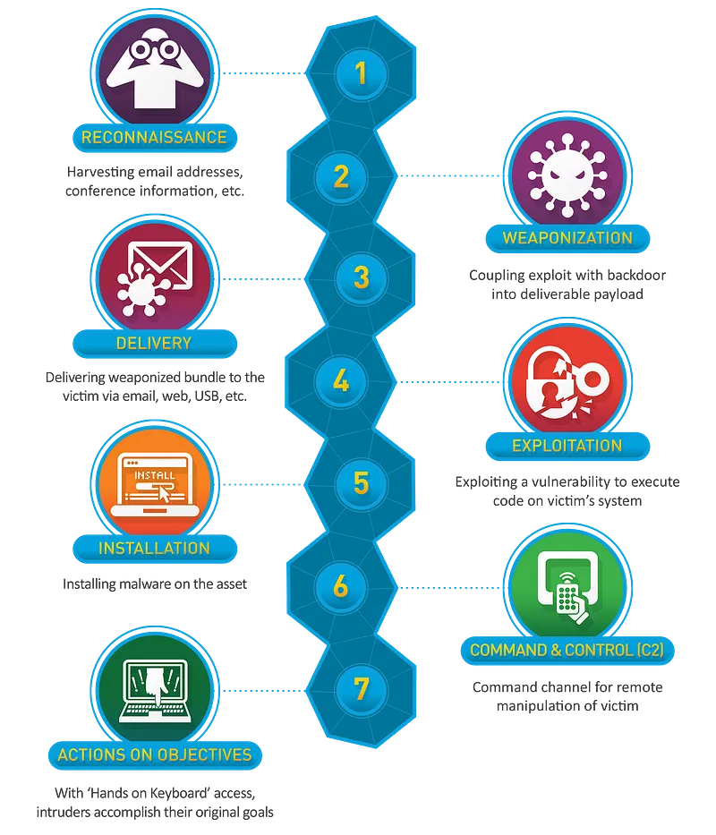

Lockheed Martin tarafından geliştirilen Siber Saldırı Zinciri, bir siber saldırının aşamalarını tanımlayan bir modeldir. Bu model, saldırganların hedeflerine ulaşmak için izledikleri yolları anlamaya ve savunma stratejileri geliştirmeye yardımcı olur. Siber saldırı zinciri, saldırganın hedefine ulaşması için geçmesi gereken yedi aşamayı tanımlar.

### Yasal Uyumluluk ve Veri Koruma Düzenlemeleri

#### GDPR (General Data Protection Regulation)

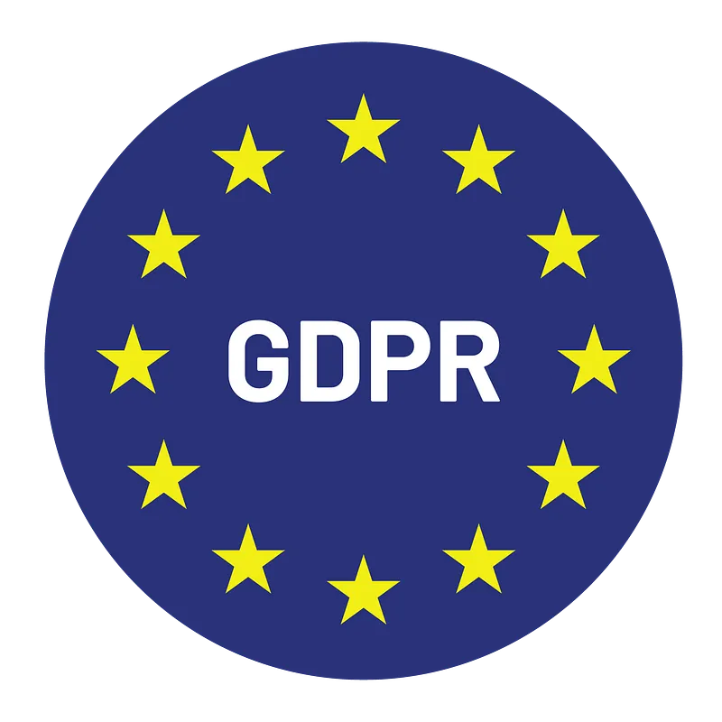

Avrupa Birliği Genel Veri Koruma Yönetmeliği (GDPR), kişisel verilerin korunması ve gizliliği için bir dizi düzenleme getirir. Bu düzenlemeler, bilgi güvenliği uygulamalarını kişisel veri işleme süreçlerine entegre etmeyi gerektirir.

#### KVKK (Kişisel Verilerin Korunması Kanunu)

Türkiye'de kişisel verilerin korunmasını düzenleyen bir kanundur. Kurumların kişisel verileri işlerken uyması gereken kuralları belirler ve veri ihlallerine karşı önlemler alınmasını zorunlu kılar.

#### PCI-DSS (Payment Card Industry Data Security Standard)

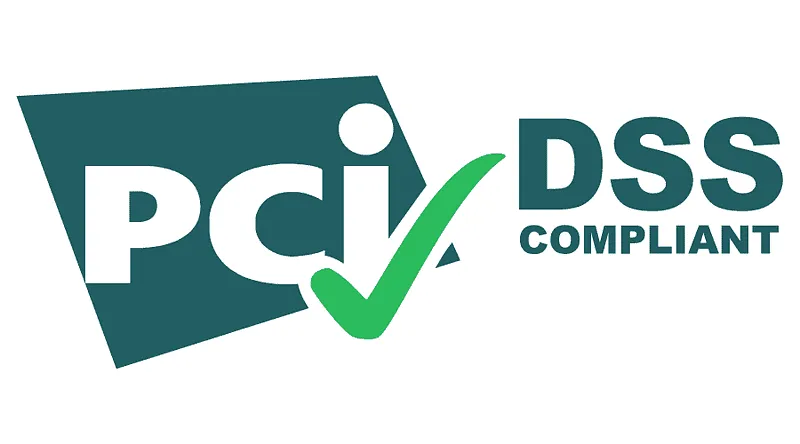

Ödeme Kartı Endüstrisi Veri Güvenliği Standardı (PCI-DSS), ödeme kartı bilgilerini korumaya yönelik zorunlu güvenlik gereksinimlerini tanımlar. Bu standart, ödeme kartı bilgilerini işleyen organizasyonların uyumlu olmasını sağlar.

#### HIPAA (Health Insurance Portability and Accountability Act)

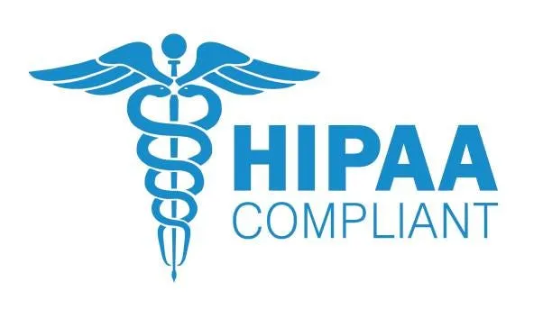

Amerika Birleşik Devletleri'nde sağlık hizmetleri ile ilgili kişisel sağlık bilgilerini korumak amacıyla oluşturulan Sağlık Sigortası Taşınabilirlik ve Sorumluluk Yasası (HIPAA), sağlık sektörü için bilgi güvenliği ve gizliliği gereksinimlerini belirler.

---

## Bilgi Teknolojileri ve Güvenliği Sertifika Kuruluşları

Bilgi teknolojileri ve güvenliği alanında, profesyonellerin yetkinliklerini belgeleyen ve uluslararası geçerliliği olan birçok sertifika bulunmaktadır. Bu sertifikalar, işverenler tarafından adayların bilgi düzeyini ve deneyimini değerlendirmek için önemli bir kriter olarak kabul edilir.

### ISC² (International Information System Security Certification Consortium)

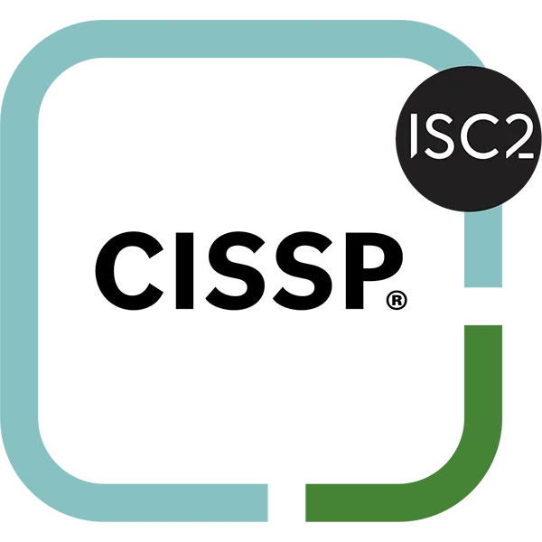

ISC², bilgi güvenliği profesyonelleri için uluslararası geçerliliği olan sertifikalar sunan, kar amacı gütmeyen bir kuruluştur. CISSP (Certified Information Systems Security Professional) gibi sektörde saygın sertifikalarıyla tanınan ISC², bilgi güvenliği alanında standartları belirlemekte ve bu alanda profesyonel gelişimi desteklemektedir.

### ISACA (Information Systems Audit and Control Association)

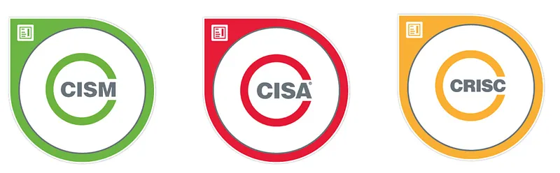

ISACA, bilgi sistemleri denetimi, kontrolü, güvenliği ve yönetişimi alanlarında uzmanlaşmış bir kuruluştur. CISA (Certified Information Systems Auditor), CISM (Certified Information Security Manager) ve CRISC (Certified in Risk and Information Systems Control) gibi sertifikalarıyla tanınır.

### CompTIA (Computing Technology Industry Association)

CompTIA, bilgi teknolojileri alanında geniş bir yelpazede sertifikalar sunan bir kuruluştur. CompTIA Security+, siber güvenlik alanında temel bilgi ve becerileri belgeleyen bir sertifikadır ve özellikle kariyerine yeni başlayanlar için uygundur.

### SANS Enstitüsü (SysAdmin, Audit, Network, Security)

SANS Enstitüsü, siber güvenlik eğitimleri ve sertifikasyonları konusunda dünya çapında tanınmış bir kuruluştur. Siber güvenlik profesyonelleri için çeşitli eğitim programları, sertifikalar ve kaynaklar sunar. SANS, siber güvenlik alanında uzmanlaşmak isteyenler için değerli bir kaynaktır ve endüstri standardı haline gelmiş sertifikalar sağlar.

### EC-Council

EC-Council, etik hackerlık ve siber güvenlik alanında sertifikalar sunan bir kuruluştur. CEH (Certified Ethical Hacker) sertifikası, etik hackerlık alanında bilgi ve becerileri belgeleyen önemli bir sertifikadır.

### Cloud Security Alliance (CSA)

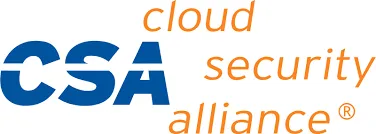

CSA, bulut güvenliği konusunda uzmanlaşmış bir organizasyondur ve CCSK (Certificate of Cloud Security Knowledge) gibi sertifikalar sunmaktadır. Bu sertifika, bulut tabanlı altyapıların güvenliği konusunda bilgi ve beceri kazandırır. CSA, ayrıca bulut güvenliği konusunda en iyi uygulamaları yaygınlaştırmak için çeşitli kaynaklar sağlar.

---

## Kurumsal Güvenlik Yönetişimi ve Sertifikasyon Ekosistemi

Bu yazımda Bilgi Teknolojileri ve Güvenliği alanında çalışan ulusal ve uluslararası kuruluşları ve bu kuruluşların oluşturdukları standartları ve ayrıca sertifika otoritelerini derledim. Umarım faydalı olmuştur. Eksik kaldığım noktalar varsa yorum kısmına sizde ekleyebilirsiniz.
