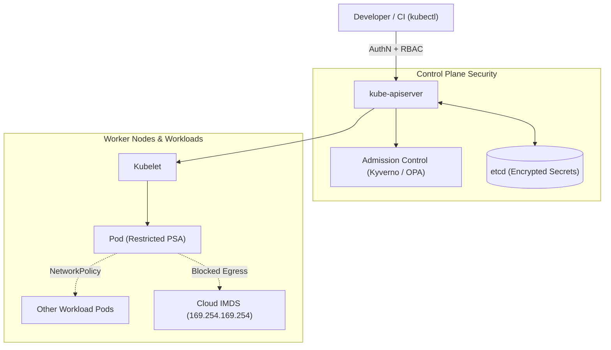

Kubernetes made it easy to scale applications, and in doing so it redefined the attack surface. Instead of protecting a single server, we now have to protect an API server, a distributed key-value store, agents running on every node and hundreds of pods that talk to each other freely. A default Kubernetes installation is optimized for functionality, not security: pods may run as root, every pod can reach every other pod, and service account tokens are mounted automatically.

In the [DevSecOps post](/en/blog/devsecops/) we covered pipeline security, GitOps and eBPF-based runtime visibility. This post turns the focus to the cluster itself: with practical configurations, we examine which controls must be applied at every layer, from the moment a workload is **admitted** to the cluster until it is **running**.

<div class="glass-panel reveal-on-scroll">

| Layer | Default State | Hardened Target |
| :--- | :--- | :--- |
| **Control Plane** | Broad RBAC, unencrypted Secrets | Least privilege, encryption in etcd, audit logs |
| **Admission** | Every manifest is accepted | Insecure pod specs rejected through Policy-as-Code |
| **Workload** | Root user, writable filesystem | Non-root, read-only root filesystem, dropped capabilities |
| **Network** | Flat network: every pod reaches every pod | Default deny, explicitly allowed flows |
| **Runtime** | Blind spot | Alerts for unexpected process and network activity |

</div>

---

## The Kubernetes Attack Surface

Effective hardening starts with knowing what is being protected. Kubernetes components run across different trust boundaries, and each has a different risk profile.



### Component-Level Risks

Each component has its own misconfiguration risks. In managed services (GKE, EKS, AKS) part of the control plane is the provider's responsibility, but RBAC, admission and workload security always remain the user's responsibility.

| Component | Typical Misconfiguration | Control |
| :--- | :--- | :--- |
| **API Server** | Anonymous access, broad `cluster-admin` bindings | `--anonymous-auth=false`, least-privilege RBAC, audit policy |
| **etcd** | Secrets stored in plain text, reachable from the network | `EncryptionConfiguration` (KMS v2), mTLS to the API Server only |
| **Kubelet** | Unauthenticated API, read-only port | `authentication.anonymous.enabled: false`, `authorization.mode: Webhook` |
| **Service Accounts** | Token mounted into every pod automatically | `automountServiceAccountToken: false`, short-lived projected tokens |
| **Cloud Identity** | Node identity usable from pods | Workload Identity / IRSA, restricted access to the metadata service |

The CIS Kubernetes Benchmark provides the complete list of these controls, tools such as `kube-bench` audit a cluster against the benchmark automatically and report the results in CI or in scheduled jobs.

---

## Admission Control: Security at the Gate

Admission controllers are the last checkpoint that validates or mutates an API request before an object is written to etcd. Rejecting an insecure pod spec here is far cheaper than trying to detect it after it is already running.

### Pod Security Admission

Kubernetes' built-in **Pod Security Admission** offers three ready-made profiles: `privileged`, `baseline` and `restricted`. The profile is applied with namespace labels and requires no additional component:

```yaml
apiVersion: v1
kind: Namespace
metadata:
  name: payments
  labels:
    pod-security.kubernetes.io/enforce: restricted
    pod-security.kubernetes.io/enforce-version: latest
    pod-security.kubernetes.io/warn: restricted
    pod-security.kubernetes.io/audit: restricted
```

The `restricted` profile enforces a non-root user, disabled privilege escalation, all Linux capabilities dropped and the `RuntimeDefault` seccomp profile. During migration, the `warn` and `audit` modes can be used first to see which workloads would be affected.

### Policy-as-Code with Kyverno

Pod Security Admission offers fixed profiles, organization-specific rules (allowed image registries, mandatory labels, resource limits, read-only root filesystems) require a policy engine. Kyverno defines policies in Kubernetes-native YAML:

```yaml
apiVersion: kyverno.io/v1
kind: ClusterPolicy
metadata:
  name: require-hardened-workloads
  annotations:
    policies.kyverno.io/category: Pod Security
spec:
  validationFailureAction: Enforce
  background: true
  rules:
    - name: hardened-security-context
      match:
        any:
          - resources:
              kinds: ["Pod"]
      validate:
        message: "Containers must run as non-root with a read-only root filesystem and no privilege escalation."
        pattern:
          spec:
            containers:
              - securityContext:
                  runAsNonRoot: true
                  readOnlyRootFilesystem: true
                  allowPrivilegeEscalation: false
                  capabilities:
                    drop: ["ALL"]
    - name: trusted-registries
      match:
        any:
          - resources:
              kinds: ["Pod"]
      validate:
        message: "Images must come from the internal registry."
        pattern:
          spec:
            containers:
              - image: "registry.internal.example.com/*"
```

For the same need, **OPA Gatekeeper** expresses policies in Rego and is more flexible for rules that require complex logic. **ValidatingAdmissionPolicy**, stable since Kubernetes 1.30, enables simple validations with CEL expressions and no external component. The choice should depend on the team's skills, policy complexity and operational load.

<div class="render-cards">
  <article class="render-card">
    <h4>Pod Security Admission</h4>
    <ul>
      <li><strong>Strength:</strong> Built in, no installation required.</li>
      <li><strong>Limit:</strong> Only three fixed profiles.</li>
    </ul>
  </article>
  <article class="render-card">
    <h4>Kyverno</h4>
    <ul>
      <li><strong>Strength:</strong> YAML-based, supports mutation and image signature verification.</li>
      <li><strong>Limit:</strong> An extra component and webhook to operate.</li>
    </ul>
  </article>
  <article class="render-card">
    <h4>OPA Gatekeeper</h4>
    <ul>
      <li><strong>Strength:</strong> Powerful, cross-platform policy language with Rego.</li>
      <li><strong>Limit:</strong> Steeper learning curve.</li>
    </ul>
  </article>
</div>

---

## Workload Hardening

Admission policies decide what gets rejected, development teams still need to write correct manifests from the start. The template below is a hardened Deployment that passes both the `restricted` profile and the Kyverno policy:

```yaml
apiVersion: apps/v1
kind: Deployment
metadata:
  name: payment-api
  namespace: payments
spec:
  replicas: 3
  selector:
    matchLabels: { app: payment-api }
  template:
    metadata:
      labels: { app: payment-api }
    spec:
      automountServiceAccountToken: false
      securityContext:
        runAsNonRoot: true
        runAsUser: 10001
        fsGroup: 10001
        seccompProfile:
          type: RuntimeDefault
      containers:
        - name: api
          image: registry.internal.example.com/payment-api@sha256:<digest>
          ports:
            - containerPort: 8080
          securityContext:
            allowPrivilegeEscalation: false
            readOnlyRootFilesystem: true
            capabilities:
              drop: ["ALL"]
          resources:
            requests: { cpu: "100m", memory: "128Mi" }
            limits: { memory: "256Mi" }
          volumeMounts:
            - name: tmp
              mountPath: /tmp
      volumes:
        - name: tmp
          emptyDir: {}
```

Details worth noting: the image is pinned by **digest** rather than a tag (tags are mutable), directories the application must write to are mounted separately with `emptyDir` to allow a read-only filesystem, and the memory limit prevents a single pod from exhausting the node.

---

## Zero Trust East-West Traffic with Network Policies

Kubernetes' default network model is flat: any pod can connect to any pod in the cluster. A single compromised frontend pod can reach the database or internal management services directly. Network Policies turn this model into "deny by default, allow explicitly".

### Default Deny and Explicit Allows

The first step is to block all ingress and egress traffic in the namespace. Then only the required flows are opened one by one:

```yaml
apiVersion: networking.k8s.io/v1
kind: NetworkPolicy
metadata:
  name: default-deny-all
  namespace: payments
spec:
  podSelector: {}
  policyTypes: ["Ingress", "Egress"]
---
apiVersion: networking.k8s.io/v1
kind: NetworkPolicy
metadata:
  name: api-to-db
  namespace: payments
spec:
  podSelector:
    matchLabels: { app: payment-db }
  policyTypes: ["Ingress"]
  ingress:
    - from:
        - podSelector:
            matchLabels: { app: payment-api }
      ports:
        - protocol: TCP
          port: 5432
---
apiVersion: networking.k8s.io/v1
kind: NetworkPolicy
metadata:
  name: allow-dns-egress
  namespace: payments
spec:
  podSelector: {}
  policyTypes: ["Egress"]
  egress:
    - to:
        - namespaceSelector:
            matchLabels:
              kubernetes.io/metadata.name: kube-system
          podSelector:
            matchLabels: { k8s-app: kube-dns }
      ports:
        - { protocol: UDP, port: 53 }
        - { protocol: TCP, port: 53 }
```

A default-deny policy also blocks DNS resolution, so the rule allowing DNS egress must not be forgotten. Egress rules are also used to block pods from reaching the cloud metadata service (`169.254.169.254`), if pods need a cloud identity, it should be provided through mechanisms such as Workload Identity or IRSA, independent of the node identity.

> [!IMPORTANT]
> NetworkPolicy objects only take effect with a CNI plugin that enforces them (Calico, Cilium, etc.). On a CNI without support, policies are silently ignored, so every cluster must be tested to confirm that the policy really blocks traffic.

eBPF-based CNIs such as Cilium take this model a step further with L7 policies (HTTP path, gRPC method) and identity-based mTLS between services.

---

## Runtime Monitoring: Behavioral Detection with Falco

Admission and network policies are preventive controls, but when a vulnerability inside a legitimate image is exploited, the attacker operates within the allowed boundaries. Runtime monitoring catches **unexpected behavior** inside the container. Falco enriches system calls with Kubernetes metadata and raises rule-based alerts.

### A Workload-Specific Example

An interactive shell opening inside a production payment service container is almost always an event worth investigating. The rule below uses macros from Falco's default rule set and scopes the event to a namespace:

```yaml
- rule: Shell Spawned in Payments Container
  desc: An interactive shell was started inside a container in the payments namespace.
  condition: >
    spawned_process and container
    and proc.name in (shell_binaries)
    and k8s.ns.name = "payments"
  output: >
    Shell in payments container
    (user=%user.name pod=%k8s.pod.name container=%container.name
    image=%container.image.repository cmdline=%proc.cmdline parent=%proc.pname)
  priority: WARNING
  tags: [container, shell, mitre_execution]
```

Runtime alerts should not be left on their own. When Falco output is shipped to the SIEM and put through the same lifecycle (testing, metrics, tuning) as the [Detection-as-Code](/en/blog/detection-engineering-as-code/) approach, cluster security becomes part of the SOC's overall detection strategy. For in-kernel enforcement and the eBPF architecture in detail, see the runtime section of the [DevSecOps post](/en/blog/devsecops/).

---

## Implementation Priorities

Rolling out every control at once strains teams and creates outage risk. The order below delivers the largest risk reduction for the lowest operational cost:

1. **RBAC review:** Inventory `cluster-admin` bindings and wildcard (`*`) permissions, and disable automatic service account token mounting.
2. **Pod Security Admission:** In every namespace, first `warn`/`audit`, then `enforce: restricted` (or `baseline` in namespaces with exceptions).
3. **Default-deny Network Policies:** Starting with critical namespaces, restrict east-west traffic to explicit allows.
4. **Organization-specific policies:** Kyverno or Gatekeeper for trusted registries, digest-pinned images and resource limits.
5. **Runtime monitoring:** Connect Falco rules to the SIEM and start measuring alert quality.

Kubernetes security comes not from a single tool but from complementary layers: every insecure manifest rejected at the gate removes an event that would otherwise have to be caught at runtime. Be the architect of your infrastructure, and draw your trust boundaries in code.
