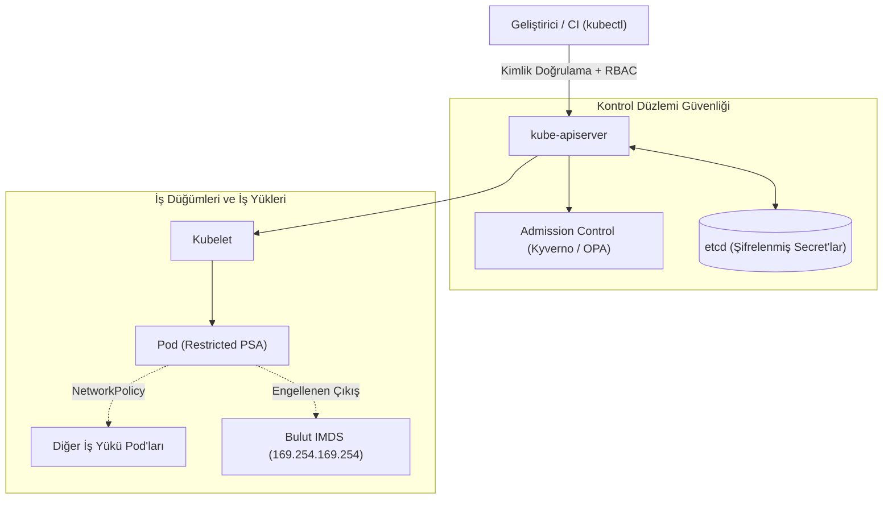

Kubernetes, uygulamaları ölçeklendirmeyi kolaylaştırırken saldırı yüzeyini de yeniden tanımladı. Tek bir sunucuyu korumak yerine artık bir API sunucusunu, dağıtık bir anahtar-değer deposunu, her düğümde çalışan ajanları ve birbiriyle serbestçe konuşan yüzlerce pod'u korumak gerekiyor. Varsayılan Kubernetes kurulumu işlevsellik için optimize edilmiştir, güvenlik için değil: pod'lar root olarak çalışabilir, her pod diğer her pod'a erişebilir ve servis hesabı token'ları otomatik olarak bağlanır.

[DevSecOps yazısında](/tr/blog/devsecops/) pipeline güvenliğini, GitOps'u ve eBPF tabanlı runtime görünürlüğünü ele almıştık. Bu yazı, odağı doğrudan kümenin kendisine çeviriyor: bir iş yükünün kümeye **kabul edilmesinden** (admission) **runtime'a** kadar her katmanda hangi kontrollerin uygulanması gerektiğini, uygulanabilir yapılandırmalarla inceliyoruz.

<div class="glass-panel reveal-on-scroll">

| Katman | Varsayılan Durum | Sıkılaştırılmış Hedef |
| :--- | :--- | :--- |
| **Kontrol Düzlemi** | Geniş RBAC, şifrelenmemiş Secret'lar | En az ayrıcalık, etcd'de şifreleme, denetim logları |
| **Admission** | Her manifest kabul edilir | Policy-as-Code ile reddedilen güvensiz pod tanımları |
| **İş Yükü** | Root kullanıcı, yazılabilir dosya sistemi | Non-root, salt okunur kök dosya sistemi, düşürülmüş yetenekler |
| **Ağ** | Düz ağ: her pod her pod'a erişir | Varsayılan ret, açıkça izin verilen akışlar |
| **Runtime** | Kör nokta | Beklenmeyen süreç ve ağ aktivitesi için alarm |

</div>

---

## Kubernetes Saldırı Yüzeyi

Etkili bir sıkılaştırma, neyin korunduğunu bilmekle başlar. Kubernetes'in bileşenleri farklı güven sınırlarında çalışır ve her biri farklı bir risk profiline sahiptir.



### Bileşen Bazlı Riskler

Her bileşenin kendine özgü yanlış yapılandırma riskleri vardır. Yönetilen servislerde (GKE, EKS, AKS) kontrol düzleminin bir kısmı sağlayıcının sorumluluğundadır, ancak RBAC, admission ve iş yükü güvenliği her zaman kullanıcının sorumluluğunda kalır.

| Bileşen | Tipik Yanlış Yapılandırma | Kontrol |
| :--- | :--- | :--- |
| **API Server** | Anonim erişim, geniş `cluster-admin` bağlamaları | `--anonymous-auth=false`, en az ayrıcalıklı RBAC, denetim (audit) politikası |
| **etcd** | Secret'ların düz metin saklanması, ağdan erişilebilirlik | `EncryptionConfiguration` (KMS v2), yalnızca API Server'a mTLS |
| **Kubelet** | Kimlik doğrulamasız API, salt okunur port | `authentication.anonymous.enabled: false`, `authorization.mode: Webhook` |
| **Servis Hesapları** | Her pod'a otomatik bağlanan token | `automountServiceAccountToken: false`, kısa ömürlü projected token'lar |
| **Bulut Kimliği** | Düğüm kimliğinin pod'lardan kullanılabilmesi | Workload Identity / IRSA, metadata servisine erişimin kısıtlanması |

CIS Kubernetes Benchmark bu kontrollerin tam listesini sunar. `kube-bench` gibi araçlar ise kümeyi bu karşılaştırmaya göre otomatik olarak denetler ve sonuçları CI ortamında veya periyodik işlerde raporlar.

---

## Admission Kontrolü: Kapıdaki Güvenlik

Admission controller'lar, bir nesne etcd'ye yazılmadan önce API isteğini doğrulayan veya değiştiren son kontrol noktasıdır. Güvensiz bir pod tanımını burada reddetmek, onu çalıştıktan sonra tespit etmeye çalışmaktan çok daha ucuzdur.

### Pod Security Admission

Kubernetes'in yerleşik **Pod Security Admission** mekanizması, üç hazır profil sunar: `privileged`, `baseline` ve `restricted`. Profil, namespace etiketleriyle uygulanır ve ek bir bileşen kurulumu gerektirmez:

```yaml
apiVersion: v1
kind: Namespace
metadata:
  name: payments
  labels:
    pod-security.kubernetes.io/enforce: restricted
    pod-security.kubernetes.io/enforce-version: latest
    pod-security.kubernetes.io/warn: restricted
    pod-security.kubernetes.io/audit: restricted
```

`restricted` profili, root olmayan kullanıcıyı, yetki yükseltmenin kapatılmasını, tüm Linux yeteneklerinin düşürülmesini ve `RuntimeDefault` seccomp profilini zorunlu kılar. Geçiş döneminde önce `warn` ve `audit` modları kullanılarak hangi iş yüklerinin etkileneceği görülebilir.

### Kyverno ile Policy-as-Code

Pod Security Admission sabit profiller sunar, kuruma özgü kurallar (izin verilen imaj kayıt defterleri, zorunlu etiketler, kaynak limitleri, salt okunur kök dosya sistemi) için bir politika motoru gerekir. Kyverno, politikaları Kubernetes'e özgü YAML ile tanımlar:

```yaml
apiVersion: kyverno.io/v1
kind: ClusterPolicy
metadata:
  name: require-hardened-workloads
  annotations:
    policies.kyverno.io/category: Pod Security
spec:
  validationFailureAction: Enforce
  background: true
  rules:
    - name: hardened-security-context
      match:
        any:
          - resources:
              kinds: ["Pod"]
      validate:
        message: "Containers must run as non-root with a read-only root filesystem and no privilege escalation."
        pattern:
          spec:
            containers:
              - securityContext:
                  runAsNonRoot: true
                  readOnlyRootFilesystem: true
                  allowPrivilegeEscalation: false
                  capabilities:
                    drop: ["ALL"]
    - name: trusted-registries
      match:
        any:
          - resources:
              kinds: ["Pod"]
      validate:
        message: "Images must come from the internal registry."
        pattern:
          spec:
            containers:
              - image: "registry.internal.example.com/*"
```

Aynı ihtiyaç için **OPA Gatekeeper**, politikaları Rego diliyle ifade eder ve karmaşık mantık gerektiren kurallarda daha esnektir. Kubernetes 1.30 ile kararlı hale gelen **ValidatingAdmissionPolicy** ise CEL ifadeleriyle harici bir bileşen olmadan basit doğrulamaları mümkün kılar. Seçim, ekibin yetkinliğine, politika karmaşıklığına ve operasyonel yüke göre yapılmalıdır.

<div class="render-cards">
  <article class="render-card">
    <h4>Pod Security Admission</h4>
    <ul>
      <li><strong>Avantaj:</strong> Yerleşik, kurulum gerektirmez.</li>
      <li><strong>Sınır:</strong> Yalnızca üç sabit profil.</li>
    </ul>
  </article>
  <article class="render-card">
    <h4>Kyverno</h4>
    <ul>
      <li><strong>Avantaj:</strong> YAML tabanlı, mutasyon ve imaj imza doğrulama desteği.</li>
      <li><strong>Sınır:</strong> Ek bileşen ve webhook işletimi.</li>
    </ul>
  </article>
  <article class="render-card">
    <h4>OPA Gatekeeper</h4>
    <ul>
      <li><strong>Avantaj:</strong> Rego ile güçlü, platformlar arası politika dili.</li>
      <li><strong>Sınır:</strong> Daha dik öğrenme eğrisi.</li>
    </ul>
  </article>
</div>

---

## İş Yükü Sıkılaştırması

Admission politikaları neyin reddedileceğini belirler, geliştirici ekiplerin ise baştan doğru manifest yazması gerekir. Aşağıdaki şablon, `restricted` profilini ve Kyverno politikasını geçen sıkılaştırılmış bir Deployment örneğidir:

```yaml
apiVersion: apps/v1
kind: Deployment
metadata:
  name: payment-api
  namespace: payments
spec:
  replicas: 3
  selector:
    matchLabels: { app: payment-api }
  template:
    metadata:
      labels: { app: payment-api }
    spec:
      automountServiceAccountToken: false
      securityContext:
        runAsNonRoot: true
        runAsUser: 10001
        fsGroup: 10001
        seccompProfile:
          type: RuntimeDefault
      containers:
        - name: api
          image: registry.internal.example.com/payment-api@sha256:<digest>
          ports:
            - containerPort: 8080
          securityContext:
            allowPrivilegeEscalation: false
            readOnlyRootFilesystem: true
            capabilities:
              drop: ["ALL"]
          resources:
            requests: { cpu: "100m", memory: "128Mi" }
            limits: { memory: "256Mi" }
          volumeMounts:
            - name: tmp
              mountPath: /tmp
      volumes:
        - name: tmp
          emptyDir: {}
```

Burada dikkat edilmesi gereken detaylar: imaj etiket yerine **digest** ile sabitlenir (etiketler değiştirilebilir), salt okunur dosya sistemi için uygulamanın yazması gereken dizinler `emptyDir` ile ayrıca bağlanır ve bellek limiti, tek bir pod'un düğümü tüketmesini engeller.

---

## Network Policy ile Zero Trust Doğu-Batı Trafiği

Kubernetes'in varsayılan ağ modeli düzdür: herhangi bir pod, kümedeki herhangi bir pod'a bağlanabilir. Ele geçirilen tek bir ön yüz pod'u, doğrudan veritabanına veya iç yönetim servislerine ulaşabilir. Network Policy, bu modeli "varsayılan ret, açık izin" prensibine çevirir.

### Varsayılan Ret ve Açık İzinler

İlk adım, namespace içindeki tüm giriş ve çıkış trafiğini kapatmaktır. Ardından yalnızca gerekli akışlar tek tek açılır:

```yaml
apiVersion: networking.k8s.io/v1
kind: NetworkPolicy
metadata:
  name: default-deny-all
  namespace: payments
spec:
  podSelector: {}
  policyTypes: ["Ingress", "Egress"]
---
apiVersion: networking.k8s.io/v1
kind: NetworkPolicy
metadata:
  name: api-to-db
  namespace: payments
spec:
  podSelector:
    matchLabels: { app: payment-db }
  policyTypes: ["Ingress"]
  ingress:
    - from:
        - podSelector:
            matchLabels: { app: payment-api }
      ports:
        - protocol: TCP
          port: 5432
---
apiVersion: networking.k8s.io/v1
kind: NetworkPolicy
metadata:
  name: allow-dns-egress
  namespace: payments
spec:
  podSelector: {}
  policyTypes: ["Egress"]
  egress:
    - to:
        - namespaceSelector:
            matchLabels:
              kubernetes.io/metadata.name: kube-system
          podSelector:
            matchLabels: { k8s-app: kube-dns }
      ports:
        - { protocol: UDP, port: 53 }
        - { protocol: TCP, port: 53 }
```

Varsayılan ret politikası DNS çözümlemesini de keser, bu yüzden DNS çıkışına izin veren kural unutulmamalıdır. Çıkış (egress) kuralları ayrıca pod'ların bulut metadata servisine (`169.254.169.254`) erişimini engellemek için de kullanılır, pod'ların bulut kimliğine ihtiyacı varsa bu erişim Workload Identity veya IRSA gibi mekanizmalarla, düğüm kimliğinden bağımsız olarak sağlanmalıdır.

> [!IMPORTANT]
> Network Policy nesneleri yalnızca bunları uygulayan bir CNI eklentisiyle (Calico, Cilium vb.) etkilidir. Desteklemeyen bir CNI'da politikalar hata vermeden yok sayılır, bu yüzden her kümede politikanın gerçekten trafiği engellediği test edilmelidir.

Cilium gibi eBPF tabanlı CNI'lar. L7 (HTTP yolu, gRPC metodu) seviyesinde politika ve servis kimliğine dayalı mTLS ile bu modeli bir adım öteye taşır.

---

## Runtime İzleme: Falco ile Davranış Tespiti

Admission ve ağ politikaları önleyici kontrollerdir, ancak meşru bir imaj içindeki bir zafiyet istismar edildiğinde saldırgan izin verilen sınırlar içinde hareket eder. Runtime izleme, container içinde **beklenmeyen davranışı** yakalar. Falco, sistem çağrılarını Kubernetes meta verisiyle zenginleştirerek kural tabanlı alarm üretir.

### Kurala Özgü Örnek

Üretimdeki bir ödeme servisi container'ında etkileşimli bir kabuk açılması, neredeyse her zaman araştırılması gereken bir olaydır. Aşağıdaki kural, Falco'nun varsayılan kural setindeki makroları kullanır ve olayı namespace ile sınırlar:

```yaml
- rule: Shell Spawned in Payments Container
  desc: An interactive shell was started inside a container in the payments namespace.
  condition: >
    spawned_process and container
    and proc.name in (shell_binaries)
    and k8s.ns.name = "payments"
  output: >
    Shell in payments container
    (user=%user.name pod=%k8s.pod.name container=%container.name
    image=%container.image.repository cmdline=%proc.cmdline parent=%proc.pname)
  priority: WARNING
  tags: [container, shell, mitre_execution]
```

Runtime alarmları tek başına bırakılmamalıdır. Falco çıktıları SIEM'e aktarılıp [Detection-as-Code](/tr/blog/detection-engineering-as-code/) yaklaşımıyla aynı yaşam döngüsünden (test, metrik, ayar) geçirildiğinde, küme güvenliği SOC'un genel tespit stratejisinin bir parçası haline gelir. Çekirdek seviyesinde engelleme ve eBPF mimarisinin ayrıntıları için [DevSecOps yazısındaki](/tr/blog/devsecops/) runtime bölümüne bakabilirsiniz.

---

## Uygulama Önceliklendirmesi

Tüm kontrolleri aynı anda devreye almak hem ekipleri zorlar hem de kesinti riski yaratır. Aşağıdaki sıralama, en yüksek risk azaltımını en düşük operasyonel maliyetle sağlar:

1. **RBAC denetimi:** `cluster-admin` bağlamalarını ve joker (`*`) yetkileri envanterleyin, servis hesabı token'larının otomatik bağlanmasını kapatın.
2. **Pod Security Admission:** Tüm namespace'lerde önce `warn`/`audit`, ardından `enforce: restricted` (veya istisnalı namespace'lerde `baseline`).
3. **Varsayılan ret Network Policy:** Kritik namespace'lerden başlayarak doğu-batı trafiğini açık izinlere bağlayın.
4. **Kuruma özgü politikalar:** Güvenilir registry'ler, digest ile imaj sabitleme ve kaynak limitleri için Kyverno veya Gatekeeper.
5. **Runtime izleme:** Falco kurallarını SIEM'e bağlayın ve alarm kalitesini ölçmeye başlayın.

Kubernetes güvenliği tek bir araçla değil, birbirini tamamlayan katmanlarla sağlanır: kapıda reddedilen her güvensiz manifest, runtime'da yakalanması gereken bir olayı daha baştan ortadan kaldırır. Altyapınızın mimarı olun ve güven sınırlarınızı kodla çizin.
