Web geliştirme ekosistemi, performans, ölçeklenebilirlik ve güvenlik gereksinimlerinin sürekli artmasıyla birlikte köklü bir evrim geçiriyor. Geleneksel monolitik İçerik Yönetim Sistemlerinin (CMS) hantallığı, sunucu tarafında yarattıkları işlem yükleri ve bitmek bilmeyen eklenti zafiyetleri, modern mühendisliği çok daha çevik, hafif ve güvenli mimarilere yönelmeye zorladı.

Özellikle yüksek trafikli e-ticaret platformları inşa eden veya sistem güvenliğini (DevSecOps) önceliklendiren mühendisler için mimari kararlar artık "hangi dili kullansak?" sorusunun çok ötesinde. Geleneksel CMS yapılarından Statik Site Üreticilerine (SSG) uzanan yolculuğu, modern görüntüleme (rendering) stratejilerini ve uçtan uca web ekosistemini teknik bir anatomi problemi olarak inceliyoruz.

---

## Neden cPanel Merkezli Düşünceden Uzaklaşıyoruz?

Yıllar boyunca internetin omurgasını Linux, Apache, MySQL ve PHP'den oluşan LAMP yığını ve bu yığın üzerinde koşan WordPress gibi monolitik CMS'ler oluşturdu. Ancak geleneksel bir CMS, kullanıcı her sayfa talep ettiğinde veritabanına bağlanmak, veriyi çekmek ve HTML'i sunucuda anlık olarak inşa etmek zorundadır. Bu "Just-in-Time" yaklaşımı, ani trafik patlamalarında sunucu darboğazı yaratırken, dışarıdan gelebilecek SQL Enjeksiyonu veya sunucu taraflı RCE (Uzaktan Kod Çalıştırma) saldırılarına geniş bir kapı aralar.

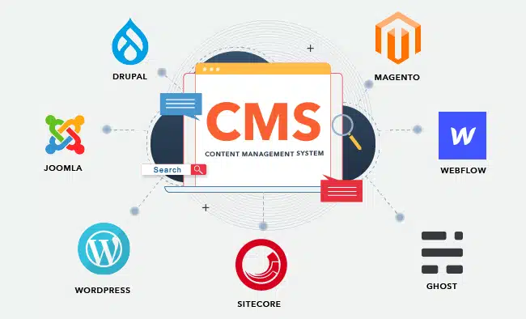
*Geleneksel monolitik mimari akışı: Veritabanı ve sunucu bağımlılığı performans darboğazlarına yol açar.*

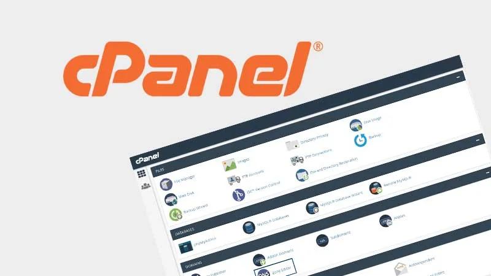
*Klasik cPanel ortamı: Kolay ama geniş bir saldırı yüzeyi barındıran "sunucu yönetme" modeli.*

Klasik paylaşımlı hosting modelleri (cPanel, Plesk) fonksiyonel görünse de üç kalıcı maliyet üretir:

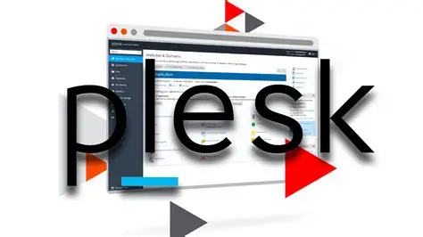
*Plesk: cPanel ile aynı operasyonel ödünleşimleri taşıyan panel merkezli hosting modeli.*

- **Performans Maliyeti:** Her istekte dinamik hesaplama ve veritabanı gecikmesi. Ziyaretçi geldiğinde PHP uyanır, MySQL sorgusu atılır ve sayfa o an birleştirilir. Milisaniyelerin dönüştürme oranını belirlediği modern webde bu gecikme kabul edilemez.
- **Güvenlik Maliyeti:** Panel + tema + eklentiler + sunucu çalışma zamanının (runtime) oluşturduğu devasa saldırı yüzeyi. İhtiyaç duyulmayan her dinamik bileşen potansiyel bir siber risk alanıdır.
- **Operasyonel Maliyet:** Sürekli yama yönetimi, sürüm uyumlulukları ve kesintisiz izleme yükü.

Eski tip sunucu kur-yönet modelinden uzaklaşmamızın temel nedeni, altyapıyla boğuşmak yerine **çıktıyı doğrudan kullanıcıya en yakın noktadan (Edge CDN) servis etmeye** odaklanmaktır.

---

## Rendering Anatomisi: CSR, SSR, SSG, ISR

Bir web uygulamasının ekrana nasıl çizileceği, sistemin ani yük dalgalanmalarını çökmeden nasıl kaldırabileceğini belirler. Modern web mühendisliği, HTML'in nerede ve ne zaman üretildiğine göre dört ana strateji üzerinde yükselir:

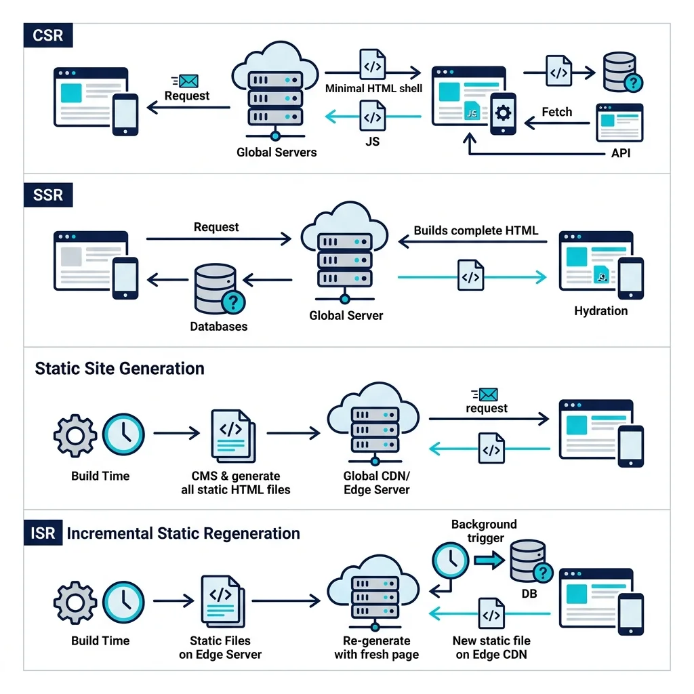
*Modern rendering mimarileri: CSR, SSR, SSG ve ISR'nin veri akış modelleri.*

<article class="render-card render-card-csr reveal-on-scroll">

CSR
<h3>Client-Side Rendering</h3>

Sunucu boş bir HTML kabuğu döner. Sayfanın inşası kullanıcının tarayıcısında JavaScript ile tamamlanır.

<ul>
<li><strong>İlk Görünüm:</strong> JavaScript dosyasının indirilip çalıştırılmasına bağlıdır (SPA deneyimi).</li>
<li><strong>SEO:</strong> Arama motoru botları için ek optimizasyon ve hydration gerektirir.</li>
<li><strong>İdeal Senaryo:</strong> Dahili yönetim panelleri, CRM ve kullanıcı oturumu gerektiren dashboard'lar.</li>
</ul>
</article>

<article class="render-card render-card-ssr reveal-on-scroll">

SSR
<h3>Server-Side Rendering</h3>

Her gelen istek için HTML sayfası sunucu tarafında taze veriyle anlık olarak derlenir.

<ul>
<li><strong>İlk Görünüm:</strong> Arama motorları ve ilk içerik çizimi (TTFB) için mükemmeldir.</li>
<li><strong>Güvenlik:</strong> Hassas API anahtarları istemciye sızmaz, sunucu katmanında kalır.</li>
<li><strong>İdeal Senaryo:</strong> Dinamik stok takibi, canlı fiyatlandırma ve kişiselleştirilmiş kullanıcı akışları.</li>
</ul>
</article>

<article class="render-card render-card-ssg reveal-on-scroll">

SSG
<h3>Static Site Generation</h3>

Sayfalar derleme (build) aşamasında bir kez üretilir ve global CDN ağları üzerinden doğrudan dağıtılır.

<ul>
<li><strong>Güvenlik:</strong> Veritabanı ve sunucu kodu kullanıcıya kapalıdır, saldırı yüzeyi sıfıra iner.</li>
<li><strong>Hız:</strong> Milisaniyelik yüklenme süreleri (Sıfır veritabanı sorgusu).</li>
<li><strong>İdeal Senaryo:</strong> Teknik dokümantasyonlar, şirket sayfaları ve siber güvenlik blogları.</li>
</ul>
</article>

<article class="render-card render-card-isr reveal-on-scroll">

ISR
<h3>Incremental Static Regeneration</h3>

SSG hızını SSR güncelliğiyle birleştirir. Tüm siteyi yeniden derlemeden yalnızca değişen sayfalar arka planda yenilenir.

<ul>
<li><strong>Avantaj:</strong> Milyonlarca sayfalık devasa kataloglarda build sürelerini dakikalara indirir.</li>
<li><strong>Performans:</strong> Statik hızında dinamik veri sunumu (stale-while-revalidate).</li>
<li><strong>İdeal Senaryo:</strong> Büyük e-ticaret siteleri ve haber portalları.</li>
</ul>
</article>

### Hibrit Yaklaşımlar ve "Adalar" Mimarisi (Islands Architecture)
Milyonlarca ürünü olan platformlar için hibrit mimariler vazgeçilmezdir. **Astro** ile ana akım haline gelen **Islands Architecture (Adalar Mimarisi)**, sayfanın varsayılanını "Sıfır JavaScript" (salt HTML/CSS) olarak kurgular. Yalnızca dinamik etkileşim gerektiren bileşenler (arama çubuğu, sepet butonu, yorum alanı) bağımsız "adalar" olarak istemci tarafında canlandırılır (hydrate edilir). Bu sayede tarayıcıya megabaytlarca gereksiz JS yüklenmesi engellenir. Hugo ve mdBook gibi araçlar ise derleme hızında Go ve Rust'ın gücünü kullanarak binlerce sayfayı saniyeler içinde işler.

---

## Mimari Karar Matrisi: Hangi Model Ne Zaman Seçilmeli?

Doğru mimariyi seçmek projenin teknik kaderini belirler:

1. **İçerik çoğunlukla editörler veya Markdown ile mi üretiliyor?**
   * **Evet:** SSG tarafına odaklanın (Astro / Hugo). Örneğin GitHub Pages üzerinde çalışan statik yapılar dışarıdan kod enjeksiyonunu tamamen imkansız kılar.
   * **Hayır, kullanıcı aksiyonlarına göre anlık değişiyor:** SSR veya ISR düşünün (Next.js / Nuxt).
2. **Kişiselleştirilmiş kullanıcı oturumları kritik mi?**
   * **Evet:** Hibrit mimari (SSR + Edge Caching + Middleware).
   * **Hayır:** SSG + adacık tabanlı etkileşim ile maksimum performans.
3. **Ekibin operasyonel bakım kapasitesi sınırlı mı?**
   * **Evet:** Çalışma zamanı barındırmayan statik mimariler (Cloudflare Pages, Vercel) yama ve sunucu izleme yükünü sıfırlar.
   * **Hayır:** Konteyner tabanlı Kubernetes veya mikroservis mimarileri yönetilebilir.
4. **Yayınlama sıklığı dakikalık düzeyde dinamik mi?**
   * **Evet:** ISR veya Next.js "on-demand revalidation" yetenekleri en doğru tercihtir.
   * **Hayır:** Saf SSG mimarisi sarsılmaz bir kararlılık sağlar.

---

## Popüler Teknoloji Yığınları ve Mimari Karşılaştırma

Modern web ekosisteminde başarı, hız, güvenlik ve operasyonel sürdürülebilirlik dengesini kurabilen doğru teknoloji seçimiyle mümkündür.

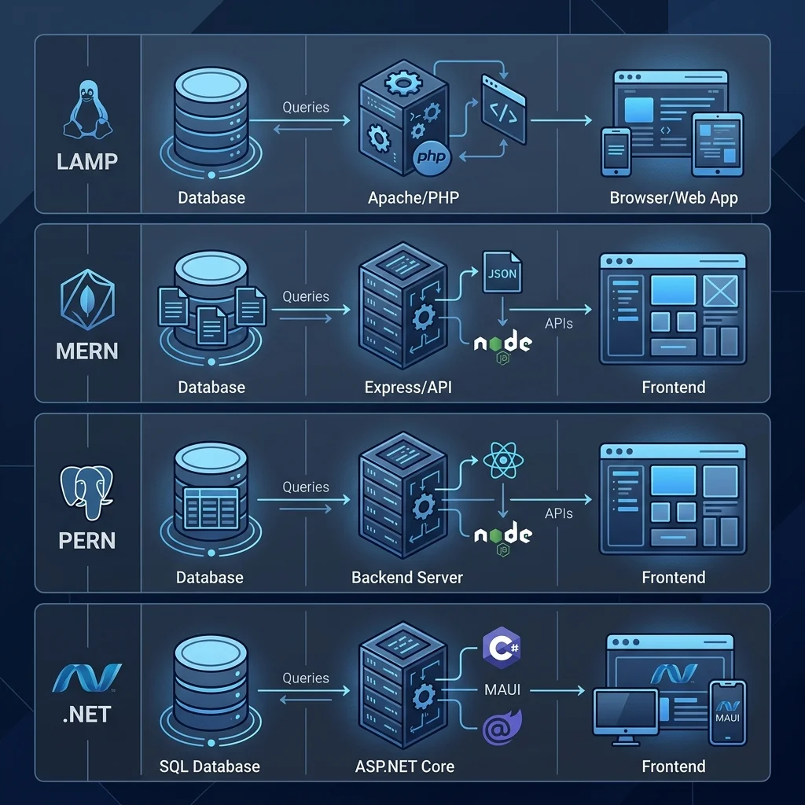

### LAMP Stack (Linux, Apache, MySQL, PHP)
Yirmi yılı aşkın süredir internetin büyük bölümünü ayakta tutan monolitik devdir.
* **Mimari:** Sunucu tarafı render (SSR) temellidir. Her istek Apache tarafından karşılanır, PHP MySQL ile konuşur ve HTML tarayıcıya iletilir.
* **Artıları:** Kurulumu basittir, paylaşımlı hostinglerde sorunsuz çalışır, kaynak kütüphanesi devasadır.
* **Riskleri:** Anlık yoğun trafikte dikey ölçekleme zordur. Güncellenmeyen eklentiler RCE ve SQLi zafiyetlerine davetiye çıkarır.

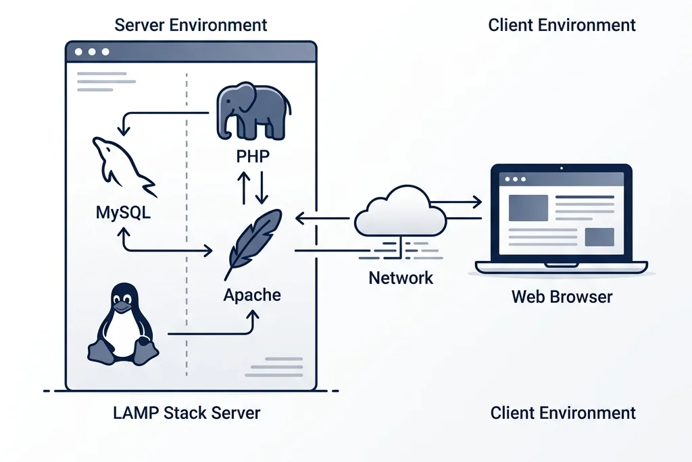
*LAMP Mimarisi: Linux sunucu üzerinde Apache, MySQL ve PHP katmanlarının SSR tabanlı çalışması.*

### MERN / MEAN Stack (MongoDB, Express, React/Angular, Node.js)
Hem sunucuda hem istemcide tek bir dilin (JavaScript/TypeScript) konuşulduğu modern SPA standardıdır.
* **Mimari:** JSON API'leri üzerinden beslenen CSR veya SSR destekli dinamik ön yüzler.
* **Artıları:** Hızlı prototipleme, şema esnekliği (NoSQL) ve gerçek zamanlı veri akışları için uygundur.
* **Güvenlik (Tedarik Zinciri Riskleri):** Devasa NPM bağımlılık ağacı ciddi tedarik zinciri saldırılarına (supply chain attacks) açık kapı bırakır, katı SCA ve lockfile denetimleri şarttır.

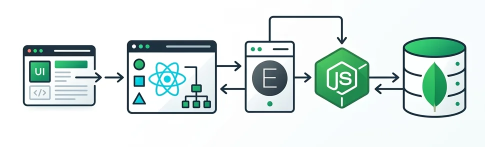
*MERN Mimarisi: MongoDB döküman tabanlı veritabanı, Node.js sunucu ve React arayüz bütünlüğü.*

### PERN Stack (PostgreSQL, Express, React, Node.js)
İlişkisel verinin, finansal işlemlerin ve e-ticaret altyapılarının omurgasıdır.
* **Mimari:** NoSQL yerine tam ACID uyumluluğuna sahip **PostgreSQL** kullanılır.
* **Neden Seçilmeli?** Sipariş veya stok adımlarında hata çıktığında işlemi geri alan (rollback) katı veri bütünlüğü sağlar. SaaS platformları ve kurumsal e-ticaret için altın standarttır.

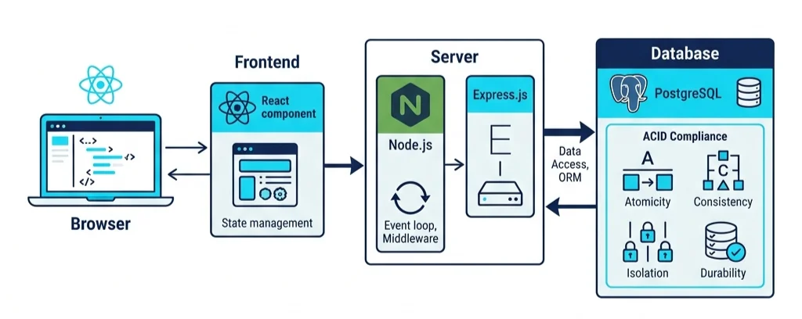
*PERN Mimarisi: PostgreSQL ilişkisel veritabanı ile garanti altına alınan kurumsal veri bütünlüğü.*

### JAMstack (JavaScript, APIs, Markup)
Sunucu ve veritabanı katmanını kullanıcıdan tamamen soyutlayan sunucusuz (serverless) mimaridir.
* **Mimari:** Ön yüz derleme aşamasında Headless CMS veya mikroservis API'lerinden veriyi çeker, statik HTML üretir ve global CDN'lere dağıtır.
* **Güvenlik Gücü:** Ortada hacklenebilecek bir sunucu işletim sistemi veya açık veritabanı portu bulunmaz.

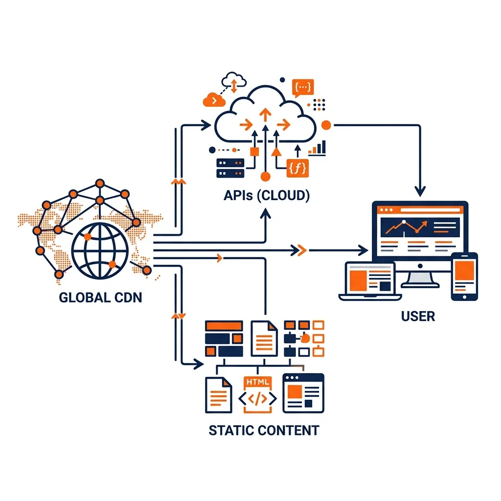
*JAMstack Mimarisi: Mikroservisler ve API'ler üzerinden CDN tabanlı, sunucusuz (serverless) dağıtım.*

### Modern .NET Stack (C#, ASP.NET Core, Entity Framework Core)
Açık kaynaklı, çapraz platform ve olağanüstü yüksek performanslı kurumsal güç merkezidir.
* **Mimari:** Güçlü tip güvenliğine sahip C# ve çoklu iş parçacığı (multi-threading) yetenekleriyle donatılmış ASP.NET Core Minimal API'ler.
* **Performans & Güvenlik:** Node.js'in tek iş parçacıklı yapısının tıkandığı yoğun hesaplama ve bankacılık/ERP yüklerinde .NET açık ara öne çıkar. Yerleşik ASP.NET Core Identity altyapısı kurumsal kimlik yönetimini (MFA, RBAC) standartlaştırır.

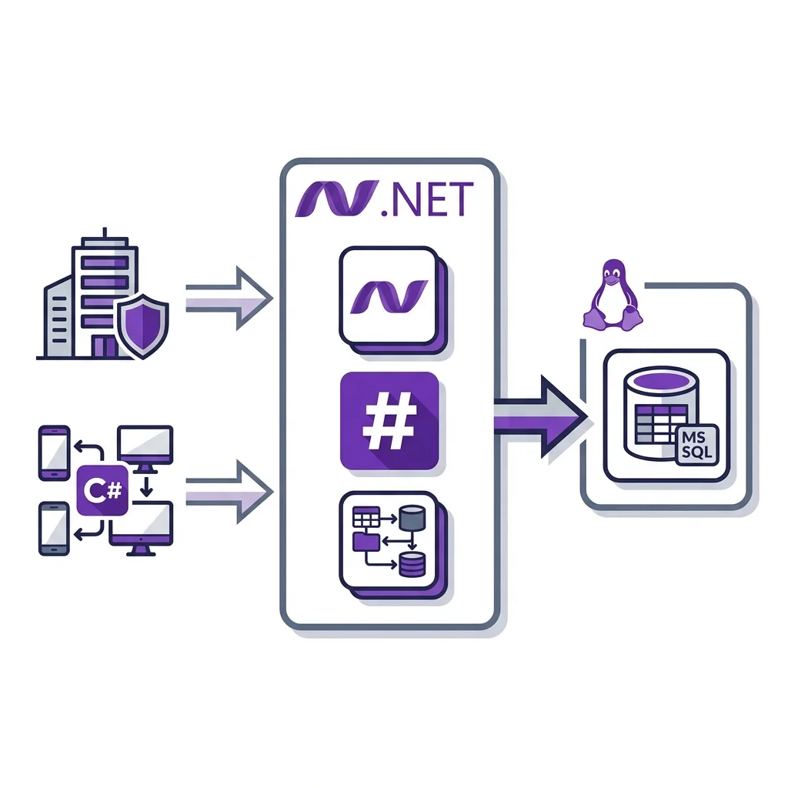
*Modern .NET Mimarisi: Açık kaynaklı, çapraz platform ASP.NET Core ve Entity Framework gücü.*

### Büyük Veri ve Olay Güdümlü (Event-Driven) Akışlar
Sistemler büyüdükçe doğrudan API çağrıları darboğaz yaratır. Servisler arası iletişimi koparmak (decouple) için **Apache Kafka** gibi dağıtık mesaj kuyrukları devreye girer. Devasa güvenlik loglarının (SIEM) veya ürün analitiğinin işlenmesinde Kafka ve **Apache Spark** ikilisi veri mühendisliğinin zirvesini temsil eder.

---

## DevSecOps ve Altyapı: Dağıtımdan Güvenliğe Uçtan Uca Süreç

Kodun kalitesi kadar, o kodun internete nasıl açıldığı ve korunacağı da modern mühendisliğin ayrılmaz bir parçasıdır.

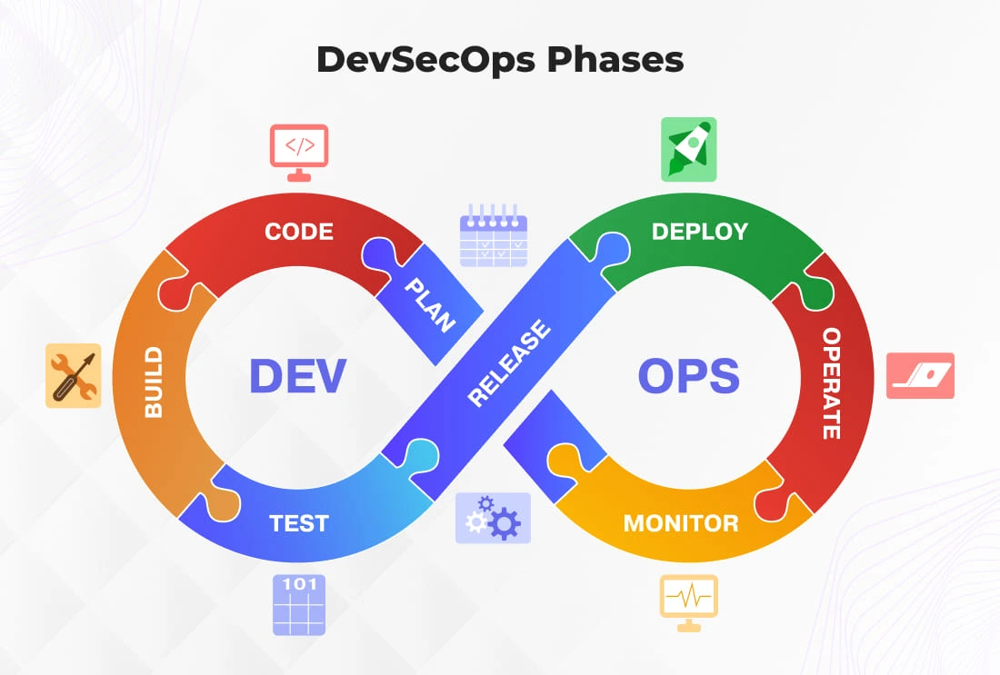
*Modern CI/CD süreçlerinde DevSecOps entegrasyonu: Build, Scan ve Deploy güvenliği.*

### Yazılım Tedarik Zinciri Riskleri
Next.js veya Astro gibi modern araçlar binlerce NPM bağımlılığı indirir. 2025'te NPM ekosistemini sarsan hesap ele geçirmeleri ve cüzdan boşaltan zararlılar, bağımlılıkların en kritik saldırı yüzeyi olduğunu gösterdi:
* **Lockfile Zorunluluğu:** `package-lock.json` veya `pnpm-lock.yaml` dosyalarını sabitleyerek sürüm kaçırma (version hijacking) saldırılarını engelleyin.
* **SBOM ve SCA Taramaları:** Her derleme pipeline'ında CycloneDX veya Syft ile yazılım malzeme listesi (SBOM) üretin ve `Grype`/`Trivy` ile güvenlik taraması yapın.
* **Gizli Anahtar Sızıntıları:** GitHub Actions süreçlerinde `GitLeaks` ve `TruffleHog` ile API anahtarlarının koda gömülmesini önleyin.

### Edge Computing ve Cloudflare Zero Trust
Statik ve hibrit sitelerin global dağıtımında Cloudflare Pages, GitHub deponuzdaki kodu saniyeler içinde derleyerek dünya genelindeki yüzlerce CDN noktasına dağıtır.

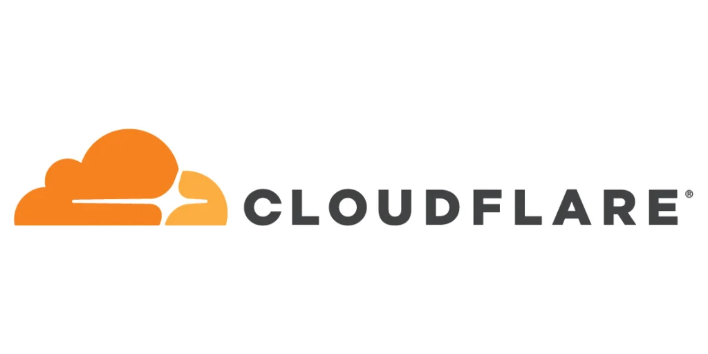
*Cloudflare mimarisi: İçeriği sunucu barındırmadan küresel CDN noktalarına dağıtarak saldırı yüzeyini sıfırlar.*

Edge üzerinde çalışan Cloudflare Workers, WAF kurallarını trafiğin sunucunuza ulaşmasından önce işletir. Şirket içi yönetim araçlarınız için Cloudflare Zero Trust entegrasyonu kurarak VPN ihtiyacını ortadan kaldırabilir ve yalnızca kimliği doğrulanmış personelin iç panellere erişmesini sağlayabilirsiniz.

---

## Mimari Anti-Pattern'ler ve Kaçınılması Gereken Hatalar

Başarılı bir web mimarisi kurarken sık düşülen tuzaklar:

* **"Her Şeyi SSG Yapalım" Yanılgısı:** Canlı borsa veya anlık sohbet gibi sürekli değişen verileri zorla statikleştirmeye çalışmak karmaşıklığı artırır ve kırılgan kod üretir. Bu senaryolarda ISR veya WebSocket destekli hibrit modellere yönelin.
* **"Framework Değiştirince Otomatik Hızlanırız":** Görsel optimizasyonu (WebP/AVIF), font yönetimi ve script bütçesi yapmadan sadece framework değiştirmek Lighthouse skorlarında kalıcı iyileşme sağlamaz.
* **"Güvenliği Sona Bırakırız":** Tedarik zinciri güvenliğini ve secret scanning kontrollerini canlıya çıkış gününe ertelemek veri sızıntılarına açık davettir.
* **"SEO Sadece Meta Etiketidir":** Tarayıcı uyumluluğu, canonical linkler, yapılandırılmış veri (Schema.org) ve Core Web Vitals metriklerini ihmal etmek, siteniz ne kadar hızlı olursa olsun organik görünürlüğünüzü sınırlar.

---

Web mimarisinde her derde deva tek bir sihirli araç yoktur, projenin karakterine, veri dinamizmine ve güvenlik gereksinimlerine en uygun mühendislik tercihi vardır. E-ticaret platformlarında PERN ve Next.js'in dinamizmini kullanırken CI/CD pipeline'larında güvenlik taramalarını aksatmamak, teknik dokümantasyon veya kişisel projelerde ise Astro/Hugo ile Cloudflare Pages'in hızını birleştirmek modern web mimarisinin temel anahtarıdır.
