Traditional antivirus and legacy EPP architectures consistently crumble against modern living-off-the-land techniques, fileless in-memory execution, and credential abuse. Relying on signature matching is no longer sufficient. Enterprise resilience now depends on platforms that observe every low-level system call, correlate multi-stage process trees, and trigger automated containment within seconds: the domain of EDR and XDR.

In this deep dive, we evaluate the leading enterprise endpoint platforms—analyzing their architectural designs, telemetry depth, and day-to-day operational trade-offs.

---

## The Paradigm Shift: EPP, EDR, and XDR Compared

When evaluating security platforms, architectural value lies not just in raw telemetry ingestion, but in management overhead and Total Cost of Ownership (TCO). Modern endpoint security layers differentiate across several operational dimensions:

| Dimension | EPP (Endpoint Protection) | EDR (Endpoint Detection & Response) | XDR (Extended Detection & Response) |
| :--- | :--- | :--- | :--- |
| **Management Model** | Passive / Deterministic ("Set and forget"). Static policies pushed periodically. | Active / Analytical. Demands continuous telemetry review and proactive threat hunting. | Hybrid / Automated. Centralized orchestration fusing endpoint, network, identity, and cloud telemetry. |
| **Alert Archetype** | Binary (0/1). Either malicious or benign. Generally surfaces a simple "Quarantined" notification. | Contextual & Behavioral. Maps anomalous execution paths backed by audit artifacts. | Holistic (Storyline). Merges distributed indicators into a unified attack lifecycle narrative. |
| **Alert Management** | Low volume, but carries high False Negative risk against evasive payloads. | Flags low-level anomalies, which can trigger severe alert fatigue in tier-1 analysts. | Leverages cross-telemetry correlation engines to discard noise, cutting alert volume by 50–70%. |
| **Response Actions** | File isolation, USB port disabling, local scheduled scans. | Endpoint network isolation, process termination, RAM dump capture, live terminal execution. | Complete EDR toolset plus perimeter IP blacklisting, IdP session revocation, and inbox purging. |
| **Operational Resource** | Handled easily by general IT or system administration teams. | Demands dedicated SOC analysts and security operations engineers. | Requires advanced detection engineers, senior architects, or Managed Detection & Response (MDR). |

---

## CrowdStrike Falcon

As a pioneer of cloud-native endpoint defense, CrowdStrike Falcon sets the benchmark for lightweight agent footprints and hyperscale cloud correlation. The platform operates through a single kernel-mode sensor that pipes real-time system events directly into the cloud-hosted Threat Graph engine.

Beyond detection, the platform extends deeply into operational hygiene. **Falcon Discover** continuously inventories unmanaged assets and credential risks, while **Falcon for IT** leverages an osquery backend to execute SQL-driven queries across the fleet in real time. The integration of Charlotte AI further accelerates triage by letting analysts query complex telemetry using natural language.

*   **Pros:** Ultra-lightweight agent that preserves system performance, powerful natural language querying via Charlotte AI, gold-standard threat intelligence.
*   **Cons:** Highly modular licensing model leads to steep TCO escalation, highlights software vulnerabilities without offering native patch deployment capabilities.

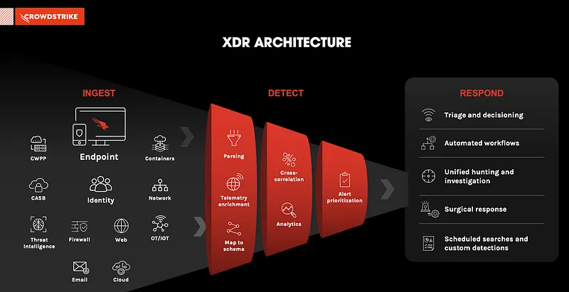

> [CrowdStrike Official Documentation & XDR Guide](https://www.crowdstrike.com/cybersecurity-101/what-is-xdr/)

---

## Cybereason

Cybereason distinguishes itself through visual correlation and operational context. It remains one of the few enterprise platforms capable of full on-premises deployments alongside its cloud offering, though advanced XDR integrations are primarily cloud-centric.

At the core of the platform lies the **Malop (Malicious Operation)** engine. Rather than overwhelming analysts with disconnected alerts, Malop binds hundreds of disparate suspicious events into a unified, actionable timeline. Analysts can traverse the attacker’s movement—from initial execution to lateral propagation—in an intuitive graphical tree.

*   **Pros:** Intuitive Malop attack visualizer that consolidates complex timelines onto a single screen, flexible on-premises hosting options.
*   **Cons:** High-end XDR integrations depend strictly on cloud infrastructure, and the third-party ecosystem is narrower than top-tier rivals.

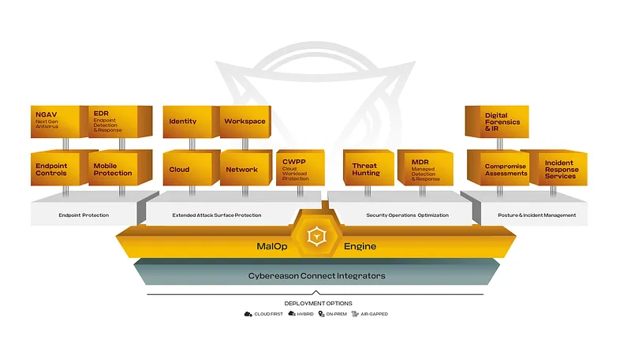

> [Cybereason Platform Overview](https://www.cybereason.com/platform)

---

## Microsoft Defender for Endpoint

Formerly known as Defender ATP, Microsoft Defender for Endpoint is built directly into the core of the Windows operating system. Eliminating the need for third-party agent distribution, it delivers seamless deployment across Windows-dominated enterprises with near-zero friction.

As part of the wider Microsoft 365 Defender ecosystem, it natively shares signals with Entra ID, Defender for Office 365, and Defender for Cloud. This cross-boundary visibility allows teams to track an attack from a phishing lure through identity abuse to host-level exploitation within a single dashboard.

*   **Pros:** Native Windows integration without agent deployment overhead, unmatched cohesion with the enterprise Microsoft 365 ecosystem.
*   **Cons:** Managing non-Windows endpoints (Linux/macOS) remains cumbersome, and full automated investigation features demand premium enterprise licensing (E5/G5).

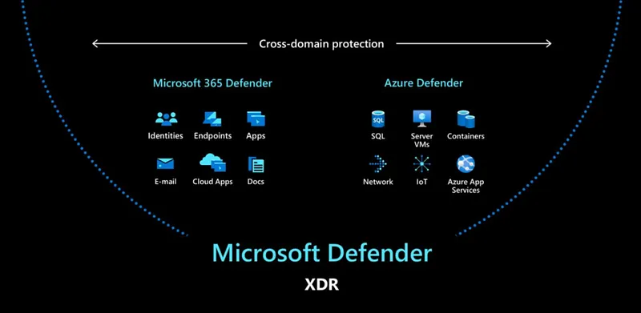

> [Microsoft Defender XDR and Zero Trust Strategy](https://www.infusedinnovations.com/blog/secure-intelligent-workplace/budgeting-for-microsoft-defender-xdr-and-zero-trust-security)

---

## Palo Alto Cortex XDR

Palo Alto Cortex XDR rejects endpoint isolationism, correlating host telemetry with network flows, firewall logs, and cloud audit trails. Built to extract maximum value from Palo Alto Next-Generation Firewalls (NGFW), it delivers unparalleled visibility into encrypted traffic patterns and network anomalies.

Its **Pathfinder** module analyzes the behavior of unmanaged assets—such as IoT hardware and medical equipment—without requiring agent software. When a threat is detected, built-in SOAR automation can simultaneously sever network sessions at the firewall level and terminate malicious execution trees on the host.

*   **Pros:** Industry-leading multi-telemetry correlation between network and endpoint layers, automated network-edge isolation via native NGFW controls.
*   **Cons:** Full value realization demands heavy investment in Palo Alto network infrastructure, paired with premium licensing and data ingestion costs.

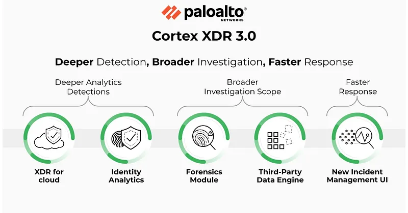

> [Palo Alto Cortex XDR Architecture Review](https://www.xcitium.com/palo-alto-cortex-xdr/)

---

## SentinelOne Singularity

SentinelOne Singularity anchors its value proposition in autonomous, on-sensor intelligence. Its local behavioral AI engine operates directly within the agent, enabling threat classification and mitigation even when endpoints are air-gapped or disconnected from the internet.

The platform’s **Storyline** engine tags every process thread with a unique identifier, maintaining contextual state across reboots. Its signature capability—**Rollback**—leverages a tamperproof local journal independent of Windows Volume Shadow Copies (VSS), reversing ransomware encryption within minutes. Complementing this, **Singularity Ranger** turns every deployed endpoint into a passive network sensor, surfacing rogue and unmanaged devices across local subnets.

*   **Pros:** Tamperproof Rollback mechanism resilient against VSS sabotage, autonomous on-sensor behavioral engine that functions offline, agent-driven network discovery via Ranger.
*   **Cons:** Core capabilities like Ranger, RSO, and vulnerability management require separate add-on licenses, console navigation can be complex across feature tiers.

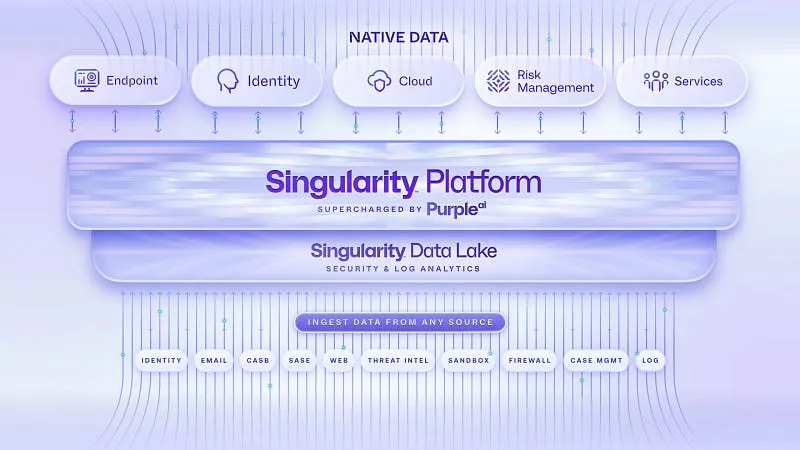

> [SentinelOne Singularity Platform Documentation](https://www.sentinelone.com/platform/)

---

## VMware Carbon Black

VMware Carbon Black provides a battle-tested EDR framework across both cloud-hosted and on-premises environments. Its core architectural advantage lies in deep hypervisor integration with VMware vSphere and vCenter, securing virtual servers with minimal guest-OS virtualization overhead.

Employing continuous behavioral logging and kernel-level event streaming, Carbon Black remains a favored option for defense, banking, and government sectors where regulatory mandates strictly enforce local data sovereignty.

*   **Pros:** Unmatched hypervisor-level integration across VMware infrastructure, proven stability for on-premises enterprise data centers.
*   **Cons:** Licensing restructuring and roadmap uncertainty following the Broadcom acquisition, higher resource footprint on older hardware.

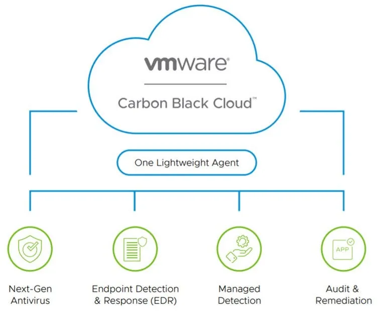

> [VMware Carbon Black Hosted EDR Datasheet](https://www.vmware.com/docs/vmw-datasheet-carbon-black-hosted-edr)

---

## Wazuh

Wazuh is an open-source security powerhouse that merges host intrusion detection, log analytics, file integrity monitoring (FIM), and compliance auditing into a unified framework. It effectively bridges the gap between open-source SIEM and EDR functionalities.

For mid-sized organizations with tight security budgets, Wazuh provides robust visibility without software license costs. Pre-built mapping rules for standards such as PCI DSS, GDPR, HIPAA, and NIST 800-53 significantly streamline compliance reporting.

*   **Pros:** Fully open-source and free without licensing restrictions, extensive customizability, excellent file integrity monitoring and log aggregation.
*   **Cons:** Demands advanced engineering expertise for cluster tuning and rule authoring, lacks the turnkey commercial support infrastructure of enterprise vendors.

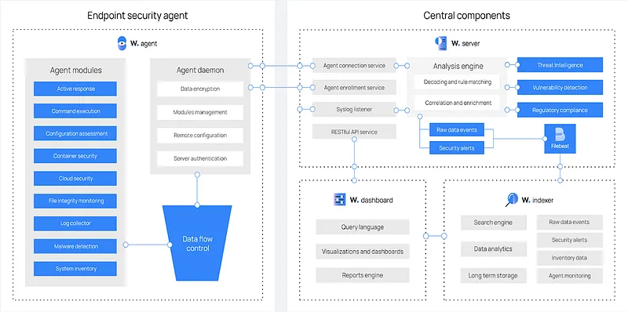

> [Wazuh Architecture and Getting Started Guide](https://documentation.wazuh.com/current/getting-started/components/index.html)

---

## Elastic Security

Built on the proven search scalability of Elasticsearch and Kibana, Elastic Security combines SIEM and endpoint telemetry into a unified data plane. Its schema-flexible architecture enables threat hunters to query petabytes of historical logs without upfront indexing delays.

The unified Elastic Agent streams process metrics and kernel events straight into Elasticsearch clusters. Concurrently, machine learning models continuously inspect behavioral patterns to surface credential theft, privilege escalation, and lateral movement.

*   **Pros:** Exceptional sub-second query performance across immense datasets, fully customizable Kibana visualization dashboards, active global community.
*   **Cons:** Infrastructure storage and memory requirements surge alongside log volume, demands proficiency in ESQL and KQL for complex investigative queries.

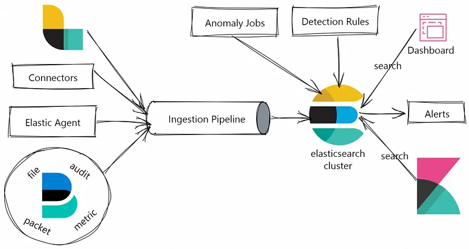

> [Threat Hunting Architecture with Elastic Security](https://dzlab.github.io/2023/04/26/elastic-cybersecurity/)

---

## Bitdefender GravityZone

Bitdefender GravityZone leverages decades of antimalware engineering and hypervisor optimization to deliver a resilient enterprise EPP/EDR solution. Utilizing a Docker-based microservices architecture, its management plane deploys cleanly as a virtual appliance, saving organizations substantial Windows Server licensing overhead.

The platform operates via the modular **BEST (Bitdefender Endpoint Security Tools)** agent. Its **Ransomware Mitigation** engine buffers tamperproof shadows of target files at the first sign of suspicious cryptographic activity, automatically restoring files after neutralizing the process. Furthermore, it actively intercepts remote encryption attacks crossing SMB network shares at the IP level.

*   **Pros:** Native patch management integration, centralized scanning offload for virtual machines to conserve host resources, strong protection against network-based ransomware.
*   **Cons:** Vulnerability assessment and patching require separate licensing tiers, legacy operating systems receive a more restricted feature set.

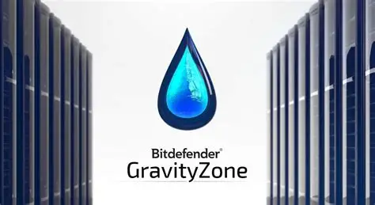

> [Bitdefender GravityZone Enterprise Documentation](https://www.bitdefender.com/business/support/en/77212-376327-endpoint-protection.html)

---

## Trend Micro Apex One

Trend Micro Apex One stands out within on-premises enterprise environments through its pioneering **Virtual Patching** architecture. Orchestrated via Apex Central, the solution builds on proven Windows IIS and SQL infrastructure.

Virtual Patching shields vulnerabilities from the moment they are publicly disclosed until formal operational testing and patching take place. By filtering exploit payloads at the network HIPS layer, it neutralizes attacks without requiring server reboots—an indispensable capability for industrial control systems (ICS/OT) and critical production databases.

*   **Pros:** Long-term extended support for legacy platforms like Windows XP, 7, and Server 2008, network-layer exploit filtering without reboot downtime.
*   **Cons:** On-premises management requires dedicated Windows Server and SQL infrastructure, deep HIPS packet inspection can create minor throughput drag on older hardware.

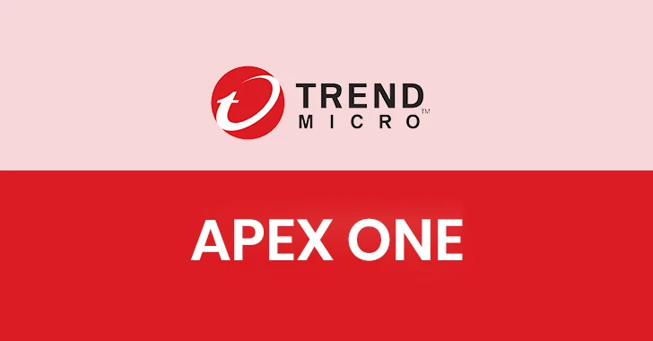

> [Trend Micro Apex Central Event Mapping Documentation](https://docs.trendmicro.com/en-us/documentation/article/trend-micro-apex-central-2019-online-help-syslog-mapping-cef)

---

## Kaspersky Endpoint Security for Business

Kaspersky Endpoint Security (KES) maintains an entrenched presence in the on-premises enterprise sector through comprehensive systems administration capabilities. Its Kaspersky Security Center (KSC) architecture uses hierarchical master/slave clustering to coordinate sprawling, geographically separated branch offices.

During an active outbreak, **System Watcher** and the **Remediation Engine** operate independently of Windows VSS, rolling back malicious registry modifications and restoring encrypted documents from secure local backups. Its integrated **Systems Management** engine acts as a robust WSUS alternative, pushing operating system golden images and third-party software updates from a centralized console.

*   **Pros:** Resilient local remediation functioning independently of Windows VSS, extensive IT operations and patch management suite, dedicated lightweight Embedded agent.
*   **Cons:** Geopolitical restrictions and regulatory headwinds in several western markets, separate update cycles for the Network Agent and the endpoint security engine.

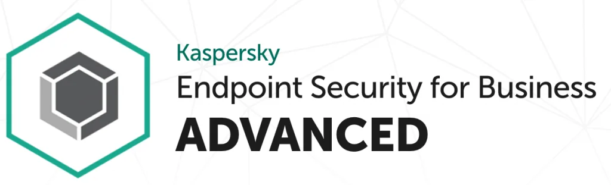

> [Kaspersky Endpoint Security for Business Documentation](https://support.kaspersky.com/KESB/14.2/en-US/181954.htm)

---

## ESET PROTECT

ESET PROTECT upholds the vendor’s hallmark philosophy of lightweight footprints and minimal performance impact, modernized with native XDR capabilities. The management server deploys on Windows or Linux, or as a pre-packaged virtual appliance.

Beyond behavioral heuristics, ESET integrates **Intel TDT (Threat Detection Technology)**. By analyzing CPU Performance Monitoring Unit (PMU) telemetry at the hardware level, it detects ransomware encryption loops directly on the silicon. This allows the system to identify sophisticated, memory-resident threats while maintaining near-zero CPU drag.

*   **Pros:** Exceptional performance with minimal CPU and RAM footprint across virtual and legacy endpoints, hardware-level ransomware detection via Intel TDT.
*   **Cons:** Patch management on Linux hosts is still evolving, top-tier detection and XDR modules demand higher licensing tiers.

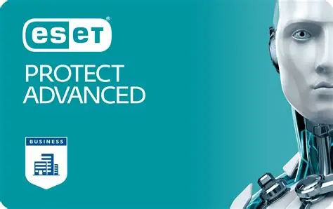

> [ESET PROTECT Administration and Syslog Guide](https://help.eset.com/protect_admin/11.0/en-US/admin_server_settings_syslog.html)

---

## Tanium

Tanium XEM (Converged Endpoint Management) rejects standard client-server database architectures in favor of its proprietary **Linear Chain** protocol. In enterprise networks with hundreds of thousands of nodes, queries are not broadcast individually from a central server. Instead,, peered agents form dynamic sub-chains that pass questions and answers sequentially.

This architecture enables organizations to query 100,000+ endpoints in under 15 seconds or distribute zero-day patches across WAN pipes without bandwidth saturation using peer-to-peer distribution. **Tanium Performance** logs host resource usage second by second, giving operations teams exact historical metrics to diagnose chronic performance bottlenecks.

*   **Pros:** Unrivaled real-time query speed across vast enterprise fleets, peer-to-peer patch distribution saving up to 98% WAN bandwidth, high-fidelity sub-second performance forensics.
*   **Cons:** High barrier of entry and initial capital expense, architectural complexity is overkill for small-to-medium networks.

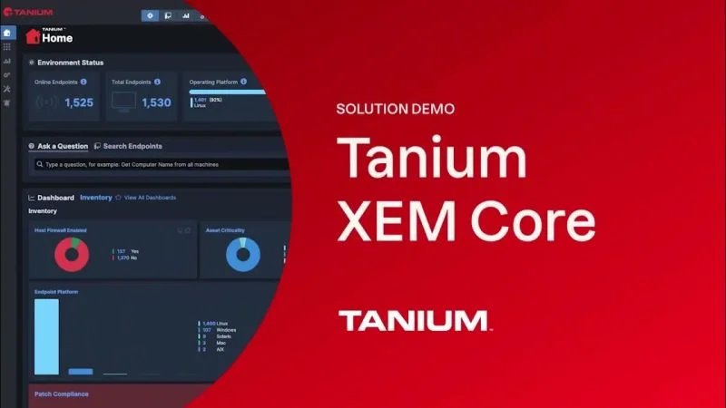

> [Tanium Converged Endpoint Management Guide](https://www.tanium.com/products/tanium-performance/)

---

## Sophos Intercept X

Sophos Intercept X implements a synchronized security architecture, creating direct cross-talk between endpoint agents and Sophos Firewall appliances via the **Security Heartbeat** protocol.

If an endpoint’s security posture changes to red due to an active ransomware outbreak or beaconing attempt, the firewall automatically quarantines the host at the network layer, preventing lateral traversal across internal VLANs. In reverse, **Synchronized Application Control** allows the firewall to query the endpoint directly whenever unidentified encrypted traffic is detected, identifying the exact executable and file path responsible.

*   **Pros:** Automated and autonomous network-level quarantine orchestrated between host and firewall, instant discovery of unidentified network traffic at the process source.
*   **Cons:** The full value proposition requires committing the entire network perimeter to Sophos Firewall hardware.

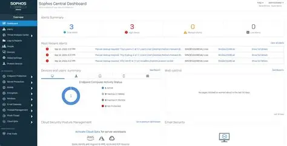

> [Sophos Intercept X and Synchronized Security](https://www.sophos.com/en-us/products/intercept-x)

---

## Fortinet FortiEDR

Fortinet FortiEDR integrates into the vendor’s wider Security Fabric, offering patented real-time **post-infection protection** at the kernel boundary.

Unlike solutions that focus exclusively on pre-execution blocks, FortiEDR prevents unauthorized modifications and communication even if untrusted code executes on the host. Its **FortiTelemetry** protocol interfaces seamlessly with FortiGate firewalls, piping host-level latency and application experience data directly into NOC monitoring panels.

*   **Pros:** Autonomous kernel-level protection halting data exfiltration and file modification mid-execution, seamless telemetry handshake within the Fortinet Fabric ecosystem.
*   **Cons:** Management console is less modern compared to pure-play EDR peers, reduced integration depth in non-Fortinet network environments.

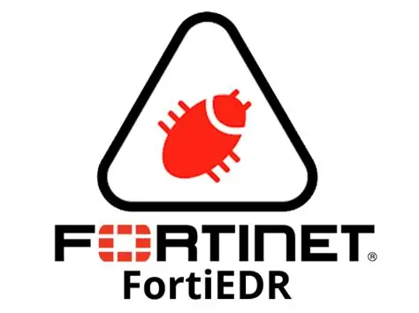

> [Fortinet FortiEDR Solution Overview](https://www.fortinet.com/products/endpoint-security/fortiedr)

---

## The Convergence of NOC and SOC: Unified IT Operations

Operational silos between Security Operations (SOC) and IT Infrastructure (NOC) teams create visibility blind spots and drag out Mean Time to Resolution (MTTR). Disjointed monitoring platforms and conflicting log data hamper incident response when seconds count.

Modern XDR and Converged Endpoint Management (XEM) platforms are resolving this divide by leveraging kernel-level access to absorb traditional RMM and network monitoring functions into a unified operational fabric:

1.  **Agent Consolidation:** Deploying separate agents for inventory, patch management, performance monitoring, and EDR causes severe agent fatigue and system instability. Unified sensors (e.g., SentinelOne, CrowdStrike, Tanium) collect telemetry for both security analysts and systems administrators simultaneously.
2.  **Autonomous Asset Discovery:** Capabilities like SentinelOne Ranger and Tanium Discover turn existing endpoints into passive network probes. Rogue, unmanaged assets (Shadow IT) are mapped across subnets without dedicated scanning appliances or network overhead, triggering automated isolation where necessary.
3.  **Digital Employee Experience (DEX):** Telemetry engines like Tanium Performance and CrowdStrike Falcon for IT capture second-by-second CPU, memory, and disk history. When an endpoint stutters, support engineers can immediately inspect historical process graphs, drastically reducing troubleshooting cycles.
4.  **Remote Orchestration & Self-Healing (RSO & RTR):** Technologies such as SentinelOne Remote Script Orchestration (RSO) and CrowdStrike Real Time Response (RTR) allow administrators to execute scripts across thousands of machines simultaneously with SYSTEM privileges. When integrated with SOAR playbooks, this enables self-healing infrastructure—such as automatically purging temp caches or restarting critical services the moment anomalies are detected.
