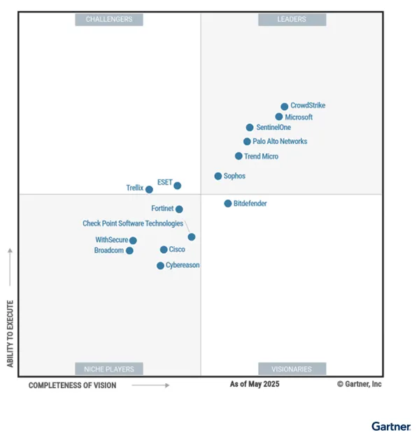
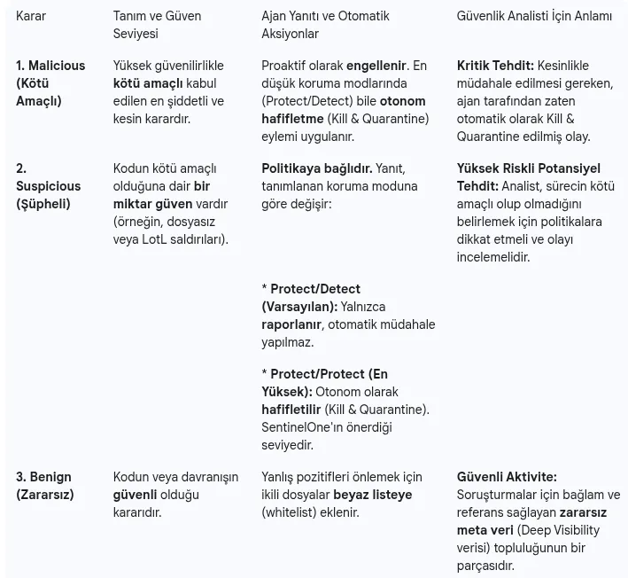
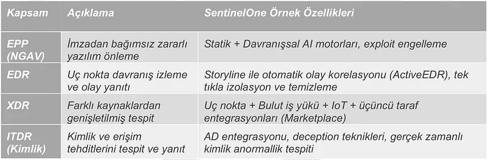
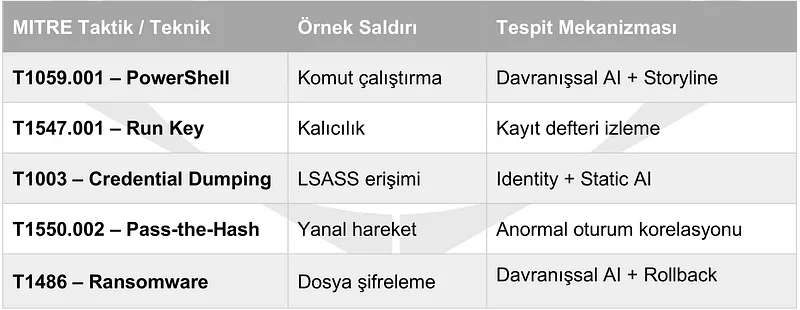
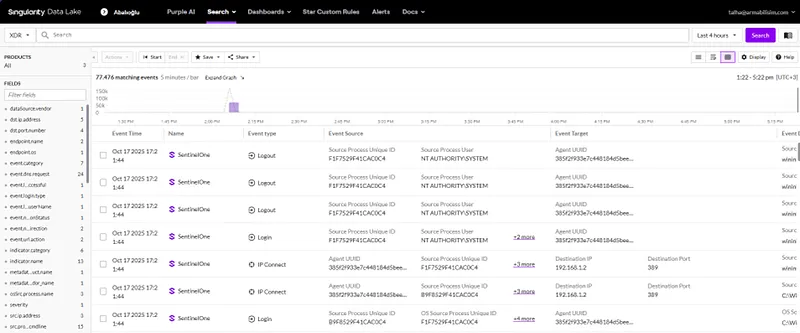
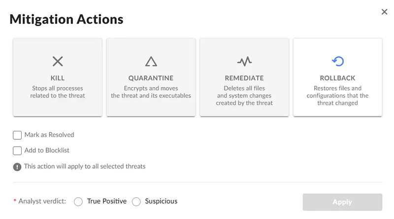
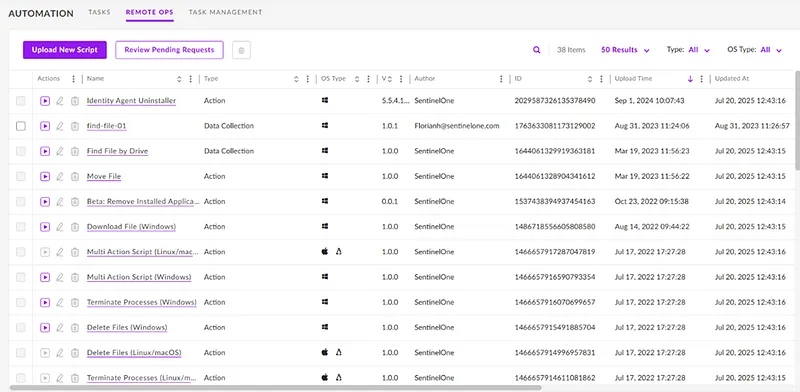
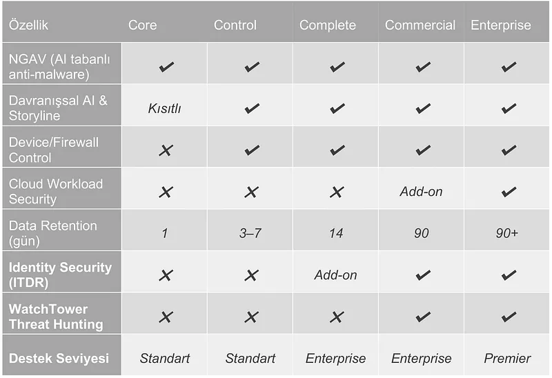
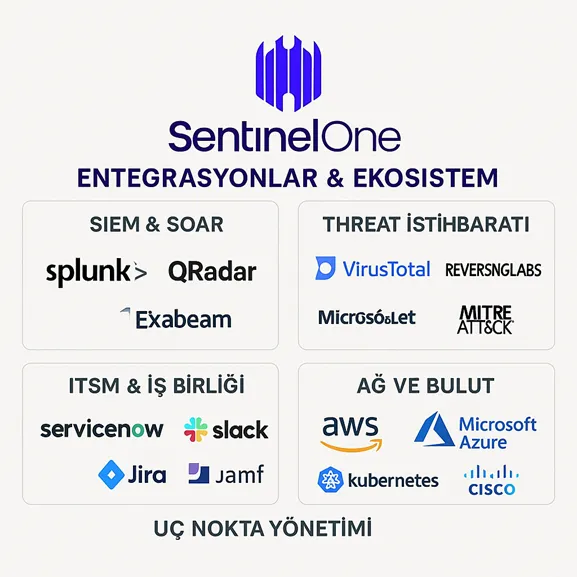
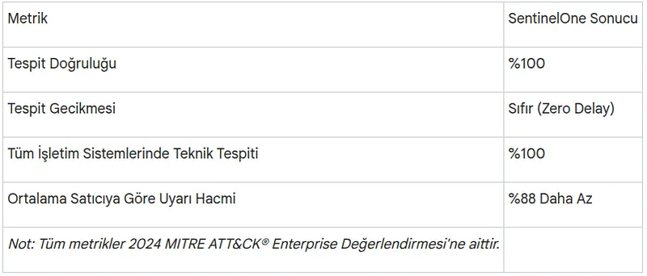

One of the biggest operational bottlenecks in enterprise endpoint defense is reconstructing the true attack sequence from thousands of disjointed telemetry events without relying on cloud round-trip latency. SentinelOne Singularity addresses this challenge by embedding behavioral detection directly into an autonomous kernel-level agent, combining EPP, EDR, and XDR into a unified footprint.

In this deep dive, we evaluate the platform's kernel-level process monitoring, patented Storyline™ correlation model, VSS-based rollback mechanisms against ransomware, and Purple AI telemetry from a SOC engineering perspective.

---

## Platform Architecture and Security Vision

SentinelOne Singularity Platform offers an artificial intelligence (AI) supported and autonomous solution against today's rapidly changing cybersecurity threat landscape. The platform provides integrated protection by combining endpoint protection (EPP), endpoint detection and response (EDR), extended detection and response (XDR), and identity-based threat detection and response (ITDR) into a single unified architecture. In addition to being positioned as a "Leader" for consecutive years in Gartner's Magic Quadrant reports, it achieves top-tier results in MITRE ATT&CK evaluations.


The platform's strategic vision is to dismantle traditional security silos by consolidating endpoint, cloud, and identity defenses under a single autonomous umbrella. Beyond simplifying operations, this approach responds to threats at machine speed, minimizing operational risk and bolstering cyber resilience.

SentinelOne’s architecture is built on three core competitive pillars:

1. **Single Agent:** A unified, lightweight agent architecture for all endpoints that dramatically reduces deployment and management complexity.
2. **Autonomous Decision-Making:** On-agent artificial intelligence that detects and mitigates threats locally with zero latency, entirely independent of cloud connectivity.
3. **Unified Data Plane:** A centralized data lake that pools endpoint, cloud, and identity telemetry for cross-domain correlation and proactive threat hunting.



---

## Single-Agent Architecture & On-Agent Intelligence

The strategic rationale behind SentinelOne’s architectural design is eliminating the "data tax" and integration debt created by fragmented point solutions, significantly lowering total cost of ownership (TCO).

### Kernel-Level Monitoring & Low Resource Footprint

SentinelOne deploys a single, lightweight agent across Windows, macOS, and Linux endpoints. Operating at the operating system kernel level, it continuously monitors file system, process, and memory activity in real time. Agent resource consumption is strictly optimized to avoid degrading endpoint performance:

* **CPU Utilization:** 0–4%
* **Memory Footprint:** ~20 MB
* **Disk Footprint:** ~200 MB

This minimal resource footprint ensures that security enforcement across both end-user workstations and high-throughput server workloads proceeds with negligible business disruption.

### Autonomous On-Agent Intelligence & Offline Operation

The defining architectural capability of SentinelOne is its **ability to execute detection, prevention, and response logic locally without cloud connectivity**. This **on-agent intelligence** provides true zero-delay protection, delivering an immediate defensive advantage over platforms that depend on cloud round trips for behavioral verdicts. Agents detect and neutralize threats even on air-gapped systems or during network outages.

The agent’s **Autonomous Decision Engine** generates definitive verdicts (**Malicious, Suspicious, Benign**) for every inspected file and process. These verdicts dictate automated policy actions:



To minimize operational risk, SentinelOne recommends enabling **Protect/Protect** mode, ensuring both Malicious and Suspicious threats trigger automated **Kill & Quarantine** actions immediately, neutralizing adversary dwell time at machine speed.

### Centralized Management Console & Elastic Scalability

The SentinelOne management console can be delivered as a multi-tenant cloud service (SaaS) or on-premise deployment. Role-based access control (RBAC) allows granular policy segmentation across distinct business units and operational teams. The backend infrastructure is architected to scale seamlessly to manage over 500,000 active agents from a single pane of glass.

---

## Multi-Layered Threat Detection & Deep Visibility

SentinelOne provides defense-in-depth through a multi-stage inspection pipeline that evaluates files and processes across both execution phases:

1. **On-Write (Pre-Execution) Static Analysis:** Files written to disk are analyzed for structural characteristics and code signatures before execution is allowed.
2. **On-Execute (Runtime) Behavioral Analysis:** Active processes, API invocations, network sockets, and system modifications are tracked dynamically to uncover evasive malicious behavior.



### Static AI & Behavioral AI Engines

* **Static AI (Pre-Execution):** Unlike legacy signature-based antivirus, Static AI uses supervised machine learning models trained on millions of benign and malicious samples. It scores structural file features in milliseconds, blocking zero-day exploits and polymorphic binaries without requiring signature updates.
* **Behavioral AI (Runtime):** Once a process spawns, Behavioral AI tracks system call sequences and inter-process communications. Specifically engineered to uncover fileless malware, Living-off-the-Land (LotL) techniques, and in-memory injection, it anchors on Indicators of Attack (IoAs) rather than static IoCs.



### Detection Engine Categories

Every SentinelOne alert maps directly to a specific detection engine, signaling to the analyst whether prevention occurred pre-execution or during runtime:

| Category | Phase | Detection Engines | What It Evaluates |
| :--- | :--- | :--- | :--- |
| **Reputation** | Pre-execution | Reputation | Object hash validated against local cache or cloud threat intelligence. |
| **Static AI** | Pre-execution | Static AI, Static AI – Suspicious | Supervised machine learning score evaluating structural binary traits. |
| **Behavioral AI** | On-execution | Executables, Documents, Scripts, Lateral Movement, Anti Exploitation / Fileless, Potentially Unwanted Applications, Application Control, Detect Interactive Threat | Dynamic process behavior, memory tampering, script execution, lateral traversal, network attacks, interactive command shells, and fileless persistence. |

### Contextual Correlation with Storyline™ Technology

SentinelOne’s patented Storyline™ technology automatically reconstructs thousands of raw EDR telemetry points—file writes, registry keys, network connections, child processes—into an intuitive graph of the full attack sequence.

Every monitored sequence receives a unique **Storyline ID**. Analysts no longer need to manually stitch together disparate alerts. From the initial dropper to subsequent lateral movement, the entire attack progression is displayed in a single unified graph, collapsing root cause analysis (RCA) from hours down to seconds.



### Singularity Data Lake & OCSF Standardization

Singularity Data Lake unifies enterprise telemetry across endpoints, cloud workloads, identity stores, and third-party security appliances:

* **Holistic Visibility:** Cross-tier queries reveal how an adversary transitioned from a compromised workstation into cloud infrastructure or accessed privileged identity assets.
* **Cross-Domain Correlation:** Ingesting telemetry into a single pool allows analytics engines to correlate weak signals across disparate domains into actionable high-fidelity incidents.
* **Open Schema Standardization (OCSF):** Ingested data is normalized using the **Open Cybersecurity Schema Framework (OCSF)**, enabling consistent indexing and rapid querying via DQL (Deep Visibility Query Language).

---

## Incident Response, One-Click Rollback & Automation

SentinelOne delivers automated response actions designed to neutralize intrusions and repair collateral damage without requiring re-imaging.

### Device Isolation & S1QL Telemetry Queries

Upon identifying a high-severity threat, the agent can isolate the host from the network immediately, restricting all traffic except encrypted communications back to the management console.

Telemetry events are retained for **14 to 90 days** depending on the licensing tier. Analysts query this raw telemetry using SentinelOne's query language (**S1QL**). For example, auditing all invocations of `net user` across the fleet over the past 180 days is executed with a straightforward query:

```sql
SELECT Timestamp, DeviceName, ProcessName, CommandLine  
FROM ProcessActivities  
WHERE LOWER(CommandLine) LIKE '%net user%' AND Timestamp > NOW()-180d;
```

### One-Click Remediation & Ransomware Rollback

Against destructive attacks such as ransomware, Rollback offers automated file and configuration recovery:

1. The Behavioral AI engine identifies unauthorized encryption activity and terminates the malicious process tree.
2. The agent isolates all system modifications tied to that specific Storyline™ ID.
3. Upon issuing the **Rollback** command, the agent uses Windows Volume Shadow Copies (VSS) to restore encrypted or altered files to their pre-incident clean state without rolling back unrelated user activity.



This targeted restoration capability eliminates the need to pay ransoms or perform time-consuming operating system re-installations.

### Custom Detection & Response: STAR Rules

Storyline Active Response (STAR) allows security engineering teams to convert custom Deep Visibility queries into automated detection rules. When incoming telemetry matches a STAR expression, automated actions trigger instantly:

* **Alert:** Dispatches priority notifications to the SOC queue.
* **Kill Process:** Terminates matching malicious executions immediately.
* **Quarantine:** Isolates the host network adapter to stop lateral spread.

### Singularity Hyperautomation (SOAR) & RemoteOps

The console’s **RemoteOps** capability provides an enterprise-wide live terminal for executing targeted management and investigative tasks. Commands can be dispatched across thousands of hosts simultaneously to gather forensic memory captures, collect event logs, or terminate services.



**Singularity Hyperautomation** provides built-in, no-code security orchestration:

* **Visual Playbook Designer:** Analysts construct automated playbooks that execute complex mitigation workflows whenever specific criteria are met.
* **Bilateral Integrations:** Orchestration bridges internal agent actions with perimeter firewalls, SIEM platforms, and ITSM ticketing tools.

---

## AI-Driven Security Operations (Autonomous SOC)

SentinelOne accelerates operational response from human triage speeds to machine speed through generative and agentic AI integrations.

### Purple AI: Natural Language Triage & Guided Investigation

Purple AI functions as an embedded AI security analyst, translating natural language prompts into optimized DQL queries and providing structured triage summaries:

* **Conversational Threat Hunting:** Analysts can input queries such as *"Show all base64-encoded PowerShell executions in the last 24 hours"* and receive validated DQL syntax alongside immediate visualization.
* **Automated Summarization:** Consolidates complex incident graphs into plain-language executive summaries and actionable investigation checklists.
* **Accelerated MTTR:** Independent analyst studies indicate Purple AI can reduce mean time to respond (MTTR) by up to **55%**.

### AI-SIEM & Real-Time Anomaly Analytics

Built atop the Singularity Data Lake, AI-SIEM replaces brittle manual query pipelines with automated machine-learning models:

* **Dynamic Ingestion Analysis:** Continuous ML models evaluate incoming telemetry streams, flagging subtle behavioral outliers that bypass static correlation thresholds.
* **Operational Scalability:** Drastically reduces log engineering overhead and query development cycles across petabyte-scale data lakes.

---

## Extended Detection & Response (XDR): Cloud & Identity Security

SentinelOne extends protection beyond conventional workstations to protect modern cloud-native architectures and directory infrastructure.

### Singularity Cloud Security (CNAPP)

Singularity Cloud Security delivers a comprehensive Cloud-Native Application Protection Platform (CNAPP) bridging runtime defense with posture management:

* **CWPP (Cloud Workload Protection Platform):** Protects Linux instances, containers, and Kubernetes clusters in AWS, Azure, and GCP. Linux workloads leverage **eBPF (Extended Berkeley Packet Filter)** probes, delivering low-overhead observability while eliminating the kernel panic hazards associated with legacy kernel modules.
* **CSPM (Cloud Security Posture Management):** Identifies cloud infrastructure misconfigurations, over-privileged IAM roles, and regulatory gaps. Augmented by the acquisition of **PingSafe**, SentinelOne integrates agentless vulnerability scanning across the entire cloud development lifecycle.

### Singularity Identity Security (ITDR)

Protects Active Directory (AD) and Microsoft Entra ID environments against identity-centric privilege escalation:

* **Advanced Attack Detection:** Intercepts credential-based techniques such as `Pass-the-Hash`, `Kerberoasting`, and `Golden Ticket` attacks in real time.
* **Deception Technology:** Distributes deceptive decoy credentials and lure network shares across endpoints. When an attacker probes these deceptive artifacts, high-fidelity alerts trigger immediate containment before privileges are compromised.

### Threat Hunting & Digital Forensics (DFIR)

* **Deep Visibility (Event Search):** Equips threat hunters with high-speed search across historical endpoint activity, allowing rapid hunting for novel TTPs or emergent IOC lists.
* **RemoteOps Forensics:** Centrally coordinates digital forensics and incident response (DFIR). Analysts remotely capture forensic artifacts, disk images, and memory snapshots without deploying additional agents.

---

## Policy Management, Licensing & Compliance

SentinelOne provides flexible configuration modes and tiered licensing bundles tailored to diverse organizational architectures.

### Policy Protection Modes

The policy engine determines whether the agent acts strictly as a passive detector or executes immediate autonomous containment:

| Mode (Malicious / Suspicious) | Malicious Detections | Suspicious Detections | Recommended Deployment |
| :--- | :--- | :--- | :--- |
| **Detect / Detect** | Alert only | Alert only | Initial pilot, baseline auditing, and non-intrusive testing. |
| **Protect / Detect** | Automated kill & quarantine | Alert only | Standard production baseline for initial rollouts. |
| **Protect / Protect** | Automated kill & quarantine | Automated kill & quarantine | Hardened production tiers and critical server clusters. |

Administrative consoles manage **Threat Protection**, **Device & Firewall Control** (USB and perimeter firewall filters), **Ranger (Network Control for unmanaged asset discovery)**, and **Exclusions** via hierarchical policy inheritance.

### Licensing Tiers & Deployment Options

* **Core:** Foundation NGAV engine with baseline endpoint visibility.
* **Control:** Adds USB device control and host-based firewall management.
* **Complete:** Standard enterprise package including Behavioral AI, full EDR telemetry, STAR rules, and RemoteOps.
* **Commercial:** Integrates identity security (ITDR) and WatchTower managed threat hunting (MDR).
* **Enterprise:** Full-scale platform access, including Purple AI and autonomous SOC automation modules.



### Vulnerability Prioritization & Ecosystem Integrations

* **Risk-Based Vulnerability Management:** Prioritizes software patches based on real-world weaponization and asset criticality rather than raw CVSS scores alone.
* **Pre-Built Integrations:** Offers over 70 turn-key integrations with SIEM, SOAR, ITSM, and cloud service providers.



* **Regulatory Compliance:** End-to-end transport encryption (TLS 1.2/1.3) and AES-256 cloud encryption support compliance across GDPR, SOC 2 Type II, ISO 27001, FedRAMP High, PCI-DSS, and HIPAA frameworks.

---

## Market Validation & SOC Engineering Takeaways

Objective evaluations confirm the technical and operational efficacy of SentinelOne's autonomous architecture.

### MITRE ATT&CK Evaluations & Analyst Recognition

During MITRE Engenuity ATT&CK® Enterprise evaluations, SentinelOne demonstrated leading coverage and analytic visibility against sophisticated adversary playbooks.



Crucially, the platform generated **88% fewer alerts** than the evaluated cohort average. This high signal-to-noise ratio validates the platform's ability to prevent alert fatigue and let analysts focus on genuine compromises. Ongoing leadership designations across Gartner Magic Quadrant reports and Frost & Sullivan innovation rankings further reflect this architectural maturity.

### Strategic Takeaways for Cybersecurity Teams

1. **Reduced MTTR and Maximized SOC Efficiency:** On-agent autonomous containment, 1-Click Rollback, and Purple AI triage minimize manual analyst overhead and drive down mean time to respond (MTTR).
2. **Unified Observability Without Vendor Sprawl:** A single agent paired with Singularity Data Lake eliminates the integration overhead and visibility blind spots inherent in stitching together fragmented EPP, CWPP, and ITDR point solutions.
3. **Future-Proof Security Investment:** Expansion into cloud security (PingSafe CNAPP) and generative AI application defense (Prompt Security) ensures the platform provides scalable, long-term defense as enterprise infrastructure evolves.
