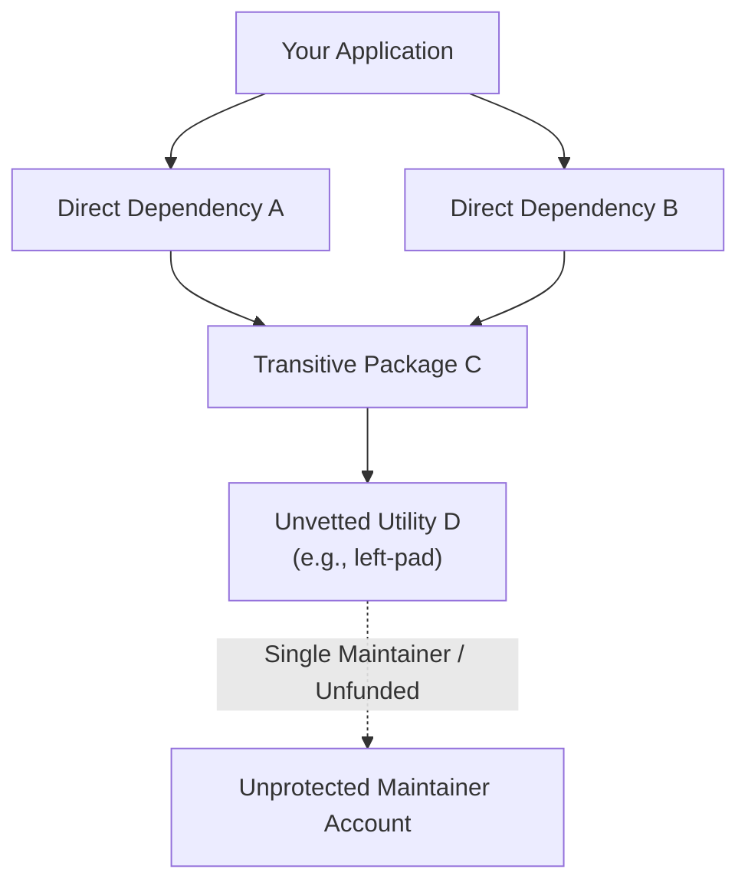
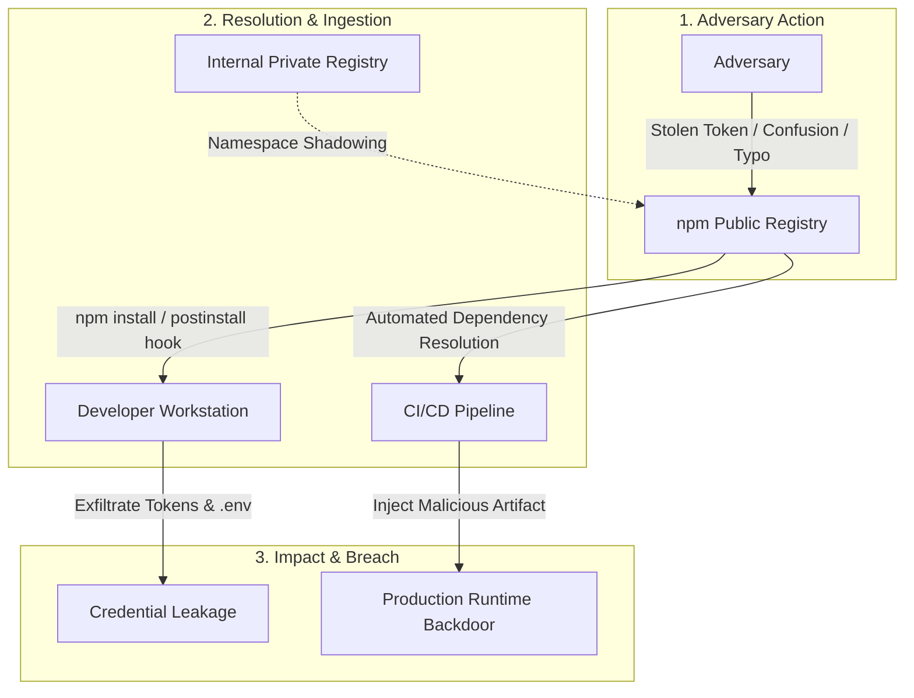

The overwhelming majority of modern application code bases does not originate from in-house development teams, but from unvetted open-source libraries. Incorporating a single third-party package extends the application trust boundary across that library's dependencies, its transitive tree, and every maintainer publishing code along that chain. Research by Zimmermann et al. on the npm ecosystem (USENIX Security 2019) demonstrated that installing an average npm package implicitly requires trusting 79 third-party packages and 39 individual maintainers.

At this scale, supply chain risk cannot be managed package by package. Modeling the open-source software ecosystem as a **directed graph** quantitatively exposes which libraries and maintainer accounts represent systemic single points of failure (SPOFs). This guide explores the architectural mechanics of the npm ecosystem, real-world attack vectors, graph-theoretic centrality analysis, and enterprise-grade defense strategies.

<div class="glass-panel reveal-on-scroll">

| Perspective | Traditional Package-Level Evaluation | Graph-Theoretic Holistic Analysis |
| :--- | :--- | :--- |
| **Core Question** | "Does this package contain a known CVE?" | "If this package is compromised, how many projects in the graph are affected?" |
| **Scope** | Direct dependencies only | The complete transitive dependency tree |
| **Risk Metric** | Static CVE and CVSS scores | Reach, centrality metrics, maintainer concentration |
| **Blind Spot** | Zero-day threats and malicious updates lacking CVEs | Cascading risks reaching the build and CI/CD environment |
| **Deliverable** | Patch checklist | Prioritized monitoring, build hardening, and SBOM inventory |

</div>

---

## Architectural Anatomy of the npm Ecosystem

The npm package manager relies on project manifest files, deterministic lockfiles, and a hierarchical file system layout. The primary architectural building blocks and their associated threat vectors include:

* **`package.json`:** The project manifest defining direct dependencies (`dependencies`, `devDependencies`), metadata, and lifecycle automation (`scripts`). From a security standpoint, the `scripts` block represents the primary execution risk, capable of running arbitrary shell commands during package resolution.
* **Semantic Versioning (SemVer):** Manages release iterations in `MAJOR.MINOR.PATCH` format. Range operators such as caret (`^`) and tilde (`~`) allow automated installation of minor and patch updates. When an attacker compromises a legitimate maintainer account and publishes a malicious patch, this automated resolution delivers the exploit directly to downstream pipelines.
* **`package-lock.json`:** Ensures deterministic, reproducible builds by locking exact package versions, cryptographic SHA-512 hashes (`integrity`), and registry source URIs (`resolved`). Unauthorized tampering with lockfiles enables lockfile injection attacks.
* **`node_modules`:** The on-disk directory storing fetched package archives and their transitive trees. Due to deep nested folder hierarchies, manual code review within `node_modules` is practically impossible.

| Component | Function | Security Role | Primary Threat Vector |
| :--- | :--- | :--- | :--- |
| **`package.json`** | Defines project dependencies and metadata. | Hosts automated script execution blocks. | Malicious lifecycle hooks (`preinstall`, `postinstall`) |
| **`package-lock.json`** | Locks exact dependency versions. | Enforces SHA-512 integrity checks and provenance. | Lockfile injection and registry URI spoofing |
| **`node_modules`** | Physical file storage for installed packages. | Directly imported during runtime execution. | Local file tampering and obfuscated payloads |
| **SemVer Rules** | Governs version resolution policies. | Dictates automated version upgrades. | Exploitation of trusted updates to deploy backdoors |

---

## Transitive Dependency Risk and Visibility Blind Spots

Direct dependencies declared in `package.json` represent only the tip of the iceberg. The true dependency footprint consists of hundreds of transitive packages captured in lockfiles (`package-lock.json`, `pnpm-lock.yaml`). These indirect dependencies execute with the exact same system permissions as application code.

Mathematically, for a dependency tree with maximum depth $D$ and average branching factor $b$, the total package count $N$ follows geometric series expansion:

$$N = \frac{b(b^D - 1)}{b - 1}$$

This exponential growth makes manual auditing unfeasible. While developers typically inspect only their direct dependencies, malicious payloads concealed deep within transitive nodes escape scrutiny, establishing a severe **visibility blind spot**.



Package **D** in the diagram exemplifies a classic systemic vulnerability: a minor, infrequently updated utility package authored by a single maintainer that is indirectly consumed by thousands of downstream applications. The 2016 `left-pad` incident demonstrated how unpublishing a single eleven-line utility breaks global build pipelines, the 2018 `event-stream` compromise proved that unvetted maintainer handoffs directly introduce weaponized backdoors.

---

## Modeling the Open-Source Ecosystem as a Directed Graph

The software ecosystem can be formalized as a directed graph `G = (V, E)`, where vertices $V$ represent packages and directed edges $E$ denote dependency relationships. An edge `u → v` indicates that package $u$ depends on package $v$. Security analysis predominantly examines the **reverse graph** ($R$): reachable nodes in $R$ from package $v$ represent every downstream project exposed to a potential compromise of $v$.

### Data Ingestion and Ecosystem Scale

Graph construction requires ingesting public metadata feeds provided by package registries. For npm, this involves the CouchDB continuous replication changes feed, for PyPI, BigQuery public datasets and JSON APIs serve as foundational inputs:

* **Version Resolution:** Dependencies specify SemVer ranges (`^1.2.0`). Graph models evaluate either the latest stable releases or deterministic historical snapshots.
* **Dependency Separation:** Production dependencies (`dependencies`) and build-time dependencies (`devDependencies`) exhibit distinct threat profiles and must be isolated as separate edge types.
* **Ecosystem Scale:** The npm registry hosts over 2.5 million active packages with more than 25 million dependency edges. PyPI accounts for approximately 500,000 packages and 3 million edges.

---

## Identifying Critical Nodes with Centrality Metrics

Once the dependency graph is assembled, computing multiple centrality metrics isolates high-risk components across the network topology:

<div class="render-cards">
  <article class="render-card">
    <h4>In-Degree</h4>
    <p>The count of packages that directly depend on a target node. Computationally inexpensive, but fails to capture transitive blast radius.</p>
  </article>
  <article class="render-card">
    <h4>Transitive Reach</h4>
    <p>The total number of reachable nodes in the reversed graph. Represents the direct blast radius across the ecosystem if a package is compromised.</p>
  </article>
  <article class="render-card">
    <h4>PageRank</h4>
    <p>Weights incoming edges based on the structural importance of parent nodes. Reveals foundational building blocks anchoring the ecosystem.</p>
  </article>
  <article class="render-card">
    <h4>Betweenness Centrality</h4>
    <p>Quantifies how frequently a node falls on the shortest path between arbitrary package pairs, highlighting topological bridge packages.</p>
  </article>
</div>

### Graph Analysis with Python and NetworkX

The following script models an ecosystem edge list and extracts topological risk metrics, utilizing randomized sampling for large-scale betweenness estimation:

```python
import csv
import networkx as nx

# edges.csv: dependent,dependency (u depends on v)
G = nx.DiGraph()
with open("edges.csv", newline="", encoding="utf-8") as f:
    G.add_edges_from((row[0], row[1]) for row in csv.reader(f))

# Reverse graph: an edge v -> u indicates that compromising v exposes u
R = G.reverse(copy=False)

in_degree = dict(G.in_degree())
pagerank = nx.pagerank(G, alpha=0.85)
betweenness = nx.betweenness_centrality(G, k=2000, seed=42)

# Compute transitive reach across top candidates
candidates = sorted(in_degree, key=in_degree.get, reverse=True)[:500]
reach = {pkg: len(nx.descendants(R, pkg)) for pkg in candidates}

top = sorted(candidates, key=lambda p: reach[p], reverse=True)[:20]
for pkg in top:
    print(f"{pkg:35} reach={reach[pkg]:>8} in={in_degree[pkg]:>6} "
          f"pr={pagerank[pkg]:.2e} btw={betweenness.get(pkg, 0):.2e}")
```

#### Critical Node Observations

Graph analysis yields crucial empirical insights into ecosystem concentration:

* **Asymmetric Blast Radius:** Ubiquitous utilities such as `chalk`, `commander`, `tslib`, or Python's `urllib3` contain concise code bases yet transitively permeate more than 500,000 downstream projects.
* **PageRank vs. In-Degree Divergence:** Evaluating direct downloads or simple in-degree metrics consistently underestimates compact parser and polyfill utilities that surface as indispensable bottlenecks in PageRank and betweenness rankings.

---

## Maintainer Concentration: The Human Factor

Package topology represents only half of the exposure surface. Code integrity ultimately hinges on the accounts authorized to publish release artifacts. Modeling package maintainers as a bipartite graph enables computing the **aggregate reach of individual maintainer credentials**: the union of transitive reach sets across all packages published by an account.

* **Small Core, Outsized Impact:** A disproportionately small cluster of maintainers holds publishing keys to libraries underpinning the vast majority of software infrastructure.
* **Single-Maintainer Vulnerability:** Widely distributed packages maintained by a single developer represent critical single points of failure vulnerable to account takeover (ATO).
* **Unmaintained Nodes:** High-reach packages that haven't received updates in years face acute risks of ownership hijacking and abandonment exploits.

---

## Cyber Risks and Attack Typologies in the npm Ecosystem

Adversaries exploit registry dynamics, automated resolution mechanics, and lifecycle hooks through sophisticated attack patterns:



### Dependency Confusion

Pioneered by security researcher **Alex Birsan** in 2021, dependency confusion exploits how package managers resolve dependencies across dual public and private registries. Organizations author proprietary internal packages. When attackers discover these private package names, they register identical identifiers on the public npm registry with exaggerated version numbers (e.g., `99.9.9`). Default build configurations lacking strict namespace rules prioritize the higher public version, executing malicious code inside enterprise firewalls. Birsan demonstrated this vulnerability across **Microsoft, Apple, Yelp, Tesla, and Shopify**.

### Maintainer Account Takeover (ATO)

Adversaries compromise legitimate developer accounts through targeted spear-phishing or by acquiring expired domain names tied to historical maintainer email addresses, allowing password reset redirection.

### Lifecycle Script Exploitation

Automated installation hooks (`preinstall`, `postinstall`) execute native shell commands immediately upon installation. In the March 2026 **Axios Incident**, attackers injected `plain-crypto-js@4.2.1` into transitive trees, leveraging its `postinstall` hook to drop a cross-platform Remote Access Trojan (RAT).

### Protestware and Abandoned Packages

* **node-ipc Incident (CVE-2022-23812):** The author of the popular `node-ipc` library intentionally published updates containing destructive code targeting specific geolocation endpoints, cascading immediately into dependent tools like Vue.js CLI.
* **Abandoned Dependencies:** Neglected packages accumulate unpatched vulnerabilities that remain permanently exploitable due to absent maintainership.

| Attack Vector | Mechanics | Historical Precedents | Impact Scope |
| :--- | :--- | :--- | :--- |
| **Dependency Confusion** | Publishing identical private package names with higher versions on public registries. | Apple, Microsoft, Tesla Breaches (2021) | Internal network infiltration and remote command execution |
| **Typosquatting** | Registering minor typographical variations of popular libraries (`lodsh`, `crossenv`). | Continuous npm telemetry campaigns | Exfiltration of local environment variables and developer credentials |
| **Account Takeover (ATO)** | Compromising developer credentials via phishing or expired domain acquisition. | `event-stream` (2018), Axios (2026) | Distribution of malicious payloads through signed release channels |
| **Lifecycle Script Abuse** | Embedding malicious commands in automated install hooks. | Axios / `plain-crypto-js` RAT (2026) | Immediate backdoor installation upon package fetching |
| **Protestware** | Deliberate sabotage of legitimate packages for ideological motives. | `node-ipc` (`peacenotwar`), `colors.js` | Arbitrary data deletion and system denial of service |

---

## Real-World Case Study: The Mini Shai-Hulud Worm (April/May 2026)

In April and May 2026, the **TeamPCP** actor launched the "Mini Shai-Hulud" campaign, marking the first recorded **self-replicating worm** in npm registry history:

1. **Identity Spoofing and Pull Request Injection:** Attackers submitted a poisoned Pull Request to the widely used **TanStack** repository (12M+ weekly downloads) impersonating the trusted Anthropic Claude GitHub App. Triggered by `pull_request_target`, the PR ran inside privileged runner contexts, exfiltrating GitHub access tokens.
2. **GitHub Actions Cache Poisoning:** The exploit manipulated the pnpm cache store in the project's `release.yml` workflow, depositing a 1.1 GB tainted cache archive.
3. **Privilege Harvesting and Automated Propagation:** Subsequent authorized commits triggered release builds that restored the tainted cache, executing malicious logic that captured organizational npm publishing tokens.

Within **six minutes of token capture**, the worm published **84 malicious releases** across 42 legitimate `@tanstack/*` packages, cascading through dependencies including `@antv`, `echarts-for-react`, `@opensearch-project/opensearch`, and `@mistralai/mistralai`.

---

## Next-Generation Threats Targeting Developer Environments

Adversaries increasingly bypass production perimeters by attacking developer endpoints directly:

* **Poisoned IDE Plugins and Tooling:** Malicious extensions for VS Code or JetBrains IDEs compromise local workstations to capture secrets from local environments.
* **Manipulation of Autonomous AI Coding Agents:** Autonomous coding agents frequently pull recommended packages from public repositories without verifying package provenance, enabling targeted hallucination and typosquatting attacks.
* **CI/CD Secret Exfiltration:** Build pipeline environments housing deployment credentials, cloud tokens, and registry access keys are targeted via build-time scripts.

---

## Defensive Strategies and Supply Chain Hardening

Mitigating software supply chain risk requires defense-in-depth spanning static analysis, installation hardening, private proxying, and runtime observability.

### Actionable Pipeline Controls

Integrating the following commands hardens CI/CD pipelines against dependency attacks:

```bash
# Deterministic clean install without executing arbitrary install scripts
npm ci --ignore-scripts --allow-git=none

# Verify registry cryptographic signatures and provenance attestations
npm audit signatures

# Generate standardized CycloneDX Software Bill of Materials (SBOM)
npx @cyclonedx/cyclonedx-npm --output-file sbom.cdx.json

# Scan the SBOM artifact against vulnerability databases
grype sbom:./sbom.cdx.json
```

> [!NOTE]
> **NPM 12 – Critical Security Architecture Updates**
>
> In the upcoming **NPM 12** release announced by GitHub:
> - `allowScripts` is **disabled by default**.
> - `npm install` no longer executes `preinstall` or `postinstall` hooks automatically, script execution becomes strictly **opt-in**.
> - Git dependencies (`--allow-git`) and remote URL fetching (`--allow-remote`) are blocked by default.
>
> Teams can prepare by running `npm approve-scripts` to audit and explicitly whitelist required build scripts within `package.json`.

### Enterprise Architecture Safeguards

1. **Private Proxy Registries:** Route all developer requests through internal mirrors (Sonatype Nexus, JFrog Artifactory). Enforce scoped namespaces (e.g., `@organization/package-name`) and exclude external routing for internal scopes to neutralize dependency confusion.
2. **Minimum Release Age (Cooldown):** Configure automated dependency tooling (e.g., Renovate `minimumReleaseAge: 3 days`) to delay adoption of newly published versions, allowing community security audits to detect compromised releases.
3. **Process Tree & Egress Monitoring:** Monitor developer endpoints and build runners with EDR/SIEM tools to flag `node` processes spawning unexpected shells (`curl`, `sh`, `powershell.exe`) and block anomalous outbound network egress.

| Defense Layer | Recommended Tooling | Protection Delivered | Priority |
| :--- | :--- | :--- | :--- |
| **Static Analysis & SBOM** | CycloneDX, Grype, Snyk, npq, lockfile-lint | Vulnerability identification, SBOM governance, and provenance verification | High |
| **Installation Hardening** | `npm ci`, `--ignore-scripts`, `--allow-git=none` | Neutralization of malicious lifecycle execution hooks | Critical |
| **Proxy & Registry Controls** | JFrog Artifactory, Sonatype Nexus | Prevention of dependency confusion and unauthorized public fetching | Critical |
| **Runtime Observability** | EDR/XDR, SIEM, Falco | Rapid detection of anomalous process spawning and network exfiltration | High |

---

## Engineering Takeaways and Holistic Defense Vision

Building software on modern open-source foundations requires recognizing that every imported library expands your operational trust perimeter. Modeling dependency architectures as directed graphs transforms abstract security concerns into quantifiable, prioritized, and enforceable engineering controls.

Effective supply chain defense begins with complete visibility over the code and maintainers you rely on. By combining deterministic lockfiles, strict script isolation, and graph-informed dependency auditing, engineering organizations can systematically defend against ecosystem vulnerabilities.
