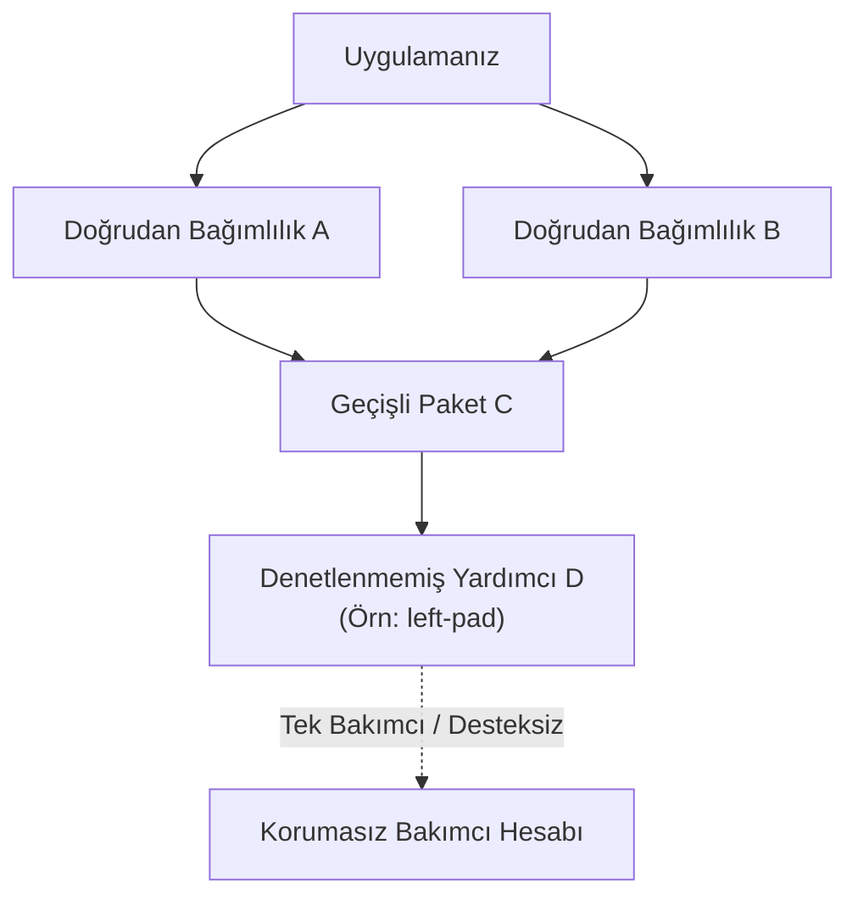
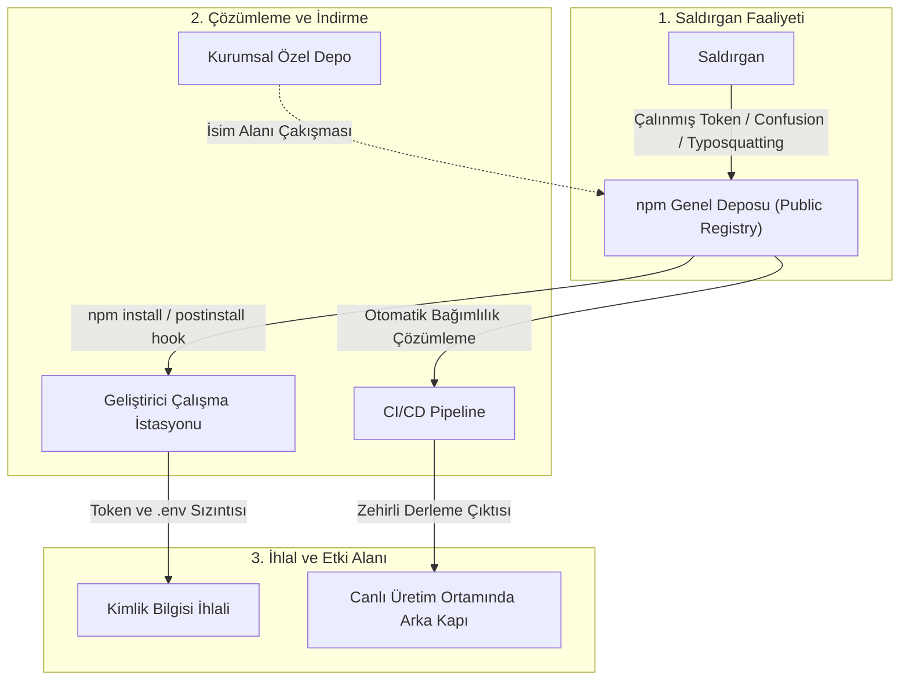

Modern bir uygulamanın kod tabanının büyük kısmı, geliştirme ekibinin kendi yazdığı satırlardan değil, hiç denetlemediği açık kaynak kütüphanelerden oluşur. Bir projeye tek bir paket dahil etmek, o paketin bağımlılıklarını, onların alt bağımlılıklarını ve bu zincirdeki her paketi yayınlayan tüm bakımcıları doğrudan güven sınırının içine çeker. Zimmermann ve arkadaşlarının npm ekosistemi üzerine yaptığı araştırma (USENIX Security 2019), ortalama bir npm paketinin kurulumunun dolaylı olarak 79 üçüncü taraf kütüphaneye ve 39 bağımsız bakımcıya koşulsuz güvenmek anlamına geldiğini ortaya koymuştur.

Bu ölçekte bir risk, paketleri tek tek inceleyerek yönetilemez. Ekosistemi bir **yönlü çizge (directed graph)** olarak modellemek, hangi paketlerin ve hangi bakımcı hesaplarının ekosistemin geri kalanı için tek hata noktası (SPOF) olduğunu nicel olarak gösterir. Bu yazıda, npm ekosisteminin mimari çalışma mantığını, gerçek dünya saldırı vektörlerini, çizge tabanlı analiz yöntemlerini ve kurumsal savunma stratejilerini bütüncül bir yaklaşımla ele alıyoruz.

<div class="glass-panel reveal-on-scroll">

| Bakış Açısı | Paket Bazlı Geleneksel Değerlendirme | Çizge Tabanlı Bütüncül Analiz |
| :--- | :--- | :--- |
| **Soru** | "Bu pakette bilinen bir zafiyet var mı?" | "Bu paket ele geçirilirse ekosistemde kaç proje enfekte olur?" |
| **Kapsam** | Yalnızca doğrudan bağımlılıklar | Tüm geçişli (transitive) bağımlılık zinciri |
| **Risk Ölçüsü** | CVE ve CVSS puanı | Erişim (reach), merkezilik metrikleri, bakımcı yoğunlaşması |
| **Kör Nokta** | Henüz CVE kaydı açılmamış sıfırıncı gün tehditleri | Derleme ve CI/CD ortamına sızan zincirleme riskler |
| **Çıktı** | Yama listesi | Önceliklendirilmiş izleme, sıkılaştırma ve SBOM envanteri |

</div>

---

## npm Ekosisteminin Mimari Yapısı ve Çalışma Mantığı

npm, proje dosyalarının tanımlandığı manifestolara, bağımlılık kilitlerine ve hiyerarşik bir dosya sistemine dayanır. Bu mimarinin temel bileşenleri ve taşıdıkları güvenlik riskleri şu şekilde özetlenebilir:

* **`package.json`:** Projenin kimlik kartıdır. Projede kullanılan kütüphaneleri (`dependencies`, `devDependencies`), üst verileri ve kurulum betiklerini (`scripts`) barındırır. Güvenlik açısından en kritik alan, kütüphane kurulurken işletim sistemi seviyesinde otomatik komut çalıştırabilen `scripts` bloğudur.
* **SemVer (Semantic Versioning):** Paket sürümlerinin `MAJOR.MINOR.PATCH` düzeninde yönetilmesini sağlar. Sürüm tanımlarken kullanılan `^` veya `~` gibi joker karakterler, paket yöneticisinin en son minor veya patch sürümlerini otomatik olarak indirmesine izin verir. Bu durum, hesabı ele geçirilen güvenilir bir geliştiricinin zararlı bir patch yayınlaması halinde, saldırgan kodunun binlerce sisteme otomatik olarak sızmasına zemin hazırlar.
* **`package-lock.json`:** Sürüm kaymalarını önlemek ve kurulumu deterministik (tutarlı) hale getirmek için kullanılır. Bağımlılıkların indirildiği tam adresi (`resolved`) ve dosyaların doğruluğunu denetleyen SHA-512 özetini (`integrity`) tutar. Bu dosyanın değiştirilmesi, lockfile enjeksiyonu saldırılarına yol açabilir.
* **`node_modules`:** İndirilen tüm kütüphanelerin ve onların alt bağımlılıklarının fiziksel olarak kaydedildiği klasördür. Ağacın çok derin olmasından dolayı, bu klasör içindeki kodların elle denetlenmesi neredeyse imkansızdır.

| Bileşen | Görevi | Güvenlikteki Rolü | Birincil Tehdit Vektörü |
| :--- | :--- | :--- | :--- |
| **`package.json`** | Proje bağımlılıklarını ve meta verilerini tutar. | Otomatik çalışan script alanlarını barındırır. | Kötü amaçlı kurulum betikleri (`preinstall`, `postinstall`) |
| **`package-lock.json`** | Bağımlılıkların tam sürümlerini kilitler. | SHA-512 bütünlük kontrolü ve kaynak doğrulaması sağlar. | Lockfile enjeksiyonu ve kaynak URL değiştirme |
| **`node_modules`** | Paketlerin kaynak kodlarını fiziksel olarak barındırır. | Kodun çalıştırılırken doğrudan dahil edildiği dizindir. | Dosya manipülasyonları ve kod gizleme |
| **SemVer Kuralları** | Sürüm güncellemelerini yönetir. | Otomatik sürüm geçişlerine izin veren operatörleri belirler. | Güvenilir kütüphanenin yeni sürümü üzerinden zararlı yayılması |

---

## Geçişli Bağımlılık Riski ve Görünürlük Kör Noktaları

Bir projenin `package.json` dosyasında listelenen doğrudan bağımlılıklar, buzdağının yalnızca görünen kısmıdır. Gerçek bağımlılık ağacı, kilit dosyasında (`package-lock.json`, `pnpm-lock.yaml`) yer alan yüzlerce geçişli paketten oluşur. Geliştiricinin bilinçli olarak seçmediği bu paketler, aynı ayrıcalıklarla derleme ortamında ve üretimde çalışır.

Matematiksel olarak derinliği $D$ ve her paketin ortalama bağımlılık sayısı (dallanma faktörü) $b$ olan bir bağımlılık ağacındaki toplam paket sayısı $N$ şu formülle ifade edilebilir:

$$N = \frac{b(b^D - 1)}{b - 1}$$

Bu üstel büyüme, kodların manuel olarak incelenmesini imkansız kılar. Geliştiriciler yalnızca doğrudan ekledikleri paketleri denetlerken, ağacın derinliklerinde yer alan zararlı kodlar gözden kaçar ve ciddi bir **görünürlük kör noktası (visibility blind spot)** oluşur.



Diyagramdaki **D** paketi tipik bir risk örüntüsünü temsil eder: küçük, nadiren güncellenen, tek bir bakımcıya bağlı ve binlerce projenin dolaylı olarak kullandığı bir yardımcı paket. 2016'daki `left-pad` olayı, bu tür bir paketin yayından kaldırılmasının dahi küresel derleme hatlarını kırabildiğini, 2018'deki `event-stream` vakası ise bakım devrinin doğrudan kötü niyetli bir arka kapıya dönüşebileceğini kanıtlamıştır.

---

## Açık Kaynak Ekosisteminin Yönlü Çizge Olarak Modellenmesi

Ekosistem, düğümleri paketler, kenarları ise bağımlılık ilişkileri olan yönlü bir çizge `G = (V, E)` ile modellenir. Bir `u → v` kenarı, "u paketi v paketine bağımlıdır" anlamına gelir. Güvenlik analizinde genellikle bu çizgenin **tersi** ($R$) kullanılır: ters çizgede bir paketten ulaşılabilen tüm düğümler, o paketin güvenliği ihlal edildiğinde zincirleme olarak etkilenebilecek tüm projelerdir.

### Veri Toplama ve Ekosistem Ölçeği

Çizgenin kurulması için gereken meta veriler, paket registry'lerinin (package registries) kamuya açık arayüzlerinden toplanır. npm için CouchDB değişiklik akışı (changes feed), PyPI için BigQuery kamuya açık veri setleri temel alınır:

* **Sürüm Çözümleme:** Bağımlılıklar sürüm aralıklarıyla (`^1.2.0`) tanımlanır. Analizde ekosistemin güncel kararlı (stable) sürümleri veya belirli bir tarihteki anlık görüntüsü kullanılır.
* **Bağımlılık Türü Ayrımı:** `dependencies` üretim runtime'ında çalışırken, `devDependencies` yalnızca derleme ortamında çalışır. İkisi farklı tehdit yüzeylerini temsil ettiği için ayrı kenar türleri olarak modellenmelidir.
* **Örnek Ekosistem Ölçeği:** npm registry'si 2.5 milyondan fazla aktif paket ve 25 milyonu aşkın bağımlılık kenarı barındırırken. PyPI tarafında bu rakam 500.000 paket ve yaklaşık 3 milyon kenara ulaşmaktadır.

---

## Merkezilik Metrikleriyle Kritik Düğümlerin Tespiti

Çizge kurulduktan sonra her paket için birden fazla risk metriği hesaplanır. Her metrik farklı bir soruya yanıt verir ve birlikte değerlendirilmelidir:

<div class="render-cards">
  <article class="render-card">
    <h4>Giriş Derecesi (In-Degree)</h4>
    <p>Pakete doğrudan bağımlı olan paket sayısıdır. Hesaplanması ucuzdur ancak dolaylı geçişli etkiyi yansıtmaz.</p>
  </article>
  <article class="render-card">
    <h4>Geçişli Erişim (Reach)</h4>
    <p>Paketten ters çizgede ulaşılabilen toplam düğüm sayısıdır. Paket ele geçirilirse zincirleme olarak etkilenebilecek tüm ekosistemi doğrudan ölçer.</p>
  </article>
  <article class="render-card">
    <h4>PageRank</h4>
    <p>Kritik ve popüler paketlerin bağımlı olduğu paketlere daha yüksek ağırlık verir. Ekosistemin temel yapı taşlarını ortaya çıkarır.</p>
  </article>
  <article class="render-card">
    <h4>Betweenness Centrality</h4>
    <p>Düğümün diğer paket çiftleri arasındaki en kısa yollarda ne sıklıkla yer aldığını gösterir. Farklı toplulukları birbirine bağlayan köprü paketleri bulur.</p>
  </article>
</div>

### Python ve NetworkX ile Çizge Analizi

Aşağıdaki betik, bir bağımlılık listesinden çizgeyi kurarak metrikleri hesaplar. Milyonlarca düğümlü büyük ağlarda betweenness centrality hesabı için örnekleme yaklaşımı kullanılır:

```python
import csv
import networkx as nx

# edges.csv: bağımlı_olan,bağımlılık (u depends on v)
G = nx.DiGraph()
with open("edges.csv", newline="", encoding="utf-8") as f:
    G.add_edges_from((row[0], row[1]) for row in csv.reader(f))

# Ters çizge: v -> u kenarı, v ele geçirildiğinde u'ya ulaşılabileceğini gösterir
R = G.reverse(copy=False)

in_degree = dict(G.in_degree())
pagerank = nx.pagerank(G, alpha=0.85)
betweenness = nx.betweenness_centrality(G, k=2000, seed=42)

# En yüksek in-degree değerine sahip adaylar arasından geçişli erişimi hesapla
candidates = sorted(in_degree, key=in_degree.get, reverse=True)[:500]
reach = {pkg: len(nx.descendants(R, pkg)) for pkg in candidates}

top = sorted(candidates, key=lambda p: reach[p], reverse=True)[:20]
for pkg in top:
    print(f"{pkg:35} reach={reach[pkg]:>8} in={in_degree[pkg]:>6} "
          f"pr={pagerank[pkg]:.2e} btw={betweenness.get(pkg, 0):.2e}")
```

#### Kritik Düğüm Bulguları

Analiz sonuçları, ekosistemin küçük bir çekirdek etrafında aşırı yoğunlaştığını kanıtlamaktadır:

* **Asimetrik Erişim:** Örneğin `chalk`, `commander`, `tslib` veya Python tarafında `urllib3`, `six` gibi temel kütüphaneler, kod hacimleri birkaç yüz satırdan ibaret olsa bile 500.000'den fazla alt projeye geçişli olarak nüfuz eder.
* **PageRank vs. In-Degree Ayrımı:** Yalnızca doğrudan indirme veya `in-degree` sayısına bakıldığında gözden kaçan yardımcı parser veya polyfill paketleri, PageRank ve betweenness centrality sıralamalarında ekosistemin vazgeçilmez "darboğazları" olarak ilk sıralarda yer alır.

---

## Bakımcı Yoğunlaşması: İnsan Faktörü

Paket çizgesi riskin yalnızca yarısını gösterir. Bir paketin güvenliği, sonuçta onu yayınlama yetkisine sahip hesapların güvenliğine bağlıdır. Paket–bakımcı iki parçalı çizgesi birleştirildiğinde, **bir bakımcı hesabının toplam erişimi** hesaplanabilir: o hesabın yayınlayabildiği tüm paketlerin geçişli erişim kümelerinin birleşimi.

* **Az Sayıda Hesap, Devasa Etki:** Ekosistemin önemli bir kısmına ulaşan paketler, görece küçük bir bakımcı grubunun elindedir.
* **Tek Bakımcılı Kritik Paketler:** Yüksek erişime sahip ancak yalnızca tek bir yayın yetkilisi olan kütüphaneler, hesap ele geçirme (ATO) saldırılarına karşı en kırılgan noktalardır.
* **Bakımsız Düğümler:** Uzun süredir güncellenmeyen ancak yüksek erişimli paketler, sahiplik devri veya terk edilme risklerini taşır.

---

## npm Ekosistemindeki Siber Riskler ve Saldırı Türleri

Saldırganlar, npm ekosisteminin açık yapısını ve paket çözümleme mantığındaki tasarım boşluklarını istismar etmek amacıyla son derece gelişmiş teknikler kullanmaktadır.



### Bağımlılık Karışıklığı (Dependency Confusion)

2021 yılında güvenlik araştırmacısı **Alex Birsan** tarafından keşfedilen bu yöntem, paket yöneticilerinin hem yerel hem de genel kayıt depolarını bir arada kullanırken düştüğü mantıksal zafiyeti istismar eder. Büyük kuruluşlar, dahili kütüphanelerini özel (private) depolarda tutar. Saldırganlar bu isimleri tespit ettiklerinde genel npm deposuna giderek aynı isimle `99.9.9` gibi aşırı yüksek bir sürüm numarasıyla paket yüklerler. Proje yapılandırmasında kaynak öncelikleri kilitlenmemişse, paket yöneticisi genel depodaki sahte paketi indirir. Alex Birsan bu teknikle **Microsoft, Apple, Yelp, Tesla ve Shopify** iç ağlarında kod çalıştırmayı başarmıştır.

### Geliştirici Hesaplarının Ele Geçirilmesi (Account Takeover)

Geliştirici hesapları çoğunlukla iki yöntemle hedef alınır:
* **Hedefli Kimlik Avı (Phishing):** Geliştiricilere sahte destek bildirimleri gönderilerek iki aşamalı doğrulama (2FA) sıfırlama kodlarının ele geçirilmesi.
* **Süresi Dolan Alan Adları (Expired Domains):** Geliştiricinin npm hesabına bağlı e-posta alan adının süresi dolduğunda, saldırgan bu domaini satın alıp şifre sıfırlama bağlantısını ele geçirir.

### Kurulum Betikleriyle Gelen Tehlike (Lifecycle Scripts)

npm paketleri kurulurken otomatik çalışan yaşam döngüsü hook'ları (`preinstall`, `postinstall`) doğrudan işletim sisteminde kod yürütür. Mart 2026'daki **Axios Olayı**'nda saldırganlar, alt bağımlılıklara `plain-crypto-js@4.2.1` paketini yerleştirmiş ve `postinstall` betiği üzerinden sisteme çapraz platform destekli bir Uzaktan Erişim Truva Atı (RAT) indirmiştir.

### Protestware ve Terk Edilmiş Paketler

* **node-ipc Olayı (CVE-2022-23812):** Popüler `node-ipc` kütüphanesinin geliştiricisi, politik gerekçelerle belirli coğrafi lokasyonlardaki makinelerde dosyaları silen zararlı kod yayınlamış. Vue.js CLI gibi binlerce geliştirme aracı doğrudan etkilenmiştir.
* **Terk Edilmiş Paketler (Abandoned Packages):** Bakımı durdurulan paketlerde zamanla sıfırıncı gün açıkları keşfedilse de güncelleme yayınlanmadığı için sistemler kalıcı olarak savunmasız kalır.

| Saldırı Yöntemi | Nasıl Çalışır? | Tarihsel / Gerçek Örnekler | Etki Alanı |
| :--- | :--- | :--- | :--- |
| **Dependency Confusion** | Şirket içi paket adlarıyla genel depoya yüksek sürümlü sahte paket yüklenmesi. | Apple, Microsoft, Tesla İhlalleri (2021) | İç ağlara sızma ve sunucularda komut çalıştırma |
| **Typosquatting** | Popüler paket adlarındaki yazım hatalarının taklit edilmesi (`lodsh`, `crossenv`). | Çeşitli npm kimlik avı paketleri | API anahtarlarının ve çevre (env) verilerinin çalınması |
| **Account Takeover (ATO)** | Geliştirici hesaplarının çalınması veya süresi biten domainlerin alınması. | `event-stream` (2018), Axios Vakası (2026) | Meşru güncellemeler üzerinden zararlı kod dağıtımı |
| **Lifecycle Script İstismarı** | Kurulum sırasında çalışan betiklerin kötüye kullanılması. | Axios / `plain-crypto-js` RAT (2026) | Geliştirici makinesinde arka kapı (backdoor) açılması |
| **Protestware** | Geliştiricinin kendi paketini sabote etmesi. | `node-ipc` (`peacenotwar`), `colors.js` | Dosya silme ve sistemleri çalışmaz hale getirme (DoS) |

---

## Gerçek Bir Vaka: Mini Shai-Hulud Solucanı (Nisan/Mayıs 2026)

2026 yılının Nisan ve Mayıs aylarında **TeamPCP** grubu tarafından düzenlenen "Mini Shai-Hulud" saldırısı, npm tarihindeki ilk **kendi kendini çoğaltan (self-replicating) solucan** olarak kayıtlara geçti:

1. **Kimlik Taklidi ve Pull Request:** Haftalık 12 milyondan fazla indirilen **TanStack** kütüphanesinin reposuna, güvenilir bir bot kimliği (Anthropic Claude GitHub App) taklit edilerek sahte bir Pull Request (PR) gönderildi. `pull_request_target` tetikleyicisi yüzünden bu kod ana deponun yetkili sunucularında çalıştı ve GitHub erişim anahtarları sızdırıldı.
2. **GitHub Actions Önbellek Zehirlenmesi (Cache Poisoning):** Zararlı kod, projenin derleme (`release.yml`) sürecinde kullanılan pnpm paket havuzunu sabote ederek 1.1 GB boyutunda zehirli bir önbellek dosyası yazdı.
3. **Erişim Yetkisi Hırsızlığı ve Yayılım:** Ana kod deposu güncellendiğinde tetiklenen derleme sistemi, önbellekten bu zehirli bağımlılıkları geri yükledi ve derleme sırasında çalıştırarak yöneticinin npm paket yayınlama token'larını ele geçirdi.

Solucan yetkileri aldıktan sonra **sadece 6 dakika içinde** 42 farklı meşru `@tanstack/*` paketi altında **84 adet zararlı sürüm** yayınladı. Enfeksiyon `@antv`, `echarts-for-react`, `@opensearch-project/opensearch` ve `@mistralai/mistralai` gibi popüler kütüphanelere yayıldı.

---

## Geliştirici Ortamlarını ve CI/CD Hatlarını Hedef Alan Yeni Nesil Tehditler

Saldırganlar artık sadece paket depolarına sızmakla kalmıyor, doğrudan geliştiricilerin yerel çalışma ortamlarını hedef alıyor:

* **Geliştirici Araçlarının ve IDE Eklentilerinin Zehirlenmesi:** Zararlı VS Code veya JetBrains eklentileri üzerinden yerel makineye sızılarak kurumsal kimlik bilgileri toplanmaktadır.
* **Otonom Yapay Zeka Ajanlarının Manipülasyonu:** Yapay zeka destekli kodlama asistanları (AI coding agents), internetteki zehirli paket önerilerini doğrulama yapmadan projeye ekleyebilmektedir.
* **CI/CD Gizli Bilgilerinin (Secrets) Hasadı:** CI/CD pipeline'larında yer alan bulut erişim anahtarları ve npm yayınlama token'ları, kurulum betikleri aracılığıyla dışarı sızdırılmaktadır.

---

## Tedarik Zincirini Koruma ve Savunma Stratejileri

npm tedarik zinciri risklerini tek bir güvenlik aracıyla çözmek mümkün değildir. Statik analiz, kurulum sıkılaştırma, proxy yönetimi ve runtime izleme katmanları birlikte uygulanmalıdır.

### Uygulanabilir Sertleştirme Direktifleri

Aşağıdaki komutlar, tedarik zinciri riskini CI/CD pipeline'ında ölçülebilir ve kontrol edilebilir hale getirir:

```bash
# Kilit dosyasına sadık kalarak kurulum betiklerini çalıştırmadan temiz kurulum
npm ci --ignore-scripts --allow-git=none

# Registry imzalarının ve provenance (kaynak kanıtı) bilgisinin doğrulanması
npm audit signatures

# CycloneDX formatında standart SBOM üretimi
npx @cyclonedx/cyclonedx-npm --output-file sbom.cdx.json

# SBOM'un bilinen zafiyet veritabanlarına karşı taranması
grype sbom:./sbom.cdx.json
```

> [!NOTE]
> **NPM 12 – Kritik Güvenlik Değişiklikleri (GitHub Duyurusu)**
>
> GitHub tarafından duyurulan **NPM 12** sürümüyle birlikte:
> - `allowScripts` ayarı **varsayılan olarak kapalı** gelmektedir.
> - `npm install` artık bağımlılıklardaki `preinstall` ve `postinstall` script’lerini otomatik çalıştırmayacak, script çalıştırma **açık izin (opt-in)** esasına bağlanacaktır.
> - Git bağımlılıkları (`--allow-git`) ve uzak URL bağımlılıkları (`--allow-remote`) varsayılan olarak engellenecektir.
>
> Geçiş hazırlığı için `npm approve-scripts` komutuyla yalnızca güvendiğiniz paketlerin script çalıştırmasına onay verip `package.json` dosyanıza sabitleyebilirsiniz.

### Kurumsal Mimari İlkeleri

1. **Kurum İçi Proxy Registry:** Sonatype Nexus veya JFrog Artifactory gibi yerel bir proxy kullanılarak tüm paket indirmeleri şirket içi filtreden geçirilmeli, dahili paketler `@sirket/paket-adi` şeklinde kapsamlı (scoped) adlarla korunmalıdır.
2. **Bekleme Süresi (Cooldown / Minimum Release Age):** Yeni yayınlanan sürümler, otomatik güncelleme botlarında (ör. Renovate `minimumReleaseAge: 3 days`) en az 3-7 gün bekletilmelidir. Ele geçirilen paketlerin büyük bölümü ilk saatler içinde topluluk tarafından fark edilip silinmektedir.
3. **Süreç Ağacı ve Ağ Çıkış (Egress) İzleme:** EDR ve SIEM sistemlerinde `node` sürecinin `curl`, `powershell.exe` veya `sh` gibi kabuk süreçleri başlatıp başlatmadığı izlenmeli, derleme sunucularının bilinmeyen IP adreslerine giden ağ trafiği engellenmelidir.

| Savunma Katmanı | Kullanılması Gereken Araçlar | Sağladığı Koruma | Öncelik |
| :--- | :--- | :--- | :--- |
| **Statik Analiz & SBOM** | CycloneDX, Grype, Snyk, npq, lockfile-lint | Bilinen zafiyetlerin tespiti, SBOM envanteri ve kaynak doğrulaması | Yüksek |
| **Kurulum Sıkılaştırma** | `npm ci`, `--ignore-scripts`, `--allow-git=none` | Otomatik çalışan zararlı kurulum betiklerinin engellenmesi | Kritik |
| **Depo ve Proxy Yönetimi** | JFrog Artifactory, Sonatype Nexus | Bağımlılık karışıklığı (Dependency Confusion) engelleme | Kritik |
| **Runtime İzleme** | EDR/XDR, SIEM, Falco | Anormal süreç çatallanması ve şüpheli ağ çıkışlarının tespiti | Yüksek |

---

## Mühendislik Çıkarımları ve Bütüncül Savunma Vizyonu

Açık kaynak ekosistemi üzerinde yazılım geliştirmek, devasa bir güven ağına dahil olmak demektir. Bağımlılık ağacınızı yönlü bir çizge olarak modellemek, soyut güvenlik kaygılarını ölçülebilir, önceliklendirilebilir ve sürekli denetlenebilir somut savunma kontrollerine dönüştürür.

Tedarik zinciri güvenliği, kodunuzun güvendiği her bağımlılığı ve bakımcıyı görünür kılmakla başlar. Deterministik kilit dosyaları, script engellemeleri ve çizge tabanlı risk analizleriyle bu güven sınırını proaktif olarak koruyun.
