[Letsdefend Blue Team Eğitim Platformu](https://letsdefend.io/)

Siber güvenlik dünyasında tehdit avcılığı, saldırganları tespit etmek ve faaliyetlerini durdurmak için proaktif yaklaşımlar geliştirmeyi gerektirir. Geleneksel güvenlik önlemleri saldırganları durdurmak için pasif yöntemler sunarken, deception tabanlı tehdit avcılığı bu stratejiyi bir adım öteye taşır. Deception tabanlı tehdit avcılığı, saldırganları yanıltan, onları gerçek hedeflerine ulaşmaktan alıkoyan ve bu süreçte taktiklerini ortaya çıkaran bir yöntemdir.

Bu teknik, bir organizasyonun ağı içine saldırganların dikkatini dağıtmak ve onları tespit etmek amacıyla kasıtlı olarak yanıltıcı bilgiler ve sahte hedefler (honeypot'lar ve honeynet'ler gibi) yerleştirmeyi içerir. Saldırganlar, bu tuzakların gerçek sistemler olduğuna inanarak onlara yönelir ve bu da güvenlik ekiplerinin saldırganların yöntemlerini ve niyetlerini daha iyi anlamasını sağlar. Bu yaklaşım, saldırıların daha erken aşamalarda tespit edilmesini sağlar ve bir organizasyonun güvenlik duruşunu önemli ölçüde güçlendirir.

Deception tabanlı tehdit avcılığı sadece saldırganları tespit etmekle kalmaz, aynı zamanda hareketlerini de izleyerek gelecekteki saldırılara karşı savunma stratejilerinin geliştirilmesine katkıda bulunur.

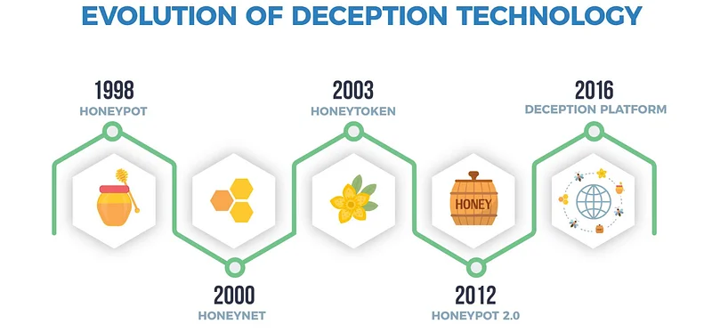

( **Görsel Kaynağı** : <https://www.wwt.com/article/deception-technology> )

---

## Deception Teknolojileri ile Tehdit Avcılığı

Tehdit avcılığı, siber saldırıları tespit etmek ve durdurmak için tasarlanmış aktif bir süreçtir. Deception teknolojileri, saldırgan davranışlarını ortaya çıkararak ve güvenlik ekiplerinin yöntemlerini anlamalarına yardımcı olarak buna katkıda bulunur. Deception tabanlı tehdit avcılığı sadece saldırıları tespit etmekle kalmaz, aynı zamanda saldırganların nasıl hareket ettiğini izleyerek daha geniş bir güvenlik perspektifi sağlar.

Bu teknolojiler, honeypot'lar, honeynet'ler, sahte dosyalar ve sahte veritabanları gibi çeşitli deception unsurlarını bir organizasyonun ağına entegre eder. Saldırganlar bu tuzakları gerçek hedeflerle karıştırır ve onlarla etkileşime girer, bu da güvenlik ekiplerinin saldırganların tekniklerini, araçlarını ve niyetlerini analiz etmesini sağlar. Sonuç olarak, organizasyonlar mevcut saldırılara karşı savunmalarını güçlendirebilir ve gelecekteki tehditler için daha etkili güvenlik stratejileri geliştirebilirler.

---

## Tehdit Avcılığında Deception Teknolojilerinin Rolü

Tehdit avcılığında deception teknolojilerinin rolü, saldırganları yanıltmak, yöntemlerini ifşa etmek ve güvenlik ekiplerinin saldırının hangi aşamada olduğunu anlamalarına yardımcı olmaktır. Bu teknolojiler, ağlara ve sistemlere stratejik olarak tuzaklar yerleştirerek saldırganları aldatır ve gerçek hedeflerine ulaşmalarını zorlaştırır.

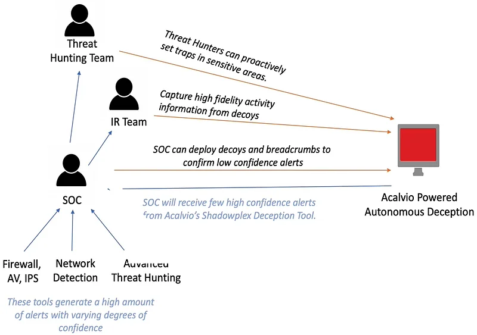

( **Görsel Kaynağı** : <https://www.youtube.com/watch?app=desktop&v=N9TkDjzeVDc> )

Deception teknolojileri, tehdit avcılığı sürecinde birkaç kritik rol oynar:

* **Saldırganları Yönlendirme:** Saldırganlar, tuzakların gerçek kaynaklar olduğuna inanarak onları hedef almaları için kandırılır. Bu, dikkatlerini gerçek hedeflerden uzaklaştırır ve zarar vermelerini önler.
* **Saldırıları Tespit Etme:** Saldırganlar tuzaklarla etkileşime girdiğinde veya onları manipüle ettiğinde, deception sistemleri güvenlik ekiplerine derhal uyarı gönderir. Bu uyarılar saldırıların erken tespit edilmesini sağlar.
* **Saldırgan Davranışlarını Analiz Etme:** Deception teknolojileri, saldırganların tuzaklarla etkileşiminin her adımını kaydeder. Bu veriler saldırganların yöntemlerini, araçlarını ve niyetlerini anlamak için analiz edilir.
* **Savunma Stratejileri Geliştirme:** Deception teknolojilerinden elde edilen içgörüler, güvenlik ekiplerinin daha etkili savunma stratejileri geliştirmesini sağlar. Saldırganların zayıf noktalarını belirleyerek ekipler ağlarının güvenliğini artırabilirler.

---

## Deception Tabanlı Tehdit Tespiti

Deception tabanlı tespit, saldırganlar yanıltıcı unsurlarla etkileşime girdiğinde tetiklenen bir siber güvenlik yaklaşımıdır. Bu yöntem, saldırganları yanıltmak ve varlıklarını ortaya çıkarmak için sahte kaynaklar ve hedefler kullanır.

Deception tabanlı tespit aşağıdaki adımlarla gerçekleştirilir:

* **Tuzakların Kurulması:** Sahte unsurlar ağlar ve sistemler içine stratejik olarak yerleştirilir. Bu tuzaklar saldırganları çekmek ve tuzağa düşürmek için tasarlanmıştır.
* **Saldırganların Tespiti:** Bir saldırgan bir tuzağa erişmeye veya onu manipüle etmeye çalıştığında, deception sistemi bu aktiviteyi tespit eder ve güvenlik ekiplerini uyarır. Bu, saldırının erken tespit edilmesini sağlar.
* **Aktivitenin Kaydedilmesi:** Saldırganın tuzaklarla etkileşiminin her adımı kaydedilir. Bu veriler saldırının nasıl geliştiğini ve hangi tekniklerin kullanıldığını analiz etmek için kullanılır.
* **Hızlı Müdahale:** Deception tabanlı tespit, saldırıların hızlı bir şekilde tanımlanmasını sağlayarak güvenlik ekiplerinin derhal müdahale etmesine olanak tanır. Erken tespit, saldırının etkisini en aza indirir ve saldırganın ilerlemesini engeller.

Deception tabanlı tespit, siber güvenlik savunmasının güçlü bir bileşenidir. Saldırganlar tuzaklarla etkileşime girerek varlıklarını ortaya çıkarır, bu da saldırının daha eksiksiz bir değerlendirmesine olanak tanır ve güvenlik stratejilerinin güçlendirilmesine yardımcı olur.

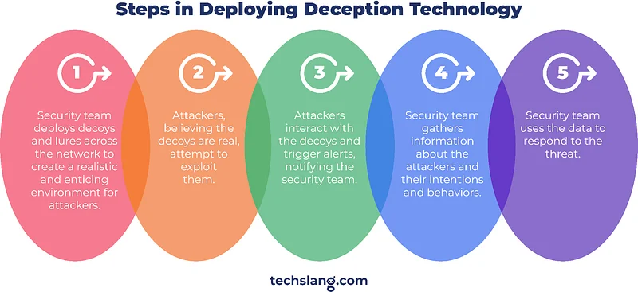

---

## Hipotez Değerlendirmesi

Siber güvenlikteki deception teknolojileri, saldırganları yanıltarak hareketlerini ve niyetlerini ortaya çıkarmanın etkili bir yolunu sunar. Bu teknolojiler saldırganları sahte hedeflere yönlendirerek erken tespite olanak tanır ve güvenlik ekiplerinin tehditlere hızlı bir şekilde yanıt vermesini sağlar. Deception tabanlı tespit, anomali tespiti ve davranışsal analizle desteklenen, siber tehditlere karşı proaktif bir savunma hattı oluşturur. Bu yaklaşımlar, saldırganların asıl hedeflerine ulaşmasını zorlaştırırken bir organizasyonun güvenlik stratejisini güçlendirerek ağ güvenliğini maksimize eder.

---

## Tehdit Avcılığı Sürecinde Deception Kullanımı

Tehdit avcılığı, siber saldırıları meydana gelmeden önce tespit etmeyi amaçlayan proaktif bir güvenlik stratejisidir. Bu stratejide deception sistemleri kritik bir rol oynar. Deception sistemleri siber saldırganları yanıltmak, gerçek hedeflerine ulaşmalarını engellemek ve sahte hedefler ile tuzaklar kullanarak güvenlik ekiplerine değerli içgörüler sağlamak için tasarlanmıştır. Bu sistemler saldırganları takip etmeye ve tanımlamaya yardımcı olarak tehdit avcılığı sürecinde hayati bir bileşen görevi görür.

Deception sistemleri, ağlar, sistemler veya uygulamalar içine stratejik olarak yerleştirilen honeypot'lar, sahte veritabanları ve sahte dosyalar gibi tuzaklar kullanır. Saldırganlar bu tuzakları gerçek hedeflerle karıştırıp onlarla etkileşime girdiğinde, güvenlik ekipleri saldırganların teknikleri, araçları ve amaçları hakkında temel bilgiler toplayabilir. Bu sayede organizasyonlar, bir saldırının erken aşamalarında saldırgan davranışlarını tespit edip analiz ederek savunmalarını güçlendirebilirler.

Başka bir deyişle deception sistemleri tehdit avcılığı sürecini hızlandırır, saldırganlar tarafından kullanılan yöntemleri ortaya çıkarır ve gelecekteki tehditlere karşı daha etkili savunma önlemlerinin geliştirilmesini destekler.

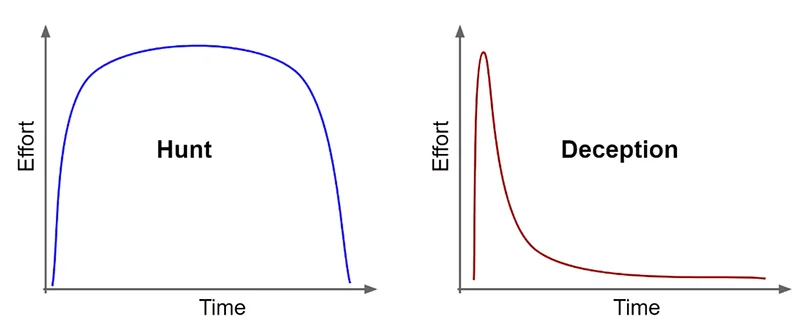

( **Görsel Kaynağı** : <https://www.countercraftsec.com/blog/benefits-and-use-cases-of-deception-for-threat-hunting/> )

---

## Deception Sistemi Loglarının Toplanması ve Analizi

Deception sistemleri, saldırganların tuzaklarla girdiği her türlü etkileşimi kaydeder ve bu bilgileri loglarda saklar. Bu log verileri saldırganların niyetlerini, tekniklerini ve yöntemlerini anlamak için kritiktir. Deception log verilerinin toplanması ve analizi, tehdit avcılığı sürecinin çok önemli bir parçasını oluşturur.

* **Veri Toplama:** Deception sistemleri tuzaklara yönelik tüm saldırı girişimlerini günlüğe kaydeder. Bu veriler saldırganların ne zaman, nasıl ve hangi araçları kullanarak saldırılarını gerçekleştirdiklerini içerir. Toplanan loglar zaman damgaları, saldırgan IP adresleri, kullanılan komutlar ve sistemle olan diğer etkileşimler gibi kritik bilgiler içerebilir.
* **Merkezi Log Yönetimi:** Tespit sistemlerinin loglarını merkezi bir log yönetimi sistemine veya bir SIEM (Güvenlik Bilgisi ve Olay Yönetimi) platformuna aktarmak, bu verilerin verimli bir şekilde yönetilmesini ve analiz edilmesini sağlar. Merkezi bir log yönetimi sistemi büyük hacimli verileri depolayabilir, analiz edebilir ve saldırgan davranışları arasındaki bağlantıları tanımlayabilir.
* **Normal ve Anormal Modellerin Tanımlanması:** Log verilerinin analizi, tipik saldırgan davranış modellerini anlamaya yardımcı olur. Normal modellerden sapan anomalileri belirlemek, bir saldırının aşamasını ve saldırganların gerçek hedeflerine ulaşmadan önce durdurulup durdurulamayacağını belirlemek için kritiktir.
* **Davranışsal Analiz:** Log verileri saldırganların tuzaklarla nasıl etkileşime girdiğini analiz etmek için kullanılır. Davranışsal analiz saldırganların izlediği adımları, kullandıkları araçları ve saldırı yöntemlerini ortaya çıkarır. Sonuç olarak, güvenlik ekipleri daha etkili savunma stratejileri geliştirebilirler.

---

## Aktivitelerin Tespiti ve Analizi

Aktivitelerin tespiti ve analizi, deception tabanlı tehdit avcılığında saldırganların tuzaklarla etkileşime girdiği noktada başlar. Bu süreç saldırıları tanımlamayı, saldırganların niyetlerini ve tekniklerini anlamayı ve bu bilgilere dayanarak güvenlik önlemlerini optimize etmeyi içerir.

* **Anomali Tespiti:** Deception sistemleri, normal ağ aktivitesi ile tuzaklara yönelik saldırı girişimleri arasındaki farkları belirleyerek anomalileri tespit eder. Bu anomaliler genellikle saldırı girişimlerinin ilk işaretleridir ve bu nedenle kritiktir. Örneğin bir kullanıcının aniden normal davranışından sapması ve sahte bir veritabanına erişmeye çalışması, bir saldırganın sistemde aktif olduğunu gösterebilir.
* **İmza ve Davranış Tabanlı Tanımlama**: Deception sistemlerindeki şüpheli etkinlikler hem imza tabanlı hem de davranış tabanlı tespit yöntemleri kullanılarak tanımlanır. İmza tabanlı tespit bilinen saldırı modellerini tanımlamaya odaklanırken, davranış tabanlı tespit anormal saldırgan davranışlarını tanımlar. Birlikte kullanıldıklarında bu yöntemler daha geniş bir saldırı spektrumunu tespit edebilir.
* **Gerçek Zamanlı İzleme:** Deception sistemleri tuzaklara yönelik saldırı girişimlerini gerçek zamanlı olarak izler ve saldırgan aktivitesini anında tespit ederek saldırı zarar vermeden gerekli önlemlerin alınmasını sağlar. Gerçek zamanlı izleme, özellikle hızlı hareket eden veya yüksek etkili saldırılar için kritik bir savunma mekanizmasıdır.
* **Saldırganları Takip ve Analiz Etme:** Saldırganın tuzaklarla etkileşimi sırasında yakalanan veriler, attıkları adımları ve saldırıyı nasıl yürütmeye çalıştıklarını anlamak için analiz edilir. Analiz saldırgan tarafından kullanılan araçlar, komutlar ve stratejiler hakkında derin bir içgörü sağlar.
* **Saldırıların Etkisini Azaltma:** Tuzaklar üzerindeki saldırgan aktivitesini tespit etmek ve analiz etmek sadece saldırıları tanımlamakla kalmaz. Aynı zamanda etkilerini de en aza indirir. Bu verilerle donatılmış güvenlik ekipleri hızlı bir şekilde müdahale edebilir ve saldırganı sisteme zarar vermeden durdurabilir.

---

## Hipotez Değerlendirmesi

Deception sistemleri, tehdit avcılığı sürecinde saldırganları yanıltmak ve tekniklerini ortaya çıkarmak için etkili bir yol sunar. Deception sistemlerinde log verilerinin toplanması ve analizi saldırgan davranışlarını anlamada kritik bir rol oynar. Tuzaklar üzerindeki aktivite tespiti ve analizi, saldırıların erken tespit edilmesini ve etkili bir şekilde durdurulmasını sağlar. Bu süreçler organizasyonların güvenlik stratejilerini güçlendirmelerine, saldırganların niyetlerini daha iyi anlamalarına ve gelecekteki tehditlere hazırlanmalarına yardımcı olur. Deception sistemlerinin etkili kullanımı, siber güvenlik savunmasında güçlü bir araçtır ve ağ güvenliğinin geliştirilmesinde kritik bir rol oynar.

---

## Yetkisiz Erişim Girişimleri Hipotezi

---

## Hipotez

Belirli bir dahili IP adresinden sahte bir veritabanına veya dosya sunucusuna yapılan olağandışı erişim girişimleri, bir saldırganın ağa yetkisiz erişim sağladığını ve değerli veriler elde etmeye çalıştığını gösterebilir.

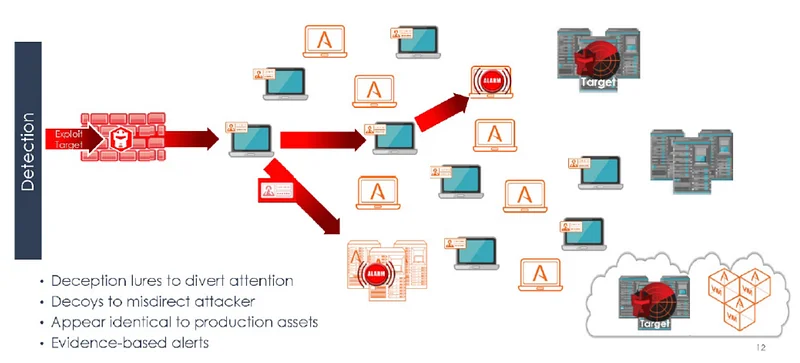

( **Görsel Kaynağı** : <https://www.linkedin.com/pulse/deception-technology-aditya-mukherjee-phd-information-security-/> )

---

## Veri Kaynakları

* **Deception Sistemi Logları:** Sahte veritabanlarına veya dosya sunucularına yapılan tüm erişim girişimlerini ve bu girişimlerin ayrıntılarını içeren loglar.
* **SIEM Logları:** Tespit sisteminden toplanan ve merkezi bir platformda analiz edilen loglar.
* **Ağ Akış Analizi (Network Flow Analysis):** Şüpheli bağlantı akışlarını izlemek için ağ trafiği verilerinin incelenmesi.
* **Kullanıcı Aktivite Logları:** Sistemlere erişen kullanıcı aktivitelerini takip eden ve anormal davranışları kaydeden loglar.
* **Tehdit İstihbaratı Veritabanları:** Bilinen saldırı yöntemleri ve kötü niyetli aktörler hakkında güncel bilgiler içeren veritabanları.

---

## Analiz Adımları

* Tespit sistemi loglarını SIEM platformuna aktarın.
* Sahte veritabanına veya dosya sunucusuna yapılan tüm erişim girişimlerini kaydedin.
* Normal ağ trafiğini ve kullanıcı aktivitelerini analiz edin.
* Tuzaklara yönlendirilen trafik seviyesini ve hangi kullanıcıların bu sahte hedeflere erişmeye çalıştığını belirleyin.
* Tuzaklara yönelik olağandışı erişim girişimlerini tespit edin.
* Normal davranıştan sapan aktiviteleri, özellikle tuzaklara çok sayıda erişim girişimi yapan dahili IP adreslerini araştırın.
* Ağ akış analizini ve kullanıcı aktivite loglarını diğer güvenlik loglarıyla karşılaştırın.
* Saldırganın diğer sistemlere erişip erişmediğini ve saldırının mevcut aşamasını belirleyin.
* Deception sistemlerinde tutulan aktivitelerin ayrıntılı bir analizini yapın.
* Saldırgan tarafından kullanılan komutları, erişmeye çalıştıkları verileri ve sistemle olan etkileşimlerini analiz edin.
* Şüpheli aktivitelerin geçerliliğini ve önemini değerlendirin.
* Saldırganın niyetlerini ve potansiyel hedeflerini belirleyin.
* Olayı doğrulamak ve saldırının aşamasını belirlemek için ek veriler toplayın.
* Saldırının kapsamını netleştirmek için ek loglar ve tehdit istihbaratı verileri kullanın.

---

## Hipotez Doğrulama ve Beklenen Bulgular

* Belirli bir dahili IP adresinden yapılan anormal erişim girişimleri deception sistemlerinde tespit edilecektir.
* Sahte veritabanlarına veya dosya sunucularına erişim girişimleri, bir saldırganın yetkisiz erişim sağlamaya çalıştığını gösterebilir.
* SIEM ve diğer güvenlik loglarıyla yapılan korelasyon analizi, bu aktivitenin potansiyel bir saldırıyı temsil edip etmediğini değerlendirmek için kullanılır.
* Saldırgan tarafından kullanılan teknikler ve hedeflenen veriler tanımlanır ve bu da saldırının erken bir aşamada durdurulmasına olanak tanır.

---

## Hipotez Değerlendirmesi

Bu analiz adımları, belirli bir dahili IP adresinden tuzaklara yönelik olağandışı erişim girişimlerini tespit etmek için stratejiler sağlar. Deception sistemleri, bu tür anormal aktiviteleri izlemek ve tanımlamak için kritik bir veri kaynağı görevi görür. Tespit edilen anomaliler bir saldırganın ağa yetkisiz erişim sağlamaya çalıştığını gösterebilir ve hızlı müdahale imkanı tanır. Bu süreç ağ güvenliğini sağlamada ve tehditleri proaktif olarak yönetmede kritik bir rol oynar.

---

## Uygulamalı Laboratuvar

---

## Hipotez

**Not**: Bu bölümdeki sorular, aşağıdaki hipoteze dayalı olarak Tehdit Avcılığı için hazırlanmıştır:

**Hipotez**: Saldırganlar, bir organizasyonun ağındaki kritik sistemleri kontrol altına almak amacıyla onları hedef alabilirler.

---

## Tehdit Avcılığı Laboratuvar Ortamı

* Deception Olayları (FortiDeceptor)
* SIEM (Wazuh)
* Güvenlik Açığı Tarayıcı Araçları (192.168.1.50)
* Windows Güvenlik Olayları
* Linux Güvenlik Olayları

---

## Laboratuvar Notları

* Aşağıdaki soruları yanıtlamak için "8 Ağustos 2024 00:00 - 13 Ağustos 2024 00:00" arasındaki logları analiz edin.
* Sonraki sorular bir öncekilerin doğru cevaplarını gerektirir. Tüm soruları kesinlikle göründükleri sırayla yanıtlayın.

---

## Sorular

**Not:** Aşağıdaki soruları yanıtlamak için "8 Ağustos 2024 00:00 - 13 Ağustos 2024 00:00" arasındaki logları analiz edin.

**Not**: Sonraki sorular bir öncekilerin doğru cevaplarını gerektirir. Tüm soruları kesinlikle göründükleri sırayla yanıtlayın.

> Deception sistemlerinde SSH servisi ile ilgili en fazla uyarının oluşturulmasına neden olan sistemin kaynak IP adresi nedir?

SIEM'de "rule.groups: fortideceptor" ve "data.event_type: ssh-logon-failure" filtrelerini kullanın ve "data.src_ip" alanını kontrol edin.

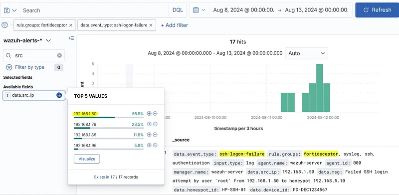

**Cevap**: 192.168.1.50

> "Vulnerability Scanner Tools" haricinde, deception sistemlerinde SSH servisi ile ilgili en fazla uyarının oluşturulmasına neden olan sistemin kaynak IP adresi nedir?

SIEM'de şu filtreleri uygulayın: "rule.groups: fortideceptor" ve "data.event_type: ssh-logon-failure." Ardından "Vulnerability Scanner Tools" IP adresini hariç tutun ve "data.src_ip" alanını kontrol edin.

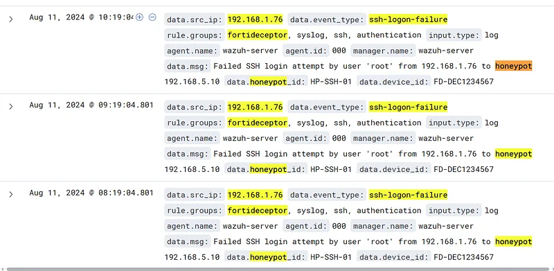

**Cevap**: 192.168.1.76

> "Vulnerability Scanner Tools" hariç tutulduğunda, SSH ile ilgili en fazla uyarıya neden olan sistem kaç farklı hedefe (hedef port 22) erişmeye çalıştı?

SIEM'de "rule.groups: fortigate," "data.dstport: 22" ve "data.srcip: [IP_Adresi]" filtrelerini kullanın.

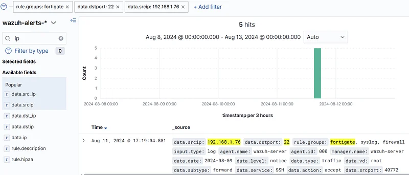

**Cevap**: 5

> Vulnerability Scanner Tools haricinde, deception sistemlerinin SSH servisinde en fazla uyarının oluşturulmasına neden olan sistem tehdit avcılığı sürecinin önceki aşamalarında tanımlanmıştı. Söz konusu sistem hangi hedef sisteme (agent.name) erişmeye çalışmış ve sonucunda en fazla "SSH logon failure" olayı oluşmuştur?

SIEM'de "data.srcip: [IP_Adresi]" ve "rule.groups: sshd" filtrelerini kullanın, ardından ssh logon failure olaylarını analiz edin. "agent.name" değerini bulun.

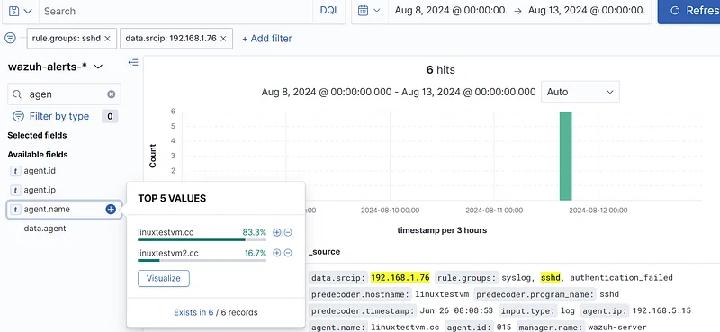

**Cevap**: linuxtestvm.cc

> Vulnerability Scanner Tools haricinde, deception sistemlerinin SSH servisinde en fazla uyarının oluşturulmasına neden olan sistem tehdit avcılığı sürecinin önceki aşamalarında tanımlanmıştı. Bu sistemin başarıyla SSH bağlantısı kurduğu hedef sistemin IP adresi nedir?

SIEM'de "data.srcip: [IP_Adresi]" ve "rule.groups: sshd" filtrelerini kullanın, ardından "ssh logon success" olaylarını inceleyin. "agent.ip" değerini kontrol edin.

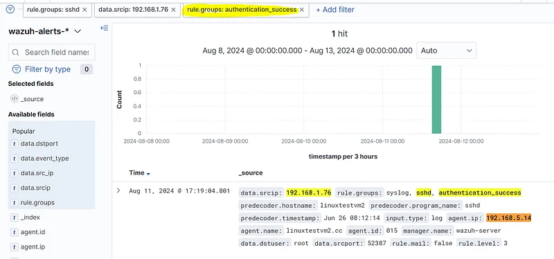

**Cevap**: 192.168.5.14

> Vulnerability Scanner Tools haricinde, deception sistemlerinin SSH servisinde en fazla uyarının oluşturulmasına neden olan sistem tehdit avcılığı sürecinin önceki aşamalarında tanımlanmıştı. Hedef sisteme başarıyla erişmek için SSH servisi dışında hangi protokol kullanılmıştır?

IP adresini SIEM'de tam metin aramasıyla aratın ve "data.service" alanındaki değerleri kontrol edin.

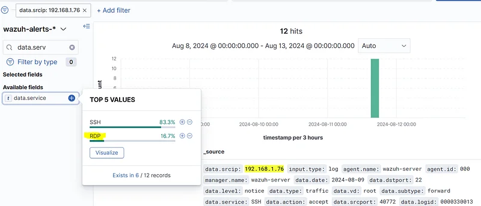

**Cevap**: RDP

> Deception sistemlerinin RDP servisinde en fazla uyarının oluşturulmasına neden olan IP adresi nedir?

SIEM'de "rule.groups: windows" filtresini kullanın ve IP adresini arayın.

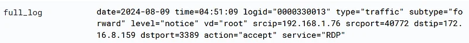

**Cevap**: 192.168.1.76

> Tehdit avcılığı sürecinin önceki aşamalarında, deception sistemlerinin RDP servislerinde en fazla uyarıya neden olan sistem tanımlanmıştı. Bu sistemin RDP kullanarak başarıyla eriştiği hedef sistemin IP adresi nedir?

SIEM'de "rule.groups: windows" filtresini kullanın ve IP adresini arayın.

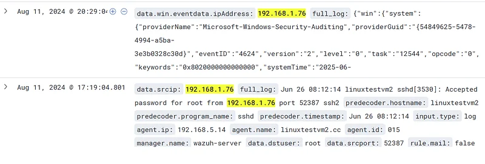

**Cevap**: 172.16.8.159

> Tehdit avcılığı sürecinin önceki aşamalarında, deception sistemlerinin RDP servislerinde en fazla uyarıya neden olan sistem tanımlanmıştı. Bu sistemden hedef sisteme erişmek için hangi kullanıcı hesabı (username) kullanılmıştır?

SIEM'de "rule.groups: windows" filtresini kullanın ve IP adresini arayın.

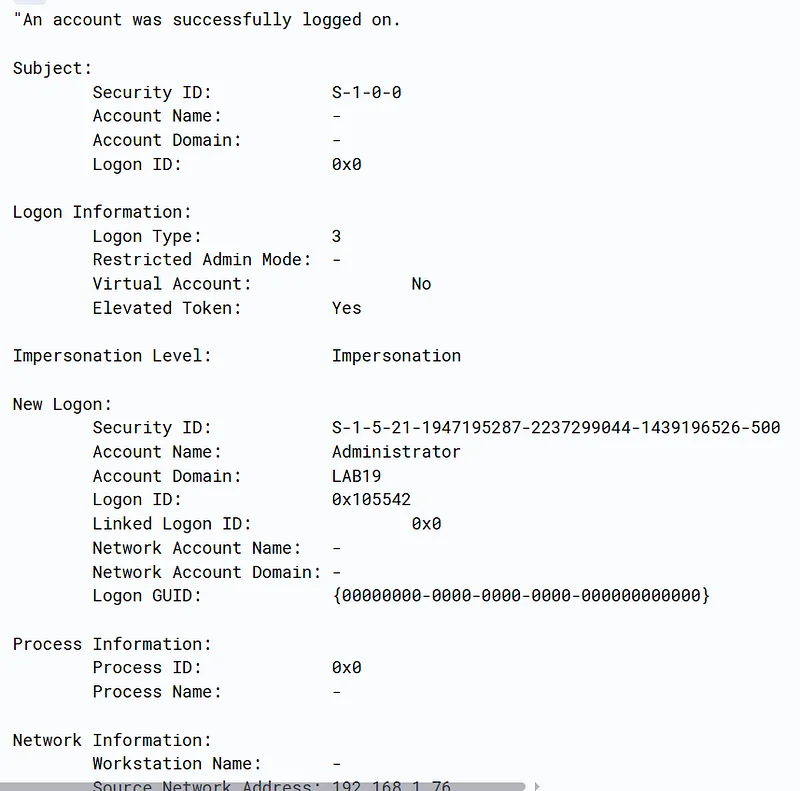

**Cevap**: Administrator
