[Letsdefend Blue Team Eğitim Platformu](https://letsdefend.io/)

Güvenlik duvarı (firewall) logları, ağ trafiğini izlemek ve güvenlik olaylarını analiz etmek için kritik bir veri kaynağıdır. Tehdit avcılığı sırasında güvenlik duvarı logları, potansiyel tehditleri tespit etmek, anomalileri belirlemek ve güvenlik olaylarına hızlı ve etkili bir şekilde yanıt vermek için kullanılır. Bu kurs, tehdit avcılığı sürecinde güvenlik duvarı loglarının rolünü ve önemini kapsamaktadır.

( **Görsel Kaynağı** : <https://www.linkedin.com/pulse/crucial-logs-threat-hunting-alex-lasher-50eje/> )

---

## Tehdit Avcılığı için Güvenlik Duvarı Loglarından Alınan Bilgiler

Güvenlik duvarı logları, ağ trafiğini izlemek ve güvenlik tehditlerini tespit etmek için esastır. Bu loglar normal ağ davranışı modellerini belirlemeye, anomalileri tespit etmeye ve potansiyel tehditleri ortaya çıkarmaya yardımcı olur. Tehdit avcılığı sürecinde güvenlik duvarı logları, kaynak ve hedef IP adresleri, port ve protokol kullanımı, erişim zamanları, trafik türleri ve hacimleri, erişim politikaları ve anormal davranışlar gibi kritik bilgiler sağlar. Bu bilgilerle donatılmış güvenlik ekipleri proaktif savunma stratejileri geliştirebilir ve olaylara hızla müdahale edebilirler.

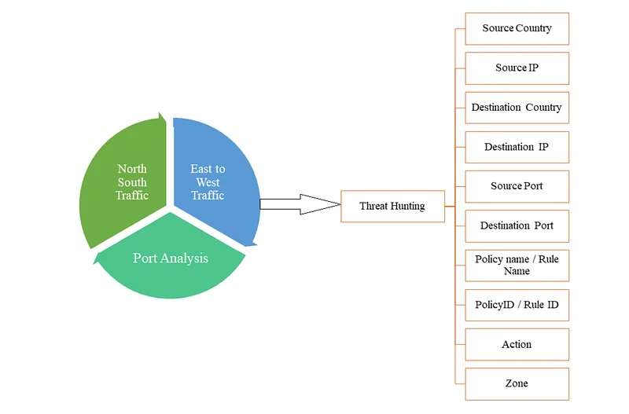

( **Görsel Kaynağı** : <https://hackforlab.com/threat-hunting-with-firewall-traffic/> )

---

## Kaynak ve Hedef IP Adresleri

Ağ paketlerinin kaynak ve hedef IP bilgileri, tehdit aktörlerinin temas kurduğu uç noktaları belirlemede ilk veri katmanıdır.

### İzleme ve Analiz

* **İzleme:** Güvenlik duvarı logları, ağdaki tüm bağlantıların kaynak ve hedef IP adreslerini içerir. Bu bilgi, hangi IP adreslerinin diğer IP adresleriyle sıkça iletişim kurduğunu takip etmek için kullanılabilir.
* **Analiz:** Kaynak ve hedef IP adresleri analiz edilerek saldırganlar ve hedefleri belirlenebilir. Potansiyel tehditleri tanımlamak için şüpheli IP adresleri bilinen siber saldırı göstergeleriyle (IOC) karşılaştırılır.

### Örnekler

* Bir dahili IP adresinden birden fazla harici IP adresine yapılan bağlantılardaki ani artış veri sızdırma belirtisi olabilir.
* Şüpheli bir harici IP adresinden belirli bir dahili IP adresine yapılan tekrarlı bağlantı girişimleri kaba kuvvet (brute force) saldırısının göstergesi olabilir.

---

## Portlar ve Protokoller

Ağda kullanılan port ve protokol kombinasyonları, servislerin meşruiyetini ve olası yetkisiz tünelleme girişimlerini değerlendirmede kritik rol oynar.

### Kullanım Modelleri ve Güvenlik

* **Kullanım Modelleri:** Hangi portların ve protokollerin kullanıldığını izlemek, normal ağ davranışı modellerinin oluşturulmasına yardımcı olur. Anormal port kullanımı potansiyel tehditlere işaret edebilir.
* **Güvenlik:** Beklenmedik portlara gelen ve giden trafiği izlemek, güvenlik açıklarını ve kötü niyetli faaliyetleri tanımlamak için çok önemlidir.

### Örnekler

* Nadiren kullanılan bir porttaki trafik miktarında görülen ani artış bir saldırıya işaret edebilir.
* Güvensiz protokollerin (örneğin Telnet) kullanımı güvenlik olayı riskini artırabilir.

---

## Erişim Zamanları

Bağlantıların gerçekleştiği zaman damgaları, insan kaynaklı meşru trafik ile otomatik saldırı araçları arasındaki farkı ortaya koyar.

### Zaman ve Kronoloji

* **Zaman Analizi:** Güvenlik duvarı logları ağ trafiğinin ne zaman gerçekleştiğini gösterir. Bu bilgi, belirli zaman dilimlerindeki anormal aktiviteleri tespit etmek için kullanılır.
* **Kronoloji:** Olayların ne zaman gerçekleştiğini belirlemek, saldırıların zaman çizelgelerini oluşturmaya ve aşamalarını anlamaya yardımcı olur.

### Örnekler

* Normal mesai saatleri dışında, gece geç saatlerde gerçekleşen büyük veri transferleri şüpheli olabilir.
* Belirli bir zaman dilimi içinde tekrarlanan başarısız oturum açma girişimleri kaba kuvvet saldırısının bir göstergesi olabilir.

---

## Trafik Türleri ve Hacimleri

Ağ oturumlarında taşınan veri miktarı ve transfer hızı, olası veri sızdırma veya hizmet engelleme saldırılarının doğrudan habercisidir.

### Veri Akışı ve Bant Genişliği Kullanımı

* **Veri Akışı:** Güvenlik duvarı logları ağdaki veri akışının hacmini ve türünü gösterir. Anormal veri akışları potansiyel tehditlerin belirlenmesine yardımcı olabilir.
* **Bant Genişliği Kullanımı:** Belirli zaman dilimlerindeki bant genişliği kullanımını izlemek, normal trafik modellerinden sapmaların tespit edilmesini kolaylaştırır.

### Örnekler

* Beklenmedik şekilde yüksek bant genişliği kullanımı bir DDoS saldırısına işaret edebilir.
* Belirli bir IP adresinden sürekli olarak gerçekleştirilen büyük veri transferleri bir veri sızdırma faaliyeti olabilir.

---

## Erişim Politikaları ve Kurallar

Güvenlik duvarında yapılandırılmış izin ve engelleme kurallarının tetiklenme sıklığı, kural seti etkinliğini ve politika ihlallerini gösterir.

### Kurallar ve İzinler

* **Kural Uygulama:** Güvenlik duvarı logları hangi erişim politikalarının ve kurallarının uygulandığını gösterir. Bu durum, kuralların etkinliğini değerlendirmeye ve geliştirmeye yardımcı olur.
* **İzin Verme ve Engelleme:** Potansiyel güvenlik açıklarını ve saldırı girişimlerini tanımlamak için izin verilen ve engellenen bağlantıların analizi esastır.

### Örnekler

* Belirli bir IP adresinden gelen ve defalarca engellenen bağlantı girişimleri kötü niyetli faaliyeti gösterebilir.
* Güvenlik duvarı kurallarının sık sık ihlal edilmesi, güvenlik politikalarının gözden geçirilmesi gerektiğini gösterir.

---

## Anormal Davranışlar ve İhlaller

Temel trafik profilinden belirgin sapmalar gösteren bağlantılar, saldırganların ortamdaki keşif ve hareketlilik adımlarını işaret eder.

### Anomali Tespiti ve Olaylar

* **Anomali Tespiti:** Güvenlik duvarı logları, normal davranış modellerinden sapmaları belirlemek ve potansiyel tehditlere işaret edebilecek anomalileri tespit etmek için kullanılır.
* **Güvenlik Olayları:** Tespit edilen güvenlik olaylarının analizi, kök nedenlerin ve etkilerin belirlenmesine yardımcı olur.

### Örnekler

* Dahili ağdan harici ağlara yapılan anormal sayıda bağlantı girişimi bir iç tehdidi veya veri sızdırma girişimini gösterebilir.
* Normalde erişilemeyen sistemlere yapılan bağlantı girişimleri güvenlik politikalarının ihlal edildiğine işaret edebilir.

Güvenlik duvarı logları tehdit avcılığı için kritik bilgiler sağlar. Kaynak ve hedef IP adresleri, port ve protokol kullanımı, erişim zamanları, trafik türleri ve hacimleri, politikalar, izinler ve anormal davranışlar gibi detaylar ağ güvenliğini sağlamak ve potansiyel tehditleri belirlemek için kullanılır. Bu bilgilerle güvenlik ekipleri ağ trafiğini analiz edebilir, anomalileri ve tehditleri tespit edebilir ve olaylara hızlı ve etkili bir şekilde müdahale edebilirler.

---

## Güvenlik Duvarı Logları ile Tehdit Avcılığı Adımları

Bu bölüm, normal ve anormal ağ trafiği modellerini ayırt etmeye odaklanarak güvenlik duvarı loglarını kullanarak tehdit avcılığı metodolojisini açıklar. Normal trafik, rutin kullanıcı aktivitelerini, standart uygulama iletişimlerini ve tipik port/protokol kullanımını içeren düzenli ve beklenen veri akışlarını temsil ederken, anormal trafik, olağandışı veri transfer hacimleri, düzensiz zamanlardaki bağlantılar veya şüpheli IP adresleriyle yapılan iletişimler gibi beklenmedik davranışları kapsar. Tehdit avcılığı süreci üç temel aşamadan oluşur: Birincisi, referans noktaları oluşturmak için trafik modellerini, kullanıcı aktivitelerini ve cihaz davranışlarını zaman içinde izleyerek temel normal davranışı belirlemek, ikincisi, logları kötü niyetli IP/alan adları için tehdit istihbaratı veritabanlarıyla karşılaştırarak ve beklenmedik port kullanımı veya bağlantıları izleyerek şüpheli aktiviteleri tespit etmek, ve üçüncüsü, olağandışı veri transferleri, DDoS saldırılarını veya veri sızdırmayı gösterebilecek trafik artışları, kaba kuvvet saldırılarına işaret eden başarısız oturum açma girişimleri ve tekrarlanan yetkisiz erişim girişimleri dahil olmak üzere anomalileri analiz etmektir. Güvenlik duvarı log analizine yönelik bu sistematik yaklaşım, güvenlik ekiplerinin potansiyel tehditleri etkili bir şekilde tanımlamasına, güvenlik olaylarını erken tespit etmesine ve ağ altyapısını korumak için hızlı yanıt vermesine olanak tanır ve bu metodoloji dışa doğru (outbound) bağlantı hipotezi analizi gibi daha gelişmiş tehdit avcılığı teknikleri için bir temel oluşturur.

---

## Normal Trafik Davranışını Anlamak

Etkili bir tehdit avcılığı süreci, öncelikle kurum ağının olağan çalışma dinamiklerinin ve beklenen trafik kalıplarının net olarak kavranmasını gerektirir.

### Normal ve Anormal Trafik Arasındaki Farklar

* **Normal Trafik:** Bir ağ içindeki düzenli ve beklenen veri akışını ifade eder. Belirli kullanıcılar tarafından belirli zamanlarda gerçekleştirilen faaliyetlerin yanı sıra belirli servisler ve uygulamalar tarafından düzenli olarak kullanılan portları ve protokolleri içerir. Örneğin şirket içinde sıkça kullanılan bir uygulamanın belirli bir IP adresi ve port üzerinden sürekli veri alışverişinde bulunması normal kabul edilir.
* **Anormal Trafik:** Anormal, beklenmedik veya olağandışı trafiği ifade eder. Örnekler arasında veri transferlerinde ani artışlar, beklenmedik zamanlarda yapılan bağlantılar veya beklenmedik IP adreslerinden gelen trafik yer alır. Anormal trafik potansiyel bir güvenlik olayına veya saldırıya işaret edebilir.

---

## Normal Trafik Davranışını Tanımlamak

* **Trafik Modellerini Belirleyin:** Bir ağın normal işleyişini anlamak için trafik belirli bir süre boyunca izlenir. Bu süre zarfında normal trafik modellerini belirlemek için hangi IP adreslerinin belirli saatlerde hangi portlar ve protokoller üzerinden iletişim kurduğu gözlemlenir.
* **Kullanıcı ve Cihaz Davranışını İzleyin:** Normal davranışı anlamak için ağdaki kullanıcıların ve cihazların günlük faaliyetleri izlenir. Bu durum, belirli kullanıcıların hangi sistemlere eriştiğini ve belirli zamanlarda ne yaptıklarını takip etmeyi içerir.
* **Referans Noktaları Oluşturun:** Normal trafik davranışını anlamak için toplanan veriler, anomalileri tespit ederken karşılaştırma yapmak için kriterler (benchmark) olarak kullanılır.

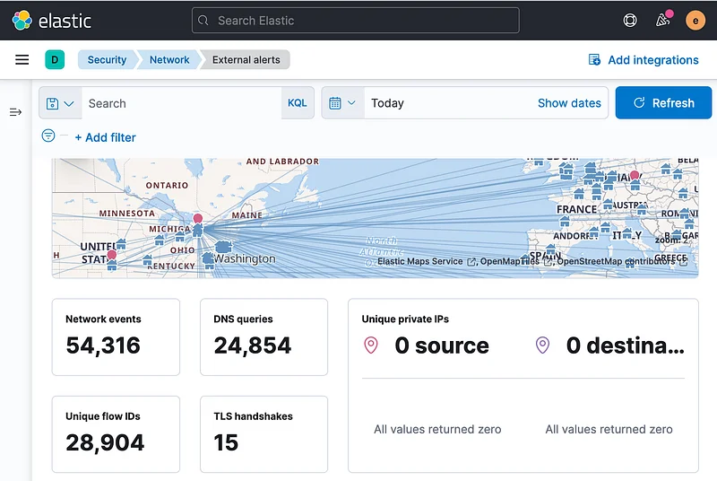

( **Görsel Kaynağı** : <https://www.digitalocean.com/community/tutorials/how-to-build-a-siem-with-suricata-and-elastic-stack-on-debian-11> )

---

## Şüpheli Trafiği Tespit Etmek

Tehdit istihbaratı verileri ve anomali filtreleri kullanılarak, ağdaki şüpheli varlıklar ve olağandışı bağlantılar hedeflenir.

### Şüpheli IP Adresleri ve Alan Adları

* **Kötü Niyetli IP Adreslerini ve Alan Adlarını İnceleyin:** Güvenlik duvarı loglarını bilinen tehdit istihbaratı kaynaklarından elde edilen kötü niyetli IP adresleri ve alan adlarıyla karşılaştırın. Bu adreslerden gelen veya bunlara giden trafik şüpheli kabul edilir.
* **İzleyin ve Tanımlayın:** Güvenlik duvarı loglarını sürekli izleyin ve bilinen kötü niyetli IP adresleri ve alan adlarıyla eşleşen bağlantıları tanımlayın. Bu bulgular potansiyel saldırılara karşı önceden uyarı sağlar.

### Anormal Port Kullanımı ve Bağlantılar

* **Beklenmedik Port Kullanımı:** Normalde kullanılmayan veya nadiren kullanılan portlara gelen ve giden trafiği izleyin. Bu, özellikle yüksek riskli portlar için (örneğin 3389 - RDP) önemlidir.
* **Şüpheli Bağlantılar:** Ağ içinden veya dışından gelen beklenmedik bağlantılar, özellikle belirli protokoller kullanılarak yapılan anormal bağlantı girişimleri şüpheli kabul edilir. Örneğin normalde sadece dahili ağa erişmek için kullanılan bir sistem aniden dış dünyaya bağlanmaya çalışır.

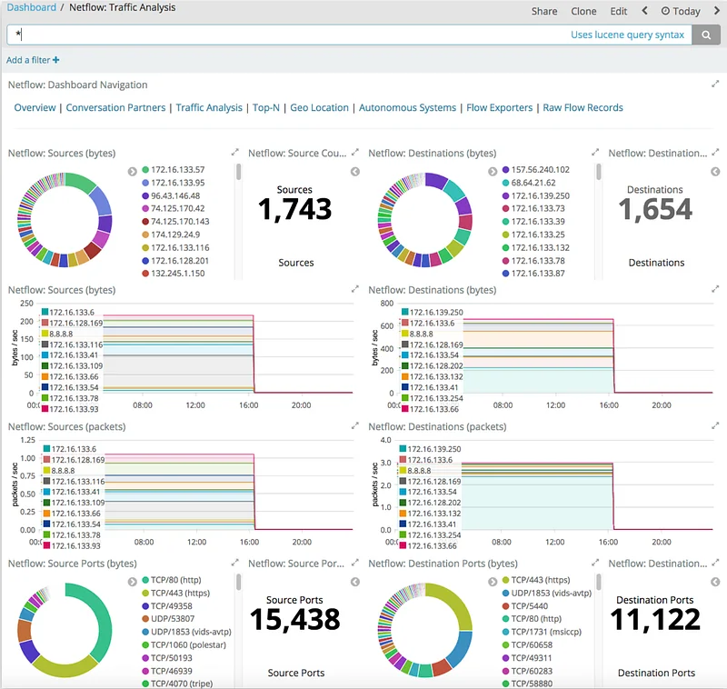

( **Görsel Kaynağı** : <https://www.researchgate.net/figure/Example-of-the-main-Elastiflow-Kibana-page-at-AGLT2_fig2_335862467> )

---

## Anomalileri ve Anormal Davranışları Analiz Etmek

Belirlenen şüpheli trafik örnekleri, derinlemesine analiz edilerek saldırı girişiminin boyutu ve hedefi netleştirilir.

### Trafik Anomalileri

* **Veri Transferlerindeki Anomaliler:** Normalden önemli ölçüde daha büyük olan veya beklenmedik zamanlarda gerçekleşen veri transferleri tespit edilir. Örneğin mesai saatlerinden sonra yapılan büyük transferler anormal sayılabilir.
* **Trafik Artışları (Spikes):** Kısa bir süre içindeki ani trafik artışları DDoS saldırısını veya veri sızdırma girişimini gösterebilir. Bu tür anomaliler güvenlik duvarı loglarındaki trafik modelleri analiz edilerek tespit edilir.

### Erişim Girişimleri ve Başarısız Oturum Açmalar

* **Başarısız Oturum Açma Girişimleri:** Belirli bir IP adresinden veya kullanıcıdan gelen sürekli başarısız oturum açma girişimleri bir kaba kuvvet saldırısına işaret edebilir.
* **Yetkisiz Erişim Girişimleri:** Erişmemeleri gereken kaynaklara erişmeye çalışan kullanıcılar veya sistemler potansiyel güvenlik olayları olarak kabul edilir.
* **Tekrarlanan Hatalar:** Kısa bir süre içinde tekrarlanan başarısız oturum açma veya bağlantı girişimleri kötü niyetli faaliyetleri gösterebilir. Örneğin yanlış kimlik bilgilerini kullanarak bir kaynağa tekrar tekrar erişmeye çalışan bir sistem.

Güvenlik duvarı loglarını kullanarak bu adımlar tehdit avcılığı sürecini daha etkili hale getirecektir. Güvenlik duvarı logları ağ güvenliğini sağlamak ve potansiyel tehditleri tespit etmek için kritik bir veri kaynağıdır. Güvenlik ekiplerinin anomalileri ve potansiyel tehditleri belirlemesine ve hızlı yanıt vermesine olanak tanırlar.

---

## Dışa Doğru (Outbound) Bağlantı Hipotezi

Siber güvenlikteki Dışa Doğru Bağlantı Hipotezi, belirli bir dahili IP adresinden harici hedeflere alışılmadık portlar kullanarak yapılan ani bağlantı girişimi artışıyla karakterize edilen ve reverse shell bağlantıları gibi kötü niyetli faaliyetlere işaret edebilecek anormal ağ davranışlarını tespit etmeye odaklanır. Tespit metodolojisi, temel ağ modellerini oluşturmak ve sapmaları belirlemek için merkezi bir sistem aracılığıyla güvenlik duvarı loglarının, SIEM verilerinin, ağ akış bilgilerinin ve IDS/IPS loglarının toplanmasını ve analiz edilmesini içerir. Analiz süreci logların SIEM çözümlerine aktarılmasını, trafik modellerinin zaman içinde kaydedilmesini, normal port ve protokol kullanımının belirlenmesini ve nadiren kullanılan portlar üzerinden harici IP adreslerini hedefleyen anormal bağlantı girişimlerinin tespit edilmesini kapsar. Beklenen sonuçlar, dahili kaynaklardan gelen olağandışı bağlantı hacimlerinin tespitini, standart dışı portlar kullanan bağlantıların tanımlanmasını, hedeflenen harici IP adreslerinin keşfini ve bu faaliyetlerin potansiyel güvenlik tehditlerini temsil edip etmediğini belirleyen korelasyon analizini içerir, bu da nihayetinde ağ altyapısını korumak için erken tehdit tespitine ve hızlı olay müdahalesine olanak tanır.

---

## Hipotez

Belirli bir yerel IP adresinden, alışılmadık portlar kullanılarak harici IP adreslerine yapılan çok sayıda ani bağlantı girişimi olabilir.

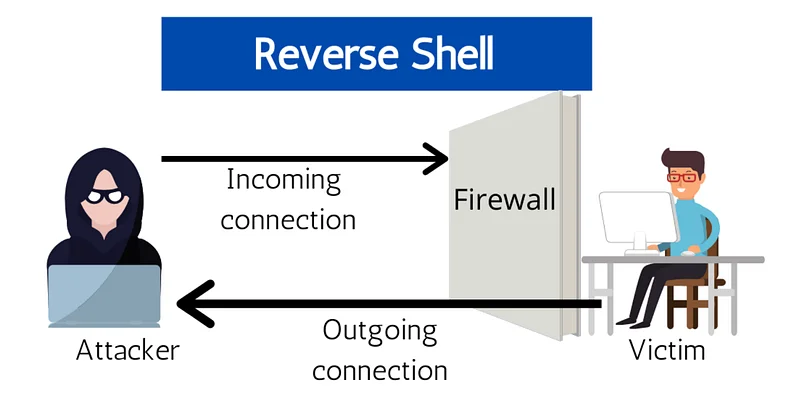

( **Görsel Kaynağı** : <https://www.techslang.com/definition/what-is-a-reverse-shell/> )

---

## Veri Kaynakları

* **Güvenlik Duvarı Logları:** Gelen ve giden ağ trafiği, belirli portlara yapılan bağlantı girişimleri ve başarılı/başarısız bağlantı girişimlerinin kayıtları.
* **SIEM Logları:** Merkezi bir platformda entegre edilen ve toplanan güvenlik duvarı logları.
* **Ağ Akış Analizi (Network Flow Analysis):** Ağ trafiği verilerinin incelenmesi ve bağlantıların izlenmesi.
* **IDS/IPS Logları:** Şüpheli veya kötü niyetli faaliyetleri tespit eden ve kaydeden sistemlerden gelen loglar.

---

## Analiz Adımları

* Güvenlik duvarı loglarını merkezi bir log yönetimi sistemine veya SIEM çözümüne aktarın.
* Belirli bir süre boyunca tüm gelen ve giden trafiği kaydedin.
* Normal ağ trafiği modellerini belirlemek için logları analiz edin.
* Normalde kullanılan portları ve protokolleri tanımlayın.
* Normal trafik modellerinden sapan faaliyetleri tanımlayın.
* Belirli bir dahili IP adresinden gelen çok sayıda olağandışı bağlantı girişimini inceleyin.
* Normalde kullanılmayan veya nadiren kullanılan portlar üzerinden yapılan bağlantı girişimlerini tespit edin.
* Bu bağlantılar tarafından hedeflenen harici IP adreslerini tanımlayın.
* Güvenlik duvarı loglarını diğer ağ ve güvenlik loglarıyla karşılaştırın.
* Anormal faaliyetlerin korelasyon analizini yapın ve belirli modelleri tespit edin.
* Tespit edilen faaliyetlerin doğruluğunu ve önemini değerlendirin.
* Olayı doğrulamak ve bağlantıların aşamasını belirlemek için ek veriler toplayın.

---

## Hipotez Doğrulama ve Beklenen Bulgular

* Güvenlik duvarı loglarında belirli bir dahili IP adresinden gelen anormal sayıda bağlantı girişimi tespit edilir.
* Harici IP adreslerine normalde kullanılmayan veya nadiren kullanılan portlar üzerinden yapılan bağlantılar tanımlanır.
* Belirli bir harici IP adresini hedefleyen çok sayıda olağandışı bağlantı girişimi tespit edilir.
* SIEM ve diğer güvenlik loglarıyla yapılan korelasyon analizi, bu faaliyetlerin potansiyel bir saldırıya işaret edip etmediğini belirler.

---

## Hipotez Değerlendirmesi

Bu analiz adımları, belirli bir dahili IP adresinden harici IP adreslerine alışılmadık portlar kullanarak yapılan ani bağlantı girişimi artışını tespit etmek için stratejiler sağlar. Güvenlik duvarı logları bu tür anormal faaliyetleri izlemek ve tespit etmek için kritik bir veri kaynağıdır. Anomali tespiti, potansiyel saldırıların erken teşhis edilmesini ve hızlı yanıt verilmesini sağlar. Bu durum, ağın güvenliğini sağlamada ve ortaya çıkan tehditleri proaktif olarak yönetmede çok yol kat edilmesini sağlar.

---

## Uygulamalı Laboratuvar

Bu, iki ülke arasındaki diplomatik gerginlikler nedeniyle Kamboçya'dan kuruluşu hedef alan sofistike saldırıların gerçekleştirilebileceği hipotezine dayanan bir Tehdit Avcılığı laboratuvar egzersizidir. Laboratuvar ortamı SIEM (Wazuh), güvenlik duvarı trafiği ve anomali tespiti olayları, CTI (tehdit istihbaratı) olayları ve EDR (Sysmon) olaylarını içermektedir. Öğrenciler 1-7 Ağustos 2024 arasındaki logları analiz etmeli ve her biri bir öncekinin doğru cevabını gerektirdiğinden soruları sırayla yanıtlamalıdır. Wazuh laboratuvarına erişmek için kullanıcıların bağlana tıklaması, kurulum için 3-4 dakika beklemesi, sağlanan IP adresine gitmesi, "letsdefend:letsdefend123" kimlik bilgileriyle oturum açması ve Discover sayfasını açması gerekmektedir.

---

## Hipotez

**Not**: Bu bölümdeki sorular, aşağıdaki hipoteze dayalı olarak Tehdit Avcılığı için hazırlanmıştır.

**Hipotez**: İki ülke arasındaki diplomatik gerginlik nedeniyle Kamboçya'dan organizasyonu hedef alan sofistike saldırıların gerçekleşmesi bir ihtimaldir.

---

## Tehdit Avcılığı Laboratuvar Ortamı

* SIEM (Wazuh)
* Güvenlik Duvarı Trafik Olayları
* Güvenlik Duvarı Anomali Tespit Modülü Olayları
* CTI Olayları ([Threat Intel LetsDefend Platformu](https://app.letsdefend.io/threat-intelligence-feed))
* EDR Olayları (Sysmon)

---

## Laboratuvar Notları

* Aşağıdaki soruları yanıtlamak için "1 Ağustos 2024 00:00 - 7 Ağustos 2024 00:00" arasındaki logları analiz edin.
* Sonraki sorular bir öncekilerin doğru cevaplarını gerektirir. Tüm soruları kesinlikle göründükleri sırayla yanıtlayın.

---

## Sorular

**Not:** Aşağıdaki soruları yanıtlamak için "1 Ağustos 2024 00:00 - 7 Ağustos 2024 00:00" arasındaki logları analiz edin.

**Not**: Sonraki sorular bir öncekilerin doğru cevaplarını gerektirir. Tüm soruları kesinlikle göründükleri sırayla yanıtlayın.

> **"Kamboçya" (Cambodia) kaynaklı ve "Allow" (İzin Verilidi) eylemine sahip kaç adet güvenlik duvarı logu bulunmaktadır?**

İlk olarak zaman çizelgesini (timeline) ayarlamam gerekiyor. Sorunun ilgili bölümünde verilen zamanı mutlak (absolute) olarak ayarladım.

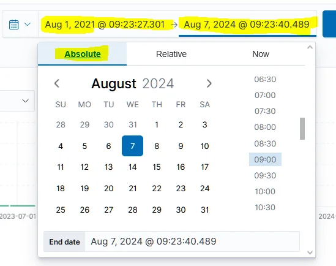

Zaman çizelgesini ayarlama

İkinci olarak log tipini seçmem gerekiyor. Güvenlik duvarı logunu kural gruplarına (rule groups) göre filtrelemem gerekiyor. Otomatik filtreleme için '+' butonunu kullanın.

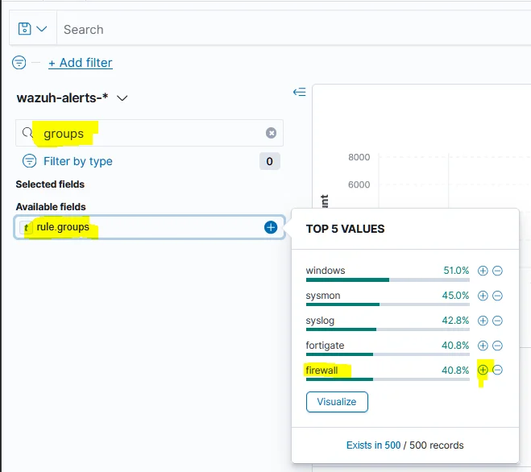

Log tipini seçme

Ardından kaynak ülkeyi seçmem gerekiyor. Bunu yapmak için data.srccountry filtresini kullanabilirim.

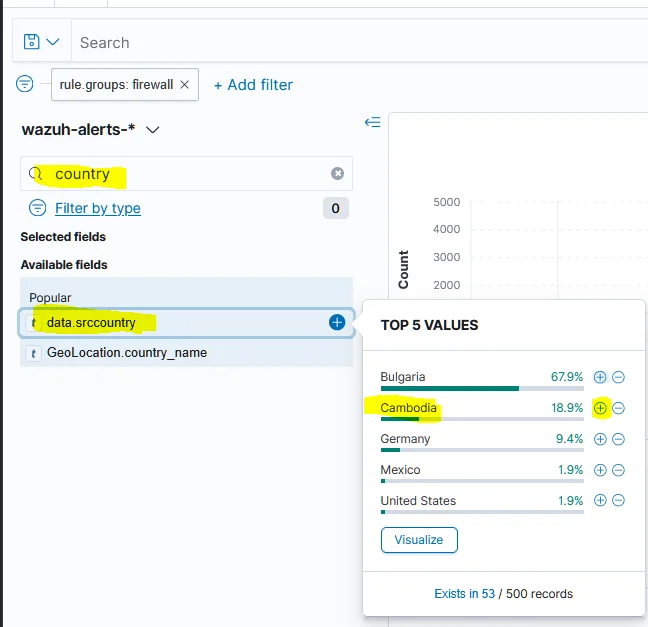

Ülkeyi filtreleme

Aynı şekilde eylem türünü allowed olarak filtreleyin.

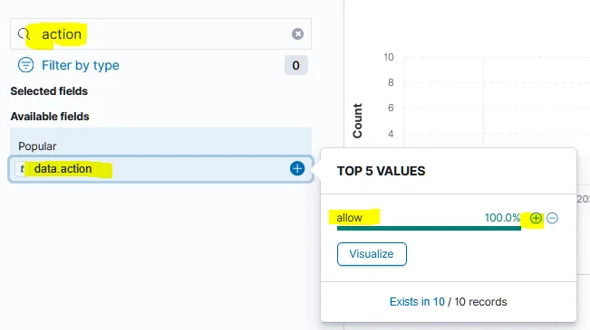

İzin verilen eylemi filtreleme

Grafiğin üzerine geldiğimde olay sayısını görebiliyorum. Cevabımızın 10 olduğunu bulduk.

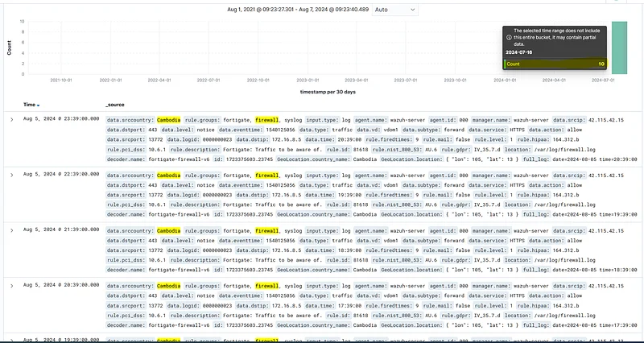

Filtrelenmiş veriler

**Cevap: 10**

> **"Kamboçya" kaynaklı ve "Allow" eylemine sahip güvenlik duvarı logları arasında kaç tane benzersiz hedef sistem hedeflenmiştir?**

Alanlardaki (fields) hedef IP bilgisini incelediğimde 3 farklı IP'ye trafik olduğu açıkça görülüyor. Buradan cevabın 3 olduğunu bulduk.

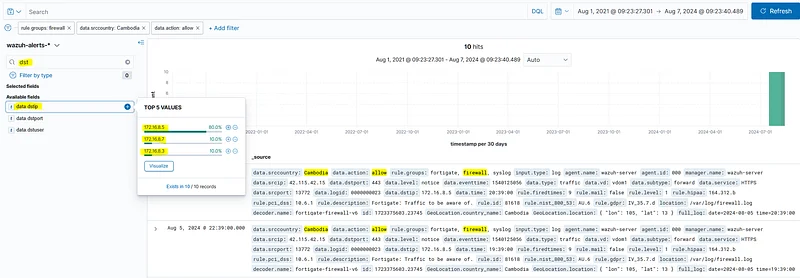

Hedef IP alanı

**Cevap: 3**

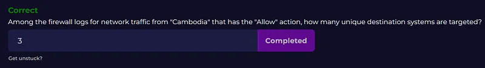

> **"Kamboçya" kaynaklı ve "Allow" eylemine sahip güvenlik duvarı logları arasında kaç tane benzersiz kaynak IP adresi bulunmaktadır?**

Alanlardaki kaynak IP bilgisini incelediğimde 3 farklı IP'ye trafik olduğu açıkça görülüyor. Buradan cevabın 3 olduğunu bulduk.

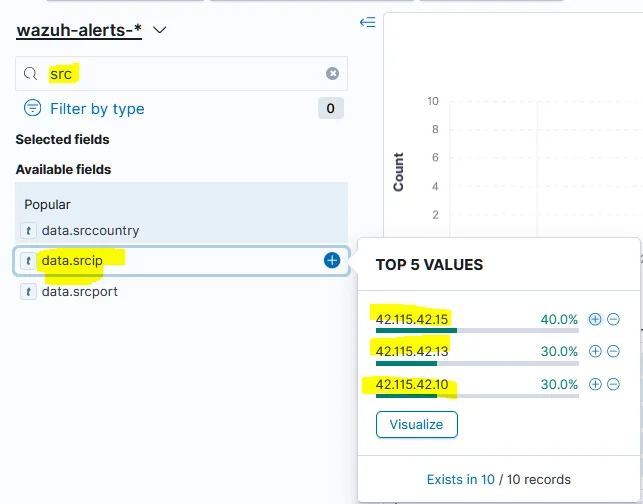

Kaynak IP alanı

**Cevap: 3**

> [LetsDefend Threat Intel](https://app.letsdefend.io/threat-intelligence-feed) platformunda kaynak IP'leri ("Kamboçya" kaynaklı ve "Allow" eylemli loglardaki) araştırın. Bu IP adresleri hangi tehdit aktörü grubunun IoC'lerine aittir?

Tehdit istihbaratı platformunda ilgili IP'yi arattığımızda ilgili APT grubunu buluyoruz.

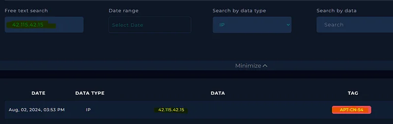

**Cevap:** APT-CN-54

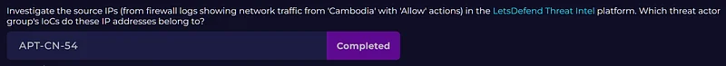

> **[LetsDefend Threat Intel](https://app.letsdefend.io/threat-intelligence-feed) platformunda kaynak IP'leri ("Kamboçya" kaynaklı ve "Allow" eylemli loglardaki) araştırın. Tespit edilen saldırgan grubunun Kamboçya dışından olan IP adresi nedir?**

Kamboçya'dan gelen trafiğe ait 3 IP biliyoruz, tag bölümünde APT grubunun adını yazıp aratırsak bu 3 IP dışındaki diğer IP adresini bulacağız.

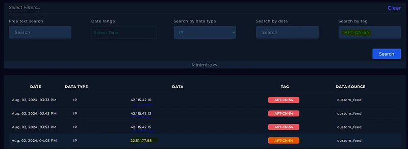

Tehdit İstihbaratı

**Cevap:** 22.51.177.88

> **Tehdit avcılığı sürecinin önceki aşamalarında, Kamboçya dışındaki bir ülkeden gelen ve tanımlanmış bir tehdit aktörü grubuyla ilişkilendirilen bir IP adresi tespit edilmişti. Bu IP adresinden kaynaklanan ve "Allow" eylemi ile işaretlenmiş ağ trafiği için güvenlik duvarı loglarında kaç farklı hedef sistem bulunmaktadır?**

data.srcip alanından ilgili IP'yi filtrelediğimizde sadece 1 adet allow eylemi alan olay görüyoruz.

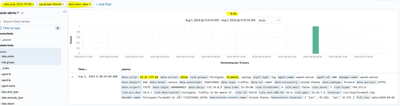

**Cevap: 1**

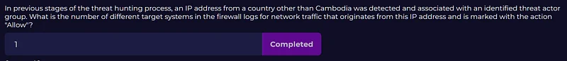

> ***Tehdit avcılığı sürecinin önceki aşamalarında, Kamboçya dışındaki bir ülkeden gelen ve tanımlanan tehdit aktörü grubuyla bağlantılı bir IP adresi tespit edilmişti. Bu IP adresinden kaynaklanan ağ trafiği için güvenlik duvarı logları arasında kaç farklı güvenlik duvarı olayı "anomali" olarak raporlanmıştır?***

Action allow filtresini kaldırdığımızda 1 adet paketin port_scan anomalisi nedeniyle düşürüldüğünü (dropped) gözlemliyoruz.

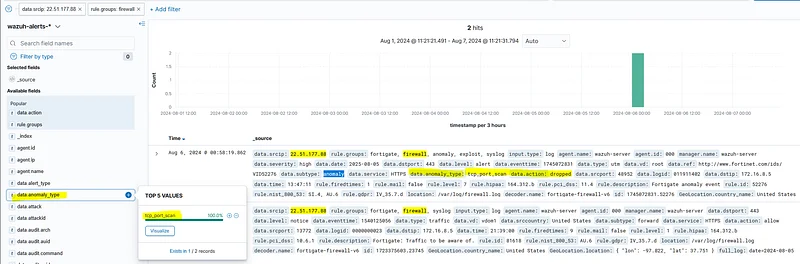

**Cevap: 1**

> **Tehdit avcılığı sürecinin önceki aşamalarında, Kamboçya dışındaki bir ülkeden gelen ve tanımlanan tehdit aktörü grubuyla bağlantılı bir IP adresi tespit edilmişti. Bu IP adresinden kaynaklanan ağ trafiği için güvenlik duvarı logları arasında raporlanan olay/olayların anomali türü nedir?**

Bu cevabı önceki soruda da bulmuştuk. Anomali türünün tcp_port_scan olduğunu gözlemledik.

**Cevap:** tcp_port_scan

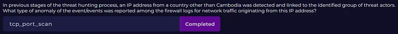

> **Tehdit avcılığı sürecinin önceki aşamalarında, Kamboçya dışındaki bir ülkeden gelen ve tanımlanan tehdit aktörü grubuyla bağlantılı bir IP adresi tespit edilmişti. Bu IP adresinden kaynaklanan ağ trafiği için güvenlik duvarı loglarında raporlanan anomali olayları için güvenlik duvarının eylemi neydi?**

Bu cevabı da önceki soruda bulmuştuk. Eylem türünün dropped olduğunu gözlemledik.

**Cevap:** dropped

> **Önceki tehdit avcılığı aşamalarında (önceki sorular) tanımlanan tehdit aktörü grubunun IoC'lerinde listelenen alan adı (domain) nedir?**

İlgili alan adını Tehdit İstihbaratı platformundan bulabiliriz.

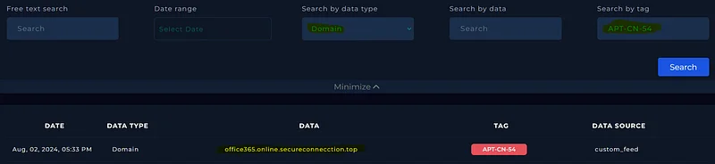

**Cevap:** office365.online.secureconnection.top

> **Önceki tehdit avcılığı aşamalarında (önceki sorular) tanımlanan tehdit aktörü grubuna ait IoC'ler arasında, ilişkili alan adına DNS sorguları yapan sistemin IP adresi nedir?**

Bulduğumuz alan adını kullanarak arama yapabiliriz. Endpoint Event Logları içinde bir olay buluyoruz. 'Agent IP' alanını kullanarak IP adresini tespit edebiliriz.

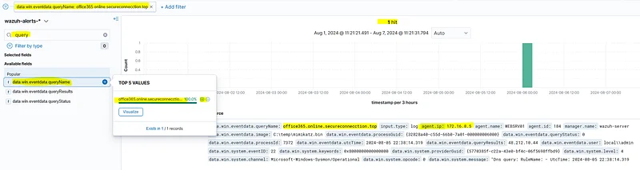

**Cevap:** 172.16.8.5
