[Letsdefend Blue Team Eğitim Platformu](https://letsdefend.io/)

Modern kurumsal savunma, pasif alarm incelemesinden hipotez odaklı proaktif araştırmaya geçişi zorunlu kılmaktadır. SIEM (Güvenlik Bilgisi ve Olay Yönetimi) sistemleri merkezi log toplama, normalizasyon ve korelasyon altyapısı sunarken, Tehdit Avcılığı (Threat Hunting), statik tespit kurallarını atlatmayı başaran gizli tehditleri telemetri verisi üzerinden tespit etmeyi hedefler.

SIEM (Güvenlik Bilgisi ve Olay Yönetimi) sistemleri, çeşitli kaynaklardan log verisi toplayan, bu verileri analiz eden ve korelasyon kurallarını kullanarak anlamlı içgörüler üreten güvenlik teknolojileridir. SIEM sistemleri gerçek zamanlı izleme, olay tespiti, uyarı verme ve raporlama gibi yeteneklerle donatılmıştır. Bu özellikler güvenlik ekiplerinin ağ içinde meydana gelen anomalileri ve şüpheli aktiviteleri tespit etmesini sağlar.

Öte yandan Tehdit Avcılığı, siber tehditleri tespit etmeyi ve ortadan kaldırmayı amaçlayan proaktif bir araştırma sürecidir. Tehdit Avcılığı, SIEM tarafından oluşturulan uyarılara yanıt vermenin ötesine geçer, aynı zamanda bilinmeyen veya gizli tehditleri ortaya çıkarmayı amaçlar. Bu süreç güvenlik analistlerinin belirli hipotezler geliştirmesini ve ağ içindeki potansiyel tehditleri aramasını içerir.

SIEM ve Tehdit Avcılığı arasındaki ilişki bu iki yaklaşımın birbirini tamamlayıcı doğasından kaynaklanmaktadır. SIEM geniş bir veri yelpazesi sunarak tehdit avcılarının ihtiyaç duyduğu kritik bilgileri sağlar. Tehdit avcıları da potansiyel tehditleri tanımlamak ve doğrulamak için SIEM tarafından sağlanan veriler üzerinde derinlemesine analizler gerçekleştirir. Bu sinerji organizasyonun güvenlik duruşunu güçlendirerek siber saldırılara karşı daha hazırlıklı olmasını sağlar.

---

## Tehdit Avcılığında SIEM'in Rolü

SIEM (Security Information and Event Management) sistemleri, siber güvenlik tehditlerini tespit etmede ve önlemede kritik bir rol oynar. Tehdit avcılığı süreçlerinde, SIEM'in kapsamlı veri toplama, analiz ve korelasyon yetenekleri potansiyel tehditlerin hızlı ve etkili bir şekilde tespit edilmesini sağlar.

---

## Veri Toplama ve Birleştirme

SIEM sistemleri ağ cihazları, sunucular, uygulamalar, uç noktalar ve güvenlik cihazları dahil olmak üzere birden fazla kaynaktan veri toplar, birleştirir ve depolar. SIEM bu verileri analiz ederek anomalilerin ve potansiyel tehditlerin belirlenmesine yardımcı olur.

* **Çeşitli Kaynaklardan Log Toplama:** Güvenlik duvarları, IDS/IPS, antivirüs sistemleri, DLP (Veri Kaybı Önleme) araçları ve diğer güvenlik cihazlarından loglar toplanır.
* **Veri Zenginleştirme:** Toplanan veriler. IP adresi coğrafi konumu ve tehdit istihbaratı gibi bağlamsal bilgilerle zenginleştirilir.
* **Merkezi Depolama:** Tüm loglar merkezi bir konumda saklanarak ihtiyaç duyulduğunda hızlı erişim sağlanır.

( **Görsel Kaynağı** : <https://www.elastic.co/campaigns/elastic-guide-to-threat-hunting> )

---

## Gerçek Zamanlı Analiz ve Korelasyon

SIEM toplanan verileri gerçek zamanlı olarak analiz eder ve korelasyon kurallarını kullanarak anlamlı içgörüler üretir. Böylece farklı kaynaklardan gelen veriler arasında ilişkiler kurulmasına olanak tanıyarak potansiyel tehditlerin daha hızlı tespit edilmesini sağlar.

* **Anomali Tespiti:** Kullanıcı ve sistem faaliyetlerindeki anormal davranışları tanımlar.
* **Korelasyon Kuralları:** Anlamlı olaylar oluşturmak için farklı loglar arasında ilişkiler kurar.
* **Anlık Uyarılar:** Tespit edilen anomaliler için anında uyarılar ve bildirimler oluşturur.

---

## Olay Tespiti ve Müdahale

SIEM, tespit edilen olayları güvenlik ekibine bildirir ve hızlı müdahale için gerekli bilgileri sağlar. Bu durum tehditlerin hızla kontrol altına alınmasını sağlar ve hasarı en aza indirir.

* **Olay Yönetimi:** Tespit edilen olayların hızlı ve etkili bir şekilde yönetilmesini sağlar.
* **Uyarı Önceliklendirme:** Gelen uyarıları önem derecelerine göre önceliklendirir.
* **Müdahale ve İyileştirme:** Tespit edilen tehditlere karşı hızlı müdahale ve düzeltici eylemleri kolaylaştırır.

---

## Raporlama ve Görselleştirme

SIEM sistemleri tehdit avcılığı süreçlerinden elde edilen verileri ve bulguları anlamlı raporlar ve görselleştirmeler şeklinde sunarak güvenlik ekiplerinin ve yönetimin tehdit ortamını daha iyi anlamasına yardımcı olur.

* **Ayrıntılı Raporlama:** Tehdit avcılığı bulgularının ayrıntılı raporlarını sunarak üst yönetim ve paydaşlarla bilgi paylaşımını kolaylaştırır.
* **Dinamik Dashboardlar:** Gerçek zamanlı tehdit görselleştirmesi ve gelişmiş izleme süreçleri için canlı ve etkileşimli panolar sunar.
* **Uyum Raporları:** Kuruluşların yasal gereklilikleri karşılamasını sağlamak için mevzuata uygunluk raporları oluşturur.

---

## Otomasyon ve Orkestrasyon

SIEM sistemleri tehdit avcılığı süreçlerini otomatikleştirerek ve diğer güvenlik araçlarıyla entegre ederek güvenlik operasyonlarını iyileştirir, manuel müdahale ihtiyacını azaltır ve tehditlere daha hızlı yanıt verilmesini sağlar.

* **Otomatik Tehdit Tespiti:** Tekrarlayan görevleri ve tehdit tespit süreçlerini otomatikleştirir.
* **SOAR Entegrasyonu:** SIEM, olay müdahale süreçlerini hızlandırmak için SOAR (Güvenlik Orkestrasyonu, Otomasyonu ve Müdahalesi) araçlarıyla entegre olur.
* **Artan Verimlilik:** Otomasyon ve orkestrasyon, güvenlik ekiplerinin verimliliğini artırarak tehditlere karşı daha etkili savunma yapılmasını sağlar.

---

## Hipotez Değerlendirmesi

SIEM sistemleri siber güvenlik tehditlerini tespit etmek ve önlemek için vazgeçilmezdir. Birden fazla kaynaktan gelen verileri toplayarak, analiz ederek ve ilişkilendirerek anomalilerin ve potansiyel tehditlerin hızla belirlenmesini sağlayarak tehdit avcılığında üstünlük sağlarlar. Temel özellikler arasında gerçek zamanlı analiz, olay önceliklendirme ve otomatik yanıtlar yer alır ve bunlar güvenlik ekibinin verimliliğini artırır. SIEM ayrıca daha iyi tehdit görselleştirmesi ve uyumluluk için ayrıntılı raporlama ve dinamik panolar sağlar. Süreçleri otomatikleştirerek ve SOAR gibi araçlarla entegre olarak SIEM, manuel çabayı azaltır ve tehdit müdahalesini hızlandırarak kuruluşları siber tehditlere karşı daha dirençli hale getirir.

---

## Hipotez Oluşturma ve Test Etme

Çözüm üretmek tehdit avcılığı sürecinde kritik bir adımdır. Siber güvenlik analistleri mevcut verilere ve tehdit istihbaratına dayanarak potansiyel tehditlerin nasıl ortaya çıkabileceğini belirler ve buna göre gelişim gösterirler. Bu bulgular belirli saldırgan davranışlarının veya anormal faaliyetlerin tespit edilmesine rehberlik eder.

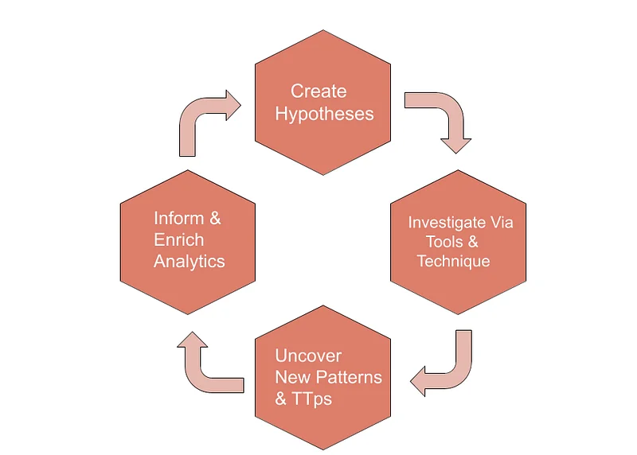

---

## Hipotez Oluşturma

Tehdit avcılığının ilk yapıtaşı, toplanan güvenlik telemetrisi ve tehdit istihbaratı ışığında sınanabilir hipotezler kurgulamaktır.

### Veri Analizi ve Ön İnceleme

Tehdit avcılığı sürecindeki ilk adım toplanan verilerin hızlı ve etkili bir şekilde incelenmesidir. Bu aşamada SIEM sistemi tarafından toplanan loglar, ağ trafiği ve uç nokta verileri gözden geçirilmelidir. Bu ön inceleme potansiyel tehditleri ve anomalileri belirlemek için temel taşıdır.

Veri incelemesi sırasında aşağıdaki anormal davranışları ve olağandışı faaliyetleri aramanız gerekir:

* **Olağandışı Erişim Girişimleri:** Kullanıcıların normalde erişmedikleri sistemlere veya verilere erişme girişimleri.
* **Şüpheli Oturum Açma Girişimleri:** Bir kullanıcı tarafından yapılan birden fazla başarısız oturum açma girişimi veya olağandışı zamanlarda yapılan oturum açmalar.
* **Beklenmedik Veri Transferleri:** Ağdaki olağandışı veri akışları, özellikle büyük dosya transferleri veya yüksek bant genişliği kullanımı.
* **Olağandışı Sistem Kaynağı Kullanımı:** CPU, bellek veya disk kullanımı gibi kaynak kullanımında ani ve beklenmedik artışlar.

Geçmiş olay kayıtları ve tehdit istihbaratı verileri yeni tehditleri tespit etmek için önemli ipuçları sağlar. Güvenlik analistleri, benzer tehditlerin yeniden ortaya çıkma olasılığını değerlendirmek için geçmiş güvenlik olaylarını gözden geçirirler. Ayrıca mevcut tehdit ortamı hakkında fikir edinmek için güncel tehdit istihbaratı kaynaklarından (örneğin ISAC'ler, ticari tehdit beslemeleri) yararlanılabilir.

### Tehdit Modelleri ve TTP'ler

Tehdit avcılığı sürecinde saldırganlar tarafından yaygın olarak kullanılan teknikleri ve yöntemleri anlamak, güvenlik analistlerinin potansiyel tehditleri daha etkili bir şekilde tespit etmesine yardımcı olduğu için kritiktir. Yaygın teknikler arasında oltalama (phishing), kötü amaçlı yazılım dağıtımı, kaba kuvvet (brute force) saldırıları ve veri sızdırma yer alır.

MITRE ATT&CK Çerçevesi saldırganlar tarafından kullanılan teknik ve prosedürleri sistematik olarak sınıflandırarak güvenlik analistlerine aşağıdaki alanlarda rehberlik eder:

* **Taktikler:** Temel olarak saldırganların neyi başarmaya çalıştığı (örneğin başlangıç erişimi elde etme, ayrıcalık yükseltme).
* **Teknikler:** Saldırganların taktiklere ulaşmak için kullandıkları yöntemler (örneğin oltalama, PowerShell kullanımı).
* **Prosedürler:** Belirli saldırgan gruplarının teknikleri nasıl uyguladığına dair ayrıntılar.

Analistler bu çerçeveyi kullanarak potansiyel saldırı vektörlerini belirler ve tehdit avcılığı sürecini daha etkili hale getirir.

### Hipotezleri Tanımlama

Hipotez oluşturma sürecinde güvenlik analistleri belirli tehdit senaryoları ve saldırı vektörleri tanımlarlar. Bu senaryolar bir kuruluşun karşı karşıya olduğu potansiyel tehditlerin anlaşılmasına yardımcı olur. Örneğin:

* **İç Tehditler (Insider Threats):** Örneğin hassas verileri çalmaya çalışan bir çalışan.
* **APT (Gelişmiş Sürekli Tehditler):** Belirli bir kuruluşu hedef alan uzun vadeli, hedefli saldırılar.
* **Veri Sızdırma (Data Exfiltration):** Kritik verilerin sızdırılması.

Hipotezler belirli bir olayın veya davranışın nasıl tespit edilebileceğini açıklamalıdır. İyi tanımlanmış formüller aşağıdaki bileşenleri içerir:

* **Tanım:** Hipotezin neyi tespit etmeyi amaçladığını ve ele aldığı tehdit türünü açıkça belirtir.
* **Beklenen Göstergeler:** Hipotezi test etmek için izlenecek belirli göstergeler (örneğin belirli bir dosya türünün sık sık kopyalanması, belirli zamanlarda anormal veri akışları).
* **Test Yöntemleri:** Bunlar hipotezin nasıl test edileceğini ve hangi veri kaynaklarının kullanılacağını açıklar.
* **Beklenen Sonuçlar:** Hipotez doğrulanırsa veya çürütülürse beklenen sonuçlar.

---

## Hipotezleri Test Etme

Kurgulanan hipotezin geçerliliği, korelasyon kuralları ve hedefli veri sorguları aracılığıyla titizlikle doğrulanır.

### Veri Toplama

Hipotez testindeki ilk adım hipotezi değerlendirmek için gerekli verileri toplamaktır. Bu süreçte çeşitli veri kaynaklarından yararlanılır:

* **Kaynakları Belirleme:** Hipotezle ilgili tüm veri kaynaklarını tanımlayın.
* **Toplama Yöntemleri:** Veri toplama yöntemlerine (örneğin syslog, ajan tabanlı toplama, API entegrasyonları) karar verin ve bunları buna göre uygulayın.
* **Veri Depolama:** Toplanan verileri analiz için bir veri havuzunda saklayın.

### Veri Analizi

Veri toplama işleminden sonra toplanan veriler ayrıntılı olarak analiz edilir. Bu aşamada hipotezde belirtilen anormal davranışlar ve faaliyetler incelenmelidir.

* **Ön İşleme:** Toplanan veriler gereksiz bilgilerden arındırılmak ve analize hazırlanmak üzere ön işlemeden geçirilir.
* **Veri Görselleştirme:** Verilerin grafikler ve tablolar aracılığıyla görselleştirilmesi anomalilerin ve kalıpların tanımlanmasını kolaylaştırır.
* **Veri Filtreleme:** Hipotezle ilgili belirli veri türleri ve olaylar için filtreleme yapılması.

### Analiz Süreci

* **Anomali Tespiti:** Kullanıcı ve sistem davranışındaki anomalilerin belirlenmesi.
* **Trend Analizi:** Olağandışı faaliyetleri tespit etmek için veri modellerinin ve trendlerinin incelenmesi.
* **Davranışsal Analiz:** Anormal davranışı tanımlamak için normal kullanıcı faaliyetlerinden sapmaların araştırılması.

### Korelasyon ve Anomali Tespiti

Veri analizi sürecinde farklı veri kaynaklarının birbiriyle ilişkilendirilmesi (correlation) daha anlamlı ve kapsamlı sonuçlar verir.

* **Korelasyon Kuralları:** Bunlar farklı loglar ve veri kaynakları arasında ilişkiler kurmak için oluşturulan kurallardır. Örneğin belirli bir zaman diliminde büyük miktarda veri indiren ve ardından aynı dönemde hassas verilere erişen bir kullanıcı gibi.
* **Olay Korelasyonu:** Büyük resmi görmek için benzer olay ve faaliyetlerin ilişkilendirilmesidir.

### Anomali ve Şüpheli Aktivite Tespiti

* **Anomali Tespit Yöntemleri:** Anomalileri tespit etmek için makine öğrenmesi algoritmalarından, istatistiksel analizden ve kural tabanlı yaklaşımlardan yararlanabilirsiniz.
* **Şüpheli Faaliyetlerin Belirlenmesi:** Anormal davranışların ve faaliyetlerin şüpheli olup olmadığını değerlendirin.

### Doğrulama ve Tespit Analizi

Bu hipotez doğrulanırsa potansiyel bir tehdit tanımlanmış demektir. Daha sonra gerekli aksiyonlar alınmalıdır. Hipotez doğrulanmazsa süreç tekrarlanmalı ve yeni hipotezler formüle edilmelidir.

* **Doğrulama:** Hipotez doğrulanırsa tehdidi ve olayın kapsamını detaylandırın.
* **Müdahale:** Doğrulanan tehditler için derhal harekete geçin. Örneğin şüpheli bir kullanıcının hesabı askıya alınabilir, kötü amaçlı yazılım tespit edilirse sistem temizlenebilir veya etkilenen cihazlar ağdan izole edilebilir.
* **Yanlış Pozitif (False Positive) Yönetimi:** Yanlış pozitifleri ayıklayın ve hipotezi yeniden değerlendirin.
* **Yeni Hipotezler:** Yanlış pozitiflerden sonra yeni hipotezler oluşturulur ve test süreci devam eder.

### Sürekli İyileştirme

* **Geri Bildirim Döngüsü:** Hipotez testi sürecinden elde edilen içgörülerin ve geri bildirimlerin gelecekteki tehdit avcılığı faaliyetlerine dahil edilmesini içerir.
* **Dokümantasyon ve Raporlama:** Hipotez testi sonuçlarının ve müdahale süreçlerinin ayrıntılı dokümantasyonunun yapılarak ilgili paydaşlarla paylaşılmasıdır.

---

## Hipotez Değerlendirmesi

Bu derste hipotez oluşturma ve test etme sürecinin nasıl yürütüleceği ve bu adımlarda nelere dikkat edilmesi gerektiği açıklanmıştır. Bu süreçler tehdit avcılığı faaliyetlerinde etkili ve proaktif bir güvenlik stratejisi geliştirmeye yardımcı olur.

---

## İç Tehdit (Insider Threat) Hipotezi

---

## Hipotez

"Bu hipotez bir çalışanın şirketten ayrılmadan önce hassas bilgileri yasa dışı yollarla sızdırmaya çalışabileceği varsayımına dayanmaktadır. Çalışan bu verileri kişisel kazanç için veya başka bir kuruluşa fayda sağlamak amacıyla kullanmayı planlıyor olabilir."

Hipotezi oluşturduktan sonra tehdit avcılığı süreci aşağıdaki adımları gerektirir.

---

## Veri Toplama

SIEM sistemleri birden fazla kaynaktan veri toplama yeteneğine sahiptir. Hipotezin geçerliliğini test etmek için bu adımda ilgili tüm verileri toplayın.

---

## Kullanıcı Aktivite Logları

**Oturum Açma/Kapatma Loglarını Toplayın:** Kullanıcının sisteme ne zaman giriş ve çıkış yaptığı hakkında bilgi toplayın.

SIEM'de ilgili kullanıcı hesaplarının faaliyetlerini filtreleyin ve oturum açma/kapatma zamanlarını analiz edin.

**Dosya Erişim Kayıtlarını Toplayın:** Kullanıcının hangi dosyalara ne zaman eriştiği hakkında bilgi toplayın.

SIEM'de dosya sunucusu loglarını inceleyin ve belirli kullanıcıların dosya erişim faaliyetlerini gözden geçirin.

---

## Ağ Trafiği Verileri

**FTP Trafik Loglarını Toplayın:** Kullanıcının büyük dosya transferleri gerçekleştirip gerçekleştirmediğini kontrol etmek için FTP loglarını toplayın.

SIEM'de ağ trafiği loglarını inceleyin ve FTP protokolü üzerinden yapılan büyük veri transferlerini analiz edin.

**E-Posta Trafik Loglarını Toplayın:** Kullanıcının e-posta yoluyla büyük dosya ekleri gönderip göndermediğini kontrol edin.

SIEM'de e-posta sunucu loglarını analiz edin ve büyük dosya ekleri içeren e-postaları filtreleyin.

---

## Uç Nokta (Endpoint) Verileri

**USB Cihaz Kullanım Loglarını Toplayın:** Kullanıcının veri sızdırmak için USB cihazları kullanıp kullanmadığını kontrol edin.

SIEM'de uç nokta güvenlik yazılımı loglarını inceleyin ve USB cihazlarının takıldığı ve çıkarıldığı zamanları gözden geçirin.

**Dosya Kopyalama Aktivite Loglarını Toplayın:** Kullanıcının dosya kopyalama faaliyetlerini izleyin.

SIEM'de uç nokta cihaz loglarını analiz edin ve belirli kullanıcılar tarafından yapılan büyük dosya kopyalama işlemlerini kontrol edin.

---

## Veri Analizi

Toplanan verileri ayrıntılı olarak analiz edin. Hipotezde belirtilen anormal davranışları ve faaliyetleri inceleyin.

---

## Kullanıcı Aktivitelerini Analiz Edin

Kullanıcının son faaliyetlerini iyice gözden geçirin.

SIEM'de kullanıcı faaliyetlerini zaman aralığına göre filtreleyin ve bunları ayrıntılı olarak inceleyin.

Kullanıcının dosya erişim ve kopyalama faaliyetlerini analiz edin.

SIEM'de dosya sunucusu ve uç nokta cihaz loglarını inceleyin ve dosya erişim ve kopyalama faaliyetlerini karşılaştırın.

---

## Korelasyon ve Anomali Tespiti

Anomali ve şüpheli etkinlikleri tespit etmek için birden fazla veri kaynağını ilişkilendirin.

---

## Olağandışı Saatlerde Yapılan Dosya Kopyalama

Kullanıcının alışılmadık zamanlarda büyük miktarda veri kopyalayıp kopyalamadığını belirleyin.

SIEM'de belirli zaman dilimlerindeki büyük dosya kopyalama işlemlerini filtreleyin ve inceleyin.

---

## Olağandışı Veri Transferleri

Ağ trafiğinde olağandışı veri transferlerini (örneğin büyük dosya yüklemeleri) arayın.

SIEM'de ağ trafiği loglarını analiz edin ve büyük dosya transferlerini ve olağandışı bağlantıları tespit edin.

---

## Doğrulama ve Tespit Analizi

Hipotezi doğrulayın. Onaylanırsa gerekli aksiyonları alın. Çürütülürse yeni hipotezler oluşturun ve test sürecini tekrarlayın.

---

## Hipotezi Doğrulayın

Kullanıcının şirketten ayrılmadan önce büyük miktarda hassas veriyi kopyaladığını ve sızdırmaya çalıştığını onaylayın.

SIEM'de toplanan ve analiz edilen verileri gözden geçirerek hipotezi doğrulayan anomalileri ve faaliyetleri onaylayın.

---

## Uygun Şekilde Müdahale Edin

Hipotez doğrulanırsa kullanıcının hesabını derhal askıya alın.

SIEM'de kullanıcı hesabının erişimini iptal edin ve gerekli güvenlik önlemlerini uygulayın.

Olayı ayrıntılı olarak incelemek için dahili bir soruşturma başlatın.

SIEM'de ilgili tüm logları ve olay kayıtlarını kapsamlı bir şekilde inceleyin ve raporlayın.

---

## Çürütülen Hipotez ve Yeni Hipotez Oluşturma

Hipotez çürütülürse yeni hipotezler oluşturun ve test sürecini tekrarlayın.

SIEM'de yeni anomaliler ve şüpheli faaliyetler için ek hipotezler geliştirin ve bu hipotezlere dayanarak yeni tehdit avcılığı süreçleri başlatın.

---

## Hipotez Değerlendirmesi

Bu adımlar SIEM kullanarak iç tehdit tespit hipotezinin nasıl test edileceğini ve doğrulanacağını detaylandırmaktadır. Bu süreci takip etmek kuruluşunuzun iç tehditlere karşı daha hazırlıklı ve daha proaktif olmasına yardımcı olacaktır.

---

## Şüpheli Yönetici (Admin) Hesabı Aktivite Hipotezi

---

## Hipotez

"Bir saldırgan kritik sistemlere erişim sağlamak için bir yönetici hesabını ele geçirmiş olabilir."

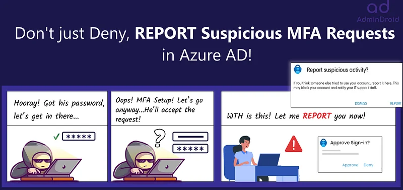

( **Görsel Kaynağı** : <https://blog.admindroid.com/enable-report-suspicious-activity-in-azure-ad/> )

---

## Veri Kaynakları

* **SIEM Logları:** Merkezi log yönetim sistemi aracılığıyla toplanan tüm ilgili loglar.
* **İşletim Sistemi Logları:** Sistem olayları ve kullanıcı faaliyetleri.
* **Hesap Yönetimi Logları:** Kullanıcı ve grup değişiklikleri, şifre değişiklikleri.
* **Active Directory (AD) Logları:** Active Directory'deki kullanıcı ve grup değişiklikleri.
* **Güvenlik Duvarı Logları:** Gelen ve giden ağ trafiği.
* **Uç Nokta Tespit ve Müdahale (EDR) Logları:** Uç noktalardaki anormal faaliyetlerin kayıtları.
* **Tehdit İstihbaratı Veritabanları:** Bilinen kötü niyetli IP adresleri ve alan adları.

---

## Analiz Adımları

Şüpheli yönetici aktivitelerini doğrulamak için loglar kronolojik ve bağlamsal adımlarla incelenir.

### Yönetici Oturum Açma Girişimleri

* **Başarısız Oturum Açmalar:** Yönetici hesapları için başarısız oturum açma girişimlerini tespit edin.
* **Başarılı Oturum Açmalar:** Başarısız girişimlerin ardından yapılan başarılı oturum açmaları kontrol edin.

### Hesap Yönetimi Aktivitesi

* **Yetki Değişiklikleri:** Kullanıcı ve grup yetkilerindeki değişiklikleri izleyin.
* **Şifre Değişiklikleri:** Yönetici hesaplarındaki şifre değişikliklerini kontrol edin.
* **Hesap Oluşturma/Silme:** Beklenmedik kullanıcı veya grup oluşturma/silme faaliyetlerini izleyin.

### Ağ Trafiği ve Bağlantı

* **Anormal Trafik:** Yönetici hesapları tarafından başlatılan anormal bağlantıları izleyin.
* **Yeni Hedefler:** Yönetici hesapları tarafından daha önce erişilmemiş IP adreslerine yapılan bağlantıları kontrol edin.
* **Port Kullanımı:** Beklenmedik portlar üzerinden yapılan bağlantıları izleyin.

### EDR Loglarının Analizi

* **Anormal İşlemler:** Uç noktalarda çalışan olağandışı işlemleri izleyin.
* **Yönetici Ayrıcalıkları:** Yönetici ayrıcalıklarına sahip işlemlerin anormal faaliyetlerini izleyin.
* **Kötü Amaçlı Yazılım:** Antivirüs ve antimalware yazılımı tarafından tespit edilen kötü amaçlı yazılımları kontrol edin.

### Active Directory Loglarının Analizi

* **Kritik Değişiklikler:** AD'deki kritik değişiklikleri (örneğin grup politikası değişiklikleri, hesap kilitlenmeleri) izleyin.
* **Oturum Açma Girişimleri:** AD'deki yönetici hesaplarında oturum açma girişimlerini kontrol edin.

### Tehdit İstihbaratı Entegrasyonu

* **Bilinen Kötü Niyetli IP'ler:** Yönetici hesapları tarafından bağlanan IP adreslerini tehdit istihbaratı veritabanlarıyla karşılaştırın.
* **Alan Adı İtibarı:** Yönetici hesapları tarafından erişilen alan adlarının itibarını kontrol edin.

### Hipotez Doğrulama ve Beklenen Bulgular

* Yönetici hesaplarında başarısız oturum açma girişimlerini takiben başarılı oturum açmalar.
* Kullanıcı ve grup yetkilerinde beklenmedik değişiklikler.
* Yönetici hesapları tarafından başlatılan anormal ağ bağlantıları.
* Uç noktalarda anormal işlem veya dosya faaliyetleri.
* AD'de kritik değişiklikler ve beklenmedik oturum açma girişimleri.
* Bilinen kötü niyetli IP adreslerine veya alan adlarına erişim.

---

## Hipotez Değerlendirmesi

SIEM sistemleri belirli raporlar dahilinde tehdit avcılığı süreçlerini destekler ve şüpheli yönetici hesabı faaliyetlerini tespit etmek için güçlü araçlar sunar. Bu derste özetlenen adımlar SIEM'in yönetici hesaplarına yönelik yetkisiz erişim girişimlerini tespit etmek için nasıl kullanılabileceğini göstermektedir. Bu süreç organizasyonların siber güvenlik duruşlarını proaktif olarak yönetmelerine ve potansiyel tehditlere karşı daha dirençli hale gelmelerine yardımcı olur.

---

## Uygulamalı Laboratuvar-1

---

## Hipotez-1

**Not:** Bu bölümdeki sorular, aşağıdaki hipoteze dayalı olarak Tehdit Avcılığı yürütmeyi amaçlamaktadır.

**Hipotez:** DMZ ortamında bulunan bir Linux sunucusundan yetkisiz sunuculara ve portlara erişim girişimleri olabilir.

---

## Tehdit Avcılığı Laboratuvar Ortamı

* **DMZ Sunucu IP Bloğu**: 172.16.8.0/24
* **Diğer Ağlar**: 10.10.10.0/24
* SIEM (Wazuh)
* Güvenlik Duvarı Trafik Olayları
* Güvenlik Duvarı Sistem Olayları
* Linux Güvenlik Olayları
* Linux Denetim (Audit) Olayları
* Linux Yum Olayları

---

## Sorular

> **Güvenlik duvarı loglarına göre, 1 Ağustos 2024 00:00 - 7 Ağustos 2024 00:00 tarihleri arasında eklenen güvenlik duvarı kuralının "log_id" değeri nedir?**

Sistemde güvenlik duvarı logları için gerekli filtrelemeyi yaptığımızda logid değerini buluyoruz.

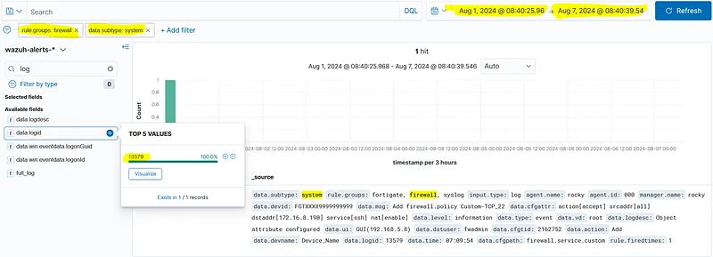

**Cevap:** 13579

> **Güvenlik duvarı loglarına göre, 1 Ağustos 2024 00:00 - 7 Ağustos 2024 00:00 tarihleri arasında "172.16.8.190" IP adresine 22 numaralı port üzerinden erişime hangi kullanıcı izin vermiştir?**

Önceki soruda bulduğumuz logu dikkatlice incelersek 22 SSH erişim isteği olduğunu gözlemliyoruz. Bize sorulan kullanıcı (user) değeri de logun içindedir.

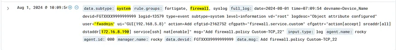

**Cevap:** fwadmin

> **DMZ sunucu loglarına göre, 1 Ağustos 2024 00:00 - 7 Ağustos 2024 00:00 tarihleri arasında kaç adet "sshd: authentication failed." olayı gerçekleşmiştir?**

172.16.8 IP'lerinin DMZ varlıkları olduğunu anlıyoruz. Bu hostlara yönelik ssh fail olaylarını arayalım. Bunun için sshd grubunu ve authentication_failed olayını aramamız gerekiyor. Gerekli filtreleri yazdığımızda cevabı 24 olarak buluyoruz.

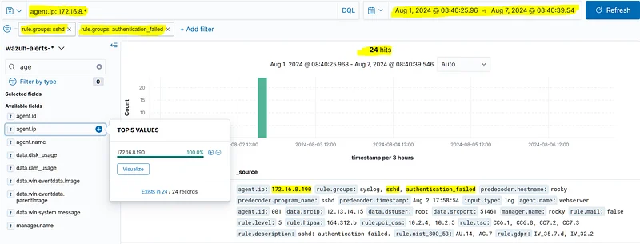

**Cevap:** 24

> **DMZ sunucu loglarına göre, 1 Ağustos 2024 00:00 - 7 Ağustos 2024 00:00 tarihleri arasında başarısız bir denemenin (sshd: authentication failed) ardından başarılı bir şekilde oturum açan (sshd: authentication success) IP adresi nedir?**

Önceki soruda 172.16.8.190 hostunun çok sayıda ssh yetkilendirme hatası aldığını görmüştük. Şimdi yetkilendirme başarısı (success) loglarına bakalım. Başarı loglarında 172.16.8.190 hostuna çok sayıda ssh hatasından sonra başarı alarak bağlanıldığını görüyoruz. Kaynak IP bilgisini 12.13.14.15 olarak belirliyoruz.

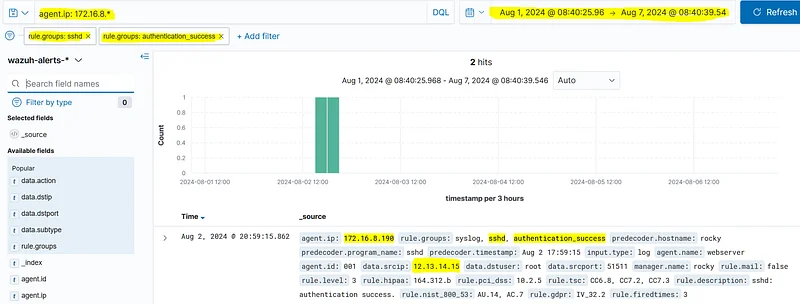

**Cevap:** 12.13.14.15

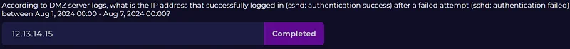

> **DMZ ortamındaki "172.16.8.190" IP adresli web sunucusuna yetkisiz erişimden sonra 1 Ağustos 2024 00:00 - 7 Ağustos 2024 00:00 tarihleri arasında hangi uygulama yüklenmiştir?**

İlgili agent ip'sini yum grubunda arattığımızda bir sonuç alıyoruz ve bu sonuçtaki tam log içeriğine baktığımızda nmap uygulamasının yüklendiğini gözlemliyoruz.

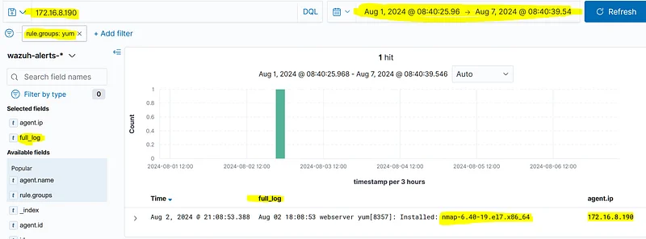

**Cevap:** nmap-6.40-19.el7.x86_64

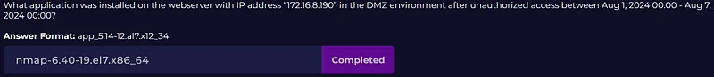

> **DMZ ortamındaki "172.16.8.190" IP adresli web sunucusuna yetkisiz erişimden sonra yüklenen uygulama kullanılarak 1 Ağustos 2024 00:00 - 7 Ağustos 2024 00:00 tarihleri arasında hangi IP bloğu taranmıştır?**

agent.name üzerinden filtreleyip nmap aktivitelerini aradığımızda denetim (audit) loglarında taranan subnet bilgisini buluyoruz.

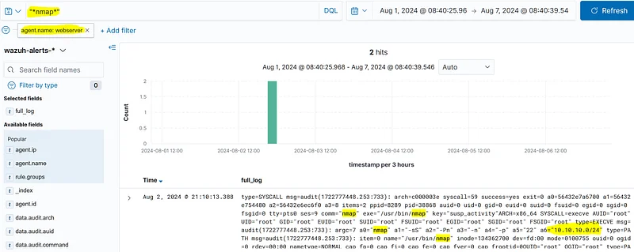

**Cevap:** 10.10.10.0/24

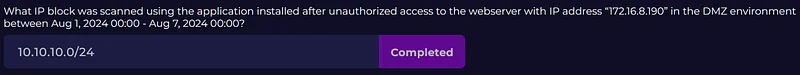

> **DMZ ortamındaki "172.16.8.190" IP adresli web sunucusuna yetkisiz erişimden sonra yüklenen uygulama kullanılarak 1 Ağustos 2024 00:00 - 7 Ağustos 2024 00:00 tarihleri arasında taranan port numarası nedir?**

Yine aynı log içeriğinde taranan port bilgisinin 22 ssh portu olduğunu görüyoruz.

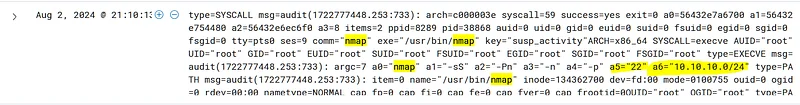

**Cevap:** 22

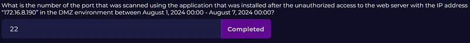

> **Güvenlik duvarı loglarına göre, 1 Ağustos 2024 00:00 - 7 Ağustos 2024 00:00 tarihleri arasında "172.16.8.190" IP adresinden "10.10.10.0/24" ağına "accept/allow" trafiği alan kaç benzersiz hedef IP adresi bulunmaktadır?**

Güvenlik duvarı grubunda 172.16.8.190 kaynak ip'sinden gelen 22 ssh isteğinden izin verilen (allow) alanları filtrelediğimizde 4 adet sonuç görüyoruz.

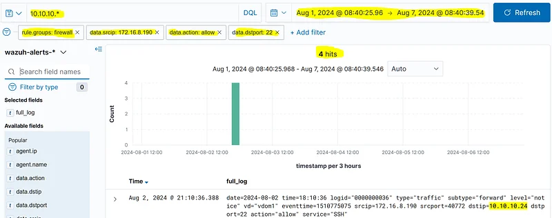

**Cevap:** 4

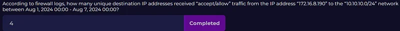

> **Güvenlik duvarı loglarına göre, 1 Ağustos 2024 00:00 - 7 Ağustos 2024 00:00 tarihleri arasında "172.16.8.190" IP adresinden "10.10.10.0/24" ağına yönelik kaç adet "SSH authentication_failed" olayı gerçekleşmiştir?**

Bu cevabı güvenlik duvarı loglarından değil, sshd loglarından bulabiliriz. Soruda bir hata var gibi görünüyor. Ssh loglarından auth fail olaylarına baktığımızda 8 hata aldığını görebiliyoruz.

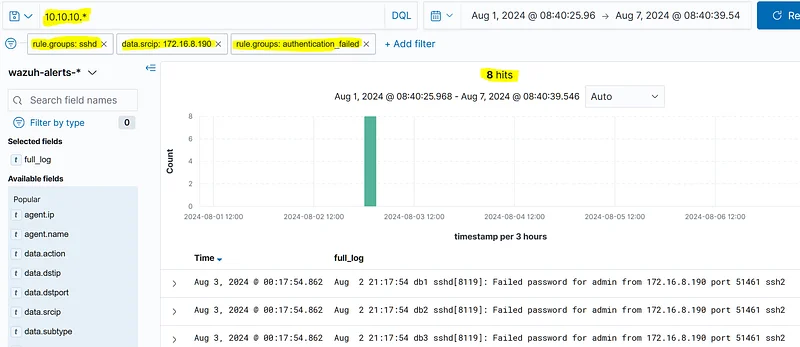

**Cevap:** 8

> **1 Ağustos 2024 00:00 - 7 Ağustos 2024 00:00 tarihleri arasında "172.16.8.190" IP adresinden SSH yoluyla başarıyla oturum açan (authentication_success) "10.10.10.0/24" ağındaki sistemin IP adresi nedir?**

Aynı filtreyi kullanarak fail yerine success olaylarını ararsak 1 adet sonuç elde ederiz. Bu olaydaki agent ip bilgisi bizim cevabımızdır.

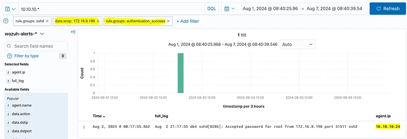

**Cevap:** 10.10.10.24

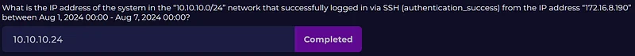

---

## Uygulamalı Laboratuvar-2

---

## Hipotez-2

**Not:** Bu bölümdeki sorular, aşağıdaki hipoteze dayalı olarak Tehdit Avcılığı yürütmeyi amaçlamaktadır.

**Hipotez:** VPN erişimi olan kullanıcı hesapları ele geçirilmiş olabilir ve yetkisiz erişim girişimleri gerçekleşiyor olabilir.

---

## Tehdit Avcılığı Laboratuvar Ortamı

* SIEM (Wazuh)
* Güvenlik Duvarı Trafik Olayları
* VPN Olayları

---

## Sorular

> **1 Ağustos 2024 00:00 - 7 Ağustos 2024 00:00 tarihleri arasında en fazla SSL VPN oturum açma hatası alan kullanıcı adı nedir?**

Güvenlik duvarı loglarında vpn alt türünü (subtype) ve yetkilendirme hatası (auth fail) olaylarını filtrelersek cevaba ulaşırız.

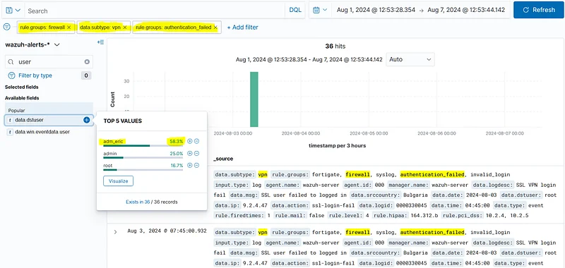

**Cevap:** adm_eric

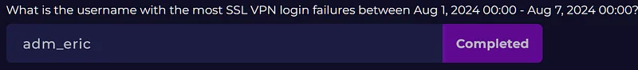

> **Almanya dışında, 1 Ağustos 2024 00:00 - 7 Ağustos 2024 00:00 tarihleri arasında en fazla SSL VPN oturum açma hatası alan VPN hesabı için hangi ülkeden başarılı oturum açma işlemi gerçekleşmiştir?**

adm_eric hesabı için Almanya dışındaki hangi ülkeden başarılı giriş yapıldığını bulmamız gerekiyor. Bunun için hesabı filtreleyip başarı (success) durumuna ulaşmalıyız.

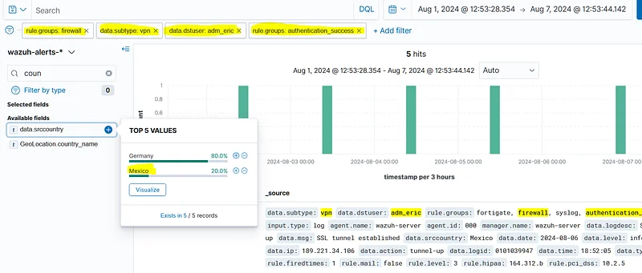

**Cevap:** Meksika

> **1 Ağustos 2024 00:00 - 7 Ağustos 2024 00:00 tarihleri arasında en fazla SSL VPN oturum açma hatası alan VPN hesabı için başarılı girişten sonra (Almanya hariç) hangi "tunnel_ip" atanmıştır?**

Bir önceki soruda, Meksika kaynaklı olan başarı logunu incelediğimizde ilgili logun tam içeriğini incelediğimizde tunnelip değerine ulaşıyoruz.

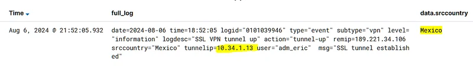

**Cevap:** 10.34.1.13

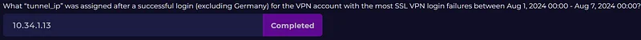

> **Trafik loglarına göre, 1 Ağustos 2024 00:00 - 7 Ağustos 2024 00:00 tarihleri arasında en fazla SSL VPN oturum açma hatası alan VPN hesabı için başarılı oturum açma (Almanya hariç) sonrasında atanan "tunnel_ip" adresinden en sık hangi hedef porta erişilmiştir?**

Bunun için güvenlik duvarı loglarında bulduğumuz 10.34.1.13 adresinden kaynaklanan trafiği filtrelememiz gerekir. Ardından dstport alanına baktığımızda giden trafiğin en çok hangi portu hedeflediğini görebiliriz.

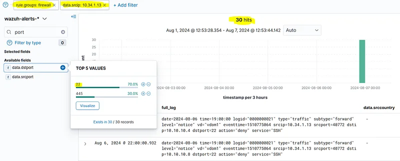

**Cevap:** 22

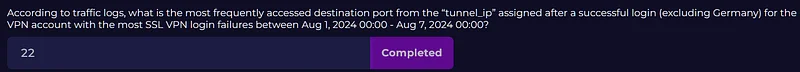

> **1 Ağustos 2024 00:00 - 7 Ağustos 2024 00:00 tarihleri arasında en fazla SSL VPN oturum açma hatası alan VPN hesabı için başarılı oturum açma (Almanya hariç) sonrasında atanan "tunnel_ip" üzerinden kaç benzersiz hedefe SSH servis erişimine izin verilmiştir?**

Bunun için 10.34.1.13 IP adresinden gelen ve 22 numaralı portu hedefleyen trafikten 'action allow' alanlarını filtrelememiz gerekir. Benzersiz sonuç sayısı cevabı verecektir.

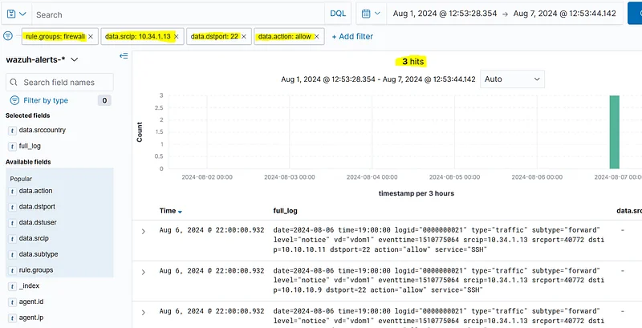

**Cevap:** 3

> **1 Ağustos 2024 00:00 - 7 Ağustos 2024 00:00 tarihleri arasında en fazla SSL VPN oturum açma hatası alan VPN hesabı için başarılı oturum açma (Almanya hariç) sonrasında atanan "tunnel_ip" adresinden hangi IP adresi ssh başarılı oturum açma (auth success) almıştır?**

Bunu yapmak için SSHD loglarına bakmamız gerekir. Başarılı SSH girişlerini kaynak IP adresine göre filtrelemek, agent.ip alanı üzerinden hangi hostun başarıyla oturum açtığını ortaya çıkaracaktır.

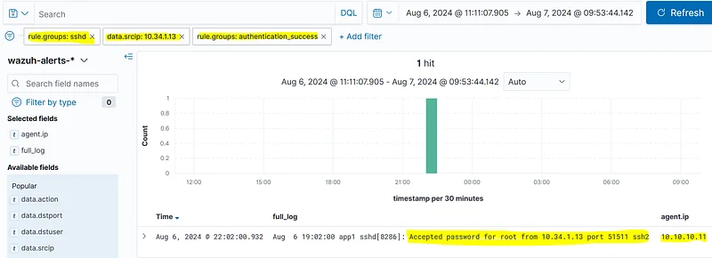

**Cevap:** 10.10.10.11

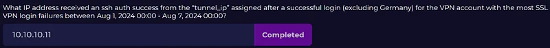

> **1 Ağustos 2024 00:00 - 7 Ağustos 2024 00:00 tarihleri arasında en fazla SSL VPN oturum açma hatası alan VPN hesabı için başarılı oturum açma (Almanya hariç) sonrasında atanan "tunnel_ip" adresinden başarılı SSH erişiminden sonra "T1057-Process Discovery" aktivitesi için hangi komut yürütülmüştür?**

Bunun için denetim (audit) loglarına bakmalıyız. agent.name ile filtrelediğimizde host üzerinde çalışan komutları bulabiliriz.

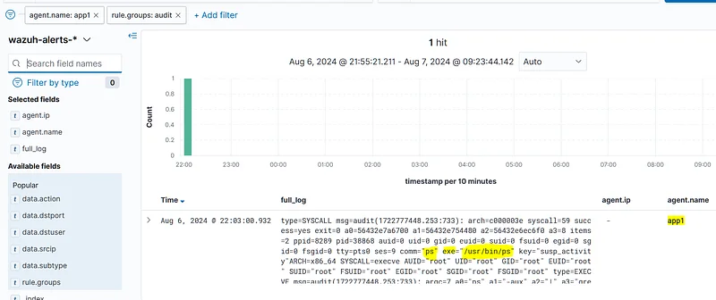

**Cevap:** ps

> **1 Ağustos 2024 00:00 - 7 Ağustos 2024 00:00 tarihleri arasında en fazla SSL VPN oturum açma hatası alan VPN hesabı için başarılı oturum açma (Almanya hariç) sonrasında atanan "tunnel_ip" adresinden başarılı SSH erişiminden sonraki "T1057-Process Discovery" aktivitesi sırasında hangi işlem (process) aranmıştır?**

Tam loga detaylı baktığımızda "ps -aux | grep proftp" komutunun yürütüldüğünü görüyoruz.

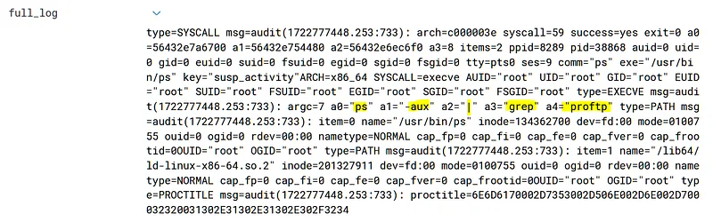

**Cevap:** proftp

---

## Uygulamalı Laboratuvar-3

---

## Hipotez-3

**Not:** Bu bölümdeki sorular, aşağıdaki hipoteze dayalı olarak Tehdit Avcılığı yürütmeyi amaçlamaktadır.

**Hipotez:** DMZ ortamındaki bir sunucudaki yanlış yapılandırılmış FTP hizmetleri anonim kullanıcı hesaplarını açık bırakmış olabilir ve bu da yetkisiz dosya yükleme ve indirmelerine izin verebilir.

---

## Tehdit Avcılığı Laboratuvar Ortamı

* **DMZ Sunucu IP Bloğu**: 172.16.8.0/24
* SIEM (Wazuh)
* FTP Olayları
* Linux Sistem Olayları
* Linux Güvenlik Olayları
* Linux Denetim (Audit) Olayları

---

## Sorular

> **1 Ağustos 2024 00:00 - 7 Ağustos 2024 00:00 tarihleri arasında FTP üzerinden anonim olarak başarıyla oturum açan IP adresi nedir?**

Bu filtre ile bulabiliriz.

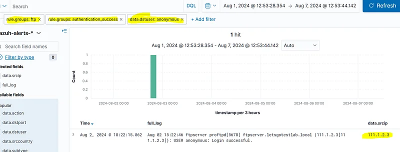

**Cevap:** 111.1.2.3

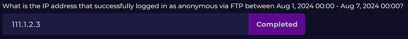

> **1 Ağustos 2024 00:00 - 7 Ağustos 2024 00:00 tarihleri arasında FTP üzerinden anonim olarak başarıyla oturum açan IP adresinin "ülke adı" (country name) nedir?**

Bulduğumuz logdaki GeoLocation.country_name bilgisini ararsak cevabı buluruz. Veya tam logda arama yapabilirsiniz.

**Cevap:** Çin (China)

> **1 Ağustos 2024 00:00 - 7 Ağustos 2024 00:00 tarihleri arasında anonim FTP oturum açmalarına izin veren sistemin IP adresi nedir?**

Bulduğumuz logdaki agent.ip bilgisini ararsak cevabı buluruz.

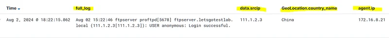

**Cevap:** 172.16.8.21

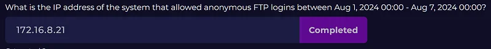

> **1 Ağustos 2024 00:00 - 7 Ağustos 2024 00:00 tarihleri arasında anonim girişlere izin veren sistemde çalışan FTP servisinin adı nedir?**

Tam log içeriğinden cevabı görebiliriz.

**Cevap:** proftpd

> **1 Ağustos 2024 00:00 - 7 Ağustos 2024 00:00 tarihleri arasında anonim girişlere izin veren sistemde FTP servisi ne zaman yeniden başlatılmıştır?**

FTP loglarında 'stopping' metnini aramak, servisin ne zaman durdurulduğuna dair logu bulmamıza yardımcı olacaktır.

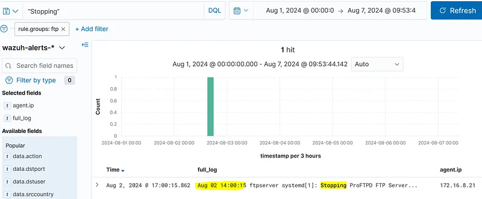

**Cevap:** 2 Ağustos 14:00:15

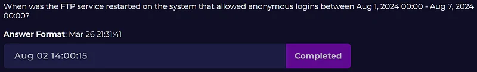

> **1 Ağustos 2024 00:00 - 7 Ağustos 2024 00:00 tarihleri arasında anonim girişlere izin veren sistemde FTP servisi yeniden başlatılmadan önce değiştirilen FTP servisiyle ilgili dosyanın tam yolu nedir?**

İlgili hostun denetim (audit) loglarını incelemek aktiviteyi gözlemlememizi sağlar. Cevap tam log içeriğinde bulunabilir.

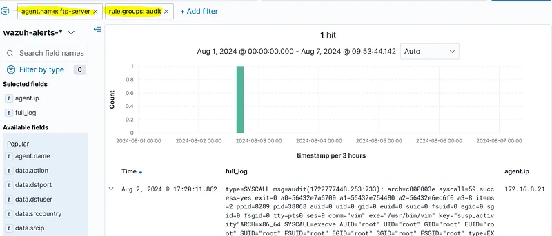

**Cevap:** /etc/proftpd/proftpd.conf

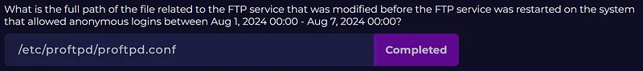

> **1 Ağustos 2024 00:00 - 7 Ağustos 2024 00:00 tarihleri arasında anonim girişlere izin veren sistemde FTP servisi yeniden başlatılmadan önce FTP servisiyle ilgili dosyayı hangi kullanıcı değiştirmiştir?**

Tam log içeriğine bakarsak root kullanıcısı olduğunu belirleyebiliriz.

**Cevap:** root

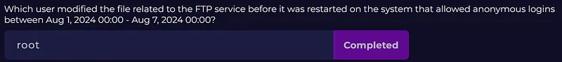

> **1 Ağustos 2024 00:00 - 7 Ağustos 2024 00:00 tarihleri arasında anonim girişlere izin veren sistemde FTP servisi yeniden başlatılmadan önce FTP servis dosyasını değiştiren kullanıcı hangi IP adresinden SSH yoluyla bağlanmıştır?**

sshd loglarına bakarsak ssh bağlanan IP'yi tespit edebiliriz.

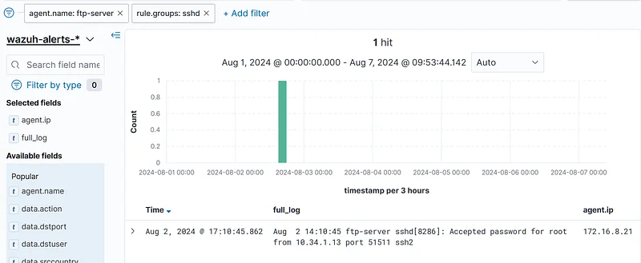

**Cevap:** 10.34.1.13
---
