Windows System Administration encompasses the workflows, policies, and utilities required to maintain and optimize Windows environments. These responsibilities span local and directory user administration, performance optimization, security baseline enforcement, and network connectivity controls. System administrators leverage the Microsoft Management Console (MMC), Windows PowerShell, and Group Policy Objects (GPO) to monitor health, triage incidents, and automate recurring operations. This guide provides a structured technical reference for both standalone workstations and enterprise Active Directory infrastructure.

---

## System Administration with Command Prompt (CMD)

The **Command Prompt (CMD)** serves as the native command-line interface for the Windows operating system. For automated workflows, commands can be compiled into **batch scripts** with a `.bat` or `.cmd` extension, executed manually or dispatched via task schedulers.

### System & Hardware Information Commands

#### Display System Details (`systeminfo`)
Displays comprehensive operating system, hotfix, hardware, and network configuration data.
```cmd
systeminfo
```

#### Display OS Version (`ver`)
Displays the exact Windows kernel version and build number.
```cmd
ver
```

#### Display Hostname (`hostname`)
Outputs the local computer name registered on the network.
```cmd
hostname
```

#### System Time and Date (`time` / `date`)
Displays and permits administrative modification of the system clock and calendar.
```cmd
time
date
```

#### Clear Command Screen (`cls`)
Clears the active command-line window buffer.
```cmd
cls
```

### File & Directory Management Commands

#### List Directory Contents (`dir`)
Lists files and subdirectories with sizes, timestamps, and attributes.
```cmd
dir
```

#### Change Directory (`cd`)
Navigates the current shell context to a specified directory path.
```cmd
cd <target_directory>
```

#### Copy Files (`copy`)
Copies one or more files from a source location to a destination path.
```cmd
copy <source> <destination>
```

#### Display File Content (`type`)
Streams the textual contents of a file directly to the console output.
```cmd
type <filename>
```

#### Echo String or Variable (`echo`)
Prints text or evaluates environment variables to the standard output.
```cmd
echo Hello World
```

#### Delete File (`del`)
Deletes specified files permanently from the file system.
```cmd
del <filename>
```

#### Remove Directory (`rmdir`)
Deletes a specified directory (`/s` removes subdirectories and files recursively).
```cmd
rmdir <directory_name>
```

### Networking & Connectivity Diagnostics

#### Inspect IP Configuration (`ipconfig`)
Displays IP addresses, subnet masks, and default gateways for all physical and virtual network adapters.
```cmd
ipconfig
```

#### Flush DNS Cache (`ipconfig /flushdns`)
Purges the local DNS resolver cache to remediate stale name resolution issues.
```cmd
ipconfig /flushdns
```

#### Test Network Reachability (`ping`)
Dispatches ICMP echo requests to evaluate packet loss and round-trip latency to a remote endpoint.
```cmd
ping <target_address>
```

#### Print Routing Table (`route print`)
Displays the active IPv4 and IPv6 network routing table and interface list.
```cmd
route print
```

#### List Network Shares (`net share`)
Displays all active network shares configured on the local host.
```cmd
net share
```

### Process, Service & Power Management

#### List Running Tasks (`tasklist`)
Enumerates all active processes, executable names, process IDs (PID), and memory utilization.
```cmd
tasklist
```

#### Terminate Process (`taskkill`)
Forcefully terminates an active task by PID or image name.
```cmd
taskkill /pid <process_id> /f
```

#### Manage Windows Services (`sc`)
Controls background Windows services (query, start, stop, pause, config).
```cmd
sc start <service_name>
sc stop <service_name>
```

#### System Shutdown and Restart (`shutdown`)
Instructs the operating system to power down or reboot with optional countdown timers.
```cmd
shutdown /s /t 0
shutdown /r /t 0
```

#### Power Scheme Configuration (`powercfg`)
Analyzes and controls power management schemes and battery diagnostics.
```cmd
powercfg /list
```

### Disk Management & Filesystem Maintenance

#### Manage Storage Partitions (`diskpart`)
Launches the interactive partition manipulation utility.
```cmd
diskpart
list volume
```

#### Disk Cleanup Utility (`cleanmgr`)
Launches the automated temporary file purge tool to reclaim storage capacity.
```cmd
cleanmgr
```

#### Filesystem Check and Repair (`chkdsk`)
Audits NTFS/FAT volumes for metadata corruption and bad sectors.
```cmd
chkdsk C: /f
```

### Local User & Group Administration

#### Manage Local User Accounts (`net user`)
Lists local accounts, creates credentials, or revokes user privileges.
```cmd
net user
net user <username> <password> /add
net user <username> /delete
```

#### Manage Local Security Groups (`net localgroup`)
Displays local security groups and assigns or audits group memberships.
```cmd
net localgroup
```

---

## Microsoft Management Console (MMC) Administration

The **Microsoft Management Console (MMC)** provides a standardized administrative shell for managing hardware, software, and networking components through modular snap-in files bearing the `.msc` extension. These snap-ins can be opened directly from the `Win + R` Run dialog.

### Core System & Hardware Snap-ins

#### Computer Management (`compmgmt.msc`)
The primary consolidated console integrating System Tools (Event Viewer, Device Manager, Shared Folders), Storage (Disk Management), and Services.


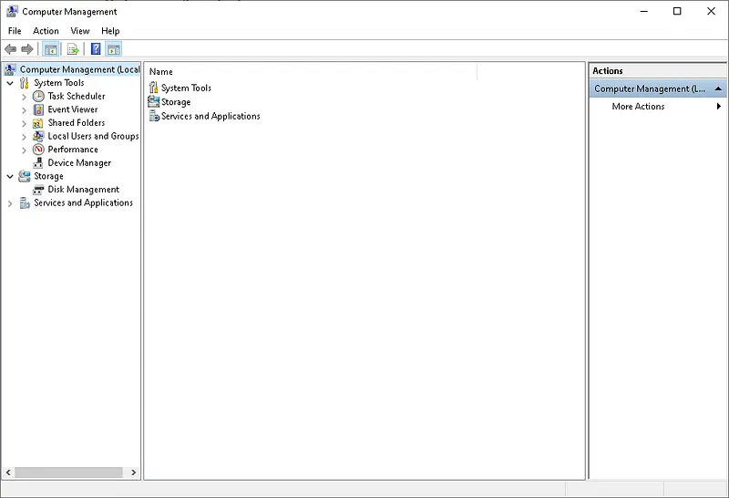

#### Device Manager (`devmgmt.msc`)
Provides visibility into physical hardware devices, enabling driver installation, rollbacks, and diagnostic identification of malfunctioning hardware.

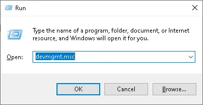

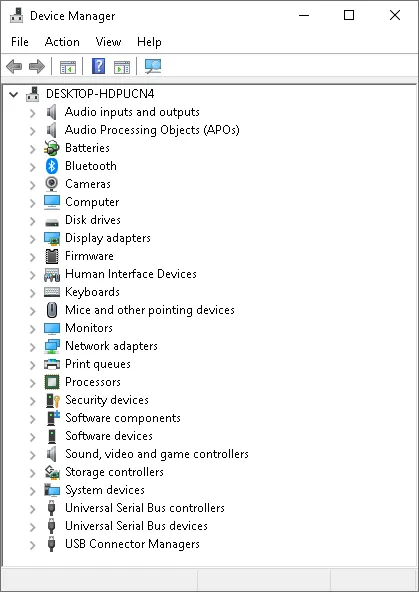

#### Disk Management (`diskmgmt.msc`)
Administers partition schemes, volume formatting, drive letter assignments, and dynamic disk configurations.


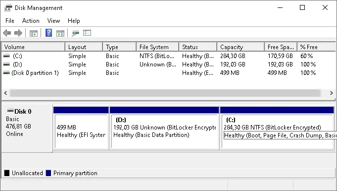

#### Services (`services.msc`)
Enables administrators to inspect, restart, stop, and set startup types (Automatic, Manual, Disabled) for all installed Windows background services.


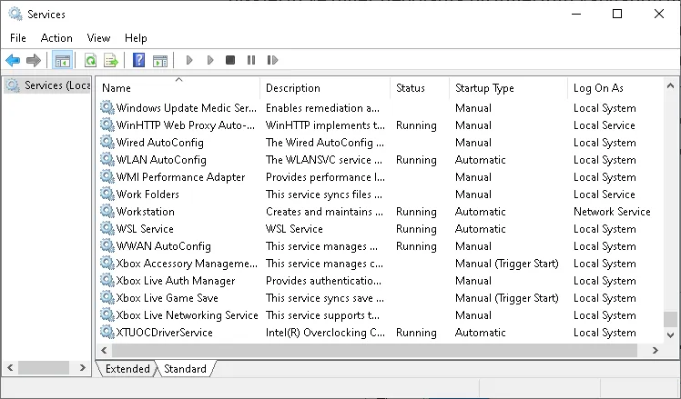

#### Event Viewer (`eventvwr.msc`)
The central repository for Windows Event Logs, capturing security audit events, operating system errors, and application warnings.


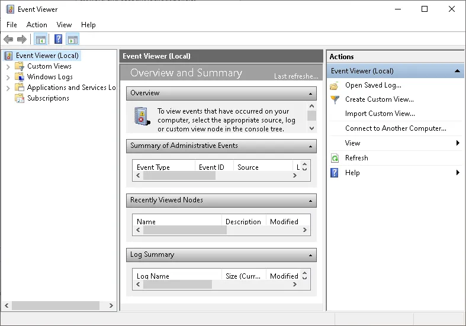

#### Performance Monitor (`perfmon.msc`)
Tracks real-time performance telemetry across CPU, memory, storage, and network queues with customizable diagnostic counters.

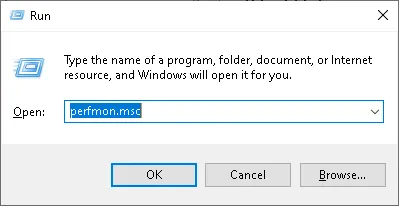

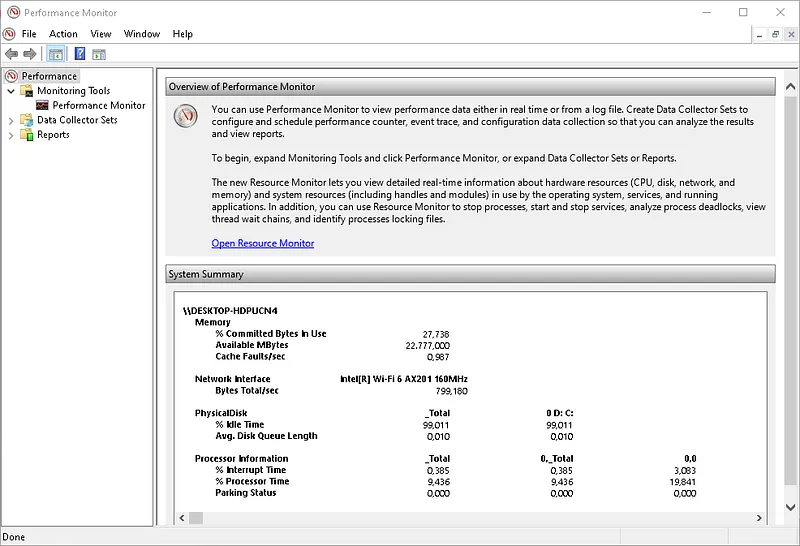

#### Task Scheduler (`taskschd.msc`)
Schedules automated maintenance scripts, backups, and program launches based on time intervals or specific system triggers.

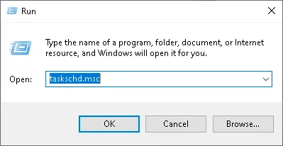

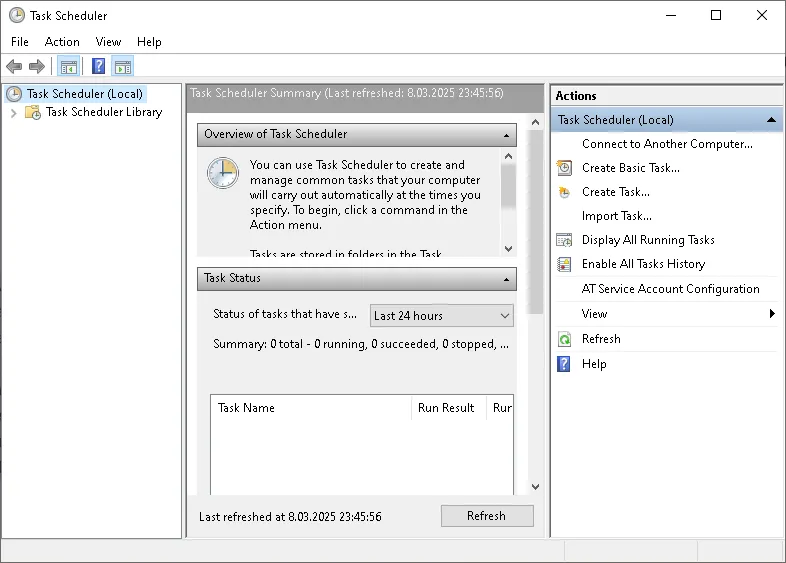

### Security, Policy & Sharing Snap-ins

#### Local Security Policy (`secpol.msc`)
Configures password complexity policies, account lockout parameters, audit policies, and user rights assignments on standalone or non-domain systems.


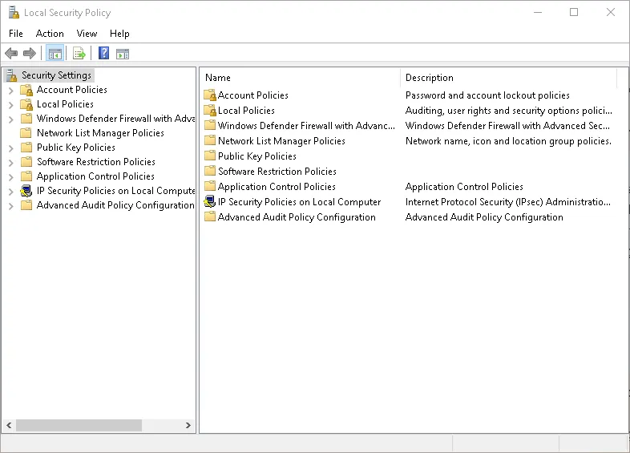

#### Local Group Policy Editor (`gpedit.msc`)
Enforces system and user policies across desktop settings, security restrictions, and administrative templates (available on Windows Pro and Enterprise editions).

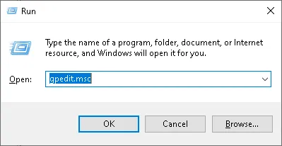

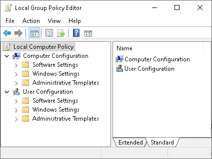

#### Local Users and Groups (`lusrmgr.msc`)
Manages local security principals, credential parameters, and local group memberships.


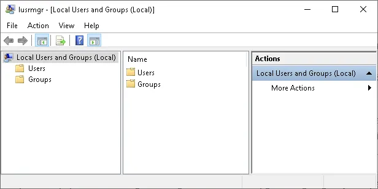

#### Windows Defender Firewall with Advanced Security (`wf.msc`)
Constructs inbound and outbound network filtering rules matching protocols, port numbers, authorized IP subnets, and executables.

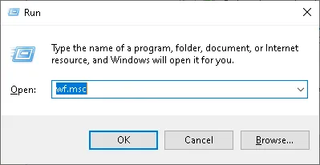

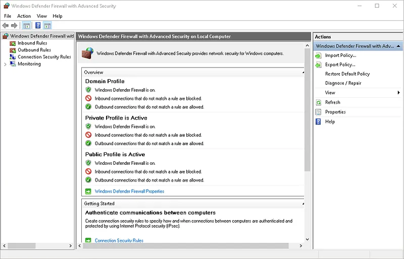

#### Shared Folders (`fsmgmt.msc`)
Audits active SMB shares, open file locks, and active client sessions across the network.

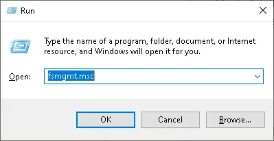

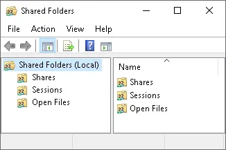

#### Local Computer Certificates (`certlm.msc`)
Manages the machine certificate store, trusted root authorities, intermediate issuers, and private encryption keys.

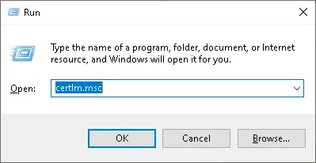

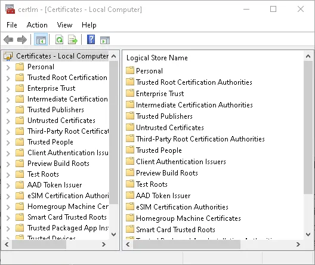

### Enterprise & Network Service Snap-ins

#### Print Management (`printmanagement.msc`)
Centralizes local and network print server queues, print spoolers, and architecture-specific driver deployments.

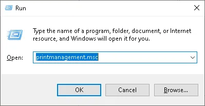

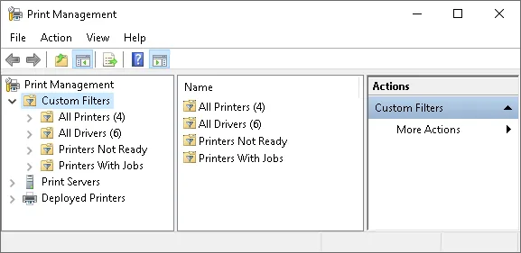

#### Remote Desktop Services Manager (`tsadmin.msc`)
Legacy console for auditing and disconnecting active user sessions across terminal servers.

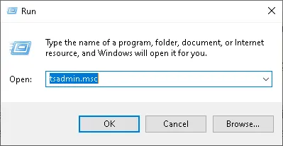

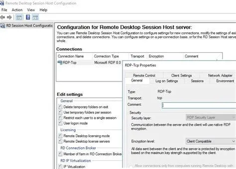

#### Authorization Manager (`azman.msc`)
Provides role-based access control (RBAC) governance for legacy .NET application scopes.

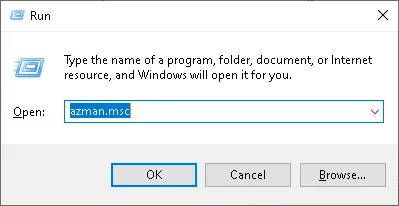

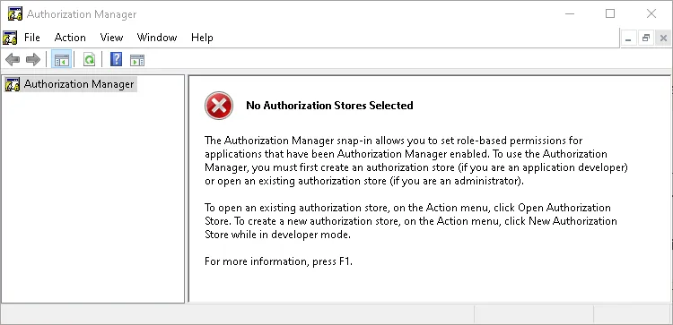

#### Component Services (`comexp.msc`)
Administers COM+ enterprise applications, Distributed Transaction Coordinator (DTC) boundaries, and system components.

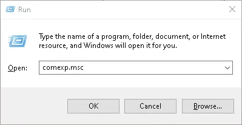

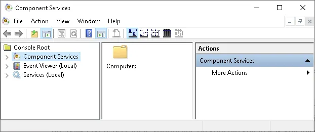

---

## Run (Win+R) Quick Reference Tables

The following reference tables consolidate essential administrative shortcuts executable via the `Win + R` Run dialog.

### Management Consoles (MMC)

| Shortcut | Description / Target Console |
| :--- | :--- |
| `eventvwr.msc` | Event Viewer |
| `devmgmt.msc` | Device Manager |
| `compmgmt.msc` | Computer Management |
| `diskmgmt.msc` | Disk Management |
| `perfmon.msc` | Performance Monitor |
| `resmon` | Resource Monitor |
| `secpol.msc` | Local Security Policy |
| `gpedit.msc` | Local Group Policy Editor |
| `lusrmgr.msc` | Local Users and Groups |
| `services.msc` | Services Management |
| `taskschd.msc` | Task Scheduler |
| `certlm.msc` | Certificates (Local Computer) |
| `certmgr.msc` | Certificates (Current User) |
| `fsmgmt.msc` | Shared Folders |
| `wf.msc` | Windows Defender Firewall with Advanced Security |
| `printmanagement.msc` | Print Management |

### System Settings (Control Panel Applets)

| Shortcut | Description / Target Applet |
| :--- | :--- |
| `control` | Control Panel |
| `control admintools` | Administrative Tools |
| `sysdm.cpl` | System Properties (Environment variables, computer name) |
| `ncpa.cpl` | Network Connections |
| `firewall.cpl` | Windows Defender Firewall |
| `appwiz.cpl` | Programs and Features (Uninstall/modify software) |
| `powercfg.cpl` | Power Options |
| `timedate.cpl` | Date and Time Settings |
| `intl.cpl` | Region and Language Settings |
| `main.cpl` | Mouse Properties |
| `mmsys.cpl` | Sound Settings |
| `inetcpl.cpl` | Internet Properties |
| `desk.cpl` | Display Settings |

### Diagnostics & System Maintenance

| Shortcut | Description / Target Tool |
| :--- | :--- |
| `msconfig` | System Configuration (Boot and startup controls) |
| `taskmgr` | Task Manager |
| `dxdiag` | DirectX Diagnostic Tool |
| `cleanmgr` | Disk Cleanup |
| `dfrgui` | Defragment and Optimize Drives |
| `regedit` | Registry Editor |
| `charmap` | Character Map |
| `snippingtool` | Snipping Tool |
| `magnify` | Magnifier |
| `osk` | On-Screen Keyboard |

### Command Shells & Networking

| Shortcut | Description / Target Tool |
| :--- | :--- |
| `cmd` | Command Prompt |
| `powershell` | Windows PowerShell |
| `powershell_ise` | PowerShell ISE |
| `mstsc` | Remote Desktop Connection (RDP) |
| `calc` | Calculator |
| `notepad` | Notepad |
| `msinfo32` | System Information |
| `winver` | Windows Version Dialog |

---

## Active Directory Administrative Tools (ADAT)

Windows Active Directory Administrative Tools (ADAT) centralize directory management across corporate domains and forests.


### Active Directory Users and Computers (ADUC)
Administers user accounts, computer objects, security groups, and Organizational Units (OUs). Administrators assign password policies, reset credentials, and structure directory hierarchies.


### Active Directory Domains and Trusts
Governs domain and forest trust relationships (one-way, two-way, transitive) and raises domain and forest functional levels.

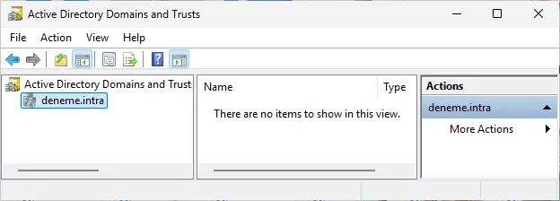

### Active Directory Sites and Services
Optimizes Active Directory replication topology by mapping physical corporate subnets to logical sites and inter-site replication links.

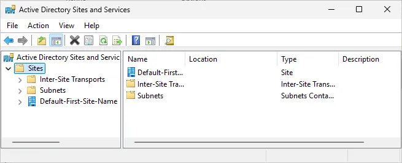

### Active Directory Administrative Center (ADAC)
A modern administrative interface with integrated PowerShell history recording, Fine-Grained Password Policies, and Active Directory Recycle Bin recovery.

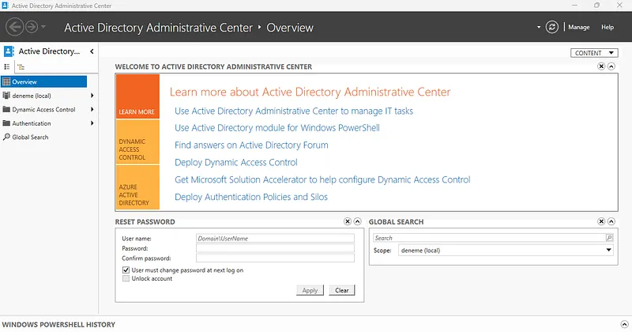

### Group Policy Management Console (GPMC)
Enforces central Group Policy Objects (GPOs) governing workstation configurations, software deployment, and enterprise security baselines.

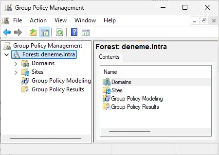

### Active Directory Module for Windows PowerShell
Bridges directory operations to automation pipelines via specialized cmdlets such as `Get-ADUser`, `New-ADGroup`, and `Set-ADAccountPassword`.

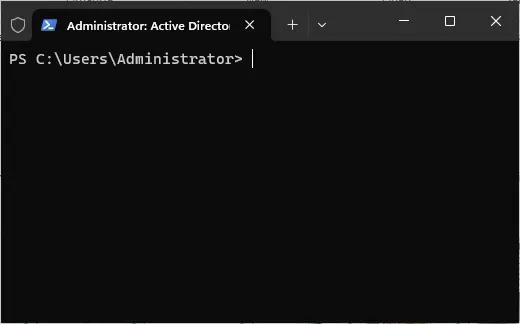

---

## Windows Management Instrumentation (WMI)

**Windows Management Instrumentation (WMI)** is Microsoft's implementation of Web-Based Enterprise Management (WBEM) for querying hardware, software, and operational metrics.

WMI empowers administrators to:
* Query processor, memory, and disk telemetry across the fleet.
* Remotely start, stop, or pause Windows services.
* Monitor operational events dynamically using WMI Event Consumers.
* Query remote hosts over standard RPC/WinRM boundaries.

Telemetry is surfaced via **WMI Providers** and structured according to the Common Information Model (CIM), queryable through **WMI Query Language (WQL)**.

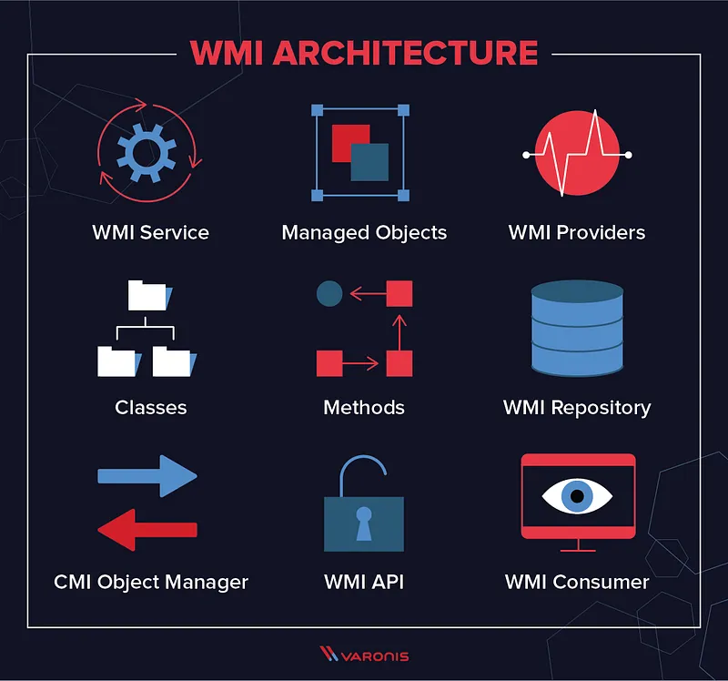

### WMI Access Interfaces & Practical Examples

#### WMI via PowerShell
PowerShell offers direct, modern bindings for querying WMI classes:
```powershell
Get-WmiObject -Class Win32_Processor
```

#### WMI via VBScript
A lightweight automation approach historically used in legacy Windows deployments:
```vbscript
strComputer = "."  
Set objWMIService = GetObject("winmgmts:\\" & strComputer & "\root\cimv2")  
Set colDisks = objWMIService.ExecQuery("SELECT * FROM Win32_DiskDrive")  
For Each objDisk in colDisks  
    WScript.Echo "DeviceID: " & objDisk.DeviceID  
Next
```

#### WMI via .NET
Enterprise software queries WMI programmatically via the `System.Management` namespace:
```csharp
using System.Management;  
  
ManagementObjectSearcher searcher = new ManagementObjectSearcher("SELECT * FROM Win32_Processor");
```

#### WMI via WMIC Command Line
Executes direct command-line queries against local or remote WMI stores:
```cmd
wmic cpu get name
```

---

## Cloud Identity Management: Azure Active Directory (Entra ID)

**Azure Active Directory (Azure AD / Microsoft Entra ID)** is Microsoft’s cloud-native identity and access management solution, integrating with on-premise Active Directory in hybrid architectures.

* **Hybrid Identity Synchronization:** Connects local Active Directory domain controllers to cloud tenants, enabling unified single sign-on (SSO).
* **Zero Trust Architecture:** Explicitly validates identity, endpoint security posture, and least-privilege permissions on every authentication request.
* **Conditional Access:** Evaluates signals such as geolocation, IP reputation, and device compliance before granting access.
* **Identity Protection:** Leverages machine-learning models to flag compromised credentials and anomalous sign-ins.
* **Unified Endpoint Management:** Integrates with Microsoft Intune for comprehensive MDM/MAM lifecycle governance.

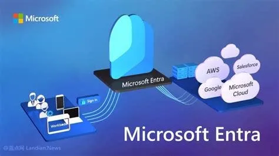

Administrators can access and explore this ecosystem with their corporate Microsoft account at <https://portal.azure.com>.
